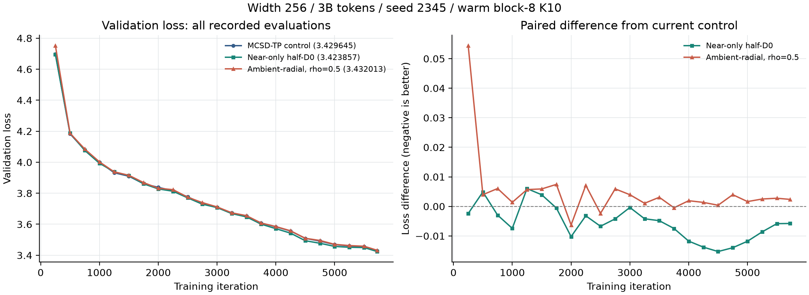

# MCSD on the Spectral Sphere

Research code and experiment records for **MCSD-TP**, near-region hybrids,
and **MuonSphere / SSO** baselines in Megatron-LM pretraining.

[Results ledger](docs/experiments/mcsd_p2gd_results_summary.md) ·
[Latest 3B comparison](docs/experiments/warm_radial_controls_3b_20261117.md) ·
[Algorithms](docs/algorithms/current_comparison_pseudocode.md) ·
[Reproduction](docs/runbooks/cluster_experiments_reproduction.md) ·
[Related work](docs/related_work.md)

> **Checked November 19, 2026, 15:05 HKT:** 49 completed width-256 runs in
> the current 1B/3B ledger. The account queue is empty. No new jobs were
> submitted in this update. Short pilots and local toy problems are reported
> separately. This is a research branch, not a frozen paper release.

## Latest Result: Near-Region Step Attenuation

**Width 256 · 28 layers · 3B processed tokens · seed 2345 · LR 0.015 · eval20.**
The fresh matched pair completed 5723 iterations with no logged NaN/skipped
iterations. Each used one H20, warm block-8 K10 with FP32 QR/Ritz, and no
original-matrix full SVD online.

| Method | Final validation loss | Train + validation | Comparison scope |
|---|---:|---:|---|
| **MCSD-TP, near-only half-D0** | **3.423857** | 17:57:09 | Fresh matched pair |
| MCSD-TP control | 3.429645 | 17:56:55 | Fresh matched pair |
| Ambient-radial hybrid, rho=0.5 | 3.432013 | 17:54:03 | Earlier matching-protocol warm run |
| Exact MCSD-TP | 3.430719 | 25:47:49 | Exact-spectrum reference |
| Exact ambient-radial, rho=0.5 | 3.429565 | 25:47:55 | Exact-spectrum reference |
| MuonSphere | 3.436023 | **16:35:03** | Historical same-protocol baseline |
| SSO | 3.435041 | 18:28:11 | Historical same-protocol baseline |

**Interpretation:** the near-only half-D0 arm improves loss by **0.005788**
over its source-matched control, with essentially unchanged time. It keeps
the MCSD-TP direction and halves it only when the cached relative gap is
at most `2e-4`. It is **not PGD or P2GD**. Its near/repeat rates are higher,
so fewer branch calls or faster gap escape are not sufficient success criteria.

The differences from historical MuonSphere / SSO are -0.012166 / -0.011184;
runtime is about 8.3% longer / 2.8% shorter. These are contextual,
single-seed comparisons, not evidence of consistent superiority.

[Full curves, branch counts, precision audit and provenance](docs/experiments/warm_radial_controls_3b_20261117.md) ·
[Machine-readable evidence](docs/results/warm_radial_controls_3b_20261117/final_summary_20261118.json)

## What Is Supported

| Direction | Current evidence | Decision |
|---|---|---|
| Near-only half-D0 | Best current 3B endpoint; one matched seed | Test all-step matrix-half, then paired replication |
| Single-LMO c0.5 | Small control gain at both 1B seeds; not consistently better than MuonSphere | Retain as a mechanism reference |
| 25% shape blend | Best selected seed-2345 1B endpoint; extra gain does not repeat at seed1234 | Do not claim a confirmed blend advantage |
| Ambient-radial switch | Exact half-step slightly helps; warm variant loses to matched control | Keep as a reference, not the leading candidate |
| A2 / K-LMO and full-projection PGD pilots | Current 100M settings underperform | Do not extend these settings to long runs |
| Anchored cone-face + radial | Local algebra/complete-return checks; conditional theory | Research candidate only, no LLM result yet |

[Complete favorable and unfavorable results](docs/experiments/mcsd_p2gd_results_summary.md) ·
[1B second-seed confirmation](docs/experiments/cluster_lmo_confirmation_1b_20261110.md)

## Theory and Local Diagnostics

The [corner/momentum audit](docs/experiments/corner_momentum_audit_20261117.md)
separates raw direction, momentum error and radial-return effects. Its
constructed quadratic losses are not LLM loss measurements.

The new [anchored cone-face note](docs/experiments/anchored_cone_radial_theory_20261118.md)
contains 324 algebra checks and 360 constructed states. On 72 exact-corner
cases with momentum equal to gradient, all anchored updates decrease the
quadratic objective; with cosine alignment 0.5, four increase it. The
conditional target is Clarke stationarity, not B-stationarity. Exact spectral
information, complete cluster coverage and decreasing-error assumptions are
not automatically satisfied by fixed-K10 training.

## Next Tests, Not Submitted

1. Same-state short LLM loss replay: D0, half-D0, ambient-half, complete cone,
   anchored cone and finite-step correction, with matched realized lengths.
2. One missing 3B **all-step matrix-only half-D0** arm at seed2345. Preserve
   the AdamW learning rate; do not halve the global LR flag.
3. Replicate control versus near-half at seed1234 with the current source.

Only promote a new cone direction after a matched loss probe. Keep width256,
K10, gap2e-4 and the data/evaluation protocol fixed; defer wider gap grids,
larger widths and 12B expansion. See the [predeclared comparisons](docs/experiments/mcsd_p2gd_results_summary.md#next).

## Implementation and Reproduction

| Component | Code / instructions |
|---|---|
| Original cluster-radial optimizer | [spectral_cluster_radial.py](Megatron-LM/emerging_optimizers/orthogonalized_optimizers/spectral_cluster_radial.py) |
| Warm FP32 Ritz spectrum | [warm_block_ritz.py](Megatron-LM/emerging_optimizers/orthogonalized_optimizers/warm_block_ritz.py) |
| Current matched direction adapter | [direct_top_pgd_pk.py](scripts/direct_top_pgd_pk.py) |
| Half-D0 regression tests | [test_warm_radial_controls.py](scripts/test_warm_radial_controls.py) |
| Frozen two-arm launcher | [Slurm configuration](slurm/warm_radial_controls_3b_20261117.sbatch) |
| Local anchored-face checks | [local_anchored_cone_radial.py](scripts/local_anchored_cone_radial.py) |
| Environment and data | [H20 runbook](docs/runbooks/cluster_experiments_reproduction.md) |

MuonSphere (`muon_ball_dist`) and SSO (`spectral_ball_dist`) retain their
reference BF16 PI10 hard pre-step normalization. The current MCSD-TP variants
use post-step approximate radial return and cache the transformed trial
spectrum. Radial normalization is not the Frobenius nearest-point projection.

Published evidence includes configurations, endpoint metrics, curves,
checksums, accounting and audit summaries. Datasets, environments, checkpoints,
matrix snapshots and bulk raw-log archives remain outside Git. Some collectors
require these local archives; the published JSON is sufficient to inspect the
reported comparisons, not to reconstruct missing model checkpoints.

Publication checks on November19: 80 local CPU unit tests passed, the 324
anchored-face algebra cases reran successfully, and linked evidence/code
was checked for existence and JSON/Python syntax. No new CUDA training ran.

## Attribution

Built on [Spectral Sphere Optimizer](https://github.com/Unakar/Spectral-Sphere-Optimizer),
[Megatron-LM](https://github.com/NVIDIA/Megatron-LM), and the included optimizer
implementations. MuonSphere is called MuonBall in legacy filenames. Preserve
upstream licenses and attribution. The separate Frobenius-geometry study is
not pooled here. Earlier width sweeps and 12B runs remain in the
[historical record](HISTORICAL_README.md).
