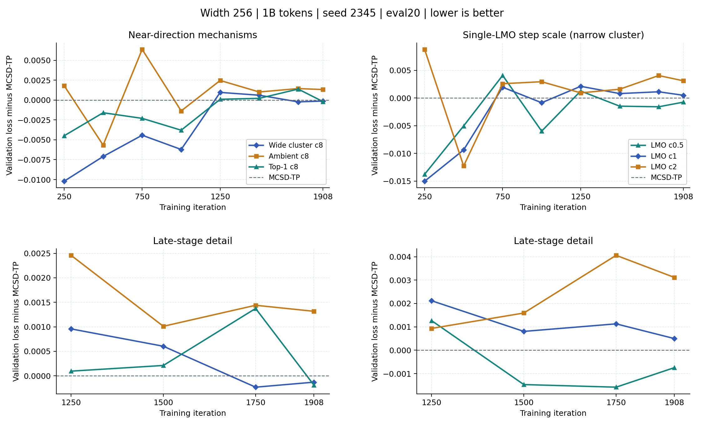

# MCSD on the Spectral Sphere

Research code and reproducible experiment records for **MCSD-TP** and a
**near-cluster P²GD-type hybrid**, compared with **MuonSphere** and **SSO** in
Megatron-LM language-model pretraining.

[Results](docs/experiments/mcsd_p2gd_results_summary.md) ·
[Algorithms and code](docs/algorithms/current_comparison_pseudocode.md) ·
[Reproduction](docs/runbooks/cluster_experiments_reproduction.md) ·
[Related work](docs/related_work.md) ·
[Historical log](HISTORICAL_README.md)

> **Research status, 2026-11-04:** 36 completed width-256 runs in the current
> 1B/3B track. The approximate implementation runs without full-matrix SVDs,
> but the hybrid has **not established a consistent advantage** over its
> matched MCSD-TP control. This is an evolving research branch, not a frozen
> paper release.

## Latest Matched Comparison

**Width 256 · 28 layers · 1B tokens · seed 2345 · LR `1.5e-2` · one H20/run.**
Six reference runs and four follow-ups completed 1908 iterations with no
logged NaN/skipped iterations. Data, model and evaluation settings match.

| Method | Final validation loss | Difference vs. MCSD-TP | Train + validation |
|---|---:|---:|---:|
| MuonSphere | 3.573290 | +0.000621 | **5:33:30** |
| SSO | 3.579043 | +0.006374 | 6:11:37 |
| MCSD-TP K10 | 3.572669 | 0 | 5:54:15 |
| Hybrid K10/c8, wide cluster | 3.572540 | -0.000129 | 5:55:24 |
| Hybrid K10/c8, narrow cluster | 3.573133 | +0.000464 | 5:55:46 |
| Single-LMO near direction, c1 | 3.573165 | +0.000496 | 5:55:50 |
| Ambient near direction, c8 | 3.573986 | +0.001317 | 5:56:10 |
| Top-1 near correction, c8 | 3.572480 | -0.000189 | 5:54:13 |
| **Single-LMO near direction, c0.5** | **3.571923** | **-0.000746** | 5:55:10 |
| Single-LMO near direction, c2 | 3.575782 | +0.003113 | 5:55:29 |



[Full analysis, branch statistics, and next tests](docs/experiments/cluster_mechanism_scales_1b_20261102.md) ·
[New machine-readable results](docs/results/cluster_mechanism_scales_1b_20261102/final_20261104.json) ·
[Reference results](docs/results/cluster_cone_lmo_1b_20261031/final_20261101.json)

**What this supports:** single-LMO c0.5 is the best current single-seed 1B
candidate: 0.001367 below MuonSphere, with 6.50% more wall time and only 55
seconds more than control. It also has **92.18% repeated near calls**;
c2 reduces repetition but worsens loss. Top-1 slightly outperforms the wide
hybrid, so a benefit from multiple-direction correction is not established.
Keep c0.5 for confirmation, not as a proven winner; earlier 3B hybrid gains
changed sign between seeds.

**Matched 1B replication, seed 1234:** MCSD-TP **3.575916**, wide hybrid
**3.575728** (difference **-0.000188**). Both completed with the same K10/eval20
protocol. The two 1B paired gains have the same sign but remain very small;
this does not resolve the conflicting 3B evidence.
[Replication record](docs/results/cluster_followup_1b_20261101/paired_final_20261102.json).

**Completed follow-ups:** all four matched 1B mechanism/step-scale tests,
`4375034_0-3`, finished on 2026-11-03. No new training was submitted in this update.
[Configurations and comparison rules](docs/experiments/cluster_mechanism_scales_1b_20261102.md).

## Algorithm Map

| Method | Direction | Return and spectral computation |
|---|---|---|
| MuonSphere (`muon_ball_dist`) | Matrix sign of Nesterov momentum | Reference hard pre-step radial normalization, BF16 PI10 |
| SSO (`spectral_ball_dist`) | Spectral constrained direction with scalar multiplier solve | Reference hard pre-step radial normalization, BF16 PI10 |
| MCSD-TP | Tangent projection → NS8 matrix sign → tangent projection | Warm block-8 K10, FP32 QR/Ritz, post-step approximate radial return |
| Hybrid | MCSD-TP at large estimated gap; normalized-momentum cluster correction near the boundary | Same approximate return and returned-point cache as MCSD-TP |

Current research reference: route threshold `5e-5`, cluster width `2e-3`,
adaptive correction rank at most four, near-step multiplier `c=8`.
`c` is **not** a branch-use percentage. Complete definitions and actual code
links are in the [algorithm guide](docs/algorithms/current_comparison_pseudocode.md).

The hybrid is **P²GD-type**, not standard P²GD: a near cluster replaces an exact
multiple singular subspace, and radial return replaces metric projection.
Neither exact feasibility nor stochastic Clarke-stationarity follows merely
from the successful training runs.

## Reproduce and Inspect

1. Follow the [H20 environment and data runbook](docs/runbooks/cluster_experiments_reproduction.md).
2. Inspect the [six-arm launch grid](slurm/cluster_cone_lmo_1b_20261031.sbatch),
   including the explicit indexed-data and tokenizer paths.
3. Run the focused tests before training:

   ```bash
   python -B -m unittest discover -s scripts -p 'test_cluster*.py' -v
   ```

4. Use the dated [results ledger](docs/experiments/mcsd_p2gd_results_summary.md#ledger)
   to match the data source, processed-token budget, seed, evaluation length,
   and optimizer version. Do not pool unlike protocols.

Datasets, environments, checkpoints, and matrix snapshots are not uploaded.
Published JSON records contain configurations, endpoint metrics, source/log
hashes, Slurm accounting, and offline audit summaries.

## Repository Guide

| Location | Purpose |
|---|---|
| [Experimental optimizer](Megatron-LM/emerging_optimizers/orthogonalized_optimizers/spectral_cluster_radial.py) | Branch selection, directions, return, and cached spectra |
| [Warm Ritz solver](Megatron-LM/emerging_optimizers/orthogonalized_optimizers/warm_block_ritz.py) | Fixed-budget approximate top spectrum; small 8×8 SVD only |
| [Single-LMO candidate](Megatron-LM/emerging_optimizers/orthogonalized_optimizers/spectral_cone_lmo.py) | Separate experimental direction, not the default hybrid |
| [Experiments](docs/experiments/mcsd_p2gd_results_summary.md) | Completed comparisons, limitations, and next decisions |
| [Runbook](docs/runbooks/cluster_experiments_reproduction.md) | Environment, data, tests, and Slurm execution |
| [Historical record](HISTORICAL_README.md) | Earlier width sweeps, exact-SVD/PGD exploration, and archived status |

## Attribution

Built on [Spectral Sphere Optimizer](https://github.com/Unakar/Spectral-Sphere-Optimizer),
[Megatron-LM](https://github.com/NVIDIA/Megatron-LM), and the included optimizer
implementations. MuonSphere is called MuonBall in legacy filenames. Preserve
the upstream license and attribution files when redistributing code.
The separate Frobenius-geometry branch and historical paper experiments are
not merged into the current results. See [related work](docs/related_work.md)
for verified papers and the limits of their applicability.
