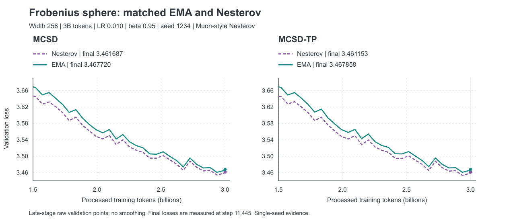
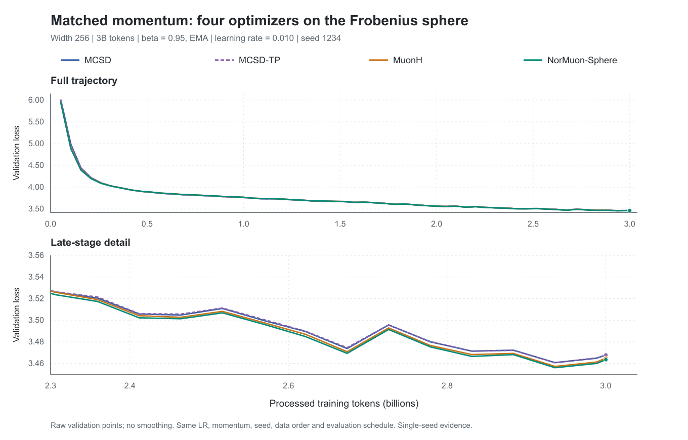
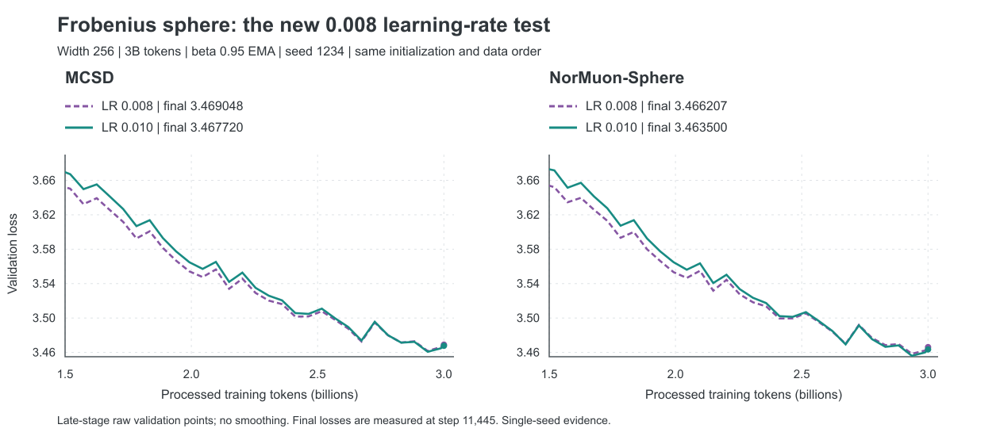

# Frobenius Sphere：3B / 6B 实验总览

**文档更新 2026-10-28；完成结果核验截至 10-27 23:50，任务核验截至 10-28 00:48 HKT** · width=256 · 28 层 · Frobenius sphere · 固定 `r=1`

| 已完成 3B | 已完成 6B | 正在运行 | 等待依赖 |
|:---:|:---:|:---:|:---:|
| **56 组** | **4 组** | **4 组** | **0 组** |

[最新结果](#latest) · [动量与 LR](#comparisons) · [6B 曲线](#six-b) · [下一步](#next) · [全部记录](#ledger)

本页为人工核验快照。**完成结果、阶段验证和排队任务分开记录**；较低的 loss 更好。
旧 width384 的初始化能量匹配组不纳入当前协议比较。

算法阅读：[现有优化器的中文伪代码与实现对照](OPTIMIZER_PSEUDOCODE_GUIDE.md)。

<a id="latest"></a>

## 最新结果

**新发现：beta=0.95 Nesterov 改善了 MCSD / MCSD-TP。** 下表取各方法在 seed=1234、完整 3B 的已测最佳配置；不是匹配动量的公平消融，也不是统计显著性结论。

| 方法 | LR | 动量 | Final val | 单卡总时间 | Job |
|---|---:|---|---:|---|---|
| **MCSD-TP** | 0.010 | **0.95 Nesterov** | **3.461153** | 18:33:09 | 4329086 |
| MCSD | 0.010 | **0.95 Nesterov** | **3.461687** | 18:28:58 | 4329085 |
| NorMuon-Sphere | 0.010 | 0.95 EMA | 3.463500 | 18:25:14 | 4320102 |
| MuonH | 0.015 | 0.9 EMA | 3.464883 | 18:21:47 | 4255794 |

MCSD-TP / MCSD 分别比 NorMuon 的已测最佳值低 **0.002347 / 0.001813**。
但两基线尚缺已完成的 `0.95 Nesterov` 结果，新 MCSD 配置也只有一个已完成 seed，不能写成“稳定优于基线”。
这四项缺口已于 10 月 28 日提交并启动，见[正在运行的补测](#next)。

### Nesterov 的匹配消融

固定 `LR=0.010 / beta=0.95 / seed=1234 / 3B`，只改变 EMA/Nesterov 组合。

| 方法 | EMA | Nesterov | Nesterov 减 EMA |
|---|---:|---:|---:|
| MCSD | 3.467720 | **3.461687** | **-0.006033** |
| MCSD-TP | 3.467858 | **3.461153** | **-0.006705** |
| MuonH | 3.464988 | 运行中：4346665 | — |
| NorMuon-Sphere | 3.463500 | 运行中：4346666 | — |



[矢量图](frobenius_3b_6b/nesterov095_20261027.svg) · [新曲线及配置](frobenius_3b_6b/latest_batch_20261027.json) · [EMA 对照曲线](frobenius_3b_6b/matched_ema095_curves.json)

这里是 **Muon-style 梯度组合**，不是在外推点重新求梯度的流形 Nesterov。
先前“0.9 Nesterov 未改善”仍成立于其已测配置，不能推广成“所有 Nesterov 都无效”。

### 其余新完成结果

| Job | 方法 | Budget / seed | LR / 动量 | Final val | 单卡总时间 |
|---|---|---|---|---:|---|
| 4329083 | MCSD-TP | 3B / 1234 | 0.008 / 0.95 EMA | 3.468235 | 18:38:52 |
| 4329084 | MuonH | 3B / 1234 | 0.008 / 0.95 EMA | 3.465584 | 18:24:07 |
| 4320105 | MCSD | 6B / 2026 | 0.010 / 0.95 EMA | 3.428305 | 36:48:51 |
| 4320106 | NorMuon-Sphere | 6B / 2026 | 0.015 / 0.9 Nesterov | 3.414900 | 36:57:26 |

至此四方法的 `0.95 EMA / LR=0.008` 均未超过各自 0.010。
本次六个新完成任务全部 `COMPLETED / exit 0:0`，无 NaN、无 skipped iteration；最终验证分别在 step11445 / 22889。
10 月 27 日核验时账号队列为空。10 月 28 日已启动四组单卡 3B 补测，磁盘剩约 29 GB；新任务均关闭 checkpoint，未新增 6B 任务。

<details>
<summary><strong>保留的 EMA 公平对照与 0.008 曲线</strong></summary>

固定 `beta=0.95 EMA / LR=0.010 / seed=1234` 时，MCSD=3.467720、MCSD-TP=3.467858、
MuonH=3.464988、NorMuon=3.463500。两基线仍优于 MCSD，说明算法排序依赖动量设置。





上述图仅比较各图注明的协议。历史状态可查 [10 月 26 日快照](frobenius_3b_6b/latest_batch_20261026.json)。

</details>

## 核心结论

1. **当前最值得复验的是 MCSD / MCSD-TP 的 `0.95 Nesterov、LR=0.010`。** 它们在单 seed 下超过已测基线，但尚缺匹配基线及重复验证。
2. **beta 与 EMA/Nesterov 有交互，不能只报告“用了 Nesterov”。** 固定 LR=0.010，MCSD/TP 的 0.9 Nesterov 比对应 EMA 差，0.95 Nesterov 则比对应 EMA 好。
3. **旧 EMA 公平对照和旧冻结配置仍保留基线优势。** 不因新最佳点出现而删除这些结果，也不混合不同配置的 seed 求均值。
4. **旧配置的 6B 没有反超。** MCSD 的两 seed 均值为 3.429691，NorMuon 为 3.420852；新 Nesterov 尚未测试 6B，因此不能用旧结果否定或证明新配置的预算迁移。
5. **0.008 和 unit-F 暂无优先级。** 四方法的 0.95 EMA 都是 0.010 优于 0.008；unit-F 已测四档均未超过常规 MCSD 的最佳值。

这些是有限网格与少量 seed 的观察，不代表全局最优超参数、统计显著性或 scaling law。

<details>
<summary><strong>实验协议：模型、数据、精度、指标定义</strong></summary>

| 项目 | 固定设置 |
|---|---|
| 模型 | width=256，28 层，FFN=768，4 个注意力头、2 个 KV 组，head dimension=64；73,418,496 参数 |
| 几何 | Frobenius sphere，按矩阵组件 shape 设置 `R = sqrt(D_out)`，`r=1` |
| 训练 | OLMo-Mix-1124，序列长度 2048，global batch=128，micro batch=4；每组一张 H20 |
| 精度 | BF16 训练，FP32 optimizer master weights；矩阵 sign 使用现有 NS 路径 |
| 辅助参数 | 使用辅助 AdamW，LR=0.001；表中 beta/EMA/Nesterov 指矩阵优化器 |
| 调度 | linear warmup 占 2%，cosine decay 至 peak LR 的 10% |
| 3B | 11,445 steps，3,000,238,080 processed tokens，warmup=229 |
| 6B | 22,889 steps，6,000,214,016 processed tokens，warmup=458；新 6B index，从初始化训练 |
| 验证 | 同一 3B valid index，每 200 steps 和训练结束评估，每次 40 batches |
| 报告值 | 最终计划 step 的 validation loss，不取训练中最低点；表中数值保留六位小数 |
| 时间 | Slurm elapsed，包含启动和验证；不是纯训练耗时 |

验证迭代器会推进，曲线比较应对齐同一 seed 的相同步数。改变 seed 可能同时改变初始化和数据顺序。
3B 与 6B 的 cosine 总时长不同，二者同一中间 token 数的差异不能单独归因于“多训练数据”。

**命名约定。** 本文 Nesterov 指 Muon-style 梯度组合：

```text
M_t = beta * M_(t-1) + (1-beta) * G_t
EMA:       S_t = M_t
Nesterov:  S_t = beta * M_t + (1-beta) * G_t
```

真实流形点外推（在新的外推点计算梯度）只做过本地小问题，尚无 LLM 主实验。
MCSD-unitF 是独立消融；基线自身的方向归一化仍保留，不能由额外开关 `direction_normalization=none` 推断基线未归一化。

</details>

<details>
<summary><strong>实验覆盖：已完成的 60 组分别回答什么问题</strong></summary>

| 实验组 | 配置范围 | 已完成数量 | 回答的问题 |
|---|---|---:|---|
| 原始 LR 网格 | 四方法，LR={0.005,0.007,0.010,0.015}，seed=1234，原动量 | 16 | 各方法 LR 敏感性 |
| 原动量 LR 补充 | 四方法，新增 LR=0.012/0.020 | 8 | 是否遗漏中间值或上边界最优 |
| MCSD-unitF | LR={0.010,0.012,0.015,0.020}，0.95 EMA | 4 | 显式方向归一化能否改善 |
| 动量对照 | MCSD/TP 的 0.9 Nesterov；四方法的 0.9 EMA，均 LR=0.010 | 6 | 动量组合的影响 |
| 匹配 EMA LR 网格 | 四方法，0.9 EMA，新增 LR=0.012/0.015 | 8 | 匹配动量后重新选择 LR |
| 冻结配置第二 seed | 四方法，seed=2026 | 4 | 已选配置是否跨 seed 重现 |
| 新公平动量对照 | MuonH/NorMuon，0.95 EMA，LR=0.010，seed=1234 | 2 | 与 MCSD/TP 完全匹配动量及 LR |
| Nesterov LR 补测 | MCSD，0.9 Nesterov，新增 LR=0.007/0.012 | 2 | 原 LR 是否掩盖 Nesterov 的表现 |
| 0.95 EMA LR 细化 | 四方法，新增 LR=0.008 | 4 | 在 0.010 左侧细化搜索 |
| 0.95 Nesterov | MCSD/TP，LR=0.010，seed=1234 | 2 | beta 固定后，梯度组合方式的影响 |
| 6B 预算迁移 | MCSD、NorMuon，seed=1234/2026 | 4 | 更长预算下的曲线与排序 |

原 LR 补充与 unitF 的 12 个作业已于 10 月 24 日重新核验：全部 COMPLETED，exit code 0:0，最终验证在 step=11445。旧 10 月 8 日文档中的 RUNNING/PENDING 是当时快照。

</details>

<a id="comparisons"></a>

## 3B 动量与学习率

<details>
<summary><strong>原动量 LR 网格：四方法 × 六档学习率</strong></summary>

固定 seed=1234。MCSD/TP 使用 **0.95 EMA**；MuonH/NorMuon 使用 **0.9 Nesterov**。

| 方法 | 0.005 | 0.007 | 0.010 | 0.012 | 0.015 | 0.020 |
|---|---:|---:|---:|---:|---:|---:|
| MCSD | 3.485531 | 3.470591 | **3.467720** | 3.473471 | 3.489496 | 3.520329 |
| MCSD-TP | 3.485612 | 3.470890 | **3.467858** | 3.472968 | 3.487949 | 3.518967 |
| MuonH | 3.529123 | 3.500046 | 3.476769 | 3.470822 | **3.466668** | 3.470523 |
| NorMuon-Sphere | 3.526564 | 3.499072 | 3.476793 | 3.469203 | **3.464757** | 3.469132 |

补到 0.020 后，原动量基线的最优已测点仍为 0.015，已不处于该网格上边界。
这是各自配置下的性能比较，动量和 LR 不同时不能作为单一因素消融。

</details>

### 固定 LR=0.010 比较动量

| 方法 | 0.95 EMA | 0.9 EMA | 0.9 Nesterov | 0.95 Nesterov |
|---|---:|---:|---:|---|
| MCSD | 3.467720 | 3.473145 | 3.478060 | **3.461687** |
| MCSD-TP | 3.467858 | 3.474456 | 3.478570 | **3.461153** |
| MuonH | 3.464988 | 3.471362 | 3.476769 | 未测 |
| NorMuon-Sphere | 3.463500 | 3.470496 | 3.476793 | 未测 |

旧 MuonH/NorMuon 的 0.95 EMA 作业 4288197/4288198 被取消，无完整 3B 结果。
新作业 4320101/4320102 已完成，该列现已具有四方法完全匹配的结果。

### 本轮 LR 细化

固定 seed=1234；表内仅填写完整 3B 最终值。

| 方法 / 动量 | LR=0.007 | LR=0.008 | LR=0.010 | LR=0.012 |
|---|---:|---:|---:|---:|
| MCSD / 0.95 EMA | 3.470591 | 3.469048 | **3.467720** | 3.473471 |
| MCSD-TP / 0.95 EMA | 3.470890 | 3.468235 | **3.467858** | 3.472968 |
| MuonH / 0.95 EMA | 未测 | 3.465584 | **3.464988** | 未测 |
| NorMuon / 0.95 EMA | 未测 | 3.466207 | **3.463500** | 未测 |
| MCSD / 0.9 Nesterov | 3.501387 | 未测 | 3.478060 | **3.473377** |

最后一行的最优点仍在已测网格上边界，不据此宣称 Nesterov 已充分调参。

<details>
<summary><strong>匹配 beta=0.9 EMA 的 LR 网格</strong></summary>

| 方法 | LR=0.010 | LR=0.012 | LR=0.015 |
|---|---:|---:|---:|
| MCSD | 3.473145 | **3.471094** | 3.472291 |
| MCSD-TP | 3.474456 | **3.471926** | 3.472186 |
| MuonH | 3.471362 | 3.467071 | **3.464883** |
| NorMuon-Sphere | 3.470496 | 3.465714 | **3.464984** |

基线在该 EMA 网格的最佳点仍处于上边界。不能用其 **Nesterov** 下的 0.020 结果，替代 **EMA** 下尚缺少的 0.020 对照。

</details>

<details>
<summary><strong>MCSD-unitF：额外方向归一化消融</strong></summary>

固定 beta=0.95 EMA、seed=1234。unitF 将 trial step 写为
`Y = W - eta * R * D / (||D||_F + eps)`，随后做 Frobenius radial return。

| LR | 常规 MCSD | MCSD-unitF | unitF 减去常规 |
|---|---:|---:|---:|
| 0.010 | 3.467720 | 3.467961 | +0.000241 |
| 0.012 | 3.473471 | 3.474321 | +0.000850 |
| 0.015 | 3.489496 | 3.490344 | +0.000848 |
| 0.020 | 3.520329 | 3.519835 | -0.000494 |

四档均不足以说明 unitF 能解决 MCSD 与基线的差距。

</details>

### 冻结配置的第二 seed

下列配置来自原动量 LR 网格，第二 seed 保持配置不变。这不是把所有动量变体重新择优后的表格。

| 方法 | LR | 动量 | Seed 1234 | Seed 2026 | 两 seed 均值 |
|---|---:|---|---:|---:|---:|
| MCSD | 0.010 | 0.95 EMA | 3.467720 | 3.474090 | 3.470905 |
| MCSD-TP | 0.010 | 0.95 EMA | 3.467858 | 3.472994 | 3.470426 |
| MuonH | 0.015 | 0.9 Nesterov | 3.466668 | 3.469006 | 3.467837 |
| NorMuon-Sphere | 0.015 | 0.9 Nesterov | 3.464757 | 3.468215 | 3.466486 |

MCSD-TP 相对 MCSD 的优势没有在两 seed 中一致出现；两个 seed 仅适合描述性比较。

新发现的 MCSD/TP `0.95 Nesterov / LR=0.010` 和 NorMuon `0.95 EMA / LR=0.010` 均未包含在本表。
它们尚缺第二 seed；不能替换旧 seed1234 的值后与不同配置的 seed2026 求平均。

<a id="six-b"></a>

## 6B 结果与曲线

| 方法 | Job | LR | 动量 | Seed | Final val | Slurm 时间 |
|---|---|---:|---|---:|---:|---|
| MCSD | 4288199 | 0.010 | 0.95 EMA | 1234 | 3.431077 | 36:52:20 |
| NorMuon-Sphere | 4288211 | 0.015 | 0.9 Nesterov | 1234 | **3.426804** | 36:49:13 |
| MCSD | 4320105 | 0.010 | 0.95 EMA | 2026 | 3.428305 | 36:48:51 |
| NorMuon-Sphere | 4320106 | 0.015 | 0.9 Nesterov | 2026 | **3.414900** | 36:57:26 |

| 旧冻结配置 | 两 seed 均值 |
|---|---:|
| MCSD：0.010 / 0.95 EMA | 3.429691 |
| NorMuon：0.015 / 0.9 Nesterov | **3.420852** |

MCSD 减 NorMuon 的配对差值为 seed1234：+0.004273、seed2026：+0.013405；均值差 **+0.008839**。
两个 seed 都是 NorMuon 更低。样本数只有两个，不作显著性结论；
这是各方法旧选定配置的比较，不是只改变优化器的匹配动量消融。


上图只展示 seed=1234，数据见 [6B validation CSV](frobenius_3b_6b/validation_6b.csv)。每组 115 个验证点，无平滑。
在该 seed 下，NorMuon 在 94/115 个匹配验证点更低；step=12000 差值 0.011603，最终差值 0.004273。
seed=2026 的完整 115 点曲线保存在 [最新快照](frobenius_3b_6b/latest_batch_20261027.json)。
**新 0.95 Nesterov MCSD/TP 未跑 6B；MuonH 和 MCSD-TP 也尚无完整 6B 结果。**

<a id="next"></a>

## 下一步实验

**A1–A4 已提交并运行；B/C 组仍为计划，未提交。** 10 月 26 日建议的六组未按原计划提交；
新结果出现后，优先验证 `0.95 Nesterov`，不继续按旧顺序扩大网格。

### 正在运行：四组 3B

统一 `width=256 / r=1 / LR=0.010 / beta=0.95 Nesterov / 3B`，只改变方法或 seed。

| 编号 | 方法 | Seed | Job | 状态 | 匹配对照与判断目标 |
|---|---|---:|---|---|---|
| A1 | MuonH | 1234 | **4346665** | RUNNING | 相对 EMA 作业 4320101 只开启 Nesterov，补齐公平对照 |
| A2 | NorMuon-Sphere | 1234 | **4346666** | RUNNING | 相对 EMA 作业 4320102 只开启 Nesterov，补齐公平对照 |
| A3 | MCSD | 2026 | **4346667** | RUNNING | 相对 Nesterov 作业 4329085 只换 seed；另与同 seed EMA 4255801 对比 |
| A4 | MCSD-TP | 2026 | **4346668** | RUNNING | 相对 Nesterov 作业 4329086 只换 seed；另与同 seed EMA 4255803 对比 |

四组于 **10-28 00:47 HKT** 在 SPG-7-1 启动，核验时均已记录首个训练 step，无 NaN 或 skipped iteration，尚无 validation 结果。
每组一张 H20、从初始化训练 11445 steps、不保存 checkpoint；总并发四卡。提交前平台有六张未分配卡，本批只申请其中四张。
训练源码使用冻结提交 `fc15600a2898d1748c8b34fe8d3945b1036f03ab`，实际源文件哈希与各自对照完全一致；没有上传本地尚在探索的优化器改动。

[提交登记、实际配置与启动快照](frobenius_3b_6b/nesterov095_submission_20261028.json) ·
[两组基线计划](../../configs/manifold/frobenius_nesterov095_baselines_20261028.json) ·
[两组第二 seed 计划](../../configs/manifold/frobenius_nesterov095_seed2026_20261028.json)

按现有 3B 实测估算，每组约 18.5 H20 卡时，总计约 **74 卡时**；若运行速度相近，预计 10 月 28 日 19:00–20:00 HKT 完成，实际以日志为准。
这四组完成后，仍需 A1/A2 的 seed2026 才有完整的四方法、两个 seed 的匹配矩阵。
不能用基线的 EMA seed2026 或旧 Nesterov LR=0.015 替代。

### 随后按证据补充

| 顺序 | 配置 / 规模 | 数量 | 启动条件与用途 |
|---|---|---:|---|
| B1：完整重复 | MuonH、NorMuon，0.95 Nesterov，LR=0.010，seed=2026，3B | 2 | 接续 A1–A4；无论初次排名如何都保留并报告，形成两个配对 seed |
| B2：局部 LR | 四方法，0.95 Nesterov，seed=1234，新增 LR=0.008/0.012 | 8 | 先看 A1/A2；用于公平调参。已有 EMA 同 LR 不可复用；可先四方法各测 0.012，再统一补 0.008 |
| B3：稳健性 | 冻结配置后，四方法增加第三个预先约定的配对 seed | 4 | 报告各 seed 的方法差值及均值/标准差，不只报告最优单次 |
| C1：新 6B | 四方法冻结 3B 配置后从初始化训练，共同 seed、数据顺序 | 4 | 3B 重复验证后再测；若先两组筛查，选 MCSD-TP 和 3B 最强基线，但不能替代四方法主表 |
| C2：跨规模 | width384/512，保持 shape-radius、数据和辅助 AdamW 协议，先固定参数迁移 | 分阶段 | 固定参数结果与后续各自调参结果分开；至少多个规模和预算才讨论 scaling law |

调参机会应保持可比，比较完整预算终点而不是挑选中途领先阶段；这些原则也得到
[预训练优化器评测研究](https://proceedings.iclr.cc/paper_files/paper/2026/hash/ea4f0a6ad7088c9b93f22d74c0c9e8c2-Abstract-Conference.html)
和[基准实验随机性研究](https://arxiv.org/abs/2103.03098)的支持。具体配置与优先级是依据本项目结果提出的建议。

### 低成本机制诊断

在同一批抽样矩阵 `W`、梯度 `G`、动量 `M` 上计算各方法的候选更新，不让四条轨迹先行分叉：

| 诊断 | 记录内容 | 用途 |
|---|---|---|
| 实际步长 | trial 与 return 后的 `norm_F(Delta W) / R`，按 Q/K/V、attention output、FFN 分组 | 区分标量步长和几何返回造成的变化 |
| 方向差异 | msign 前后切向投影的方向夹角、法向分量占比 | 定位“先投影再 msign”与基线的差异；不能仅靠 unit-F 解释 |
| 动量作用 | 同一 `G,M` 下 EMA/Nesterov 方向夹角，以及 `-<G, Delta W>` | 观察新梯度混入是否改变下降方向；不等同泛化结论 |
| 小步实际变化 | 固定少量独立训练批次，比较候选一步后的 loss，并记录诊断开销 | 检验一阶预测是否能解释现象，不用诊断集替代最终验证集 |

优先复用已有步长审计日志；缺少指标再做短任务，不先新增四组长训练。
这些是机制证据，不能代替 3B 最终 loss、配对 seed 和完整训练时间。

### 暂缓但保留的缺口

- **旧网格的公平性补充**：0.95 EMA 基线 LR=0.012、0.9 EMA 基线 LR=0.020、MCSD/TP 的 0.9 Nesterov LR=0.015。若论文继续比较这些模式，应补齐关键边界或明确未充分调参，不能删掉不利结果。
- **增加数据不是当前首选**：约 73.4M 参数已对应 3B/6B 的约 41/82 tokens/参数。这不是收敛保证，但现有结果不支持把落后直接归因于数据不够。
- **暂不扩大 unit-F、radius 或 beta 全组合**：先锁定 `r=1` 验证新动量，避免同时改变多个因素。
- **真实流形点外推仍属独立探索**：先与当前 Muon-style Nesterov 做小问题和短训练对照，报告额外状态与计算开销；不能把新结果写成已验证流形加速。

**发表前的最低检查**：同一比较组固定验证样本清单、报告调参预算、保存各 seed 的配对结果、
区分训练时间与审计开销，并保留独立于 LR 选择的评估数据。历史已完成任务不改指标定义；
若评估协议变化，单列新组。当前证据尚不足以声称跨几何普遍优势或 scaling law。

<details>
<summary><strong>服务器其他研究：spectral cluster 3B（六组均完成，不计入上述 60 组）</strong></summary>

这一批为 width=256、序列长度 4096、5723 steps、LR=0.015、seed=1234，
与本页 Frobenius 的序列长度 2048、11445 steps 不同，不能混合比较绝对 loss。

| Job | 方法 / 谱求解 | 状态 | Val loss | 已用时间 |
|---|---|---|---:|---|
| 4329039_0 | cluster control，warm block-8 FP32 Ritz，20 轮 | 完成 | 3.444459 | 18:21:23 |
| 4329039_1 | cluster adaptive4，warm block-8 FP32 Ritz，20 轮 | 完成 | 3.443598 | 18:21:58 |
| 4329039_2 | MuonSphere，参考 BF16 PI10 | 完成 | **3.442197** | 16:38:08 |
| 4329039_3 | SSO，参考 BF16 PI10 | 完成 | 3.442296 | 18:29:01 |
| 4329039_4 | cluster control，warm block-8 FP32 Ritz，10 轮 | 完成 | 3.443943 | 17:42:31 |
| 4329039_5 | cluster adaptive4，warm block-8 FP32 Ritz，10 轮 | 完成 | 3.442441 | 17:41:05 |

20 轮 adaptive4 比同批 control 低 0.000861，但仍比 MuonSphere 高 0.001401、慢约 1 小时 44 分。
10 轮 adaptive4 比其 control 低 0.001502；距 MuonSphere / SSO 分别为 +0.000244 / +0.000145。
更多子空间迭代没有在本次单 seed 下带来更低 loss，不能把求解更精细直接等同训练更好。
该 cluster 实现实际使用 **两分支近似 radial return**，没有在线精度认证或 full-SVD 自动 fallback；
不能因历史环境变量中含 `exact_svd_gap_only` 就将其标成 exact-SVD PGD 理论主实验。
运行时配置和状态保存在最新快照的 `separate_spectral_study`，这里仅报告结果，不改动任务。

</details>

<a id="ledger"></a>

## 可追溯登记

[紧凑结果数据](frobenius_3b_6b/results.json) 收录 60 个完成任务的配置、最终 loss、
时间与可用的日志哈希。原始大日志和模型数据不随本文上传；该文件保留来源快照及其校验值。
训练来自 H20 冻结快照；文档发布 commit 与训练代码 commit 不等同。
下面逐组表按 Job ID 去重。`unitF=是` 只指 MCSD 的额外方向归一化消融。

<details>
<summary>展开：60 组已完成任务明细</summary>

| Job | 方法 | Budget | LR | beta / mode | Seed | unitF | Final val | Wall time |
|---|---|---|---:|---|---:|---|---:|---|
| 4197463 | MCSD | 3B | 0.005 | 0.95 EMA | 1234 | 否 | 3.485531 | 18:35:22 |
| 4197464 | MCSD | 3B | 0.007 | 0.95 EMA | 1234 | 否 | 3.470591 | 18:29:48 |
| 4197465 | MCSD | 3B | 0.010 | 0.95 EMA | 1234 | 否 | 3.467720 | 18:36:00 |
| 4197466 | MCSD | 3B | 0.015 | 0.95 EMA | 1234 | 否 | 3.489496 | 18:30:10 |
| 4197467 | MCSD-TP | 3B | 0.005 | 0.95 EMA | 1234 | 否 | 3.485612 | 18:33:00 |
| 4197468 | MCSD-TP | 3B | 0.007 | 0.95 EMA | 1234 | 否 | 3.470890 | 18:32:30 |
| 4197469 | MCSD-TP | 3B | 0.010 | 0.95 EMA | 1234 | 否 | 3.467858 | 18:32:38 |
| 4197470 | MCSD-TP | 3B | 0.015 | 0.95 EMA | 1234 | 否 | 3.487949 | 18:34:16 |
| 4197471 | MuonH | 3B | 0.005 | 0.9 Nest | 1234 | 否 | 3.529123 | 18:24:36 |
| 4197472 | MuonH | 3B | 0.007 | 0.9 Nest | 1234 | 否 | 3.500046 | 18:24:40 |
| 4197473 | MuonH | 3B | 0.010 | 0.9 Nest | 1234 | 否 | 3.476769 | 18:30:32 |
| 4197474 | MuonH | 3B | 0.015 | 0.9 Nest | 1234 | 否 | 3.466668 | 18:30:16 |
| 4197475 | NorMuon-Sphere | 3B | 0.005 | 0.9 Nest | 1234 | 否 | 3.526564 | 18:25:12 |
| 4197476 | NorMuon-Sphere | 3B | 0.007 | 0.9 Nest | 1234 | 否 | 3.499072 | 18:26:41 |
| 4197477 | NorMuon-Sphere | 3B | 0.010 | 0.9 Nest | 1234 | 否 | 3.476793 | 18:32:22 |
| 4197478 | NorMuon-Sphere | 3B | 0.015 | 0.9 Nest | 1234 | 否 | 3.464757 | 18:33:07 |
| 4226861 | MCSD | 3B | 0.010 | 0.95 EMA | 1234 | 是 | 3.467961 | 18:35:24 |
| 4226862 | NorMuon-Sphere | 3B | 0.020 | 0.9 Nest | 1234 | 否 | 3.469132 | 18:31:51 |
| 4226863 | MCSD | 3B | 0.012 | 0.95 EMA | 1234 | 否 | 3.473471 | 18:30:16 |
| 4226864 | MCSD | 3B | 0.012 | 0.95 EMA | 1234 | 是 | 3.474321 | 18:31:38 |
| 4226865 | MuonH | 3B | 0.020 | 0.9 Nest | 1234 | 否 | 3.470523 | 18:23:59 |
| 4226866 | MCSD-TP | 3B | 0.012 | 0.95 EMA | 1234 | 否 | 3.472968 | 18:39:59 |
| 4226867 | MCSD | 3B | 0.015 | 0.95 EMA | 1234 | 是 | 3.490344 | 18:36:02 |
| 4226868 | NorMuon-Sphere | 3B | 0.012 | 0.9 Nest | 1234 | 否 | 3.469203 | 18:33:14 |
| 4226869 | MuonH | 3B | 0.012 | 0.9 Nest | 1234 | 否 | 3.470822 | 18:30:19 |
| 4226870 | MCSD | 3B | 0.020 | 0.95 EMA | 1234 | 是 | 3.519835 | 18:30:44 |
| 4226871 | MCSD | 3B | 0.020 | 0.95 EMA | 1234 | 否 | 3.520329 | 18:36:01 |
| 4226872 | MCSD-TP | 3B | 0.020 | 0.95 EMA | 1234 | 否 | 3.518967 | 18:33:45 |
| 4227544 | MCSD | 3B | 0.010 | 0.9 Nest | 1234 | 否 | 3.478060 | 18:29:33 |
| 4227545 | MCSD-TP | 3B | 0.010 | 0.9 Nest | 1234 | 否 | 3.478570 | 18:39:34 |
| 4227546 | MuonH | 3B | 0.010 | 0.9 EMA | 1234 | 否 | 3.471362 | 18:30:02 |
| 4227547 | NorMuon-Sphere | 3B | 0.010 | 0.9 EMA | 1234 | 否 | 3.470496 | 18:27:06 |
| 4227548 | MCSD | 3B | 0.010 | 0.9 EMA | 1234 | 否 | 3.473145 | 18:34:55 |
| 4227549 | MCSD-TP | 3B | 0.010 | 0.9 EMA | 1234 | 否 | 3.474456 | 18:38:32 |
| 4255793 | MCSD | 3B | 0.015 | 0.9 EMA | 1234 | 否 | 3.472291 | 18:35:26 |
| 4255794 | MuonH | 3B | 0.015 | 0.9 EMA | 1234 | 否 | 3.464883 | 18:21:47 |
| 4255795 | MCSD-TP | 3B | 0.015 | 0.9 EMA | 1234 | 否 | 3.472186 | 18:31:01 |
| 4255796 | NorMuon-Sphere | 3B | 0.015 | 0.9 EMA | 1234 | 否 | 3.464984 | 18:28:56 |
| 4255797 | MCSD | 3B | 0.012 | 0.9 EMA | 1234 | 否 | 3.471094 | 18:28:42 |
| 4255798 | MuonH | 3B | 0.012 | 0.9 EMA | 1234 | 否 | 3.467071 | 18:26:06 |
| 4255799 | MCSD-TP | 3B | 0.012 | 0.9 EMA | 1234 | 否 | 3.471926 | 18:33:12 |
| 4255800 | NorMuon-Sphere | 3B | 0.012 | 0.9 EMA | 1234 | 否 | 3.465714 | 18:26:08 |
| 4255801 | MCSD | 3B | 0.010 | 0.95 EMA | 2026 | 否 | 3.474090 | 18:35:04 |
| 4255802 | MuonH | 3B | 0.015 | 0.9 Nest | 2026 | 否 | 3.469006 | 18:25:41 |
| 4255803 | MCSD-TP | 3B | 0.010 | 0.95 EMA | 2026 | 否 | 3.472994 | 18:39:58 |
| 4255804 | NorMuon-Sphere | 3B | 0.015 | 0.9 Nest | 2026 | 否 | 3.468215 | 18:32:16 |
| 4288199 | MCSD | 6B | 0.010 | 0.95 EMA | 1234 | 否 | 3.431077 | 1-12:52:20 |
| 4288211 | NorMuon-Sphere | 6B | 0.015 | 0.9 Nest | 1234 | 否 | 3.426804 | 1-12:49:13 |
| 4320101 | MuonH | 3B | 0.010 | 0.95 EMA | 1234 | 否 | 3.464988 | 18:24:56 |
| 4320102 | NorMuon-Sphere | 3B | 0.010 | 0.95 EMA | 1234 | 否 | 3.463500 | 18:25:14 |
| 4320103 | MCSD | 3B | 0.007 | 0.9 Nest | 1234 | 否 | 3.501387 | 18:31:53 |
| 4320104 | MCSD | 3B | 0.012 | 0.9 Nest | 1234 | 否 | 3.473377 | 18:27:46 |
| 4320105 | MCSD | 6B | 0.010 | 0.95 EMA | 2026 | 否 | 3.428305 | 1-12:48:51 |
| 4320106 | NorMuon-Sphere | 6B | 0.015 | 0.9 Nest | 2026 | 否 | 3.414900 | 1-12:57:26 |
| 4329081 | MCSD | 3B | 0.008 | 0.95 EMA | 1234 | 否 | 3.469048 | 18:31:10 |
| 4329082 | NorMuon-Sphere | 3B | 0.008 | 0.95 EMA | 1234 | 否 | 3.466207 | 18:25:22 |
| 4329083 | MCSD-TP | 3B | 0.008 | 0.95 EMA | 1234 | 否 | 3.468235 | 18:38:52 |
| 4329084 | MuonH | 3B | 0.008 | 0.95 EMA | 1234 | 否 | 3.465584 | 18:24:07 |
| 4329085 | MCSD | 3B | 0.010 | 0.95 Nest | 1234 | 否 | 3.461687 | 18:28:58 |
| 4329086 | MCSD-TP | 3B | 0.010 | 0.95 Nest | 1234 | 否 | 3.461153 | 18:33:09 |

时间中的 `1-` 表示额外 1 天；所有记录的 loss 均来自最终计划验证步。

</details>

<details>
<summary><strong>历史组与更新规则</strong></summary>

旧 width384、初始化能量匹配半径的 3B 组：MCSD=3.299155，MCSD-TP=3.299154，
MuonH=3.309457。它们与当前 width256、显式 r=1 组的模型及半径不同，
不能用 3.299 与 3.46 的绝对数值判断新算法退化，也不能混入当前网格择优。

后续每完成一批，按 `(geometry, radius policy, width, tokens, method, direction variant,
LR, beta, momentum mode, seed)` 登记，保留唯一 Job ID；先确认结束状态及最终验证步数，
再填写 final loss。取消、失败、部分训练和已提交任务均不计作完成结果。
训练 loss 若另加，应统一窗口定义；现有 3B tail-10 均值与 6B 最后一个日志窗口不可直接混用。

</details>
