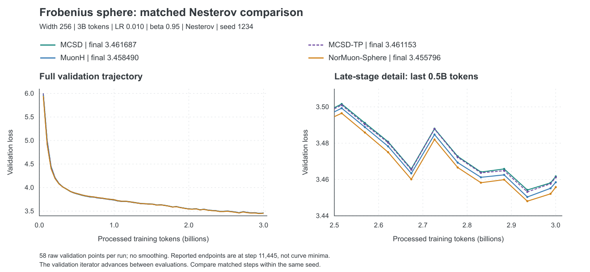
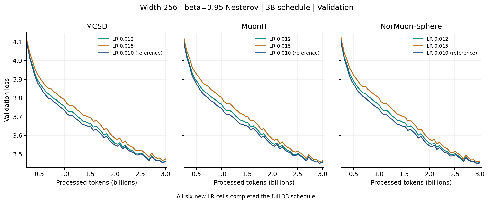
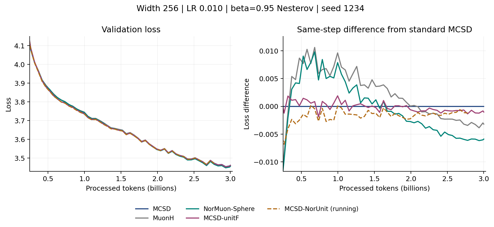
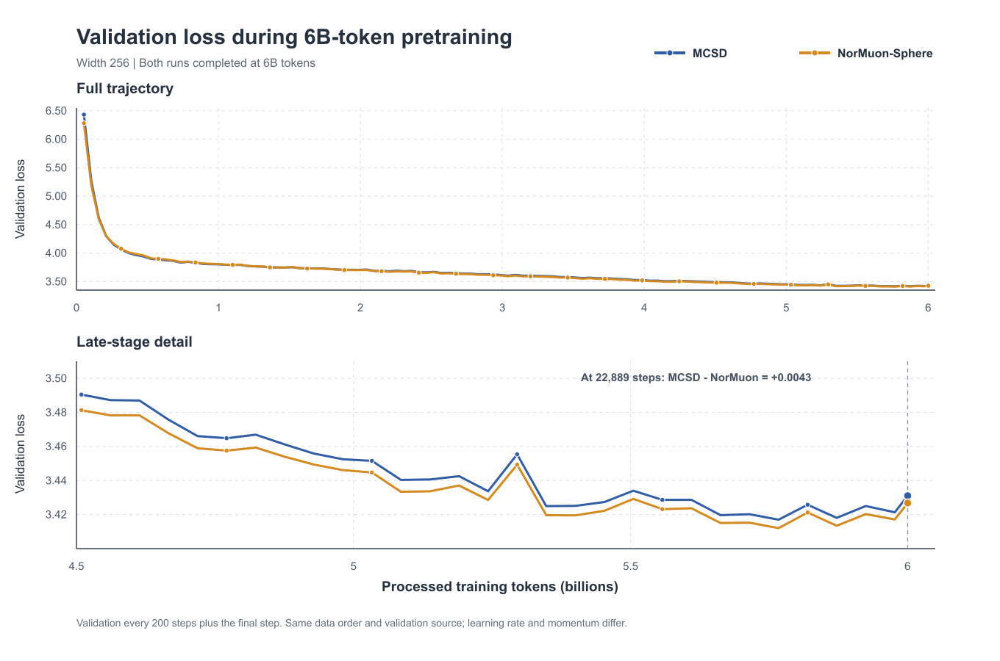
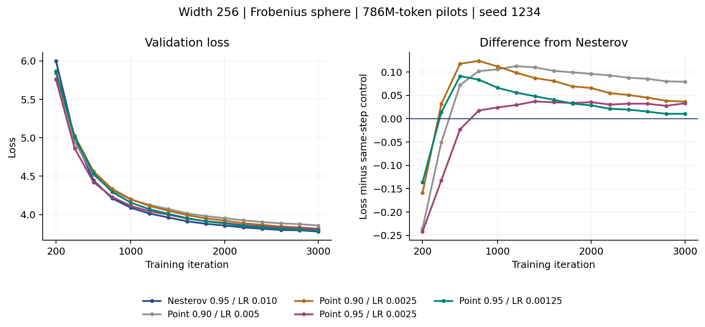

# Frobenius Sphere Experiments

**Results and queue snapshot: November 13, 2026, 17:17 HKT**

[Latest H20 results and the ELR/AUS study](FROBENIUS_ELR_AUS_20261113.md).
The [400-step MuonH diagnostic](FROBENIUS_ELR_AUS_20261113.md#does-muonh-already-use-an-almost-tangent-input)
found nearly tangent raw gradients but larger radial components after
momentum. Pre-projection improved first-order alignment most consistently
for Q/K, not for MLP matrices. All three six-step AUS checks passed;
the 3B reference is running and the 3B replay has no result yet.

MCSD and MCSD-TP are evaluated against MuonH and NorMuon-Sphere using
Megatron Dense LMs. The completed matched 3B comparison favors
**NorMuon-Sphere**. True point extrapolation now runs on H20, but its
pilots and completed 3000-step continuations have **not beaten Muon-style Nesterov**
at their respective endpoints.

[3B comparison](#latest) | [Momentum and LR](#comparisons) |
[6B results](#six-b) | [Point pilot](#point-pilot) |
[Next tests](#next) | [Full history](FROBENIUS_3B_6B_HISTORY.md) |
[Related papers](FROBENIUS_RELATED_WORK.md)

| Evidence | Coverage | Interpretation |
|---|---|---|
| Completed 3B | 60 runs in the October 29 ledger + 6 LR cells + 4 normalization/seed runs + 4 LR=0.008/0.012 runs + 1 fixed-point run | 75 completed runs across the ledger and dated readouts |
| Completed 6B | 4 runs, two methods and two seeds | Earlier frozen configurations, not the new Nesterov setting |
| Completed point pilots | 8 earlier configurations + 2 fixed-gamma pilots | Separate from full-budget results |
| November 2 point/LR batch | All 8 completed | [Complete LR readout](FROBENIUS_RESULTS_20261105.md), [3000-step point results](FROBENIUS_RESULTS_20261104.md#point-extrapolation-at-step-3000) |
| November 4 normalization/seed batch | All 4 completed | [Matched endpoints and second-seed baselines](FROBENIUS_H20_READOUT_20261112.md#full-3b-results) |
| November 10 fixed-point/unit-F batch | 2 pilots and 5 full 3B runs completed | [LR grid and fixed-point endpoint](FROBENIUS_ELR_AUS_20261113.md#completed-3b-results) |
| ELR/AUS study | Gradient/scale pilot and three short checks complete; 3B reference running | [Results and job IDs](FROBENIUS_ELR_AUS_20261113.md#controlled-h20-tests) |

This is a dated evidence summary, not a live dashboard. All losses are
validation cross-entropy; lower is better. No historical results were removed:
[historical LR tables and ledger](FROBENIUS_3B_6B_HISTORY.md#ledger),
[all-project inventory](ALL_EXPERIMENTS.md).

## Matched 3B Comparison

**Fixed:** width 256, 3B tokens, Frobenius radius `R=sqrt(D_out)`, peak
LR=0.010, beta=0.95 Nesterov, seed=1234. Same model, data and auxiliary AdamW.
Nesterov here combines gradients; it does not extrapolate the model point.

| Method | Final val. loss | Difference from NorMuon | H20 wall time |
|---|---:|---:|---|
| **NorMuon-Sphere** | **3.455796** | 0 | 18:31:38 |
| MuonH | 3.458490 | +0.002694 | 18:28:51 |
| MCSD-TP | 3.461153 | +0.005357 | 18:33:09 |
| MCSD | 3.461687 | +0.005891 | 18:28:58 |

[Vector figure](frobenius_3b_6b/nesterov095_matched_20261029.svg) |
[Curves, configurations and jobs](frobenius_3b_6b/latest_batch_20261029.json)

This is a single-seed, fixed-LR comparison, not a statistically established
method ranking or a comparison of globally optimal configurations.

### New Matched LR Grid

Same width, budget, beta=0.95 Nesterov and seed. Only complete endpoint
losses enter this table; running cells are not filled with intermediate losses.

| Method | LR=0.010 | LR=0.012 | LR=0.015 |
|---|---:|---:|---:|
| MCSD | **3.461687** | 3.463020 | 3.474075 |
| MuonH | **3.458490** | 3.458744 | 3.466872 |
| NorMuon-Sphere | **3.455796** | 3.458990 | 3.465047 |

All six new cells completed. Increasing LR has not improved any method. MCSD LR=0.015 is
0.012388 worse than its LR=0.010 reference. MuonH's 0.012 difference is
only 0.000254 and requires multiple seeds before attributing a reliable effect.

[All job states, times, train curves and caveats](FROBENIUS_RESULTS_20261105.md).

### New Normalization Ablation

MCSD-unitF finishes at **3.460665**, compared with standard MCSD's 3.461687
under the same LR=0.010, beta=0.95 Nesterov and seed=1234. The difference is
-0.001022; MuonH and NorMuon-Sphere still have lower final losses.

MCSD-NorUnit finishes at **3.460299** at LR=0.010, improving on unit-F alone
by 0.000366 in seed 1234. At LR=0.008 both runs are worse at the final
endpoint than their LR=0.010 counterparts, despite lower loss earlier.
The figure below is the November 5 intermediate snapshot.

[Final results and aligned LR comparisons](FROBENIUS_H20_READOUT_20261112.md).

## Momentum and Learning Rate

At beta=0.95, LR=0.010 and seed=1234, enabling Muon-style Nesterov helps
**all four methods**, not just MCSD.

| Method | EMA | Nesterov | Change |
|---|---:|---:|---:|
| MCSD | 3.467720 | 3.461687 | -0.006033 |
| MCSD-TP | 3.467858 | 3.461153 | -0.006705 |
| MuonH | 3.464988 | 3.458490 | -0.006498 |
| NorMuon-Sphere | 3.463500 | 3.455796 | -0.007704 |

The MCSD/MCSD-TP improvement repeats at seed 2026 (3.464190 / 3.463603).
The matched seed-2026 baselines completed: MuonH **3.463144** (4390470)
and NorMuon-Sphere **3.462039** (4390471). Both still lead plain MCSD and
MCSD-TP in that seed.

**LR=0.015 and 0.020 were tested.** Those results use earlier momentum
settings and remain in the [full LR grids](FROBENIUS_3B_6B_HISTORY.md#comparisons).
They cannot substitute for the requested beta=0.95 Nesterov grid.
The six-run LR=0.012/0.015 grid was submitted on November 2 as
[4375562--4375567](FROBENIUS_POINT_LR_BATCH_20261102.md).
The [MCSD-NorUnit plan](FROBENIUS_NESTEROV_NORUNIT_20261029.md#november-4-submission)
was submitted on November 4 with a matched unit-F-only control.

## Completed 6B Comparison

Earlier frozen configurations, trained from initialization on the new 6B
index. Learning rate and momentum differ between methods.

| Method / configuration | Seed 1234 | Seed 2026 | Two-seed mean |
|---|---:|---:|---:|
| MCSD / LR=0.010 / 0.95 EMA | 3.431077 | 3.428305 | 3.429691 |
| NorMuon-Sphere / LR=0.015 / 0.9 Nesterov | **3.426804** | **3.414900** | **3.420852** |

The mean difference is +0.008839 for MCSD. More tokens did not reverse this
earlier comparison. The new 0.95 Nesterov configuration and point variants
have no completed 6B results.

6B validation curves and exact run records

[CSV measurements](frobenius_3b_6b/validation_6b.csv) |
[All four jobs, times and qualifications](FROBENIUS_3B_6B_HISTORY.md#six-b)

## New Point-Extrapolation Pilot

The model holds live extrapolated Y and one accepted-point X buffer.
Gradient evaluation is at Y; no gradient EMA is used. The following runs
reached step 3000 (786M tokens) with the unchanged 3B cosine horizon.

| Selected configuration | Val. loss at 3000 |
|---|---:|
| **Nesterov beta=0.95, LR=0.010** | **3.778030** |
| Point cap=0.90, LR=0.005 | 3.857235 |
| Point cap=0.90, LR=0.0025 | 3.814502 |
| Point cap=0.95, LR=0.0025 | 3.811040 |
| Point cap=0.95, LR=0.00125 | **3.788594** |
| Fixed point gamma=0.95, LR=0.00125 | 3.789622 |
| Fixed point gamma=0.95, LR=0.0025 | 3.812622 |

The best tested point configuration now trails Nesterov by **0.010564**.
Its gap shrank from 0.066324 at step 1000 but did not improve between steps
2800 and 3000. This is not a crossover or an established acceleration result.
**These losses cannot be compared directly with the final 3B/6B tables.**
Neither fixed-gamma pilot improved on its matched capped-FISTA variant.
The full 3B fixed-gamma test (`4424382`) finished at **3.511619** in
18:35:26. It did not close the gap to MCSD's Nesterov endpoint (3.461687)
under the tested recipes, which use different peak LRs.

[Original six pilots, algorithm and resume checks](MCSD_POINT_PILOT_20261031.md) |
[Latest curves and machine-readable data](frobenius_point_lr_20261104/results.json)

## Next Tests

| Priority | Test | Status / decision |
|---|---|---|
| Completed | Full LR=0.012/0.015 grid and MCSD-unitF | Seven new 3B endpoints; [results](FROBENIUS_RESULTS_20261105.md) |
| Completed | MCSD-NorUnit, LR=0.010, seed=1234 | 4390469; final validation loss 3.460299 |
| Mechanism | Sample accepted/live angular displacement and compare X/Y on identical diagnostic batches | Proposed; no extra production evaluations enabled |
| Completed: fairness | Baseline second seed at the matched LR=0.010 setting | 4390470 / 4390471 |
| Completed | Normalized variants at LR=0.012 | 4419139: 3.463637; 4419140: 3.463414 |
| Completed | Full 3B fixed-point extrapolation | 4424382: 3.511619 |
| In progress | Normalized winner replication, seed 2026 | 4428698: 3.470769 at 10,800/11,445, not final |
| In progress | MuonH reference, MCSD-TP control, MCSD-TP AUS replay | Three short checks passed; 4427413 running, 4427414–4427415 pending |
| Queued | Width-384, matched 3B projection comparison | 4428781 / 4428783 / 4428784; [protocol](FROBENIUS_ELR_AUS_20261113.md#width-384-transfer) |
| Transfer | Paired seeds, retuning and larger budgets | Deferred until the matched transfer results are available |

The completed eight-job batch used two serial single-GPU lanes. Six full 3B runs were
explicitly requested, not automatically promoted point pilots. The separate
November 4 follow-up adds four 3B jobs on two serial lanes. The November 12
[H20 readout](FROBENIUS_H20_READOUT_20261112.md) preserves the earlier
snapshot; the [ELR/AUS study](FROBENIUS_ELR_AUS_20261113.md) is current.
[Submission details](FROBENIUS_POINT_LR_BATCH_20261102.md).

**Current research priority:** distinguish direction quality from actual
angular step size and stochastic-gradient effects. Relevant evidence and
limits are summarized in the [recent-paper reading list](FROBENIUS_RELATED_WORK.md).
The experiments do not yet establish universal superiority or a scaling law.

## Reproduction and Records

| Need | Resource |
|---|---|
| Full historical tables, including LR=0.015/0.020 | [Preserved 3B/6B report](FROBENIUS_3B_6B_HISTORY.md) |
| Every older protocol, cancellation and small test | [Project inventory](ALL_EXPERIMENTS.md) |
| Algorithm pseudocode and actual code paths | [Implementation guide](OPTIMIZER_PSEUDOCODE_GUIDE.md) |
| Redraw point-pilot figures on CPU | [Command and released JSON](MCSD_POINT_PILOT_20261031.md#reproduce-the-figures) |
| Environment, launch and resume | [Experiment 3 guide](mcsd_three_geometries/README.md) |
| Current scientific context | [Recent papers and proposed diagnostics](FROBENIUS_RELATED_WORK.md) |

**Protocol:** 28 layers, width 256, FFN 768, 4 query heads / 2 KV groups,
73,418,496 parameters; sequence length 2048, global batch 128, micro-batch 4,
one H20 per run. BF16 model, FP32 master weights; hidden-matrix weight decay
zero, auxiliary AdamW LR=0.001. Shape-based radii use r=1.

3B means 11445 steps; 6B means 22889. Both use 2% warmup and cosine decay to
10% of peak. Validation uses 40 batches every 200 steps and at the scheduled
endpoint. Its iterator advances, so align iteration and seed. Different
budget horizons have different LR schedules. Older width-384
initialization-energy-matched radii belong to a separate protocol.
