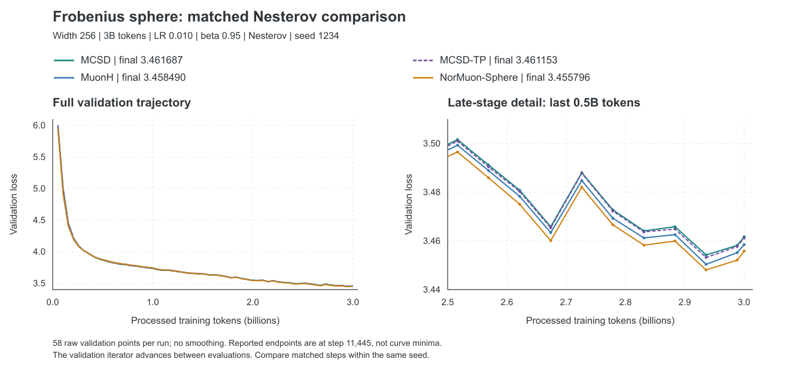

# Frobenius Sphere: 3B / 6B Experiment Summary

[Complete project inventory](ALL_EXPERIMENTS.md) includes all LR/momentum/seed
coverage, the older width-384 protocols, cancelled runs and local small-problem
tests. [Full job ledger](experiment_inventory/COMPLETED_RUNS.md).
This page interprets the current width-256 study; it is not a replacement for
the complete history.

**Documentation updated October 30, 2026.** Completed results below were verified
on October 29 at 15:01 HKT. The new seven-run batch is prepared but **not submitted**:
the H20 upload and subsequent SSH checks failed. See the [new batch record](FROBENIUS_NESTEROV_NORUNIT_20261029.md).
Width 256, 28 layers, Frobenius sphere, fixed `r=1`.

| Completed 3B | Completed 6B | Running | Waiting for dependencies |
|:---:|:---:|:---:|:---:|
| **60 runs** | **4 runs** | **0 runs** | **0 runs** |

[Latest results](#latest) · [Momentum and LR](#comparisons) · [6B curves](#six-b) · [Next experiments](#next) · [Run ledger](#ledger)

This is a verified snapshot, not a live dashboard. **Completed results, partial measurements, and submitted jobs are reported separately.** Lower loss is better.
The older width-384 experiments with initialization-energy-matched radii are excluded from the current comparison.
The counts above are the October 29 15:01 snapshot of this Frobenius study only.
Separate spectral-cluster jobs are excluded. They are not a live statement about today's queue.

Implementation reference: [optimizer pseudocode and code comparison (Chinese)](OPTIMIZER_PSEUDOCODE_GUIDE.md).

<a id="latest"></a>

## Latest Results

**The matched baselines are now complete: NorMuon-Sphere has the lowest loss.** All four methods below use the same `LR=0.010 / beta=0.95 Nesterov / seed=1234 / 3B` protocol. These are also their best tested seed-1234 configurations, but only one LR has been tested with 0.95 Nesterov. This is not evidence of globally optimal tuning or statistical significance.

| Method | LR | Momentum | Final val. loss | Single-GPU elapsed time | Job |
|---|---:|---|---:|---|---|
| **NorMuon-Sphere** | 0.010 | 0.95 Nesterov | **3.455796** | 18:31:38 | 4346666 |
| MuonH | 0.010 | 0.95 Nesterov | 3.458490 | 18:28:51 | 4346665 |
| MCSD-TP | 0.010 | 0.95 Nesterov | 3.461153 | 18:33:09 | 4329086 |
| MCSD | 0.010 | 0.95 Nesterov | 3.461687 | 18:28:58 | 4329085 |

MCSD-TP and MCSD are **0.005357 and 0.005891 above NorMuon-Sphere**, respectively; their gaps to MuonH are +0.002663 and +0.003197.
The earlier apparent MCSD advantage compared its new Nesterov setting against baselines with different momentum settings. That advantage does not survive this matched comparison.

### Earlier LR=0.015 Results Are Already Complete

The table above is restricted to **0.95 Nesterov**, not the full LR history.
The earlier runs at **0.015 have not been removed**; the original-momentum sweep also reached **0.020**.
All entries below use width 256, 3B tokens, seed 1234, fixed Frobenius `r=1`, and no extra unit-F normalization.

| Method | Momentum | LR=0.010 | LR=0.015 | Job at 0.015 |
|---|---|---:|---:|---|
| MCSD | 0.95 EMA | **3.467720** | 3.489496 | 4197466 |
| MCSD-TP | 0.95 EMA | **3.467858** | 3.487949 | 4197470 |
| MuonH | 0.9 Nesterov | 3.476769 | **3.466668** | 4197474 |
| NorMuon-Sphere | 0.9 Nesterov | 3.476793 | **3.464757** | 4197478 |
| MCSD | 0.9 EMA | 3.473145 | **3.472291** | 4255793 |
| MCSD-TP | 0.9 EMA | 3.474456 | **3.472186** | 4255795 |
| MuonH | 0.9 EMA | 3.471362 | **3.464883** | 4255794 |
| NorMuon-Sphere | 0.9 EMA | 3.470496 | **3.464984** | 4255796 |

Bold marks the lower of the two displayed LRs within each row, not the optimum over the complete grid.
In particular, MCSD/MCSD-TP with 0.9 EMA performed better at 0.012 than at either displayed LR.
The first four rows mix momentum configurations and must not be interpreted as a matched-momentum comparison.
See [the full LR grids](#comparisons) for 0.005/0.007/0.008/0.012/0.020 and the separate unit-F ablation.

**The requested next grid is 0.012/0.015 with beta=0.95 Nesterov for MCSD,
MuonH and NorMuon-Sphere (six runs).** No additional MCSD-TP run is requested.
Testing those combinations extends the new momentum configuration; it does not
repeat the completed EMA or 0.9-Nesterov runs.



[Vector figure](frobenius_3b_6b/nesterov095_matched_20261029.svg) · [Verified curves, configurations, and completion records](frobenius_3b_6b/latest_batch_20261029.json)

Each curve contains 58 raw validation points. The late-stage panel retains the evaluation fluctuations; reported final losses are at step 11445, not the minimum along the curve.

### Matched Nesterov Ablation

Fix `LR=0.010 / beta=0.95 / seed=1234 / 3B` and change only the EMA/Nesterov gradient combination.

| Method | EMA | Nesterov | Nesterov minus EMA |
|---|---:|---:|---:|
| MCSD | 3.467720 | **3.461687** | **-0.006033** |
| MCSD-TP | 3.467858 | **3.461153** | **-0.006705** |
| MuonH | 3.464988 | **3.458490** | **-0.006498** |
| NorMuon-Sphere | 3.463500 | **3.455796** | **-0.007704** |

Nesterov improves **all four methods**, not only MCSD. The largest observed gain in this matched seed is NorMuon-Sphere's 0.007704.
[Earlier MCSD/MCSD-TP EMA-versus-Nesterov figure](frobenius_3b_6b/nesterov095_20261027.png) · [EMA reference curves](frobenius_3b_6b/matched_ema095_curves.json)

Here, Nesterov means the **Muon-style gradient combination**, not manifold extrapolation with a new gradient evaluation at an extrapolated point.
The earlier lack of improvement with beta=0.9 applies only to the tested configurations, not to all Nesterov variants.

### Latest Four Completed Runs

| Job | Method | Budget / seed | LR / momentum | Final val. loss | Single-GPU elapsed time |
|---|---|---|---|---:|---|
| 4346665 | MuonH | 3B / 1234 | 0.010 / 0.95 Nesterov | 3.458490 | 18:28:51 |
| 4346666 | NorMuon-Sphere | 3B / 1234 | 0.010 / 0.95 Nesterov | 3.455796 | 18:31:38 |
| 4346667 | MCSD | 3B / 2026 | 0.010 / 0.95 Nesterov | 3.464190 | 18:29:31 |
| 4346668 | MCSD-TP | 3B / 2026 | 0.010 / 0.95 Nesterov | 3.463603 | 18:38:17 |

All four finished on October 28 with `COMPLETED / exit 0:0`, no NaNs, and no skipped iterations. Each reached final validation at step 11445.
The submitted configuration hashes and optimizer-source hashes match the recorded startup configurations. Checkpoint saving was disabled. Disk space was approximately 29 GB at that check; it is not a current measurement.

### Nesterov Replication Across Seeds

Common settings: `LR=0.010 / beta=0.95 / 3B`. The final column compares Nesterov with the **same method and seed-2026 EMA control**.

| Method | Nesterov, seed 1234 | Nesterov, seed 2026 | Two-seed mean | Seed-2026 Nesterov minus EMA |
|---|---:|---:|---:|---:|
| MCSD | 3.461687 | 3.464190 | 3.462939 | -0.009900 |
| MCSD-TP | 3.461153 | 3.463603 | 3.462378 | -0.009391 |

The corresponding seed-2026 EMA losses are 3.474090 (job 4255801) and 3.472994 (job 4255803).
The Nesterov improvement is reproduced for both methods at both seeds. MCSD-TP is slightly lower than MCSD at both seeds, by 0.000534 and 0.000587, but two seeds do not establish a statistically reliable advantage.
**The matched Nesterov baselines still lack seed 2026.** Their single-seed losses must not be compared with these two-seed means as though the comparison were paired.

<details>
<summary><strong>Matched EMA references and LR=0.008 curves</strong></summary>

At `beta=0.95 EMA / LR=0.010 / seed=1234`, MCSD=3.467720, MCSD-TP=3.467858,
MuonH=3.464988, and NorMuon-Sphere=3.463500. Both baselines outperform the MCSD variants in this setting, showing that the ranking depends on momentum configuration.


Each figure compares only the configurations stated in that figure. Historical status is available in the [October 26 snapshot](frobenius_3b_6b/latest_batch_20261026.json).

</details>

## Key Findings

1. **The completed matched Nesterov comparison favors NorMuon-Sphere, followed by MuonH, MCSD-TP, and MCSD.** The earlier lead over differently configured baselines no longer holds.
2. **Nesterov with beta=0.95 improves every method at seed 1234, and improves MCSD/MCSD-TP at seed 2026 as well.** This is evidence for a useful momentum setting, not an MCSD-specific gain or a proof of manifold acceleration.
3. **TP has a small, repeatable direction of improvement within the new Nesterov pair.** Its loss is lower than MCSD at both seeds, but the differences are small and the matched baselines still lack their second seed. Complete those two baseline runs before drawing multi-seed method rankings.
4. **The older MCSD configuration does not overtake NorMuon-Sphere at 6B.** Two-seed means are 3.429691 and 3.420852, respectively. The new Nesterov configuration has not been tested at 6B, so its budget transfer remains unknown.
5. **Further LR=0.008 and unit-F tests are lower priority.** With 0.95 EMA, LR=0.010 beats 0.008 for every method; none of the four unit-F settings beats the best standard MCSD result.

These observations cover limited grids and few seeds. They do not establish globally optimal hyperparameters, statistical significance, or a scaling law.

<details>
<summary><strong>Protocol: model, data, precision, and metrics</strong></summary>

| Item | Fixed setting |
|---|---|
| Model | Width 256, 28 layers, FFN width 768, 4 attention heads, 2 KV groups, head dimension 64; 73,418,496 parameters |
| Geometry | Frobenius sphere; component-wise shape radius `R = sqrt(D_out)`, with `r=1` |
| Training | OLMo-Mix-1124; sequence length 2048, global batch 128, micro-batch 4; one H20 per run |
| Precision | BF16 training with FP32 optimizer master weights; existing Newton-Schulz (NS) matrix-sign path |
| Auxiliary parameters | Auxiliary AdamW with LR=0.001; beta/EMA/Nesterov in the tables refer to the matrix optimizer |
| Schedule | 2% linear warmup, then cosine decay to 10% of peak LR |
| 3B | 11,445 steps, 3,000,238,080 processed tokens, 229 warmup steps |
| 6B | 22,889 steps, 6,000,214,016 processed tokens, 458 warmup steps; new 6B index, trained from initialization |
| Validation | Same 3B validation index; 40 batches every 200 steps and after training |
| Reported loss | Validation loss at the final scheduled step, not the minimum over training; six decimal places |
| Time | Slurm elapsed time, including startup and validation, not training-only time |

The validation iterator advances, so curve comparisons should align the same steps within the same seed. Changing the seed may change both initialization and data order.
The 3B and 6B cosine schedules have different horizons; differences at an intermediate token count cannot be attributed solely to additional data.

**Terminology.** Nesterov denotes the Muon-style gradient combination:

```text
M_t = beta * M_(t-1) + (1-beta) * G_t
EMA:       S_t = M_t
Nesterov:  S_t = beta * M_t + (1-beta) * G_t
```

True manifold extrapolation, with gradients evaluated at the extrapolated point, has only been tested on local small problems, not in a full LLM experiment.
MCSD-unitF is a separate ablation. Baseline-specific direction normalization remains enabled; `direction_normalization=none` disables only the additional normalization option.

</details>

<details>
<summary><strong>Coverage: what the 64 completed runs test</strong></summary>

| Experiment group | Configurations | Completed | Question |
|---|---|---:|---|
| Original LR grid | Four methods; LR={0.005,0.007,0.010,0.015}; seed=1234; original momentum settings | 16 | LR sensitivity |
| Original-momentum LR extension | Four methods; additional LR=0.012/0.020 | 8 | Interior and upper-boundary optima |
| MCSD-unitF | LR={0.010,0.012,0.015,0.020}; 0.95 EMA | 4 | Effect of explicit direction normalization |
| Momentum controls | MCSD/MCSD-TP with 0.9 Nesterov; four methods with 0.9 EMA; LR=0.010 | 6 | Effect of the gradient combination |
| Matched EMA LR grid | Four methods; 0.9 EMA; additional LR=0.012/0.015 | 8 | LR selection after matching momentum |
| Second seed, frozen configurations | Four methods; seed=2026 | 4 | Replication across seeds |
| Matched momentum baselines | MuonH/NorMuon-Sphere; 0.95 EMA; LR=0.010; seed=1234 | 2 | Fully matched momentum and LR against MCSD/MCSD-TP |
| Nesterov LR extension | MCSD; 0.9 Nesterov; additional LR=0.007/0.012 | 2 | Whether the original LR obscured Nesterov performance |
| 0.95 EMA LR refinement | Four methods; additional LR=0.008 | 4 | Search below 0.010 |
| 0.95 Nesterov | Four methods at seed=1234; MCSD/MCSD-TP also at seed=2026; LR=0.010 | 6 | Matched gradient-combination comparison and MCSD replication |
| 6B budget transfer | MCSD/NorMuon-Sphere; seeds 1234/2026 | 4 | Curves and rankings at a longer budget |

The 12 LR-extension and unit-F jobs were rechecked on October 24: all completed with exit code 0:0 and final validation at step 11445. RUNNING/PENDING labels in the October 8 report refer to that historical snapshot.

</details>

<a id="comparisons"></a>

## 3B Momentum and Learning Rate

<details>
<summary><strong>Original-momentum LR grid: four methods, six learning rates</strong></summary>

Seed=1234. MCSD/MCSD-TP use **0.95 EMA**; MuonH/NorMuon-Sphere use **0.9 Nesterov**.

| Method | 0.005 | 0.007 | 0.010 | 0.012 | 0.015 | 0.020 |
|---|---:|---:|---:|---:|---:|---:|
| MCSD | 3.485531 | 3.470591 | **3.467720** | 3.473471 | 3.489496 | 3.520329 |
| MCSD-TP | 3.485612 | 3.470890 | **3.467858** | 3.472968 | 3.487949 | 3.518967 |
| MuonH | 3.529123 | 3.500046 | 3.476769 | 3.470822 | **3.466668** | 3.470523 |
| NorMuon-Sphere | 3.526564 | 3.499072 | 3.476793 | 3.469203 | **3.464757** | 3.469132 |

After extending the grid to 0.020, both baselines still perform best at 0.015, which is no longer the upper boundary.
This compares method-specific configurations; changing both momentum and LR is not a single-factor ablation.

</details>

### Momentum at Fixed LR=0.010

| Method | 0.95 EMA | 0.9 EMA | 0.9 Nesterov | 0.95 Nesterov |
|---|---:|---:|---:|---|
| MCSD | 3.467720 | 3.473145 | 3.478060 | **3.461687** |
| MCSD-TP | 3.467858 | 3.474456 | 3.478570 | **3.461153** |
| MuonH | 3.464988 | 3.471362 | 3.476769 | **3.458490** |
| NorMuon-Sphere | 3.463500 | 3.470496 | 3.476793 | **3.455796** |

The original 0.95 EMA baseline jobs 4288197/4288198 were cancelled without full 3B results.
Replacement jobs 4320101/4320102 completed, giving fully matched results for all four methods in that column.

### LR Refinement

Seed=1234; only final losses from complete 3B runs are listed.

| Method / momentum | LR=0.007 | LR=0.008 | LR=0.010 | LR=0.012 |
|---|---:|---:|---:|---:|
| MCSD / 0.95 EMA | 3.470591 | 3.469048 | **3.467720** | 3.473471 |
| MCSD-TP / 0.95 EMA | 3.470890 | 3.468235 | **3.467858** | 3.472968 |
| MuonH / 0.95 EMA | Not tested | 3.465584 | **3.464988** | Not tested |
| NorMuon-Sphere / 0.95 EMA | Not tested | 3.466207 | **3.463500** | Not tested |
| MCSD / 0.9 Nesterov | 3.501387 | Not tested | 3.478060 | **3.473377** |

The best point in the last row remains at the grid's upper boundary; this does not establish that Nesterov has been fully tuned.

<details>
<summary><strong>Matched beta=0.9 EMA LR grid</strong></summary>

| Method | LR=0.010 | LR=0.012 | LR=0.015 |
|---|---:|---:|---:|
| MCSD | 3.473145 | **3.471094** | 3.472291 |
| MCSD-TP | 3.474456 | **3.471926** | 3.472186 |
| MuonH | 3.471362 | 3.467071 | **3.464883** |
| NorMuon-Sphere | 3.470496 | 3.465714 | **3.464984** |

Both baselines are best at the upper boundary of this EMA grid. Their LR=0.020 **Nesterov** results cannot substitute for the missing **EMA** runs at 0.020.

</details>

<details>
<summary><strong>MCSD-unitF: additional direction normalization</strong></summary>

Fix beta=0.95 EMA and seed=1234. The unit-F variant uses
`Y = W - eta * R * D / (||D||_F + eps)`, followed by a Frobenius radial return.

| LR | Standard MCSD | MCSD-unitF | unit-F minus standard |
|---|---:|---:|---:|
| 0.010 | 3.467720 | 3.467961 | +0.000241 |
| 0.012 | 3.473471 | 3.474321 | +0.000850 |
| 0.015 | 3.489496 | 3.490344 | +0.000848 |
| 0.020 | 3.520329 | 3.519835 | -0.000494 |

These four settings do not establish that unit-F closes the gap between MCSD and the baselines.

</details>

### Second Seed with Frozen Configurations

These configurations were selected from the original-momentum LR grid and held fixed for the second seed. They were not reselected across all momentum variants.

| Method | LR | Momentum | Seed 1234 | Seed 2026 | Two-seed mean |
|---|---:|---|---:|---:|---:|
| MCSD | 0.010 | 0.95 EMA | 3.467720 | 3.474090 | 3.470905 |
| MCSD-TP | 0.010 | 0.95 EMA | 3.467858 | 3.472994 | 3.470426 |
| MuonH | 0.015 | 0.9 Nesterov | 3.466668 | 3.469006 | 3.467837 |
| NorMuon-Sphere | 0.015 | 0.9 Nesterov | 3.464757 | 3.468215 | 3.466486 |

MCSD-TP does not consistently outperform MCSD across these two seeds. With only two seeds, the comparison is descriptive.

The new MCSD/MCSD-TP `0.95 Nesterov / LR=0.010` configurations are reported separately in [the latest results](#latest), now with both seeds completed.
NorMuon-Sphere `0.95 EMA / LR=0.010` still lacks its second seed. Do not replace values in this historical table with results from different configurations.

<a id="six-b"></a>

## 6B Results and Curves

| Method | Job | LR | Momentum | Seed | Final val. loss | Slurm elapsed time |
|---|---|---:|---|---:|---:|---|
| MCSD | 4288199 | 0.010 | 0.95 EMA | 1234 | 3.431077 | 36:52:20 |
| NorMuon-Sphere | 4288211 | 0.015 | 0.9 Nesterov | 1234 | **3.426804** | 36:49:13 |
| MCSD | 4320105 | 0.010 | 0.95 EMA | 2026 | 3.428305 | 36:48:51 |
| NorMuon-Sphere | 4320106 | 0.015 | 0.9 Nesterov | 2026 | **3.414900** | 36:57:26 |

| Earlier frozen configuration | Two-seed mean |
|---|---:|
| MCSD: 0.010 / 0.95 EMA | 3.429691 |
| NorMuon-Sphere: 0.015 / 0.9 Nesterov | **3.420852** |

Paired differences, MCSD minus NorMuon-Sphere, are +0.004273 for seed 1234 and +0.013405 for seed 2026; the mean difference is **+0.008839**.
NorMuon-Sphere has lower loss at both seeds, but two seeds do not establish statistical significance.
This compares the earlier method-specific configurations, not an optimizer-only ablation with matched momentum.


The figure shows only seed 1234: [6B validation CSV](frobenius_3b_6b/validation_6b.csv), with 115 unsmoothed points per run.
NorMuon-Sphere is lower at 94/115 matched validation points. The gap is 0.011603 at step 12000 and 0.004273 at the endpoint.
The complete 115-point curves for seed 2026 are in the [latest result snapshot](frobenius_3b_6b/latest_batch_20261029.json).
**The new 0.95 Nesterov MCSD/MCSD-TP configurations have not been tested at 6B. Neither MuonH nor MCSD-TP has a completed 6B run.**

<a id="next"></a>

## Next Experiments

**A1-A4 are complete; B/C are proposals, not submitted jobs.**
The immediate gap is now the two matched baseline runs at seed 2026, followed by a balanced local LR search. Do not advance only MCSD to 6B on the basis of the earlier unmatched ranking.

### Completed: Four 3B Follow-Ups

Common settings: `width=256 / r=1 / LR=0.010 / beta=0.95 Nesterov / 3B`. Only the method or seed varies.

| ID | Method | Seed | Job | Status | Matched reference and purpose |
|---|---|---:|---|---|---|
| A1 | MuonH | 1234 | **4346665** | COMPLETED | Enable only Nesterov relative to EMA job 4320101; complete the matched baseline |
| A2 | NorMuon-Sphere | 1234 | **4346666** | COMPLETED | Enable only Nesterov relative to EMA job 4320102; complete the matched baseline |
| A3 | MCSD | 2026 | **4346667** | COMPLETED | Change only the seed relative to Nesterov job 4329085; also compare with same-seed EMA job 4255801 |
| A4 | MCSD-TP | 2026 | **4346668** | COMPLETED | Change only the seed relative to Nesterov job 4329086; also compare with same-seed EMA job 4255803 |

All four started on SPG-7-1 at **00:47 HKT on October 28** and finished between **19:16 and 19:25 HKT that day**.
Each used one H20, started from initialization, trained for 11445 steps, and saved no checkpoints. Summed runtime was **74 h 08 min 17 s (74.14 GPU-hours)** across four concurrent jobs.
Training used frozen commit `fc15600a2898d1748c8b34fe8d3945b1036f03ab`. Source-file hashes match the respective references exactly; local exploratory optimizer changes were not uploaded.

[Submission register, resolved configurations, and startup snapshot](frobenius_3b_6b/nesterov095_submission_20261028.json) ·
[Verified final results](frobenius_3b_6b/latest_batch_20261029.json) ·
[Baseline plan](../../configs/manifold/frobenius_nesterov095_baselines_20261028.json) ·
[Second-seed plan](../../configs/manifold/frobenius_nesterov095_seed2026_20261028.json)

Seed-2026 runs for A1/A2 are still needed for a complete four-method, two-seed matched comparison.
Existing baseline EMA runs or older Nesterov runs at LR=0.015 cannot substitute for them.

### Follow-Ups After A1-A4

| Priority | Configuration / scale | Runs | Purpose and prerequisite |
|---|---|---:|---|
| B1: complete replication | MuonH/NorMuon-Sphere; 0.95 Nesterov; LR=0.010; seed=2026; 3B | 2 | Highest priority: complete the paired-seed comparison; retain and report both regardless of ranking |
| B2: requested LR grid | MCSD/MuonH/NorMuon-Sphere; 0.95 Nesterov; seed=1234; LR=0.012/0.015 | 6 | Prepared, not submitted. MCSD-TP excluded by request; existing EMA results cannot replace these runs |
| B2a: MCSD-NorUnit | MCSD with row-adaptive scaling and unit-F direction; 0.95 Nesterov; seed=1234; LR=0.010 | 1 | Prepared, not submitted. Compare with existing matched MCSD/MuonH/NorMuon-Sphere at 0.010 |
| B3: robustness | Four frozen configurations; a third prespecified paired seed | 4 | Report paired differences, means, and standard deviations rather than only the best run |
| C1: new 6B comparison | Four configurations frozen after 3B; fresh initialization; shared seed and data order | 4 | Follow 3B replication. A two-method pilot with MCSD-TP and the strongest 3B baseline does not replace the four-method comparison |
| C2: scale transfer | Width384/512; fixed shape-radius, data, and auxiliary AdamW protocol; transfer hyperparameters first | Staged | Separate fixed-configuration transfer from retuning. Multiple scales and budgets are needed before discussing scaling laws |

Use comparable tuning budgets and full-budget endpoints rather than selecting favorable intermediate stages. These principles are supported by work on
[pretraining optimizer evaluation](https://proceedings.iclr.cc/paper_files/paper/2026/hash/ea4f0a6ad7088c9b93f22d74c0c9e8c2-Abstract-Conference.html)
and [benchmark variability](https://arxiv.org/abs/2103.03098). The specific configurations and priorities above are recommendations based on this project's results.

### Low-Cost Mechanism Diagnostics

Evaluate candidate updates from the same sampled weights `W`, gradients `G`, and momentum states `M`, before the methods' trajectories diverge:

| Diagnostic | Record | Purpose |
|---|---|---|
| Effective step | `norm_F(Delta W) / R` before and after the return, grouped by Q/K/V, attention output, and FFN | Separate scalar step size from geometric-return effects |
| Direction differences | Angles and normal-component fractions for tangent projection before/after msign | Identify differences between project-then-msign and baseline updates beyond unit-F scaling |
| Momentum effect | EMA/Nesterov direction angles and `-<G, Delta W>` for the same `G,M` | Measure changes in the descent direction, not generalization |
| One-step loss change | Candidate-step loss on a fixed small set of independent training batches; diagnostic overhead | Check first-order predictions without replacing the final validation set |

Reuse existing step-size audit logs first; add short diagnostic runs only for missing metrics.
Mechanism evidence does not replace final 3B loss, paired seeds, or full-run timing.

### Deferred Questions

- **Incomplete earlier grids:** baseline LR=0.012 with 0.95 EMA, baseline LR=0.020 with 0.9 EMA, and MCSD/MCSD-TP LR=0.015 with 0.9 Nesterov. Complete relevant boundaries or disclose limited tuning if these modes remain in the paper; retain unfavorable results.
- **More data is not the first priority:** approximately 73.4M parameters correspond to about 41/82 tokens per parameter at 3B/6B. This does not guarantee convergence, but the current evidence does not justify attributing the performance gap solely to insufficient data.
- **Defer broad unit-F, radius, and beta sweeps:** keep `r=1` and validate the new momentum setting before changing multiple factors.
- **True manifold extrapolation remains a separate study:** compare it with Muon-style Nesterov on small problems and short training runs, reporting extra state and compute. Current results do not establish manifold acceleration.

**Before publication:** fix validation sample lists within each comparison, disclose tuning budgets, retain paired-seed results,
separate training time from audit overhead, and reserve evaluation data independent of LR selection. Do not retroactively change metrics for completed runs;
report any revised evaluation protocol separately. Current evidence does not establish universal superiority across geometries or a scaling law.

<details>
<summary><strong>Separate study: six completed spectral-cluster 3B runs, excluded from the 64-run total</strong></summary>

This batch uses width 256, sequence length 4096, 5723 steps, LR=0.015, and seed=1234.
The Frobenius runs use sequence length 2048 and 11445 steps, so absolute losses should not be pooled across the two protocols.

| Job | Method / spectral solver | Status | Val. loss | Elapsed time |
|---|---|---|---:|---|
| 4329039_0 | Cluster control; warm block-8 FP32 Ritz, 20 iterations | Completed | 3.444459 | 18:21:23 |
| 4329039_1 | Cluster adaptive4; warm block-8 FP32 Ritz, 20 iterations | Completed | 3.443598 | 18:21:58 |
| 4329039_2 | MuonSphere; reference BF16 PI10 | Completed | **3.442197** | 16:38:08 |
| 4329039_3 | SSO; reference BF16 PI10 | Completed | 3.442296 | 18:29:01 |
| 4329039_4 | Cluster control; warm block-8 FP32 Ritz, 10 iterations | Completed | 3.443943 | 17:42:31 |
| 4329039_5 | Cluster adaptive4; warm block-8 FP32 Ritz, 10 iterations | Completed | 3.442441 | 17:41:05 |

With 20 iterations, adaptive4 improves on its control by 0.000861, but remains 0.001401 above MuonSphere and takes approximately 1 hour 44 minutes longer.
With 10 iterations, adaptive4 improves on its control by 0.001502; its gaps to MuonSphere and SSO are +0.000244 and +0.000145.
More subspace iterations did not improve loss in this single-seed comparison; greater solver accuracy should not be equated with better training.
The cluster implementation uses an **approximate radial return in both branches**, without online accuracy certification or automatic full-SVD fallback.
The legacy environment variable `exact_svd_gap_only` does not make this an exact-SVD PGD theory-validation experiment.
Runtime configurations and status are stored under `separate_spectral_study` in the latest result snapshot. This section only reports results; it does not modify jobs.
The account queue also contains the separate seed-2 array `4346705`: task `_2` is running and tasks `_3` to `_5` are pending at the check time. Its partial results are not included in the Frobenius ledger; no changes were made to that array.

</details>

<a id="ledger"></a>

## Provenance and Run Ledger

[The compact results ledger](frobenius_3b_6b/results.json) records configurations, final losses,
elapsed times, and available log hashes for 64 completed jobs. Large raw logs and model data are not uploaded with this page; source snapshots and checksums are retained in the ledger.
Training used frozen H20 snapshots. Documentation commits are not training-code commits.
The table below is deduplicated by Job ID. `unitF=Yes` denotes only the additional MCSD direction-normalization ablation.

<details>
<summary>Expand: all 64 completed runs</summary>

| Job | Method | Budget | LR | beta / mode | Seed | unitF | Final val. loss | Wall time |
|---|---|---|---:|---|---:|---|---:|---|
| 4197463 | MCSD | 3B | 0.005 | 0.95 EMA | 1234 | No | 3.485531 | 18:35:22 |
| 4197464 | MCSD | 3B | 0.007 | 0.95 EMA | 1234 | No | 3.470591 | 18:29:48 |
| 4197465 | MCSD | 3B | 0.010 | 0.95 EMA | 1234 | No | 3.467720 | 18:36:00 |
| 4197466 | MCSD | 3B | 0.015 | 0.95 EMA | 1234 | No | 3.489496 | 18:30:10 |
| 4197467 | MCSD-TP | 3B | 0.005 | 0.95 EMA | 1234 | No | 3.485612 | 18:33:00 |
| 4197468 | MCSD-TP | 3B | 0.007 | 0.95 EMA | 1234 | No | 3.470890 | 18:32:30 |
| 4197469 | MCSD-TP | 3B | 0.010 | 0.95 EMA | 1234 | No | 3.467858 | 18:32:38 |
| 4197470 | MCSD-TP | 3B | 0.015 | 0.95 EMA | 1234 | No | 3.487949 | 18:34:16 |
| 4197471 | MuonH | 3B | 0.005 | 0.9 Nesterov | 1234 | No | 3.529123 | 18:24:36 |
| 4197472 | MuonH | 3B | 0.007 | 0.9 Nesterov | 1234 | No | 3.500046 | 18:24:40 |
| 4197473 | MuonH | 3B | 0.010 | 0.9 Nesterov | 1234 | No | 3.476769 | 18:30:32 |
| 4197474 | MuonH | 3B | 0.015 | 0.9 Nesterov | 1234 | No | 3.466668 | 18:30:16 |
| 4197475 | NorMuon-Sphere | 3B | 0.005 | 0.9 Nesterov | 1234 | No | 3.526564 | 18:25:12 |
| 4197476 | NorMuon-Sphere | 3B | 0.007 | 0.9 Nesterov | 1234 | No | 3.499072 | 18:26:41 |
| 4197477 | NorMuon-Sphere | 3B | 0.010 | 0.9 Nesterov | 1234 | No | 3.476793 | 18:32:22 |
| 4197478 | NorMuon-Sphere | 3B | 0.015 | 0.9 Nesterov | 1234 | No | 3.464757 | 18:33:07 |
| 4226861 | MCSD | 3B | 0.010 | 0.95 EMA | 1234 | Yes | 3.467961 | 18:35:24 |
| 4226862 | NorMuon-Sphere | 3B | 0.020 | 0.9 Nesterov | 1234 | No | 3.469132 | 18:31:51 |
| 4226863 | MCSD | 3B | 0.012 | 0.95 EMA | 1234 | No | 3.473471 | 18:30:16 |
| 4226864 | MCSD | 3B | 0.012 | 0.95 EMA | 1234 | Yes | 3.474321 | 18:31:38 |
| 4226865 | MuonH | 3B | 0.020 | 0.9 Nesterov | 1234 | No | 3.470523 | 18:23:59 |
| 4226866 | MCSD-TP | 3B | 0.012 | 0.95 EMA | 1234 | No | 3.472968 | 18:39:59 |
| 4226867 | MCSD | 3B | 0.015 | 0.95 EMA | 1234 | Yes | 3.490344 | 18:36:02 |
| 4226868 | NorMuon-Sphere | 3B | 0.012 | 0.9 Nesterov | 1234 | No | 3.469203 | 18:33:14 |
| 4226869 | MuonH | 3B | 0.012 | 0.9 Nesterov | 1234 | No | 3.470822 | 18:30:19 |
| 4226870 | MCSD | 3B | 0.020 | 0.95 EMA | 1234 | Yes | 3.519835 | 18:30:44 |
| 4226871 | MCSD | 3B | 0.020 | 0.95 EMA | 1234 | No | 3.520329 | 18:36:01 |
| 4226872 | MCSD-TP | 3B | 0.020 | 0.95 EMA | 1234 | No | 3.518967 | 18:33:45 |
| 4227544 | MCSD | 3B | 0.010 | 0.9 Nesterov | 1234 | No | 3.478060 | 18:29:33 |
| 4227545 | MCSD-TP | 3B | 0.010 | 0.9 Nesterov | 1234 | No | 3.478570 | 18:39:34 |
| 4227546 | MuonH | 3B | 0.010 | 0.9 EMA | 1234 | No | 3.471362 | 18:30:02 |
| 4227547 | NorMuon-Sphere | 3B | 0.010 | 0.9 EMA | 1234 | No | 3.470496 | 18:27:06 |
| 4227548 | MCSD | 3B | 0.010 | 0.9 EMA | 1234 | No | 3.473145 | 18:34:55 |
| 4227549 | MCSD-TP | 3B | 0.010 | 0.9 EMA | 1234 | No | 3.474456 | 18:38:32 |
| 4255793 | MCSD | 3B | 0.015 | 0.9 EMA | 1234 | No | 3.472291 | 18:35:26 |
| 4255794 | MuonH | 3B | 0.015 | 0.9 EMA | 1234 | No | 3.464883 | 18:21:47 |
| 4255795 | MCSD-TP | 3B | 0.015 | 0.9 EMA | 1234 | No | 3.472186 | 18:31:01 |
| 4255796 | NorMuon-Sphere | 3B | 0.015 | 0.9 EMA | 1234 | No | 3.464984 | 18:28:56 |
| 4255797 | MCSD | 3B | 0.012 | 0.9 EMA | 1234 | No | 3.471094 | 18:28:42 |
| 4255798 | MuonH | 3B | 0.012 | 0.9 EMA | 1234 | No | 3.467071 | 18:26:06 |
| 4255799 | MCSD-TP | 3B | 0.012 | 0.9 EMA | 1234 | No | 3.471926 | 18:33:12 |
| 4255800 | NorMuon-Sphere | 3B | 0.012 | 0.9 EMA | 1234 | No | 3.465714 | 18:26:08 |
| 4255801 | MCSD | 3B | 0.010 | 0.95 EMA | 2026 | No | 3.474090 | 18:35:04 |
| 4255802 | MuonH | 3B | 0.015 | 0.9 Nesterov | 2026 | No | 3.469006 | 18:25:41 |
| 4255803 | MCSD-TP | 3B | 0.010 | 0.95 EMA | 2026 | No | 3.472994 | 18:39:58 |
| 4255804 | NorMuon-Sphere | 3B | 0.015 | 0.9 Nesterov | 2026 | No | 3.468215 | 18:32:16 |
| 4288199 | MCSD | 6B | 0.010 | 0.95 EMA | 1234 | No | 3.431077 | 1-12:52:20 |
| 4288211 | NorMuon-Sphere | 6B | 0.015 | 0.9 Nesterov | 1234 | No | 3.426804 | 1-12:49:13 |
| 4320101 | MuonH | 3B | 0.010 | 0.95 EMA | 1234 | No | 3.464988 | 18:24:56 |
| 4320102 | NorMuon-Sphere | 3B | 0.010 | 0.95 EMA | 1234 | No | 3.463500 | 18:25:14 |
| 4320103 | MCSD | 3B | 0.007 | 0.9 Nesterov | 1234 | No | 3.501387 | 18:31:53 |
| 4320104 | MCSD | 3B | 0.012 | 0.9 Nesterov | 1234 | No | 3.473377 | 18:27:46 |
| 4320105 | MCSD | 6B | 0.010 | 0.95 EMA | 2026 | No | 3.428305 | 1-12:48:51 |
| 4320106 | NorMuon-Sphere | 6B | 0.015 | 0.9 Nesterov | 2026 | No | 3.414900 | 1-12:57:26 |
| 4329081 | MCSD | 3B | 0.008 | 0.95 EMA | 1234 | No | 3.469048 | 18:31:10 |
| 4329082 | NorMuon-Sphere | 3B | 0.008 | 0.95 EMA | 1234 | No | 3.466207 | 18:25:22 |
| 4329083 | MCSD-TP | 3B | 0.008 | 0.95 EMA | 1234 | No | 3.468235 | 18:38:52 |
| 4329084 | MuonH | 3B | 0.008 | 0.95 EMA | 1234 | No | 3.465584 | 18:24:07 |
| 4329085 | MCSD | 3B | 0.010 | 0.95 Nesterov | 1234 | No | 3.461687 | 18:28:58 |
| 4329086 | MCSD-TP | 3B | 0.010 | 0.95 Nesterov | 1234 | No | 3.461153 | 18:33:09 |
| 4346665 | MuonH | 3B | 0.010 | 0.95 Nesterov | 1234 | No | 3.458490 | 18:28:51 |
| 4346666 | NorMuon-Sphere | 3B | 0.010 | 0.95 Nesterov | 1234 | No | 3.455796 | 18:31:38 |
| 4346667 | MCSD | 3B | 0.010 | 0.95 Nesterov | 2026 | No | 3.464190 | 18:29:31 |
| 4346668 | MCSD-TP | 3B | 0.010 | 0.95 Nesterov | 2026 | No | 3.463603 | 18:38:17 |

The `1-` prefix in wall time denotes one additional day. Every listed loss is from the final scheduled validation step.

</details>

<details>
<summary><strong>Historical groups and update rules</strong></summary>

The older width-384, initialization-energy-matched 3B runs achieved MCSD=3.299155, MCSD-TP=3.299154,
and MuonH=3.309457. Their models and radii differ from the current width-256, explicit-r=1 protocol.
The absolute values 3.299 and 3.46 do not imply algorithmic regression and must not be pooled for configuration selection.

Register future completed runs by `(geometry, radius policy, width, tokens, method, direction variant,
LR, beta, momentum mode, seed)` and retain a unique Job ID. Verify the completion status and final validation step
before recording final loss. Cancelled, failed, partial, or merely submitted runs are not completed results.
Any training-loss comparison must use a consistent averaging window; the existing 3B tail-10 means and the last logged 6B windows are not directly comparable.

</details>
