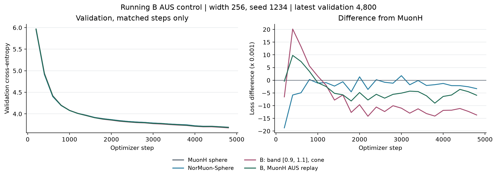
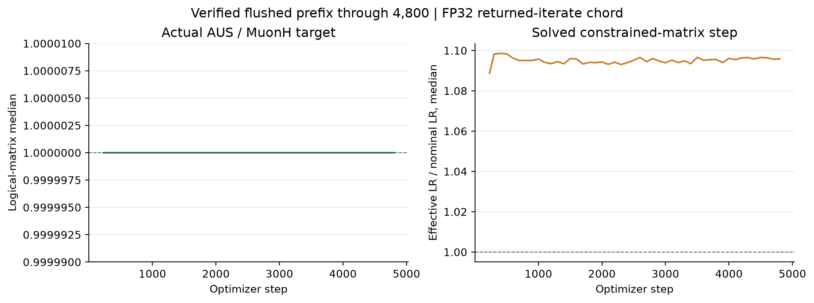

# Running B AUS Replay Progress

**Snapshot: November 25, 2026, 10:56 HKT.** Job **4504355** is running on
one H20. The captured log reaches step 4,820; this readout uses the safely
flushed prefix through **4,800 / 11,445**, or **1.258B processed tokens**.
There is no completed 3B endpoint yet. Training has zero NaNs/skipped updates.

**Interim finding:** matching MuonH's actual matrix-wise AUS removes part
of original B's current advantage, but not all of it. The aligned run is
below MuonH and NorMuon-Sphere at the same step, yet above original B.
The completed A/B study already showed that middle-training wins can
reverse near 2.6B tokens, so this is not a final optimizer ranking.

[Loss curves](#matched-step-validation) | [Replay checks](#replay-precision) |
[Next steps](#next-steps) | [JSON](frobenius_band_aus_progress_20261125/results.json) |
[Validation CSV](frobenius_band_aus_progress_20261125/validation.csv) |
[Completed full 3B A/B](FROBENIUS_BAND_RESULTS_20261125.md)

## Matched Step Validation

All four columns below use **step 4,800**, the same validation schedule and
data order, width 256, seed 1234, nominal peak LR=0.010 and beta=0.95 Nesterov.
Historical full runs are truncated to this prefix for comparison.

| Recipe | Job | Val. at 4,800 | Difference vs. MuonH |
|---|---:|---:|---:|
| Original B, no AUS replay | 4487882 | **3.675631** | -0.013683 |
| B, MuonH AUS replay | 4504355 | 3.683396 | -0.005918 |
| NorMuon-Sphere | 4346666 | 3.685995 | -0.003319 |
| MuonH sphere | 4427413 | 3.689314 | 0 |

The aligned run is 0.007765 above original B and 0.002599 below NorMuon
at this checkpoint. These are single-seed, matched-step observations, not
statistical significance claims.

| Step | Original B | B with MuonH AUS | MuonH |
|---:|---:|---:|---:|
| 3,000 | 3.773680 | 3.779599 | 3.784674 |
| 4,000 | 3.711038 | 3.716522 | 3.722905 |
| 4,800 | 3.675631 | 3.683396 | 3.689314 |



[PDF](frobenius_band_aus_progress_20261125/validation_prefix.pdf).
Only completed validations at or before the verified prefix enter the curves.

## Replay Precision

| Check | Verified through step 4,800 |
|---|---:|
| Logical matrices | 196 |
| Matrix update decisions checked | 940,800 |
| Maximum absolute returned-AUS error | 4.054e-8 |
| RMS returned-AUS error | 7.493e-10 |
| Configured absolute tolerance | 2e-6 |
| Maximum relative between-step norm discontinuity | 0 |
| FP32 norm bounds and finite-value checks | Passed |

The stored targets match the pinned MuonH reference exactly. Across the
checked prefix, matching error is not large enough to explain the observed
loss differences as a failed AUS replay. This conclusion concerns **FP32
master-weight returned chords**, not exact BF16 forward-weight matching.

At step 4,800 the replay's matrix-median AUS/target ratio is **1.000000**,
while its effective LR/nominal LR median is **1.095813**. Original B's
actual AUS/MuonH ratio at that same step was **0.912991**. Both B runs have
median norm/R approximately 1.1. Matching uses individual step/matrix
targets, not a fixed global 1.1 multiplier.



[PDF](frobenius_band_aus_progress_20261125/replay_precision_and_step.pdf).
The near-one left curve is a measured matrix median; the error table checks
all decisions, not just medians. Near-zero initial targets use absolute error.

## Interpretation

**AUS affects this trajectory.** Within B, changing only trial-length
selection reduces its current loss advantage. Step size is therefore a
substantive part of this ablation, not merely a different optimizer label.
The larger angular steps currently hurt relative to original B; whether
they help late training remains the purpose of the full-budget test.

**AUS does not yet explain the whole gap to MuonH.** At the same recorded
AUS, B still has lower validation loss at these milestones. B also differs
in radius constraints and direction construction, so this does not isolate
the Riemannian-gradient-before-LMO effect. Both accepted points and future
gradients evolve differently. Matching one scalar displacement per matrix
does not make the models or directions identical.

**Do not promote a middle-budget win.** Original B led at these steps but
finished at 3.459655, behind MuonH's 3.458490. The present run has not reached
the old reversal region or the predeclared late window.

## Protocol and Data

The replay preserves B's [0.9R,1.1R] annulus, active-boundary source/ray
corrections, unit-F direction, Nesterov combination and auxiliary AdamW.
R=sqrt(D_out). It uses the same 28-layer model, sequence 2048, global batch
128, microbatch 4, 229 warmup updates and 11,445-step cosine horizon.
Effective Polar Express count is 10; the inherited `baseline_msign_steps=8`
field does not control this call path. Constrained-matrix decay is zero.

The only intentional training intervention is solving the trial length from
the **actual post-cone direction** and MuonH's returned-AUS target. It does
not assume the ray is tangent, use a high-precision SVD, add gradient
evaluations, or alter the auxiliary AdamW schedule. One msign call remains
per matrix/update. Invalid rays and matching failures are rejected rather
than hidden by an LR cap.

Source snapshot: `4867f502b3350f25001d6c2d12783ed872ade574`.
Reference: MuonH 4427413; config/AUS hashes are in the JSON. The six-step
CUDA gate 4504354 completed; local optimizer-related checks passed 229 tests.
This readout's separate prefix/comparison regression suite also passed.

The analysis reads the **minimum** of the norm and replay flush counters,
copies only those completed rows, and verifies targets, norm bounds, finite
values, continuity and errors. The remaining preallocated tail is not data.
Training source/arrays were not modified. Full prefix arrays and a frozen
stdout snapshot are backed up locally; compact JSON/CSV and PNG/PDF figures
are published here. This is a dated snapshot, not a live dashboard.

```bash
python scripts/manifold/report_band_aus_progress_20261125.py \
  --results docs/experiments/frobenius_band_aus_progress_20261125/results.json \
  --output /tmp/band-aus-progress-figures
```

## Next Steps

1. **Keep this healthy single-GPU run going.** Inspect around step 9,000
   (~2.36B tokens), then evaluate the existing fixed nine-point late window
   at 10,000:200:11,400 plus 11,445. Do not stop based on the current ranking.
   The snapshot's pace suggests roughly 11 more hours, with shared-node
   variation; this is not a completion guarantee.
2. **Do not add LR/radius/width/6B grids yet.** The immediate question is
   whether AUS matching changes the late reversal, not which new pilot
   happens to win early. No additional jobs were submitted for this readout.
3. **Choose the follow-up after the endpoint.** If aligned B improves on
   MuonH and original B at the endpoint and late mean, replicate a matched
   pair at seed 2026. That requires a seed-2026 MuonH AUS reference; do not
   silently reuse the seed-1234 trace. If no robust gain remains, retain this
   as a mechanism result and prioritize the same-sphere, same-AUS ambient
   versus preprojected-LMO full-budget test for the original paper question.
