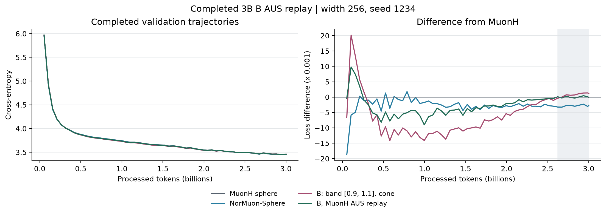
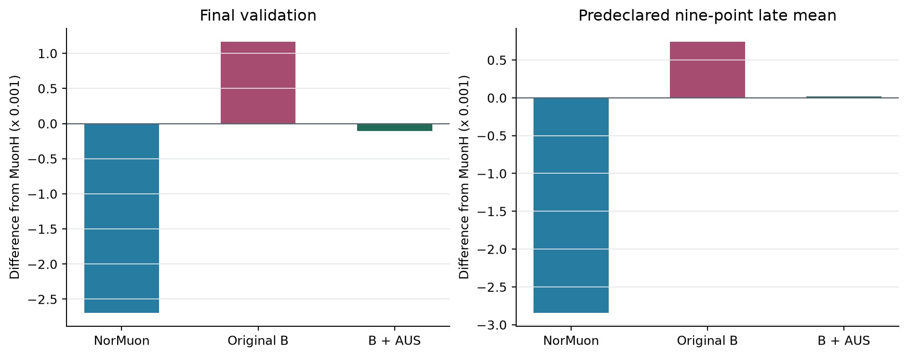
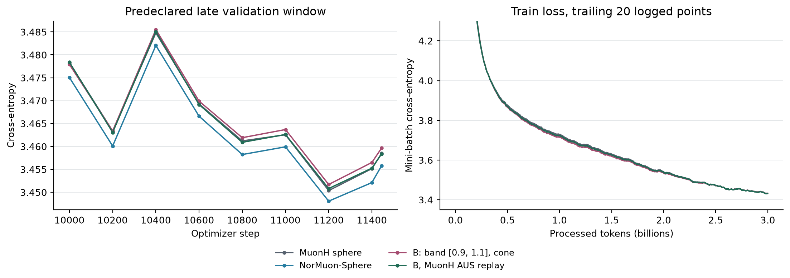
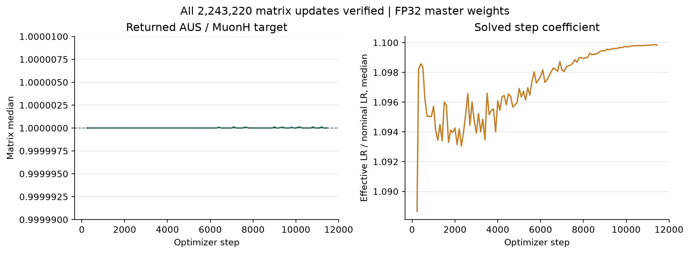

# Completed 3B B AUS Replay

**Verified November 26, 2026, 15:27 UTC+8.** Job **4504355** completed
11,445 updates with exit 0:0, zero NaNs and zero skipped updates, using one
H20 in **18:56:55**. The account queue was empty at the check; home storage
had about 13 GiB free. No new training jobs were submitted for this report.

**Main result:** matching MuonH's matrix-wise angular update size (AUS)
removes most of original B's late loss deficit. The aligned endpoint is
slightly lower than MuonH, but the predeclared late mean is slightly higher.
This is a near-match in one seed, **not an established performance win**.

[Results](#validation) | [Interpretation](#what-the-control-shows) |
[Next tests](#next-tests) | [JSON](frobenius_band_aus_final_20261126/results.json) |
[Validation CSV](frobenius_band_aus_final_20261126/validation.csv) |
[Training CSV](frobenius_band_aus_final_20261126/training.csv)

## Validation

All entries use width 256, seed 1234, 3,000,238,080 processed tokens, the
same data order, beta=0.95 Muon-style Nesterov and nominal peak LR=0.010.
B retains its [0.9R,1.1R] annulus and active-cone corrections; only its
constrained-matrix trial lengths are changed for the replay. R=sqrt(D_out).
Auxiliary AdamW follows the original schedule in every arm.

| Recipe | Job | Final loss | Delta vs. MuonH | Late mean | H20 elapsed |
|---|---:|---:|---:|---:|---|
| **NorMuon-Sphere** | 4346666 | **3.455796** | **-0.002694** | **3.461993** | 18:31:38 |
| B, MuonH AUS replay | 4504355 | 3.458382 | -0.000108 | 3.464850 | 18:56:55 |
| MuonH sphere | 4427413 | 3.458490 | 0 | 3.464835 | 18:30:02 |
| Original B, nominal LR | 4487882 | 3.459655 | +0.001165 | 3.465577 | 18:40:47 |

The late window was fixed before these outcomes: 10,000:200:11,400 plus
11,445. Replayed B wins against MuonH at **4 of 9** evaluations; its late
mean difference is **+0.000015**, RMS paired difference **0.000240**, and
largest absolute paired difference **0.000442**. These correlated evaluations
are not nine independent seeds or a statistical significance test.

MuonH, original B and NorMuon are completed historical controls whose shared
protocols were checked before reuse. NorMuon has additional second-moment
settings and a different source snapshot. This is not a newly randomized
multi-seed study or a globally best-tuned optimizer ranking.



[PDF](frobenius_band_aus_final_20261126/validation_full_3b.pdf).
The shaded region in the difference panel is the fixed late window.



[PDF](frobenius_band_aus_final_20261126/endpoint_and_late_window.pdf).
Negative values favor the treatment. The endpoint alone would overstate
the aligned run's evidence against MuonH.

### Late Validation and Training



[PDF](frobenius_band_aus_final_20261126/late_validation_and_training.pdf).
Training uses a trailing mean of 20 logged mini-batch losses, about 200
updates. Over the final 20 common logged points, steps 11,250--11,440,
MuonH averages **3.431642**, original B **3.432849**, and replayed B
**3.431668**. Late training therefore also nearly matches MuonH; this is
not an observed validation-only penalty. NorMuon training was not
re-collected for this readout and is absent from that panel.

## What the Control Shows

**Actual angular step size matters.** Relative to original B, replay lowers
the endpoint by **0.001273** and the late mean by **0.000726**. It reduces
B's middle-training advantage while avoiding most of B's late shortfall.
The [4,800-step snapshot](FROBENIUS_BAND_AUS_PROGRESS_20261125.md) remains
available as an archival record, not the final conclusion.

**It does not establish a geometric advantage.** The late mean is virtually
the same as MuonH, and NorMuon remains lower by **0.002586** at the endpoint
and **0.002857** in the late mean. B changes the feasible set and direction
rule as well as norms; it is a MuonH-style annulus intervention, not a
theorem-certified MCSD arm. This experiment cannot replace the same-sphere
test of Riemannian-gradient input to the LMO.

**AUS matching is not trajectory identity.** Different weights produce
different gradients and directions even when their scalar angular moves
agree. Matching master-weight AUS does not match BF16 forward displacements,
function-space changes, or all notions of effective learning rate.

## Replay Integrity

AUS here is the normalized chord of each returned **FP32 master matrix**:
`||W_next/||W_next||_F - W/||W||_F||_F`, not the nominal LR or an angle in
radians. The implementation solves each trial length on the actual
post-cone ray, without assuming tangency. The original positive radial
annulus return preserves that angle. See the
[general-ray formula](FROBENIUS_BAND_RESULTS_20261125.md#next-tests).

| Complete-array check | Result |
|---|---:|
| Logical matrices / updates | 196 / 11,445 |
| Matrix decisions verified | 2,243,220 |
| Before/after norm values verified | 4,486,440 |
| Maximum absolute returned-AUS error | 4.054e-8 |
| RMS returned-AUS error | 5.966e-10 |
| Configured absolute tolerance | 2e-6 |
| Maximum relative between-step norm discontinuity | 0 |
| Finite values, bounds, layouts and file hashes | Passed |

At the final update, the matrix-median AUS/target ratio is **1.000000** and
effective LR/nominal LR is **1.099819**. Norm/R ranges from **1.058531** to
**1.100000**; 87.76% of matrices are within 2e-6 of the upper bound. The
norms still differ from MuonH's sphere even though the angular steps agree.



[PDF](frobenius_band_aus_final_20261126/replay_precision_and_steps.pdf).
Curves display sampled matrix medians; the table checks every update.
Near-zero initial targets are checked in absolute error, not relative ratio.

No SVD or extra gradient evaluation was added; each matrix uses one
practical BF16 Polar Express call with **10 iterations**. The inherited
`baseline_msign_steps=8` field is unused on this path. Master weights/states
are FP32, hidden-matrix weight decay is zero, and auxiliary AdamW is unchanged.
Model: 28 layers, FFN 768, 4 query heads / 2 KV groups, head dimension 64;
sequence 2048, global batch 128, microbatch 4, 229 warmup updates and cosine
decay to 10% of peak. The run saved scalar traces, not model checkpoints.

Runtime source: `4867f502b3350f25001d6c2d12783ed872ade574`.
The reference configuration/AUS hashes and complete-array checksums are
published in JSON. Full scalar arrays and stdout are backed up locally and
remain on H20; large raw arrays are not committed to Git. The frozen runtime
and original results were not modified during analysis. The replay took
16:08 longer than original B, about 1.44%, but shared-node full wall times
are not an isolated optimizer microbenchmark.

The readout regression suite passed **40 tests**. All 232 validation records
are released; CPU redraw reproduces the JSON, and all four PNG/PDF pairs
were visually checked. Earlier running-prefix numbers were not overwritten.

Redraw the four PNG/PDF figures on CPU with NumPy and Matplotlib:

```bash
python scripts/manifold/report_band_aus_final_20261126.py \
  --results docs/experiments/frobenius_band_aus_final_20261126/results.json \
  --output /tmp/band-aus-final-figures
```

## Next Tests

1. **Prioritize the missing full-budget same-sphere direction control.**
   Compare `msign(S)` with `msign(P_W S)` under identical post-projection,
   unit-F, sphere return, seed-specific matrix AUS, data and Nesterov input.
   The no-preprojection arm currently stops at 3,000; the always-projected
   full-budget reference is 4427415. Reuse it only after checking source and
   update-arithmetic compatibility; otherwise freeze a fresh matched pair.
   This isolates the paper's direction question better than an annulus grid.
2. **Use a cheap same-state radial-contamination diagnostic.** On the sphere,
   `F_a(W)=F(W)+(a/2)*(||W||_F^2-R^2)` has the same restricted objective but
   ambient gradient `G+aW`. At fixed W and without momentum, preprojection
   removes this normal term before msign; postprojection alone generally
   does not undo msign's nonlinear response. Test both signs and several
   normal/tangent ratios, matching AUS and recording direction cosine and
   held-out loss changes. Separate the high-precision oracle from the
   practical BF16 implementation. Do not extend this fixed-state invariance
   claim to an entire EMA trajectory, whose past normals live at past points.
3. **Defer larger width, 6B and more band/LR grids.** The previously stated
   endpoint-and-late-mean promotion condition was not met. A second-seed
   matched-AUS pair can test reproducibility of the near-match, but is not
   evidence-backed performance promotion. Any seed-2026 replay requires its
   own MuonH reference, not the seed-1234 trace.

These are recommendations, not newly submitted jobs.
