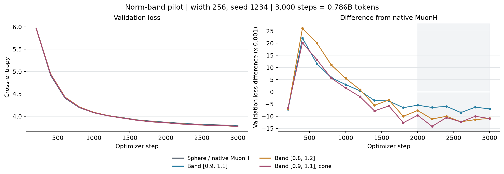
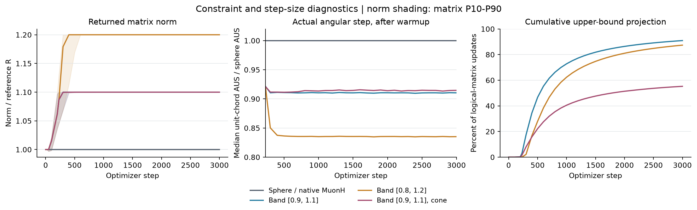
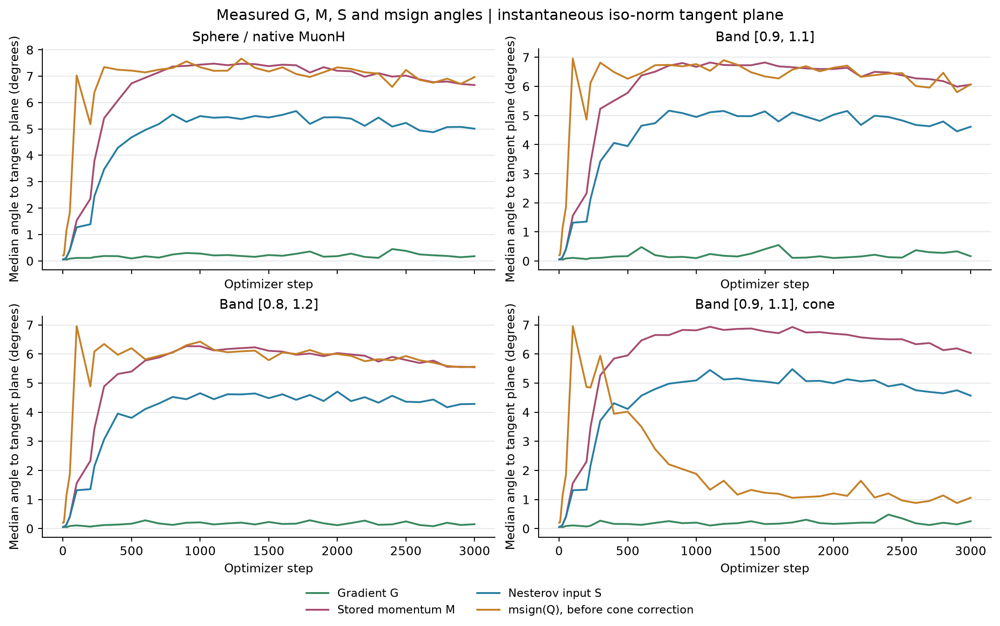

# Frobenius Norm-Band Results

**Verified November 22, 2026.** All four 3,000-step pilots completed on
November 21 with exit 0:0, zero NaNs and zero skipped updates. The account's
Slurm queue was empty at the check. No new training jobs were submitted.

**Takeaway:** permitting radial motion improves this early endpoint, but the
ordinary band arms end up at their upper bounds. This is evidence for a useful
**radius / effective-step intervention**, not yet proof that an annulus or a
new MCSD direction is intrinsically better.

[Results](#results) | [Mechanism](#what-changed) | [Protocol](#locked-protocol) |
[Next tests](#next-tests) | [JSON](frobenius_band_20261122/results.json) |
[Validation CSV](frobenius_band_20261122/validation.csv) |
[All sampled matrices](frobenius_band_20261122/matrix_diagnostics.csv.gz)

## Results

All runs use width 256, seed 1234, beta=0.95 Nesterov and peak LR=0.010.
The reference radius is `R=sqrt(D_out)`. Bounds below are multiples of R.
The budget is **786,432,000 tokens**, using the unchanged 3B learning-rate
horizon; these are **not completed 3B results**.

| Return / direction rule | Job | Val. at 3,000 | Delta vs. sphere | Mean at 2,000--3,000 | Slurm elapsed |
|---|---:|---:|---:|---:|---|
| Sphere, native MuonH | 4479797 | 3.784674 | 0 | 3.821043 | 04:50:47 |
| Band [0.9, 1.1], ambient | 4479798 | 3.777691 | -0.006983 | 3.814432 | 04:53:45 |
| Band [0.8, 1.2], ambient | 4479799 | 3.773764 | -0.010910 | 3.810468 | 04:51:03 |
| Band [0.9, 1.1], active cone | 4479800 | **3.773680** | **-0.010994** | **3.809755** | 04:55:04 |

The predeclared late mean uses six evaluations at 200-step intervals. All
three treatments beat the sphere at **all six** of those evaluations, after
trailing it at several earlier checkpoints. The cone and wider-band endpoints
differ by only **0.000084**; their late means differ by **0.000713**. These
correlated checkpoints are not six independent seeds or a significance test.



[PDF](frobenius_band_20261122/validation_band.pdf).
The shaded window is the predeclared late comparison, not a selected minimum.

### Comparison With Earlier MCSD-TP Pilots

The same-step historical reference is helpful, but its extra tangent
projection and AUS protocol must not be silently pooled with this intervention.

| Historical recipe, width 256 / seed 1234 | Job | Val. at 3,000 | Scope |
|---|---:|---:|---|
| MCSD-TP + unit-F, nominal LR | 4427414 | 3.779607 | Full 3B run, prefix shown here |
| MCSD-TP + unit-F, matched MuonH AUS | 4427415 | 3.777498 | Full 3B run, prefix shown here |
| Native MuonH | 4427413 | 3.784674 | Full 3B run, prefix shown here |

The new sphere control reproduces **all 15** old MuonH validation values
through step 3,000 exactly at printed precision. This checks the control
trajectory, evaluation order and opt-in adapter. It does not prove bitwise
equality of all hidden states. The new cone endpoint is 0.003818 below the
old replayed MCSD-TP prefix, but this is **not an AUS-matched direction test**.
At the full 3B endpoint, that old replay finishes at 3.462119, versus
3.458490 for MuonH. Early improvements have reversed before.

## What Changed

### The Band Mostly Becomes an Upper-Radius Constraint

| Arm | Returned norm / R at 3,000, min--max | Upper projections / all updates | Lower projections |
|---|---|---:|---:|
| Narrow ambient | 1.100000--1.100000 | 90.92% | 0 |
| Wider ambient | 1.200000--1.200000 | 87.36% | 0 |
| Narrow active cone | 1.098956--1.100000 | 55.24% | 0 |

Counts use **588,000 logical-matrix updates** per run (196 matrices x 3,000),
not optimizer steps or PGD branch decisions. The cone arm's lower projection
frequency does not mean more interior exploration: most final matrices are
still close to the upper bound. The lower band limits were never activated.
Consequently, these runs do not identify a useful lower bound or establish
that maintaining a broad interior is the source of the gain.

During updates 2,001--3,000, **every** ordinary-band trial required an
upper projection. The corresponding cone-arm rate was **62.93%**. That is
stronger evidence of upper-bound operation than a final norm snapshot alone.



[PDF](frobenius_band_20261122/norm_and_aus.pdf).
Norm shading is P10--P90 **across matrices**, not uncertainty across seeds.
The AUS-ratio panel starts at the end of warmup (229); near-zero early
displacements make relative ratios ill-conditioned. All early samples
remain in the released data.

### Equal Nominal LR Does Not Mean Equal ELR or AUS

All arms keep the absolute trial length at `eta_t * R`, where R is the
**fixed reference radius**, not the current matrix norm. Therefore

```text
trial ELR = ||Y - W||_F / ||W||_F = eta_t * R / ||W||_F
AUS       = ||W_next / ||W_next||_F - W / ||W||_F||_F
```

At the upper bound, narrow-band trial ELR is approximately `eta_t / 1.1`,
and wider-band trial ELR is `eta_t / 1.2`. Radial motion and the cone
correction further affect actual AUS. Here AUS is a unit-normalized **chord**;
the corresponding angle is `2*asin(AUS/2)`. It excludes pure norm changes.
Both the angular displacement and `||W_next-W||_F/||W||_F` are released.

| Arm | Trial ELR / sphere, median at 3,000 | Actual AUS / sphere, paired median |
|---|---:|---:|
| Sphere | 1.0000 | 1.0000 |
| Narrow ambient | 0.9091 | 0.9104 |
| Wider ambient | 0.8333 | 0.8351 |
| Narrow active cone | 0.9091 | 0.9146 |

Ratios pair the same logical matrices and step across trajectories before
aggregation; they are not ratios of pooled averages. The zero-LR first
update has no defined 0/0 ratio and is left null.

Thus the experiment changes the feasible set, the realized parameter norm
and the effective step. It cannot establish that the gain is exclusively
geometric. The cone correction may preserve more of the trial budget for
tangential motion, but that explanation still needs matched-AUS testing.

### G, M, S and msign Are Now Measured Through Step 3,000



[PDF](frobenius_band_20261122/momentum_and_msign_angles.pdf).
These are measured acute angles to the instantaneous iso-norm tangent plane:
`asin(|<W,Z>| / (||W||_F ||Z||_F))`, in degrees. In the band interior that
plane is a diagnostic reference, **not the feasible tangent space**, which
is the whole ambient space.

G remains close to that plane while M and the Nesterov input S depart from
it. The msign output can be more radial than its input. The cone panel uses
the **actual corrected input Q** and measures msign(Q) before the final
cone correction. Do not interpret it as the angle of the final update ray.
This figure extends actual msign measurements to 3,000, not to the older
9,000-step observer, which did not record msign angles.

| Arm | G | M | S | msign(Q) |
|---|---:|---:|---:|---:|
| Sphere | 0.176 | 6.662 | 5.010 | 6.965 |
| Narrow ambient | 0.165 | 6.062 | 4.615 | 6.069 |
| Wider ambient | 0.149 | 5.546 | 4.283 | 5.563 |
| Narrow active cone | 0.253 | 6.034 | 4.568 | 1.058 |

Values are matrix-median angles in degrees at step 3,000. The smaller
cone-arm polar angle is consistent with its boundary source correction;
it does not, by itself, establish better descent or generalization.
At this step the cone arm's corrected input Q has median angle about
`5.2e-7` degrees, whereas msign(Q) has 1.058 degrees: even a nearly tangent
input does not make the polar output tangent. The second cone correction
is therefore not generally redundant.

## Locked Protocol

| Item | Setting |
|---|---|
| Model | 28 decoder blocks; width 256; FFN 768; 4 Q heads / 2 KV groups; head dimension 64 |
| Tokens | Sequence 2,048; global batch 128; microbatch 4; 786,432,000 processed tokens |
| Data | Same existing 3B train index, validation set and order as the reference |
| Schedule | Peak 0.010; 229 warmup steps; 11,445-step cosine horizon to 10%; exit at 3,000 |
| Momentum | EMA beta=0.95, followed by Muon-style Nesterov gradient combination |
| Auxiliary parameters | AdamW, peak LR=0.001; same routing and schedule in all arms |
| Precision | BF16 model and practical ten-step Polar Express; FP32 master/state |
| Matrix decay | Zero for constrained hidden matrices |
| Initialization | Same weights at norm R in every arm; r=1 |
| Validation | 40 batches every 200 steps; not an early-stop-selected checkpoint |
| Resources | One H20 per run; four concurrent pilots; no new data or checkpoints |

**Iteration-count clarification:** the inherited config contains
`baseline_msign_steps=8`, but this MuonH/band path calls
`_polar -> polar_express_msign` with its **default 10 iterations**. The
eight-step option is not passed along this path. This was checked against
the actual frozen H20 source and hashes; the effective count is explicitly
recorded in the release rather than inferred from the unused config field.

### Actual Update

```text
M <- beta*M + (1-beta)*G
S <- beta*M + (1-beta)*G
Q <- S                                 # ambient arm
Q <- -Pi_cone(-S)                       # cone arm instead
H <- practical_msign(Q)
V <- -H
V <- Pi_cone(V)                         # cone arm only
D <- V / ||V||_F                        # zero ray remains zero
Y <- W + eta_t * R * D
W_next <- Y * clamp(||Y||_F, R1, R2) / ||Y||_F
```

For nonzero Y the return is its Frobenius metric projection onto the
**closed** annulus. At Y=0 a previous nonzero ray selects one of the nearest
points at radius R1. An open strict interval need not admit a nearest point.

At the upper boundary, `Pi_cone` removes only outward radial descent;
at the lower boundary it removes only norm-decreasing descent. Interior
descent is unmodified. Boundary activity tolerance is `8*eps(FP32)*R`.
The cone arm corrects both the source and the post-msign ray, since the
nonlinear polar map need not preserve the cone. It is an **exploratory
cone-polar heuristic**, not an exact cone-constrained LMO or an unchanged
sphere MCSD convergence result. The sphere control calls the native MuonH
update, preserving its arithmetic rather than reimplementing it.

### Integrity and Reproduction

Four six-update CUDA gates (4479793--4479796) passed before the pilots.
The earlier local related regression suite passed 180 checks. This readout
also verifies the complete **28,224-row** diagnostic grid, sampled FP32
feasibility to `2e-6*R`, cumulative clip denominators, finite measurements,
matching model/training/numerical settings, and the old validation prefix.
The BF16 forward copy is not asserted to satisfy exact real-valued bounds.

The frozen H20 source snapshot is
`aecb7ad5c910f04e5c9030ebdc06605f7fa597b4`; it is a runtime provenance ID,
not a claim that this commit is available in the public GitHub history.
Relevant source hashes and stdout/diagnostic hashes are in the released
JSON. The nominal registry optimizer is `manifold_muonh` for every arm;
the **frobenius_band configuration** identifies the actual intervention.
The data release is sufficient to redraw and reanalyze the results; it does
not contain model checkpoints or the private runtime environment.

From the repository root, with matplotlib >=3.7 installed:

```bash
python scripts/manifold/report_frobenius_band_20261122.py \
  --results docs/experiments/frobenius_band_20261122/results.json \
  --output /tmp/frobenius-band-figures
```

Slurm elapsed in the table includes allocation/startup, training and
evaluation. Process time is also released. Differences of a few minutes
on shared nodes are not optimizer-only speed measurements.

## Next Tests

1. **Complete the budget before expanding the grid.** Run the narrow cone
   and wider ambient recipes from initialization through the full 3B
   schedule, retaining the verified native MuonH reference. Prefer these
   two to many new widths/band limits: their short endpoints are tied,
   and the wider ambient arm changes fewer algorithmic operations.
2. **Separate norm from angular-step effects.** Record every matrix's
   norm and AUS in the next reference, then add a sphere AUS-matched
   control. A larger fixed-radius sphere is another useful recipe control,
   but document its different initialization; it is not a pure causal
   control. Current diagnostics are sampled, not a complete every-step
   replay trace. Do not interpolate them and call it exact replay.
3. **Replicate only a lasting effect.** If the 3B gain survives, compare
   the selected recipe against MuonH and NorMuon-Sphere at seed 2026,
   with matched tuning budgets. Do not move directly to 6B or a width grid.

For the original question about Riemannian-gradient-before-LMO, retain
the separate full-budget ambient-versus-projected, matched-AUS experiment
in the [November 19 plan](FROBENIUS_RESULTS_20261119.md). The annulus pilot
does not replace that test. **All follow-ups above are proposals, not newly
submitted jobs.** No pilot checkpoint exists; full-budget tests must restart
from the frozen initialization.
