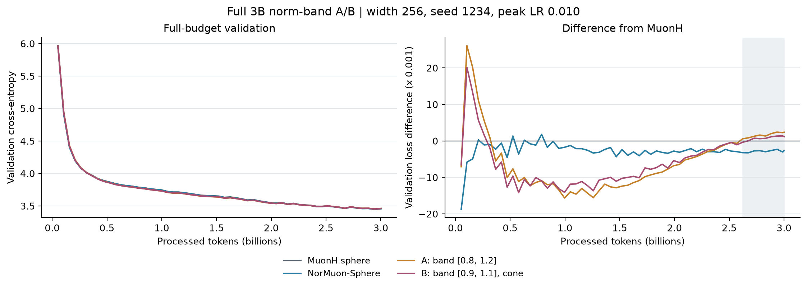
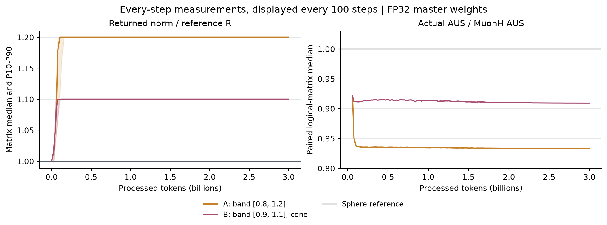
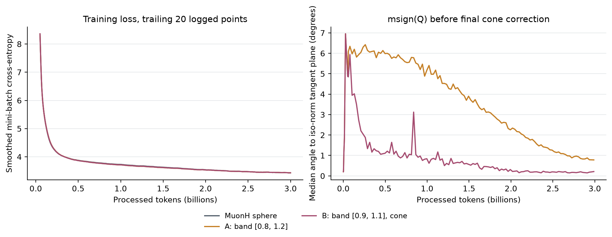

# Full 3B Norm-Band Results

**Verified November 25, 2026.** A/B completed on November 23 with exit 0:0,
zero NaNs and zero skipped updates. Both used one H20. The account queue
was empty at the check; about 15 GiB remained on the home filesystem.

**Conclusion:** the pilot's advantage does **not** survive the full 3B
endpoint or the predeclared late window. B is the better of the two band
recipes, but neither beats MuonH or NorMuon-Sphere under the tested setting.
The complete scalar trajectories are valid and ready for an AUS control.

[Validation](#validation) | [Diagnostics](#norm-and-aus-diagnostics) |
[Next tests](#next-tests) | [JSON](frobenius_band_20261125/results.json) |
[Validation CSV](frobenius_band_20261125/validation.csv) |
[Training CSV](frobenius_band_20261125/training.csv) |
[Every-step summaries](frobenius_band_20261125/every_step_summaries.csv.gz)

## Validation

Width 256, seed 1234, peak LR=0.010, beta=0.95 Nesterov, same model/data
order and auxiliary AdamW. Each run processes **3,000,238,080 tokens** over
11,445 updates. R=sqrt(D_out); A uses the ordinary [0.8R, 1.2R] annulus
return, while B uses [0.9R, 1.1R] with active-boundary source/ray corrections.
These are MuonH-style annulus interventions, not theorem-certified MCSD
variants. See the [pilot protocol](FROBENIUS_BAND_RESULTS_20261122.md#locked-protocol).

| Method / recipe | Job | Final val. loss | Delta vs. MuonH | Late mean | H20 elapsed |
|---|---:|---:|---:|---:|---|
| **NorMuon-Sphere** | 4346666 | **3.455796** | **-0.002694** | **3.461993** | 18:31:38 |
| MuonH sphere | 4427413 | 3.458490 | 0 | 3.464835 | 18:30:02 |
| B: narrow band + active cone | 4487882 | 3.459655 | +0.001165 | 3.465577 | 18:40:47 |
| A: wider band, ordinary update | 4487881 | 3.460861 | +0.002371 | 3.466465 | 18:35:59 |

The late mean was fixed **before results**: steps 10,000, 10,200, 10,400,
10,600, 10,800, 11,000, 11,200, 11,400 and 11,445. A loses to MuonH at
all nine; B wins at one and loses at eight. B improves on A by 0.001206
at the endpoint and 0.000888 in this window. This is one seed, not a
statistical significance test or a best-tuned optimizer ranking.

MuonH and NorMuon-Sphere are historical, matched-recipe baselines, not new
jobs in this batch. Model, numerical settings, radius initialization, token
budget, data/tokenizer paths, batch sizes, schedule and shared training
settings were checked before reuse. NorMuon has its own additional second-
moment settings and a different source snapshot. The complete public
[baseline ledger](frobenius_3b_6b/latest_batch_20261029.json) remains available.
The MuonH elapsed time here belongs to reference job 4427413, not an older
run with the same final loss. Times include startup and evaluation.



[PDF](frobenius_band_20261125/validation_full_3b.pdf).
Shading marks the predeclared late window. Negative differences favor the
treatment. Both treatments lead through much of training before reversing.

### Where the Ranking Reverses

| Recipe | Pilot loss at 3,000 | Last logged win vs. MuonH | Subsequent validation |
|---|---:|---|---|
| A | 3.773764 | 9,800 (~2.569B tokens) | All nine remaining evaluations lose |
| B | 3.773680 | 10,000 (~2.621B tokens) | All eight remaining evaluations lose |

These are discrete validation observations, not exact continuous crossover
times. Each full run reproduces **all 15 pilot validation values** through
step 3,000 at printed precision. Thus the reversal is not explained by an
observed change to that prefix after enabling the every-step recorder.

For context, the earlier full-budget MCSD-TP + unit-F nominal-LR run ends
at 3.461894, and its MuonH-AUS replay at 3.462119. B is below those two
endpoints, but changing the constraint and direction rule is not a controlled
test proving an advantage of the original MCSD/MCSD-TP framework.

## Norm and AUS Diagnostics

| Measurement at 11,445 | A: ordinary wide band | B: narrow cone band |
|---|---:|---:|
| Median norm/R | 1.200000 | 1.100000 |
| Norm/R min--max | 1.164788--1.200000 | 1.062220--1.100000 |
| Matrices within 2e-6 of upper bound | 92.86% | 84.69% |
| Actual AUS / MuonH AUS, paired median | 0.83338 | 0.90924 |

AUS is measured on **returned FP32 master matrices**:
`||W_next/||W_next||_F - W/||W||_F||_F`. It is a normalized chord, not
nominal LR or an angle in radians. Ratios pair the same logical matrix and
step across different trajectories; they are not a same-state direction test.



[PDF](frobenius_band_20261125/norm_and_aus_full_3b.pdf).
The plot displays matrix medians/P10--P90 every 100 steps, while recording
is every step. Shading is matrix heterogeneity, not uncertainty across seeds.

The absolute trial budget is eta_t*R, with fixed reference R. As norms grow
to about 1.2R or 1.1R, relative trial lengths approach eta_t/1.2 or eta_t/1.1.
Late actual AUS closely follows these ratios. This makes a step-size
explanation **plausible**, but the experiment also changes norms, feasible
sets and trajectories; it does not establish AUS as the sole cause.

The last cumulative clip summary is at **11,400**, not 11,445: A has 95.26%
upper projections and B 66.05%, out of 2,234,400 matrix updates. Neither
has a lower projection through that sampled summary. Do not label those
counts as final-step clip rates or PGD rates. Complete norm/AUS arrays do
extend through 11,445.

### Training and Polar Direction



[PDF](frobenius_band_20261125/training_and_polar_angles.pdf).
Training curves use a trailing average of 20 logged mini-batch losses
(about 200 updates), not validation losses. Over the final 20 common logged
points ending at 11,440, MuonH averages **3.431642**, A **3.433768**, and
B **3.432849**. Training and validation both slightly favor MuonH late;
the measurements do not show a validation-only overfitting penalty for A/B.
The training CSV/plot includes MuonH and A/B; NorMuon training logs were not
re-collected for this readout.

At sampled step 11,400, the median msign-output angles are **0.782 degrees
for A** and **0.212 degrees for B**, before B's final cone correction.
B's actual corrected input Q is nearly tangent (about 6.1e-8 degrees), but
the practical polar output is not exactly tangent. Better tangency alone
does not imply lower validation loss at equal nominal LR.

The angle is relative to the instantaneous **iso-norm plane**. In the band
interior this is only a diagnostic plane, not the feasible tangent space,
which is the whole ambient space. No full-budget native MuonH msign angle
was reconstructed from old logs.

## Integrity and Data

- Both main receipts have process/training exit 0, zero NaNs and zero skipped
  iterations. Both six-step CUDA/pretraining gates passed beforehand.
- Every run contains **2,243,220 AUS values** and **4,486,440 norm values**:
  11,445 updates x 196 matrices, with before/after norms. All values are
  finite, FP32 norm bounds pass, hashes match and norm-continuity error is zero.
- The AUS matrix layouts match the reference's logical matrices exactly.
  An incomplete preallocated array is not accepted as a complete reference.
- Runtime snapshot: `939b4edf2af70d2ec5ba6bcf0579870f019fa124`.
  Effective practical Polar Express count is **10**, not the inherited unused
  `baseline_msign_steps=8` field. Relevant hashes are in the JSON.
- Full per-matrix arrays and logs remain on H20 and are backed up in the
  local analysis archive. They are not removed or committed as large Git
  artifacts. Published CSV summaries preserve **all 22,890 A/B time steps**,
  aggregated across matrices; the JSON also contains group endpoint summaries.
- PNG/PDF figures can be redrawn from the released JSON without GPUs:

```bash
python scripts/manifold/report_frobenius_band_20261125.py \
  --results docs/experiments/frobenius_band_20261125/results.json \
  --output /tmp/frobenius-band-full-figures
```

## Next Tests

**Priority 1: one full-budget B run matched to MuonH's actual matrix-wise
AUS.** Keep B's [0.9R,1.1R] constraint, initialization, direction construction,
momentum, data order and auxiliary AdamW fixed. Only solve each constrained
matrix's trial length to match the already-recorded reference 4427413.
This asks whether B's smaller angular steps contribute to the late shortfall.
The reverse sphere-to-B replay is a useful alternative, not another mandatory
grid. Do one direction first.

Implementation must use the **actual post-cone unit descent ray v**, not
assume it is tangent. With q=W/||W||, a=<q,v>, b=sqrt(1-a^2), target chord c,
and theta=2*asin(c/2):

```text
tau   = sin(theta) / (b*cos(theta) - a*sin(theta))
alpha = ||W|| * tau
Y     = W + alpha*v
Z     = the original annulus return of Y
```

For a nonzero trial, the positive radial annulus return does not change its
angle. Handle zero targets and nonpositive/degenerate denominators explicitly;
do not silently clip and claim exact matching. Check the returned FP32 chord
with the existing 2e-6 absolute tolerance, keep one msign evaluation per matrix,
and record errors. A six-step gate is an engineering check, not a short-run
performance selection. The full budget matters because the present ordering
reverses after 2.5B tokens. This control still requires implementation and
testing; the old tangent-only replay formula is not a drop-in replacement.

If matching restores an advantage, replicate against MuonH/NorMuon at a
second seed. If it does not, stop expanding the band grid and retain this as
a mechanism/negative result rather than adding 6B or larger widths.

**Priority 2, for the original paper question:** finish the full-budget
ambient-versus-preprojected LMO comparison on the **same sphere**, with
identical post-projection, unit-F, return and actual AUS. The existing
3,000-step matched-AUS results are not a full-budget answer about the
Riemannian-gradient mechanism. Annulus performance cannot replace that test.

**No new tasks were submitted in this readout.**
