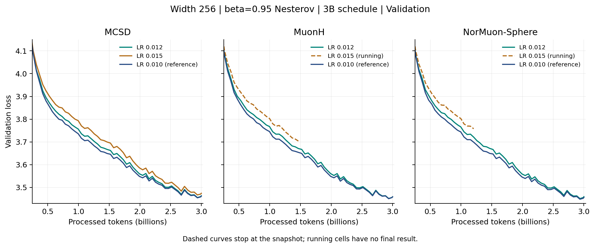
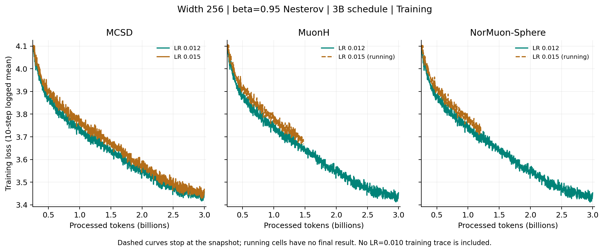
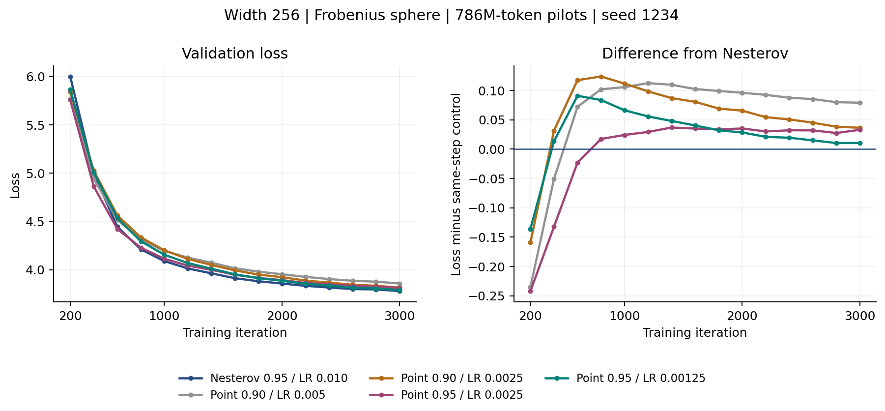

# Frobenius Results: November 4, 2026

**Snapshot: 17:07 HKT (UTC+8). Six of eight jobs completed; two still running.**
All eight have zero logged NaN/skipped iterations. This is a dated readout,
not a live dashboard. No new training jobs or cancellations accompanied this report.

[Overview](FROBENIUS_3B_6B_SUMMARY.md) |
[Submission protocol](FROBENIUS_POINT_LR_BATCH_20261102.md) |
[Measurements and provenance](frobenius_point_lr_20261104/results.json)

## Main Findings

- **Increasing the LR did not improve completed 3B results.** Under beta=0.95
  Nesterov, LR=0.010 remains the best completed tested LR for all three methods.
  The MuonH and NorMuon-Sphere LR=0.015 cells are not finished.
- **Point extrapolation is closer, but has not won.** Cap=0.95/LR=0.00125
  reaches 3.788594 at step 3000, versus 3.778030 for Nesterov: +0.010564.
- **No method-level superiority or statistical significance is established.**
  These are seed-1234 configuration comparisons; lower LR changes the point
  variant as well as its momentum mechanism.

## Complete 3B LR Comparison

Width 256, Frobenius radius r=1, beta=0.95 Nesterov, seed 1234. All cells use
the same model, OLMo indices, auxiliary AdamW, 11445-step horizon and validation
protocol. Report the final validation at **11445**, not the minimum along a curve.

| Method | LR=0.010 reference | LR=0.012 | LR=0.015 |
|---|---:|---:|---:|
| MCSD | **3.461687** | 3.463020 | 3.474075 |
| MuonH | **3.458490** | 3.458744 | Running |
| NorMuon-Sphere | **3.455796** | 3.458990 | Running |

Relative to the same-method LR=0.010 reference, LR=0.012 changes loss by
+0.001333 (MCSD), +0.000254 (MuonH), and +0.003194 (NorMuon-Sphere).
MCSD LR=0.015 is worse by +0.012388. The MuonH difference at 0.012 is small;
one seed is insufficient to distinguish a reproducible effect from variation.
This is a local LR scan, not proof of a global optimum. Earlier LR=0.015/0.020
experiments used different momentum settings and remain in the historical ledger.



[Vector validation figure](frobenius_point_lr_20261104/lr_grid_validation.pdf).
The view starts at 0.25B tokens; all earlier measurements remain in JSON.
Dashed curves stop at the observed snapshot; no endpoint is extrapolated.

| Job | Method / LR | Status | Last train step | Final or latest val. | Wall time |
|---:|---|---|---:|---|---|
| 4375562 | MCSD / 0.012 | Completed | 11440* | **3.463020 @11445** | 18:29:52 |
| 4375563 | MuonH / 0.012 | Completed | 11440* | **3.458744 @11445** | 18:24:33 |
| 4375564 | NorMuon-Sphere / 0.012 | Completed | 11440* | **3.458990 @11445** | 18:26:51 |
| 4375565 | MCSD / 0.015 | Completed | 11440* | **3.474075 @11445** | 18:35:39 |
| 4375566 | MuonH / 0.015 | Running | 5630 | 3.703447 @5600 | 09:07:32 elapsed |
| 4375567 | NorMuon-Sphere / 0.015 | Running | 4610 | 3.757840 @4600 | 07:27:10 elapsed |

*Training is logged every ten steps: the last training log is 11440, while
the successful final validation and completion record confirm all 11445 steps.
The running cells must not be compared with completed 3B endpoints.

For matched-step context, MuonH LR=0.015 is +0.049669 above its LR=0.010
reference at step 5600 (3.703447 vs 3.653778). NorMuon-Sphere LR=0.015 is
+0.059127 above its LR=0.010 reference at step 4600 (3.757840 vs 3.698713).
Neither establishes the final ranking; both jobs remain running.

<details>
<summary>Training curves and final logged-window averages</summary>



[Vector training figure](frobenius_point_lr_20261104/lr_grid_training.pdf).
These are the logged ten-step averages with no additional smoothing. This
figure includes only the new LR=0.012/0.015 runs; the old LR=0.010 training
trace was not imported. The final ten logged windows (ending 11350--11440)
average 3.439686 / 3.435940 / 3.435569 for MCSD / MuonH / NorMuon-Sphere at
LR=0.012, and 3.451317 for MCSD at LR=0.015. These are training losses,
not the reported validation endpoint or an independent held-out metric.

</details>

## Point Extrapolation at Step 3000

All rows process **786,432,000 tokens** and retain the full 3B cosine horizon.
Point variants use live extrapolated Y, an accepted X buffer and **no gradient
EMA**. Ordinary validation evaluates Y. The cap is not a gradient-EMA beta.

| Configuration | Peak LR | Val. @3000 | Difference from Nesterov | Total job time to 3000 |
|---|---:|---:|---:|---|
| Nesterov beta=0.95 | 0.01000 | **3.778030** | 0 | 04:54:13 |
| Point cap=0.90 | 0.00500 | 3.857235 | +0.079205 | 04:54:59 |
| Point cap=0.90 | 0.00250 | 3.814502 | +0.036472 | 04:55:12 |
| Point cap=0.95 | 0.00250 | 3.811040 | +0.033010 | 04:54:26 |
| Point cap=0.95 | 0.00125 | **3.788594** | **+0.010564** | 04:52:33 |

Times sum original and continuation job durations, excluding queue time.
Resumed rows incur an extra startup/checkpoint cycle; this is not an isolated
optimizer-overhead benchmark. New jobs 4375560 and 4375561 completed with exit
0:0 in 03:15:32 (additional 2000 steps) and 04:52:33 (fresh 3000 steps).



[Vector point figure](frobenius_point_lr_20261104/point_validation_3000.pdf).
The cap=0.95/LR=0.00125 gap shrinks from +0.066324 at step 1000 to +0.028507
at 2000, +0.015074 at 2600, +0.010462 at 2800 and +0.010564 at 3000.
It has not crossed the control, and the final two points do not show continued
gap reduction. Validation batches advance, so comparisons use the same step.

## Next Decisions

1. **Finish the two running LR=0.015 cells.** Preserve the complete tuning
   ledger rather than infer their endpoints from earlier steps.
2. **Keep LR=0.010 / beta=0.95 Nesterov as the current MCSD reference.**
   Prioritize paired seeds and a matched normalization/row-adaptation ablation
   over another broad upward LR sweep. MCSD-NorUnit remains unsubmitted.
3. **Only consider a bounded continuation for point cap=0.95/LR=0.00125.**
   A same-horizon extension to step 6000 with X/Y diagnostic evaluation is
   a candidate, not an already submitted task. It would test catch-up without
   assuming a 6B win. Do not promote the worse point configurations automatically.
4. **Defer larger widths and 6B point runs.** First establish persistent gains
   at equal tokens and report wall time, paired seeds, and the selected LR budget.

## Audit and Reproduction

The JSON contains 18 job segments: six original pilots, four earlier follow-ups,
and this eight-job batch, plus three LR=0.010 full-budget reference traces.
It records configurations, source/config/stdout hashes, train/validation series,
accounting states, completion evidence and logged health counters. Resume
segments are stitched by iteration with duplicate-point rejection.

The new-runtime Nesterov control matches the old full-3B MCSD LR=0.010
reference at **all 15 reported validation checkpoints through step 3000**.
This checks the recorded values, not bitwise equality of entire training states.
The older exact 16-step resume test is documented separately in the pilot report.

Frozen H20 source: `8250d00f9a36832bd6fd7198fe2e2b5d3787b7b3`.
The report does not claim that all frozen training integration has been released
on this branch. Only result/documentation/CPU-reporting files are updated here.

Redraw all three figures without the server, Torch or the training dataset:

```bash
python -m pip install matplotlib
python scripts/manifold/report_point_lr_batch.py \
  --data docs/experiments/frobenius_point_lr_20261104/results.json \
  --out /tmp/frobenius-nov4-figures --plot
python -m unittest discover -s tests -p test_point_lr_report.py -v
```
