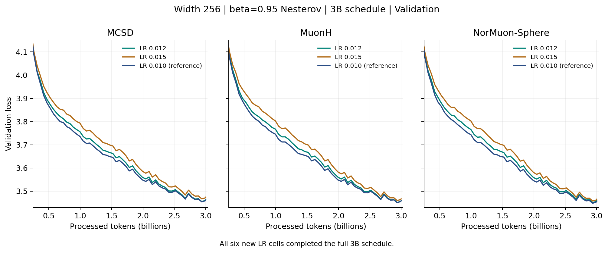
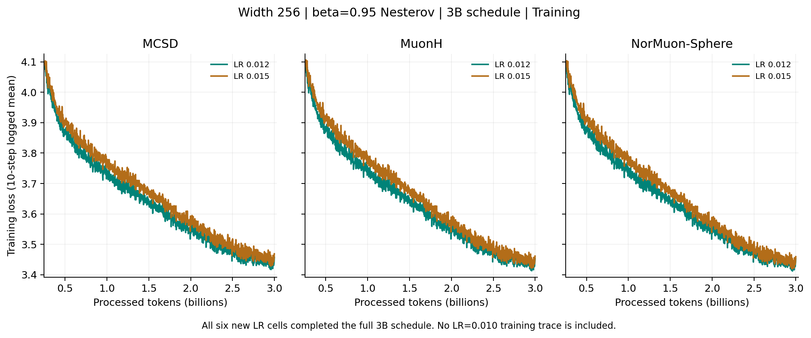
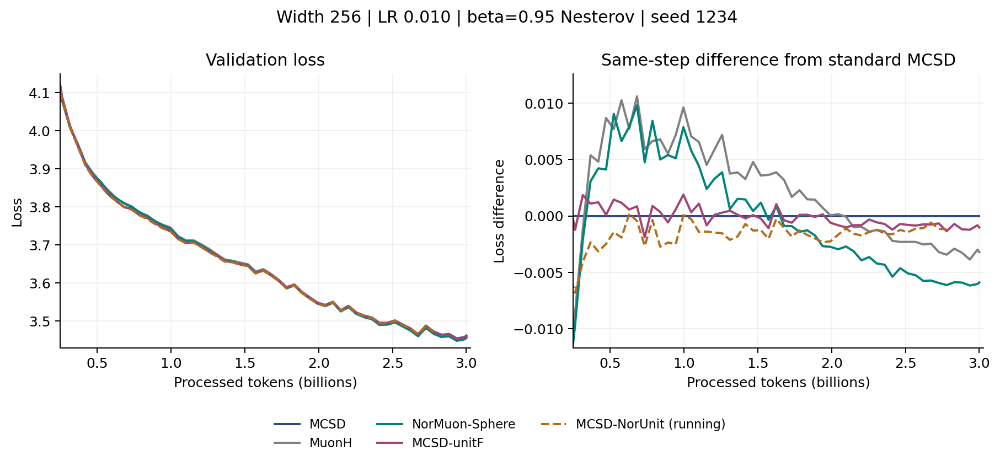

# Frobenius Results November 5 2026

**Snapshot: 15:10 HKT (UTC+8).** The six new learning-rate cells and MCSD-unitF
have completed 3B training. MCSD-NorUnit is still running; the two second-seed
baselines are pending. Completed runs and running partial curves remain separate.

[Overview](FROBENIUS_3B_6B_SUMMARY.md) |
[Previous snapshot](FROBENIUS_RESULTS_20261104.md) |
[Raw curves and provenance](frobenius_results_20261105/results.json)

## Main Findings

- **LR=0.010 wins the completed local grid for all three methods.** Neither
  0.012 nor 0.015 improves MCSD, MuonH or NorMuon-Sphere under beta=0.95 Nesterov.
- **Unit-F improves MCSD by 0.001022 at seed 1234.** Its final loss is 3.460665,
  still above MuonH (3.458490) and NorMuon-Sphere (3.455796).
- **Row adaptation has not shown an additional gain at the latest common
  checkpoint.** At step 10600, NorUnit is 0.000169 above unitF. This is an
  intermediate comparison, not a final ranking or a statistical conclusion.

## Complete Learning Rate Grid

Width 256, 3B tokens, beta=0.95 Nesterov, seed=1234, Frobenius
`R=sqrt(D_out)`. All values are final validation at **step 11445**, not the
minimum along the training curve. Model, data, auxiliary AdamW and evaluation
protocol are matched.

| Method | LR=0.010 reference | LR=0.012 | LR=0.015 |
|---|---:|---:|---:|
| MCSD | **3.461687** | 3.463020 | 3.474075 |
| MuonH | **3.458490** | 3.458744 | 3.466872 |
| NorMuon-Sphere | **3.455796** | 3.458990 | 3.465047 |

The LR=0.015 differences from each method's LR=0.010 reference are +0.012388,
+0.008382 and +0.009251, respectively. This completes the requested upward
LR scan; it does not establish a global optimum. Older grids used different
momentum settings and remain in the [historical ledger](FROBENIUS_3B_6B_HISTORY.md).



[Vector figure](frobenius_results_20261105/lr_grid_validation.pdf).
The displayed range starts at 0.25B tokens; earlier measurements remain in JSON.

| Job | Method | Peak LR | Final loss | H20 wall time |
|---:|---|---:|---:|---|
| 4375562 | MCSD | 0.012 | 3.463020 | 18:29:52 |
| 4375563 | MuonH | 0.012 | 3.458744 | 18:24:33 |
| 4375564 | NorMuon-Sphere | 0.012 | 3.458990 | 18:26:51 |
| 4375565 | MCSD | 0.015 | 3.474075 | 18:35:39 |
| 4375566 | MuonH | 0.015 | 3.466872 | 18:31:33 |
| 4375567 | NorMuon-Sphere | 0.015 | 3.465047 | 18:27:41 |

All six have scheduler exit 0:0, a successful completion record and final
validation at step 11445. The last regular training log is 11440 because
training statistics are logged every ten steps. Logged NaN/skipped counts are zero.

<details>
<summary>Training curves</summary>



[Vector training figure](frobenius_results_20261105/lr_grid_training.pdf).
These are logged ten-step means, without additional smoothing. The figure
contains the six new LR=0.012/0.015 runs; no old LR=0.010 training trace is included.

</details>

## Normalization and Row Adaptation

The same width/budget/momentum protocol applies, with peak LR=0.010.
MCSD-unitF changes only the global trial-direction normalization. NorUnit adds
row-wise second-moment scaling before the unit-F normalization; it is an
adaptive extension, not the unchanged spectral-norm-ball LMO.

| Job | Method | Seed | State | Final or latest validation | Elapsed |
|---:|---|---:|---|---|---|
| 4390468 | MCSD-unitF | 1234 | Completed | **3.460665 @11445** | 18:36:31 |
| 4390469 | MCSD-NorUnit | 1234 | Running | 3.471547 @10600 | 17:13:31 |
| 4390470 | MuonH | 2026 | Pending | Not available | Not started |
| 4390471 | NorMuon-Sphere | 2026 | Pending | Not available | Not started |

At the snapshot, NorUnit has logged training through step 10610 with zero
NaN/skipped iterations. The baseline jobs retain their serial-lane dependencies;
their pending state is not a training failure.

**Aligned checkpoint: step 10600, seed 1234.** This table does not mix a
running loss with another method's final loss.

| Method | Validation loss | Difference from standard MCSD |
|---|---:|---:|
| MCSD | 3.472725 | 0 |
| MCSD-unitF | 3.471378 | -0.001347 |
| MCSD-NorUnit | 3.471547 | -0.001178 |
| MuonH | 3.469296 | -0.003429 |
| NorMuon-Sphere | **3.466606** | -0.006119 |



[Vector figure](frobenius_results_20261105/normalization_validation.pdf).
The dashed NorUnit curve stops at its latest observation. Differences are
computed only at shared validation iterations; there is no interpolation.

## Next Decisions

1. Complete NorUnit and the two paired baseline seeds before extending the grid.
2. Treat the unit-F gain as a single-seed observation. Retain both successful
   and unsuccessful configurations in the tuning record.
3. If NorUnit does not improve on unitF, do not promote it to 6B based only on
   its improvement over unnormalized MCSD. First establish the added value of
   row adaptation and repeat the selected configuration with a paired seed.
4. Point extrapolation remains a separate exploratory track. Its best tested
   3000-step result is still +0.010564 above the Nesterov control; no new point,
   6B or wider-model jobs were submitted during this update.

## Reproduction

The JSON preserves 22 job segments, three seed-1234 LR=0.010 reference curves,
and the existing seed-2026 MCSD reference. It includes source/config/log hashes,
scheduler accounting, completion evidence, raw logged curves and health counters.
Pending jobs have null losses and health counters, not fabricated zeros.
The training runtime is frozen at `8250d00f9a36832bd6fd7198fe2e2b5d3787b7b3`.
These reporting updates do not claim that all frozen training integration has
been released on this documentation branch.

```bash
python -m pip install matplotlib
python scripts/manifold/report_point_lr_batch.py \
  --data docs/experiments/frobenius_results_20261105/results.json \
  --out /tmp/frobenius-nov5-figures --plot
python -m unittest discover -s tests -p 'test_*report*.py' -v
```

[Submission configuration and checks](FROBENIUS_NESTEROV_NORUNIT_20261029.md#november-4-submission).
