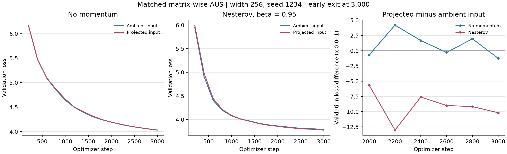
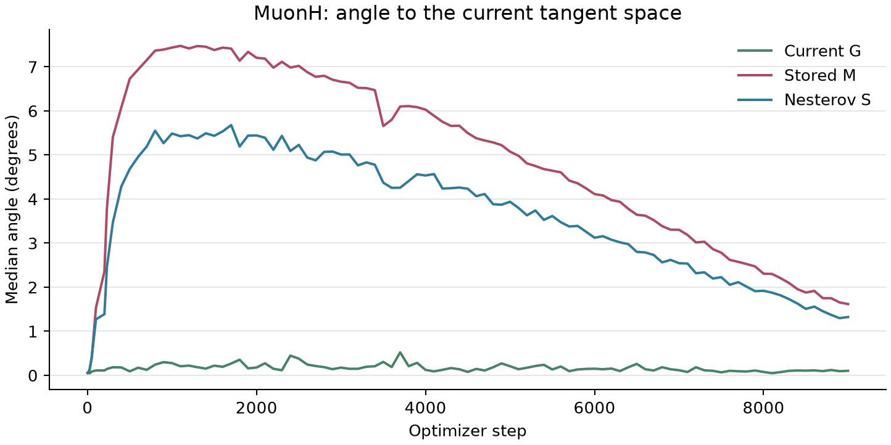
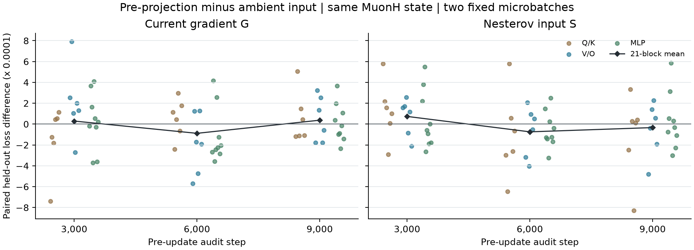
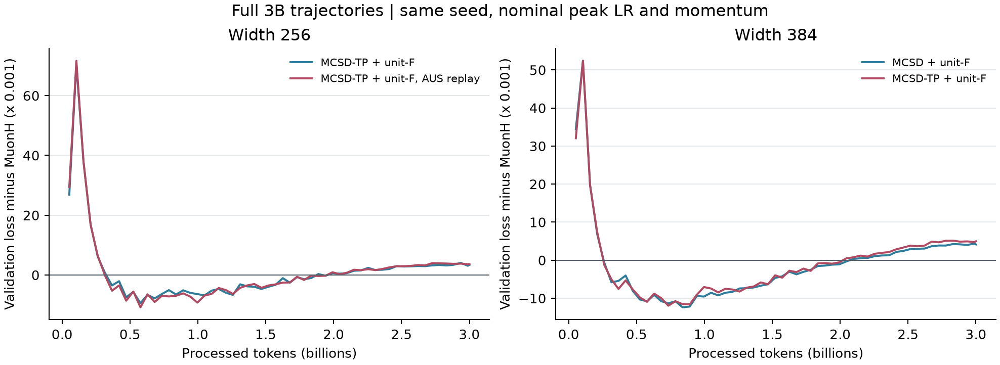

# Frobenius Sphere: Projection, Momentum, and Late Training

**Verified November 19, 2026, 15:17 HKT.** The no-momentum pair and the
late-stage held-out audit completed with exit code zero, no NaN updates and
no skipped updates. The account's Slurm queue was empty at this check.

[Overview](FROBENIUS_3B_6B_SUMMARY.md) |
[Data and figures](frobenius_results_20261119/) |
[Audit protocol](FROBENIUS_HELDOUT_AUDIT_20261118.md)

**Takeaway:** pre-projecting the Nesterov input helps the controlled early
training comparison. Pre-projecting the current gradient alone does not
give a consistent benefit. Equalizing AUS has not made the tested MCSD-TP
recipe outperform native MuonH at the full 3B endpoint.

## 1. Completed Momentum x Projection Comparison

Width 256, seed 1234, Frobenius radius `R=sqrt(D_out)`, BF16 model and
FP32 master weights. All four arms use the same practical matrix-sign
kernel, post-sign tangent projection, unit-F scaling, radial return, and
**the same per-step, per-matrix MuonH AUS trace**. Only the LMO input rule
and the constrained-matrix momentum setting form the two factors.
Auxiliary AdamW, data order, and the original 11,445-step 3B cosine horizon
are unchanged. Each pilot comparison stops at step 3,000, **786,432,000
tokens, not 3B**. The always-projected Nesterov arm reuses that prefix of
the completed full-budget replay.

| Momentum / LMO input | Job | Validation at 3,000 | Mean at 2,000:200:3,000 |
|---|---:|---:|---:|
| None / `G` | 4459729 | 4.031891 | 4.103199 |
| None / `P_W G` | 4459730 | 4.030641 | 4.104128 |
| 0.95 Nesterov / `S` | 4453012 | 3.787680 | 3.822481 |
| 0.95 Nesterov / `P_W S` | 4427415 | 3.777498 | 3.813374 |

Here `M=beta*M_old+(1-beta)*G` and `S=beta*M+(1-beta)*G`.
The projected Nesterov input is **not** the current Riemannian gradient
`P_W G`. Stored momentum in these four arms is ambient.

| Projection effect: projected minus ambient | At 3,000 | Six-point mean | Projected wins |
|---|---:|---:|---:|
| No momentum | -0.001250 | +0.000929 | 3/6 |
| Nesterov | -0.010182 | -0.009108 | 6/6 |

The difference between these effects is -0.008932 at the endpoint and
-0.010037 for the six-point mean. This is a **descriptive interaction in
one seed**, not a significance test. The six checkpoints are correlated.
The no-momentum schedule/AUS was inherited from Nesterov, not retuned, so
the absolute loss difference between rows is not a fair best-recipe ranking
of momentum versus no momentum. Compare the projection effect within rows.

The two new no-momentum jobs took 04:55:02 and 04:55:43 (Slurm elapsed).
Each matched 3,000 x 196 matrix updates; maximum absolute master-AUS errors
were 6.150e-8 and 6.153e-8, below the 2e-6 tolerance.



The other 3,000-step Nesterov variants did not improve on always-projecting:
delaying projection until step 801 ended at **3.779209**; storing a tangent
EMA ended at **3.778081**. Their six-point means were 3.813888 and 3.813809,
versus 3.813374 for the existing ambient-EMA, always-projected control.
Neither variant justifies a larger grid yet.

## 2. What the Momentum Angles Show

On the independently instrumented native MuonH trajectory, record the
acute angle `asin(abs(<W,Z>)/(||W||*||Z||))` for each of 196 logical
matrices. The following entries are medians in degrees, not seed uncertainty.

| Step | Current gradient G | Stored EMA M | Nesterov input S |
|---:|---:|---:|---:|
| 1,400 | 0.153 | 7.456 | 5.491 |
| 3,000 | 0.176 | 6.662 | 5.010 |
| 6,000 | 0.150 | 4.112 | 3.122 |
| 9,000 | 0.103 | 1.617 | 1.324 |



The current gradient is nearly tangent, while the momentum mixture has a
larger normal component that declines later. This is **consistent with**
the larger observed projection effect under momentum; it does not show
that normal momentum is the cause of the loss difference. A small normal
component also need not imply a small change after nonlinear `msign`.

## 3. Completed Same-State Held-Out Audit

CUDA gate **4464031** completed in 00:01:44. Trajectory **4464032** reached
9,000 steps in 14:34:50. Its 45 logged validation values exactly reproduce
the native MuonH reference at printed precision. This observational run is
not a new full 3B endpoint.

Before updates 3,000 / 6,000 / 9,000, perturb one matrix at a time in layers
0 / 14 / 27. Cross sources `G` and `S` with pre-projection off/on; all
candidates share post-projection, unit-F and the target master-AUS.
There are **252 candidate records**, 126 block/source pairs, no stalled
rays, and two fixed held-out microbatches per candidate. Negative differences
below favor pre-projection. Each block difference averages its two batches.

| Step | Source | Mean paired loss difference | Median | Projected wins / 21 blocks |
|---:|---|---:|---:|---:|
| 3,000 | G | +0.000029 | +0.000053 | 8/21 |
| 3,000 | S | +0.000074 | +0.000102 | 8/21 |
| 6,000 | G | -0.000089 | -0.000170 | 13/21 |
| 6,000 | S | -0.000074 | -0.000066 | 13/21 |
| 9,000 | G | +0.000037 | -0.000014 | 11/21 |
| 9,000 | S | -0.000034 | +0.000010 | 10/21 |



**Interpretation:** the sign and matrix-group ranking change with state.
At step 9,000, S has a negative mean but only 10/21 block wins and a
positive median. There is no stable all-block or Q/K-only held-out advantage
in this sample. Better training-gradient alignment is not interchangeable
with better held-out loss: at step 3,000, pre-projecting G improves the
current-gradient linear prediction in 15/21 blocks, but the held-out
two-batch average in only 8/21.

**Limits:** these are local, single-block perturbations on a **MuonH**
trajectory, not joint optimizer steps or observations on an MCSD trajectory.
The two DCLM diagnostic microbatches are not independent seeds or a
representative validation set. The audit cannot by itself explain the
full-training reversal. Master-AUS error is at most 9.314e-10; BF16 casting
leaves up to **0.7865%** paired relative differences in effective model
chord. Returned FP32 points are matched, but BF16 forward displacements
are not exactly matched. Repeat/restore forward checks enforced a 1e-6
tolerance; successful completion means they passed, not that a numerical
error bound for the measured loss differences has been proved.

## 4. Full 3B Endpoints Remain the Main Performance Test

All rows below use seed 1234, peak LR 0.010 and 0.95 Nesterov. Compare
within width. These are fixed-recipe endpoints, not per-method LR optima.

| Width | Method | Job | Final validation | Difference from MuonH |
|---:|---|---:|---:|---:|
| 256 | MuonH | 4427413 | **3.458490** | 0 |
| 256 | MCSD-TP + unit-F | 4427414 | 3.461894 | +0.003404 |
| 256 | MCSD-TP + unit-F, matched AUS | 4427415 | 3.462119 | +0.003629 |
| 384 | MuonH | 4428781 | **3.292725** | 0 |
| 384 | MCSD + unit-F | 4428783 | 3.296856 | +0.004131 |
| 384 | MCSD-TP + unit-F | 4428784 | 3.297710 | +0.004985 |



The full-budget gaps are positive despite intermediate MCSD leads. Matching
AUS did not close the width-256 gap; increasing width to 384 did not reverse
it under these recipes. The isolated **no-pre-projection, same-postprojection**
arm is not native MuonH and currently stops at 3,000. Thus the late-training
effect of the first projection alone is still unresolved. Historical
NorMuon-Sphere results remain in the [overview](FROBENIUS_3B_6B_SUMMARY.md#latest);
there is no new NorMuon, SSO or MuonSphere result in this batch. Spectral
and Frobenius protocols must not be pooled into one ranking.

## 5. Next Tests, in Order

1. **Complete the causal Nesterov pair at 3B.** Run the existing no-pre-projection
   rule from initialization through 11,445 with the same reference trace,
   post-projection and unit-F. The always-projected full 3B result already
   exists. Predeclare the endpoint and a late window (9,000:200:11,400 plus
   11,445), rather than selecting the best checkpoint. Earlier pilots saved
   no checkpoints, so this is not a cheap continuation. This single new arm
   answers whether the early projection gain survives the full schedule.
2. **Check robustness before tuning a projection policy.** On both native
   MuonH and MCSD-TP states, use 8--16 new fixed diagnostic microbatches from
   multiple sources; preserve paired comparisons and log effective BF16 AUS.
   At a few frozen states, compare the practical sign with an FP32/FP64 SVD
   oracle as an offline diagnostic, not a production optimizer replacement.
   Do not tune a Q/K-only switch from the two current batches.
3. **Replicate the decisive pair, then scale.** If the full-budget projection
   effect persists, generate a seed-2026 reference trace and repeat its
   projected/ambient pair. Use the same seed-specific trace in both arms.
   If it reverses, prioritize momentum/step geometry rather than another
   width-512 or 6B grid. Tangent EMA, delayed projection and fixed point
   extrapolation are not current performance priorities.

**No new jobs were submitted in this readout.** The proposed tests above
are recommendations, not queued work or established improvements.

## Reproduce the Readout

[All validation values (CSV)](frobenius_results_20261119/validation.csv) |
[Paired audit records (JSONL)](frobenius_results_20261119/heldout_direction_audit.jsonl) |
[Results, settings and provenance (JSON)](frobenius_results_20261119/results.json)

The JSON preserves source snapshot commits and selected optimizer file
digests; these identify frozen H20 trees and are not asserted to be public
GitHub commits. Absolute server paths and model/data payloads are excluded.
The 196-matrix AUS traces remain in the H20 archive; their digests and
replay errors are included. The source logs are checked against successful
completion receipts when collecting data.

```bash
python -m pip install matplotlib
python scripts/manifold/report_frobenius_20261119.py \
  --results docs/experiments/frobenius_results_20261119/results.json \
  --output /tmp/frobenius-readout
# With the external H20 log/config/receipt snapshot:
# python scripts/manifold/report_frobenius_20261119.py --snapshot SNAPSHOT --output OUTPUT
```

PNG and PDF figures connect sampled points, without smoothing or seed-error
bands. Seven focused analysis tests pass; this release updates documentation
and reporting only, not the training implementation.
