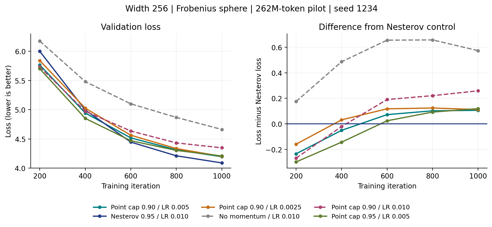
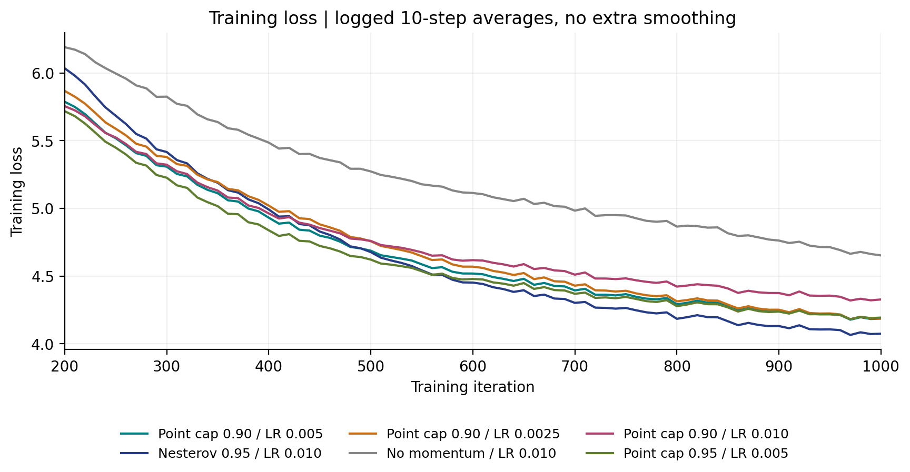

# MCSD Point Extrapolation: H20 Pilot Results

[Overview](FROBENIUS_3B_6B_SUMMARY.md) | [Related work](FROBENIUS_RELATED_WORK.md) | [Measurements](frobenius_point_20261101/results.json)

**Six pilots completed: point extrapolation helps relative to no momentum,
but does not beat the matched-runtime Nesterov control at step 1000.**
Results checked November 1, 2026; follow-up submissions checked November 2.
These are **262M-token pilots using a 3B learning-rate horizon**, not completed
3B experiments. All methods in this report are MCSD, not MCSD-TP.

## Results

Width 256, Frobenius radius `R=sqrt(D_out)`, seed 1234. Loss is the scheduled
validation at step 1000, not the best loss along the curve.

| Gradient / point scheme | Peak LR | Val. loss | Train loss* | Elapsed | Job |
|---|---:|---:|---:|---|---:|
| **Muon-style Nesterov, beta=0.95** | 0.0100 | **4.088546** | 4.097348 | 1:38:05 | 4368414 |
| Point cap=0.90 | 0.0050 | 4.194326 | 4.209379 | 1:38:03 | 4368413 |
| Point cap=0.90 | 0.0025 | 4.200407 | 4.214039 | 1:38:38 | 4368415 |
| Point cap=0.95 | 0.0050 | 4.207566 | 4.210482 | 1:38:02 | 4368418 |
| Point cap=0.90 | 0.0100 | 4.347173 | 4.346314 | 1:38:01 | 4368417 |
| No momentum | 0.0100 | 4.662017 | 4.700692 | 1:37:33 | 4368416 |

*Train loss averages the ten logged windows ending at steps 910--1000.
Elapsed is Slurm wall time, including startup, validation and checkpointing.
All six completed with exit `0:0`, finite logged losses, zero logged skipped
iterations and zero logged NaN iterations. Late training-step times range
from 5.375 to 5.425 seconds; this does not isolate optimizer-only overhead.



[Vector validation figure](frobenius_point_20261101/validation.pdf)

<details>
<summary>Training curves and numerical verification</summary>



[Vector training figure](frobenius_point_20261101/training.pdf).
No additional smoothing is applied. A continuous 16-step integration test
and an 8+8-step checkpoint restart matched exactly for the model, optimizer,
scheduler, RNG and iteration state. Jobs 4368405--4368407 completed before the
pilots were released. The export includes the exact comparison record.

</details>

## Interpretation

1. **The benefit over no momentum is not a win over Nesterov.** At LR=0.010,
   point cap=0.90 lowers loss by 0.314844 relative to no momentum, but remains
   0.258627 above Nesterov.
2. **An early lead does not persist.** Point cap=0.90/LR=0.005 leads Nesterov
   by 0.050983 at step 400, trails by 0.072195 at step 600, and by 0.105780
   at step 1000. Different LRs make this a configuration comparison, not an
   isolated momentum ablation.
3. **Lower LRs deserve a limited continuation.** LR=0.0025 is only 0.006081
   behind LR=0.005 for cap=0.90. At LR=0.005, increasing the cap to 0.95 is
   worse by 0.013240 at the endpoint. One seed and 1000 steps establish
   neither an optimum nor a statistically reliable ranking.

## Follow-Up Tests

Four jobs were submitted with **at most two single-H20 jobs concurrent**.
4373194 and 4373195 were verified running; 4373196 and 4373197 wait for
their lanes. This is a November 2 submission snapshot, not live status.

| Job | Configuration | Iterations | Purpose |
|---:|---|---|---|
| 4373194 | Point cap=0.90, LR=0.005 | Resume 1000 to 3000 | Check whether the best point pilot catches up |
| 4373195 | Nesterov beta=0.95, LR=0.010 | Resume 1000 to 3000 | Same-code, same-budget reference |
| 4373196 | Point cap=0.90, LR=0.0025 | Resume 1000 to 3000 | Test the lower LR beyond early warmup |
| 4373197 | Point cap=0.95, LR=0.0025 | Fresh 0 to 1000 | Compare caps at a lower common LR |

The original **11445-step cosine horizon and 229-step warmup remain unchanged**.
Resumes retain FP32 live Y, accepted X, auxiliary AdamW state, scheduler and
RNG. Only the stopping/checkpoint iteration changes. Step 3000 corresponds
to 786,432,000 tokens, still not 3B. No automatic 3B/6B promotion is scheduled.
The other three completed pilots are not extended; their results stay reported.

[Actual follow-up register](frobenius_point_20261101/followup_register.json).
Continuations are expected to take roughly 3.2 hours each for the additional
2000 steps, excluding queue time; the fresh pilot about 1.6 hours.

**Partial continuation readback, November 2:** both active jobs loaded the
original step-1000 checkpoint successfully. They have not reached their
step-3000 endpoints. Point cap=0.90/LR=0.005 still trails the Nesterov control:

| Iteration | Point 4373194 | Nesterov 4373195 | Point minus Nesterov |
|---:|---:|---:|---:|
| 1200 | 4.125251 | 4.012596 | +0.112655 |
| 1400 | 4.071943 | 3.962121 | +0.109822 |
| 1600 | 4.014438 | 3.911879 | +0.102559 |

[Partial measurements](frobenius_point_20261101/continuation_partial_20261102.json).
The difference has narrowed slightly over these checkpoints, but remains
large relative to the pilot endpoint; there is no demonstrated crossover.

Before full-budget promotion, compare several matched validation checkpoints,
then add a paired seed. Sample angular displacement and evaluate accepted X
versus live Y on identical diagnostic batches before attributing the gap to
direction quality or extrapolation. These are future diagnostics, not changes
to the metric already reported.

## Algorithm and Protocol

The model stores extrapolated **Y**; one extra FP32 buffer stores accepted
**X**, replacing the EMA buffer. No gradient EMA is used in point mode.
Auxiliary parameters retain AdamW. For each constrained matrix component:

```text
G = gradient evaluated at live Y
Q = G - <Y,G>_F * Y / R^2
d = -lr * R / sqrt(min(rows, cols)) * approximate_msign(Q)
X_new = R * (Y + d) / ||Y + d||_F
t_new = (1 + sqrt(1 + 4*t^2)) / 2
gamma = min((t - 1) / t_new, cap)
c = <X_new, X>_F / R^2
Y_new = R * ((1+gamma)*X_new - gamma*X/c)
        / ||(1+gamma)*X_new - gamma*X/c||_F
overwrite accepted X with X_new, live Y with Y_new
```

This uses the **radial retraction and its local inverse**, not Exp/Log.
A local-chart guard resets extrapolation if the inverse is inadmissible;
there is no objective-based safeguard or extra gradient evaluation. The
outer pattern is inspired by AManPG, not its full method or convergence
guarantees. The cap is not the EMA coefficient beta.

| Setting | Value |
|---|---|
| Model | 28 layers, width 256, FFN 768, 4 query heads, 2 KV groups, head dimension 64 |
| Data | Frozen OLMo-Mix 3B train/validation indices; sequence length 2048 |
| Batch | Global 128 sequences; micro-batch 4; one H20 per run |
| Precision | BF16 model, FP32 master/state; BF16 Polar Express, 10 iterations |
| Hidden matrices | Component-wise Frobenius radius; zero weight decay |
| Auxiliary parameters | Same AdamW configuration, LR=0.001 |
| Validation | 40 batches every 200 steps; live Y for point methods |
| LR schedule | 229 warmup steps; cosine to 10% of peak over 11445 steps |

The validation iterator advances: compare the same iteration and seed.
Full-budget legacy losses near 3.46 cannot be compared with these 262M-token
losses near 4.1. MuonH and NorMuon-Sphere are not new cells in this pilot;
their full-budget results remain in the main summary.

## Reproduce the Figures

Only Python and matplotlib are needed; no GPU, dataset or checkpoint:

```bash
python -m pip install matplotlib
python scripts/manifold/report_point_pilot.py \
  --data docs/experiments/frobenius_point_20261101/results.json \
  --out /tmp/mcsd-point-figures
```

The JSON contains every logged train/validation point, compact resolved
configurations, source and stdout hashes. The exporter rejects incomplete,
nonfinite or mismatched runs. Frozen H20 runtime commit:
`8250d00f9a36832bd6fd7198fe2e2b5d3787b7b3`, based on
`fc15600a2898d1748c8b34fe8d3945b1036f03ab`. These are runtime provenance,
not a promise that the new integration is on this public branch. This update
publishes measurements and the CPU plotter; a public training release still
needs the opt-in point integration and its tests.
