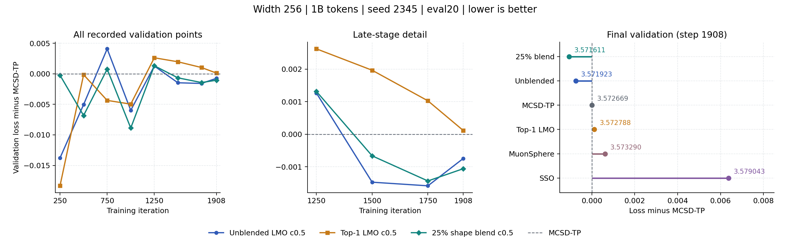

# Single-LMO Rank and Spectral-Shape Controls

[Previous matched results](cluster_mechanism_scales_1b_20261102.md) |
[Launcher](../../slurm/cluster_lmo_shape_1b_20261104.sbatch) |
[Direction implementation](../../Megatron-LM/emerging_optimizers/orthogonalized_optimizers/spectral_cone_lmo.py)

## Completed Results: 2026-11-05

Both new runs completed all 1908 iterations with exit `0:0`, eight validation
points, and no logged NaN/skipped iterations. These are **1B-token runs on the
existing 3B indexed source**, not 3B training or the historical paper sample.

| Method | Final validation loss | Difference vs. MCSD-TP | Train + validation | Job |
|---|---:|---:|---:|---|
| MuonSphere | 3.573290 | +0.000621 | **5:33:30** | `4368383_0` |
| SSO | 3.579043 | +0.006374 | 6:11:37 | `4368383_1` |
| MCSD-TP K10 | 3.572669 | 0 | 5:54:15 | `4368382_2` |
| Single-LMO adaptive q<=4, c0.5 | 3.571923 | -0.000746 | 5:55:10 | `4375034_2` |
| Single-LMO top-1, c0.5 | 3.572788 | +0.000119 | 5:54:55 | `4389998_0` |
| **Single-LMO 25% shape blend, c0.5** | **3.571611** | **-0.001058** | 5:56:14 | `4389998_1` |

The blend improves the endpoint by **0.000312** over unblended c0.5,
**0.001679** over MuonSphere, and **0.007432** over SSO. It adds 64 seconds
to unblended c0.5, 119 seconds (0.56%) to MCSD-TP, and 6.82% to MuonSphere.
Timing excludes preflight, smoke and offline audits; runs used different
nodes and were not all concurrent. These are end-to-end timings, not kernel
benchmarks.

Same-LMO top-1 is 0.000865 worse than unblended adaptive q. Thus selective
step reduction alone does not reproduce the observed gain in this seed.
This is suggestive, not a clean same-trajectory causal estimate: changing
directions also changes later spectra and routing. The blend is not uniformly
better at matched late steps; unblended c0.5 is lower at steps 1500 and 1750.
The small endpoint advantage needs an independent paired-seed check.

### Branch Behavior

Counters below end at **step 1900**, with **478,800 matrix-component
decisions**, not 1908 optimizer steps. Legacy log names containing `pgd`
refer to the near branch here; these updates do not use metric-projection PGD.

| Near mechanism | Calls | Cumulative rate | Repeated calls | Mean burst | Rate at step 1900 | Capacity overflow |
|---|---:|---:|---:|---:|---:|---:|
| Unblended adaptive q<=4 | 27,770 | 5.800% | 92.18% | 12.78 | 34.52% | 215 |
| Top-1 | 5,833 | 1.218% | 39.29% | 1.65 | 10.32% | 0 by construction |
| 25% blend, adaptive q<=4 | 20,357 | 4.252% | 88.02% | 8.35 | 30.95% | 48 |

The blend reduces repetition and overflow relative to unblended c0.5, but
neither is eliminated. Top-1 repeats much less yet has worse loss, so branch
frequency or exit rate alone is not an optimizer-selection criterion.

### Numerical Audit

Each new main run records **480,816 small Ritz SVDs**, zero full SVDs and
zero `svdvals` calls online. The exact offline audit uses 44 selected saved
matrices per run. False-safe means approximate safe / exact near at the same
threshold; false-near is the converse.

| Near mechanism | Gap MAE | Mean relative direction error | False-safe / false-near | Maximum returned-radius relative error |
|---|---:|---:|---:|---:|
| Unblended adaptive q<=4 | 7.753e-5 | 1.241% | 0 / 0 | 1.503e-4 |
| Top-1 | 7.958e-5 | 3.167% | 0 / 1 | 1.602e-4 |
| 25% blend, adaptive q<=4 | 8.297e-5 | 3.740% | 0 / 2 | 1.503e-4 |

These are selected-sample diagnostics, not population error rates. Gap error
remains comparable to or larger than the routing threshold `5e-5`. The blend
does not improve sampled direction accuracy over unblended c0.5; its endpoint
gain cannot be attributed to a more accurate spectral solver. A large logged
`radial_change_ratio` is relative to trial displacement and can be dominated
by startup/tiny steps; it is not a radius violation. No exact feasibility or
stochastic convergence certificate is claimed.

**Next decision:** retain unblended c0.5 and the 25% blend as a paired
confirmation at another seed, with the same 1B/eval20 protocol. Existing
seed-1234 control results are useful only with verified matching source,
data and evaluation settings. Defer wider gap/LR grids, larger widths and
3B expansion. This update submits no new jobs.

[Final metrics, curves, configurations, and hashes](../results/cluster_lmo_shape_1b_20261104/final_20261105.json) |
[CUDA/smoke verification](../results/cluster_lmo_shape_1b_20261104/completion_20261105.json)

## Question and Fixed Protocol

The completed single-LMO c0.5 run (`4375034_2`) reached **3.571923**,
versus 3.572669 for MCSD-TP, 3.573290 for MuonSphere and 3.579043 for SSO.
This is a selected one-seed candidate, not a replicated gain. Its cumulative
near rate was 5.800%, with 92.18% repeated calls. Faster near-region exit is
not the objective of this batch.

Keep width 256, seed 2345, LR 0.015, 1B/1908 iterations, eval20, 250 warmup,
the existing 3B indexed source, global batch 128 and sequence 4096 unchanged.
Keep route gap 5e-5, cluster tolerance 2e-4, c0.5, warm block-8 K10 FP32
QR/Ritz, BF16 NS8, Nesterov 0.9, matrix weight decay zero, cached returned
spectra and approximate radial returns. No online original-matrix full SVD,
accuracy fallback, line search or checkpoint is introduced.

## Training Arms

| Array index | Near mechanism | Change from completed c0.5 |
|---|---|---|
| 0 | `cone_lmo_top1` | Force q=1, preserving the same LMO and c0.5 |
| 1 | `cone_lmo_mix25` | Keep adaptive q<=4; blend 25% corrected momentum before final face correction |

Existing c0.5, control, MuonSphere and SSO endpoints remain the matched
references; they are not rerun. The old momentum top-1/c8 experiment is **not**
the same-LMO top-1 control. In exact arithmetic q=1 reduces the direction to
MCSD-TP, so this arm tests whether selective step reduction explains the gain.
Top-1's zero reported capacity overflow is by construction, not a full-cluster
coverage certificate.

## Shape Interpolation

Let Q be the cone-corrected, Frobenius-normalized descent momentum, S its
single NS matrix-sign output, and F the existing final selected-face
correction. Compute

$$
 S_{\theta}=(1-\theta)S+
 \theta\frac{\|S\|_F}{\max(\|Q\|_F,\epsilon)}Q,
 \qquad \theta=0.25,
$$
$$
 D_0=F(S),\qquad
 D_{\theta}=\frac{\|D_0\|_F}{\max(\|F(S_{\theta})\|_F,\epsilon)}F(S_{\theta}).
$$

Both use the unchanged c0.5 multiplier. Match the **same-point unblended near
direction**, not a separate MCSD direction. This isolates trial direction
shape from its Frobenius length; returned displacement can still differ.
Zero momentum stays zero. There is one NS call, with a second small face
correction but no additional original-matrix decomposition. Interpolation is
before the final correction; averaging two final cone directions need not
preserve a nonconvex cone.

This blend is not an exact arbitrary-norm LMO. Exact-cone tests assume a
complete genuinely repeated top space. Positive-gap near clusters, finite
NS/Ritz and approximate radial return do not establish stochastic convergence.

## Amplitude Screening, Not Another Long Run

We screened a shape-scaled cap `D *= min(1, sqrt(min(m,n))/||D||_F)` against
the previous run's 19 selected near snapshots. The recorded directions
include c0.5; the screening removes that coefficient before comparison.

| Metric | Result |
|---|---:|
| Normalized direction Frobenius range | 0.972945--1.001148 |
| Samples changed by the cap | 9/19 |
| Maximum amplitude removed | 0.1146% |
| Mean amplitude removed | 0.0438% |

This cap is almost inactive on these samples. A substantially lower cap would
mostly be another global step reduction. Do not spend a full 1B arm on it
yet; revisit with actual relative updates and layerwise/late-stage outliers.
This is a bounded-sample finding, not a population norm bound, and it does
not rule out operator-norm or return-induced distortion.

[Screening code](../../scripts/audit_cluster_lmo_amplitude.py) |
[Screening records and source hash](../results/cluster_lmo_shape_1b_20261104/amplitude_screen.json)

## Execution and Evaluation

The batch used a new isolated snapshot and one H20 per arm, at most two
concurrently. Each allocation ran CUDA tests and a separate-process four-step
smoke before fresh 1B training; smoke and main outputs are separate.
Checkpoints are disabled and at most 48 matrix samples are retained per run.

Compare final and matched-step loss, timing excluding smoke/audits, branch
rate, repeated calls and capacity overflow. Offline exact-spectrum audits
also record actual relative displacement, trial relative displacement,
radial correction ratio, gap errors and returned-radius errors. All are
diagnostics, not online acceptance criteria. Keep the original 20 validation
batches and data ordering; do not promote based only on a short early lead.

Submitted **2026-11-04 18:01 HKT** as array **4389998**:
`4389998_0` is the top-1 arm and `4389998_1` the 25% shape blend.
All 74 cluster tests plus one collector test passed both locally and on the
H20 host's CPU with its original PyTorch 2.6 environment. Both GPU allocations
passed the 27-test CUDA-targeted suite before smoke and again before main
training. Smokes took 79 / 75 seconds, each recording 1008 small Ritz SVDs
and zero full-SVD/svdvals calls.

| Job | Node | Started (HKT) | Finished (HKT) | Slurm elapsed, including checks |
|---|---|---|---|---:|
| `4389998_0` | SPG-7-1 | Nov 4, 20:20:38 | Nov 5, 02:18:03 | 5:57:25 |
| `4389998_1` | SPG-7-2 | Nov 4, 20:21:51 | Nov 5, 02:20:27 | 5:58:36 |

The frozen source manifest SHA256 is
`39eb506417f262f6e18be7848952e42a163c27b8067357926c73b3f4e58c830e`.
The submission manifest below is authoritative for deployment provenance;
source changes and later documentation commits are distinct.

[Submission manifest](../results/cluster_lmo_shape_1b_20261104/submission.json)
