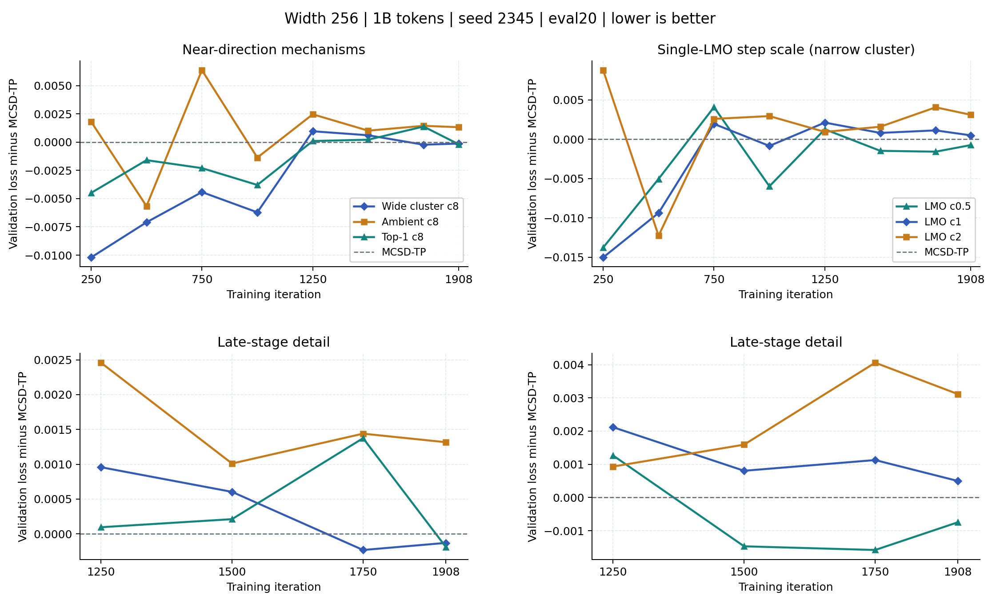

# Matched 1B Mechanism and Step-Scale Results

[Results](mcsd_p2gd_results_summary.md) · [Launcher](../../slurm/cluster_mechanism_scales_1b_20261102.sbatch)

**Verified 2026-11-04:** all four tasks in array **4375034** completed with
exit 0:0, eight validation points through step 1908, and no logged NaN or
skipped iterations. The array used at most two H20 GPUs concurrently and
finished on **2026-11-03 at 00:58 HKT**. No new training was submitted during
this results update.

## Final Comparison

All rows use width 256, seed 2345, LR 1.5e-2, 1B/1908 steps and eval20.
The six existing references and four new arms have matching data/model/
schedule settings, verified from their launch records.

| Method | Final loss | Difference vs. control | Train + validation | Job |
|---|---:|---:|---:|---|
| MuonSphere | 3.573290 | +0.000621 | **5:33:30** | `4368383_0` |
| SSO | 3.579043 | +0.006374 | 6:11:37 | `4368383_1` |
| MCSD-TP K10 control | 3.572669 | 0 | 5:54:15 | `4368382_2` |
| Wide hybrid c8 | 3.572540 | -0.000129 | 5:55:24 | `4368383_3` |
| Narrow hybrid c8 | 3.573133 | +0.000464 | 5:55:46 | `4368383_4` |
| Single-LMO c1 | 3.573165 | +0.000496 | 5:55:50 | `4368382_5` |
| Ambient near c8, new | 3.573986 | +0.001317 | 5:56:10 | `4375034_0` |
| Top-1 near c8, new | 3.572480 | -0.000189 | 5:54:13 | `4375034_1` |
| **Single-LMO c0.5, new** | **3.571923** | **-0.000746** | 5:55:10 | `4375034_2` |
| Single-LMO c2, new | 3.575782 | +0.003113 | 5:55:29 | `4375034_3` |

Single-LMO c0.5 is lower than MuonSphere by **0.001367**, SSO by **0.007120**,
the wide hybrid by **0.000617**, and its same-family c1 reference by
**0.001242**. It adds 55 seconds to control and is 6.50% slower than
MuonSphere. This is one seed after candidate selection, not a confirmed
general improvement. Timings include validation but exclude preflight and
offline audits; node/time placement is not identical.

[Vector figure](cluster_summary/validation_1b_followups_20261104.svg) ·
[New final records](../results/cluster_mechanism_scales_1b_20261102/final_20261104.json) ·
[Six reference records](../results/cluster_cone_lmo_1b_20261031/final_20261101.json)

## Branch Behavior

These cumulative counters end at **step 1900**, with **478,800 matrix-component
decisions** per run. They are not percentages of training iterations.

| Near direction | Calls | Rate | Repeat rate | Mean burst | q=1/2/3/4 | Capacity overflow |
|---|---:|---:|---:|---:|---|---:|
| Wide c8, reference | 10,894 | 2.275% | 70.97% | 3.44 | 0 / 1383 / 4616 / 4895 | 1168 |
| LMO c1, reference | 16,439 | 3.433% | 82.94% | 5.86 | 0 / 8952 / 5154 / 2333 | 180 |
| Ambient c8 | 4,336 | 0.906% | 12.66% | 1.14 | Not applicable | Not applicable |
| Top-1 c8 | 4,706 | 0.983% | 19.97% | 1.25 | 4706 / 0 / 0 / 0 | 0, by construction |
| LMO c0.5 | 27,770 | **5.800%** | **92.18%** | **12.78** | 0 / 14368 / 9952 / 3450 | 215 |
| LMO c2 | 7,695 | 1.607% | 53.10% | 2.13 | 0 / 4800 / 2338 / 557 | 7 |

The best-loss candidate has the most repeated near calls. At step 1900 its
instantaneous near rate is **87/252 = 34.52%**, versus the much smaller
whole-run cumulative rate of 5.800%. More than 94% of cumulative decisions
still use MCSD, but that does not describe the late-stage distribution.
Top-1's zero overflow does not certify that a one-vector correction covers
the full top cluster.

## Numerical Audit

Every new run recorded **480,816 small Ritz SVDs**, exactly one per component
update, and **zero original-matrix full SVD/svdvals calls online**. All four
saved 44 bounded samples. Full SVD is used only after training for these audits.

| Arm | Mean absolute gap error | Mean relative direction error | False-safe / false-near |
|---|---:|---:|---:|
| Ambient c8 | 7.872e-5 | 2.56% | 0 / 1 |
| Top-1 c8 | 8.143e-5 | 5.19% | 0 / 2 |
| LMO c0.5 | 7.753e-5 | 1.24% | 0 / 0 |
| LMO c2 | 7.789e-5 | 4.05% | 0 / 1 |

Each arm's maximum sampled returned-radius relative error is **1.503e-4**.
These shape/early/late/near-selected samples are not population rates, and
zero false-safe cases do not certify accurate routing. Errors remain relevant
to a 5e-5 threshold. Gap error is similar across the LMO scales; that alone
cannot explain, or exclude a contribution to, their different loss outcomes.

## Four Arms

| Job | Near direction | Step multiplier | Cluster tolerance | Matched reference |
|---|---|---:|---:|---|
| `4375034_0` | Frobenius-normalized ambient momentum, no correction | 8 | 2e-3 | Wide hybrid c8, `4368383_3` |
| `4375034_1` | Frobenius-normalized momentum, top-1 tangent correction | 8 | 2e-3 | Wide hybrid c8, `4368383_3` |
| `4375034_2` | Single-LMO cone-type direction | 0.5 | 2e-4 | Single-LMO c1, `4368382_5` |
| `4375034_3` | Single-LMO cone-type direction | 2 | 2e-4 | Single-LMO c1, `4368382_5` |

The first pair changes only the near correction. The second pair changes
only the multiplier within the existing narrow-cluster LMO family. Their
cluster tolerances deliberately differ, so a cross-family comparison does
not isolate the direction formula alone. No post-correction normalization or
MCSD-length matching is introduced. The coefficient is not a branch-use rate.

## Fixed Protocol

- Width 256, 28 layers, FFN 768, 2 heads, head dimension 128, sequence 4096.
- Seed 2345, fresh initialization; existing 3B indexed source, **1B processed
  budget**: 1908 steps, 1,000,341,504 tokens, global batch 128, microbatch 4.
- LR 1.5e-2, 250 warmup steps, cosine decay to 1.5e-3; eval20 every 250 steps
  and at the endpoint. Do not pool with historical eval5/sample runs.
- All safe branches use the same MCSD-TP. Route threshold 5e-5; warm block-8
  K10, FP32 QR/Ritz and master weights, BF16 NS8/training, TF32 off.
- Both branches use approximate radial return and returned-point spectral
  caches. No online accuracy gate or original-matrix full-SVD fallback.
- Nesterov coefficient 0.9, constrained-matrix weight decay zero; unchanged
  auxiliary AdamW settings and parameter-group exclusions.
- No checkpoints. Preserve logs/configuration and at most 48 selected
  matrix snapshots per run; exact-spectrum audits execute after training.

Legacy host flags mentioning `exact_svd_gap_only` or `tp_radial_pgd_exact`
are superseded by cluster dispatch. The launch record explicitly identifies
the actual warm-Ritz solver and approximate return. Each run checks that the
online full-SVD/svdvals count is zero and small-SVD count equals component
updates.

## Interpretation and Next Decisions

1. **Retain LMO c0.5 for confirmation.** Among c0.5/c1/c2, smaller scale gives
   the best endpoint despite longer near bursts. Reduced repetition is not
   an optimization target by itself. This does not prove that repetition helps.
2. **Keep top-1 as a strong mechanism control.** Its endpoint is 0.000060 below
   the wide hybrid with much less repetition. Multiple-direction correction
   is still not established as the source of the hybrid's small 1B gain.
3. **Do not promote c2 or ambient c8.** Both are worse than the matched
   control and MuonSphere. Ambient c8 won the earlier seed-2345 3B comparison,
   so this is a budget-dependent result, not a universal rejection.
4. **Confirm before expanding.** Prioritize the c0.5 candidate at seed 1234
   under the same 1B/eval20 protocol, using the completed matched control as
   reference if its exact protocol/source is preserved. Then isolate rank
   within the same single-LMO family: q=1 versus adaptive q<=4 at c0.5.
   The existing momentum top-1/c8 run is not that LMO mechanism control.
5. **Keep numerical questions separate.** Audit actual displacement and
   overflow cases offline; do not change K, gap, cluster width and scale
   simultaneously. The existing logger has no full burst distribution/P95,
   and its legacy zero residual fields are not accuracy certificates.

The separate seed-1234 pair gives 3.575916 / 3.575728 for control / wide hybrid.
Its absolute losses cannot be substituted into the seed-2345 table. Future
expanded validation must use the same fixed batches across candidates and
controls; old checkpoints are unavailable for retrospective re-evaluation.
No stochastic convergence claim follows from this engineering experiment.

## Provenance and Cost

Isolated H20 snapshot:
`/home/u3013198/projects/cluster-mechanism-scales-1b-20261102`.
Training/optimizer implementations match the completed source snapshot;
only launch-grid entries and tests were added, with current result tools.
Source checksums, actual configuration, job accounting and bounded audits are
retained separately from the completed runs.

The local suite passed 66 cluster tests plus the result-collector regression;
CUDA preflight passed for each run. The four new runs consumed **23.68
GPU-hours** of training plus validation. The array spanned about 11 hours
53 minutes from first start to last completion, including preflight and audits.
No checkpoints were generated. The separate Frobenius jobs seen in the queue
on 2026-11-04 are outside this comparison and were not changed.

[Submission metadata](../results/cluster_mechanism_scales_1b_20261102/submission.json)
