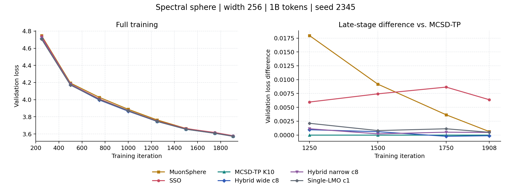

# Six-Arm 1B Comparison: Final Results

[Overview](../../README.md) · [All completed results](mcsd_p2gd_results_summary.md) · [Launch protocol](cluster_cone_lmo_1b_20261031.md) · [Raw report](../results/cluster_cone_lmo_1b_20261031/final_20261101.json)

**Verified 2026-11-01, 23:47 HKT.** All six jobs completed successfully, with
endpoint validation at step 1908 and no logged NaN/skipped iterations.

## Matched Protocol

Width 256; 28 layers; LR `1.5e-2`; seed 2345; 250-step warmup and cosine decay
to `1.5e-3`; global batch 128; sequence length 4096; 1908 steps
(`1,000,341,504` processed tokens). Training uses the existing **3B indexed
source**, not the historical paper's 1B sample. Every method evaluates 20
validation batches every 250 steps and at the endpoint. Earlier 1B runs used
five batches and must not be pooled with this batch.

Experimental methods share warm block-8 K10, FP32 QR/Ritz, BF16 NS8, approximate
post-step radial return and returned-point caches. Route threshold is `5e-5`;
the wide/narrow cluster tolerances are `2e-3` / `2e-4`. The correction rank is
capped at four. All use existing Nesterov momentum 0.9; matrix weight decay is
zero. The near branch starts from Frobenius-normalized momentum, with no
post-correction normalization or MCSD Frobenius-length matching.

## Final Endpoints

| Method | Final loss | Difference vs. control | Train + validation | Job |
|---|---:|---:|---:|---|
| MuonSphere | 3.573290 | +0.000621 | 05:33:30 | `4368383_0` |
| SSO | 3.579043 | +0.006374 | 06:11:37 | `4368383_1` |
| MCSD-TP K10 | 3.572669 | 0 | 05:54:15 | `4368382_2` |
| **Wide cluster, c8** | **3.572540** | **-0.000129** | 05:55:24 | `4368383_3` |
| Narrow cluster, c8 | 3.573133 | +0.000464 | 05:55:46 | `4368383_4` |
| Single-LMO narrow cluster, c1 | 3.573165 | +0.000496 | 05:55:50 | `4368382_5` |

The wide hybrid is lower than MuonSphere by `0.000750` and SSO by `0.006503`.
It adds 69 seconds (`0.32%`) to its control and is `6.57%` slower than
MuonSphere. These are single-run total training/validation times, not
optimizer-kernel timings. Control/LMO ran on SPG-7-1; the other four ran on
SPG-7-2, so hardware placement was not fully matched.

[Vector figure](cluster_summary/validation_1b_mechanisms_20261101.svg)

Every recorded validation point

| Step | MuonSphere | SSO | Control | Wide c8 | Narrow c8 | LMO c1 |
|---:|---:|---:|---:|---:|---:|---:|
| 250 | 4.747539 | 4.739459 | 4.722120 | 4.711915 | 4.721827 | 4.707089 |
| 500 | 4.194080 | 4.181283 | 4.179745 | 4.172650 | 4.182207 | 4.170373 |
| 750 | 4.027503 | 4.009177 | 4.000770 | 3.996347 | 4.001489 | 4.002718 |
| 1000 | 3.887900 | 3.873742 | 3.871658 | 3.865445 | 3.869629 | 3.870809 |
| 1250 | 3.763826 | 3.751833 | 3.745877 | 3.746835 | 3.747009 | 3.747993 |
| 1500 | 3.664148 | 3.662399 | 3.654964 | 3.655568 | 3.655176 | 3.655768 |
| 1750 | 3.611630 | 3.616628 | 3.607976 | 3.607745 | 3.608488 | 3.609103 |
| 1908 | 3.573290 | 3.579043 | 3.572669 | 3.572540 | 3.573133 | 3.573165 |

## Branch Behavior and Numerical Cost

Counters below end at **step 1900**, the last regular log, with **478,800
matrix-component decisions** per experimental run. They are not percentages
of training iterations and are not final-step counters.

| Near branch | Calls | Rate | Consecutive repeats / near calls | Mean burst length | q=1/2/3/4 | Capacity overflows |
|---|---:|---:|---:|---:|---|---:|
| Wide c8 | 10,894 | 2.275% | 70.97% | 3.44 | 0 / 1383 / 4616 / 4895 | 1,168 |
| Narrow c8 | 10,208 | 2.132% | 68.66% | 3.19 | 0 / 7800 / 2313 / 95 | 0 |
| LMO c1 | 16,439 | 3.433% | 82.94% | 5.86 | 0 / 8952 / 5154 / 2333 | 180 |

MCSD-TP control has no near branch. Every experimental run recorded
**480,816 small Ritz SVDs for 480,816 successful component updates**, with
**zero original-matrix full SVDs and zero svdvals calls online**. Offline
oracle decompositions are excluded from training timings and these counters.

| Offline audit | Selected samples | Mean absolute current-gap error | Mean relative direction error | False-safe / false-near |
|---|---:|---:|---:|---:|
| Control | 28 | `1.210e-4` | 1.46% | 0 / 0 |
| Wide c8 | 44 | `8.231e-5` | 5.43% | 0 / 2 |
| Narrow c8 | 44 | `7.833e-5` | 3.48% | 0 / 1 |
| LMO c1 | 44 | `7.737e-5` | 1.77% | 0 / 1 |

The maximum sampled returned-radius relative error is `1.503e-4` for each
experimental run. Samples are bounded and deliberately selected by shape and
early/late/near behavior; these are **not population error rates**. Zero
observed false-safe cases is not a safety certificate. The control's route
classification is hypothetical because it never switches branches.

## Interpretation

1. **Retain wide K10/c8 as a research reference, not a proven winner.** Its
   `0.000129` control-relative improvement is small; earlier 3B gains reversed
   sign across seeds. No confidence interval or significance claim is made.
2. **Do not promote the narrow cluster.** It removes observed capacity
   overflows but worsens endpoint loss. Less truncation alone is insufficient.
3. **Do not promote single-LMO c1 yet.** It leads at steps 250/500, then loses
   to control at the endpoint and repeats near calls more often. Geometry and
   actual direction length both changed; this run does not isolate the cause.
4. **Audit post-return behavior before more training.** The same-matrix
   `c=0.5/1/2` replay separates scale effects from the new direction. Momentum
   inner products are local diagnostics, not measured objective decrease.

## Completed Scale Audit

H20 job `4373185` completed in **47 seconds**, including CUDA tests and replay.
It inspected 160 saved matrices; 51 were routed near, including 27 late samples
(step at least 1000). Exact SVD was an offline oracle only.

| Cached-spectrum direction | Exit near region, all 51 | Exit, late 27 | Median late radial change / trial displacement | Max sampled radius error |
|---|---:|---:|---:|---:|
| Wide cone c8 | 32 | 20 | 1.75% | `5.26e-5` |
| Narrow cone c8 | 36 | 24 | 5.70% | `4.16e-5` |
| Single-LMO c0.5 | 22 | 19 | 2.14% | `3.28e-5` |
| Single-LMO c1 | 28 | 23 | 6.30% | `5.94e-5` |
| Single-LMO c2 | 37 | 25 | 10.18% | `1.33e-4` |

Every tested direction and returned displacement had a nonpositive inner
product with the saved momentum. Oracle-spectrum replay gives the same late
exit counts; approximation error alone does not explain the scale trend.
Increasing c helps leave the near region, but also increases radial changes
and radius error. The LMO's median direction Frobenius norm is 15.42 across
the 51 cases, versus about one for the cone direction: c1 is not a small step
merely because c8 is numerically larger.

**Decision:** retain c2 as a possible small pilot, not a demonstrated training
improvement. Do not choose it solely by exit rate. These snapshots contain no
objective/batch replay, and none covers an overflowing cluster in this audit.
[Full paired audit](../results/cluster_followup_1b_20261101/lmo_scales_20261101.json).

## Follow-Up

The next matched pair uses seed **1234**, K10, LR `1.5e-2`, **1B/1908 steps and
20 validation batches**: MCSD-TP control versus wide hybrid c8. It does not
duplicate the older seed-1234 1B K20/five-batch experiment or the 3B K10 run.
The pair follows the completed one-GPU offline step-scale audit. At most
two GPUs are used concurrently; no checkpoints are written.

Launchers: [paired training](../../slurm/cluster_replication_1b_20261101.sbatch)
and [offline audit](../../slurm/cluster_lmo_scales_20261101.sbatch).
The [corrected submission record](../results/cluster_followup_1b_20261101/submission_v2.json)
is the source of job IDs and dependency state.

**Update, 2026-11-02:** both jobs completed. Final losses are **3.575916**
(control) and **3.575728** (wide hybrid), a paired difference of **-0.000188**.
Training plus validation took **5:55:07 / 5:55:53**. Both recorded 480,816
small Ritz SVDs and zero online original-matrix full SVD/svdvals calls.
[Verified final record](../results/cluster_followup_1b_20261101/paired_final_20261102.json).

Jobs **4373351_0 / 4373351_1** were RUNNING at 2026-11-02 00:59 HKT. The first
array `4373186` failed before training because a standalone preflight test
lacked the optimizer import path. Its logs/source remain preserved; the v2
snapshot fixes imports and override isolation. This is a launch repair, not
an algorithm change or an additional completed experiment.
