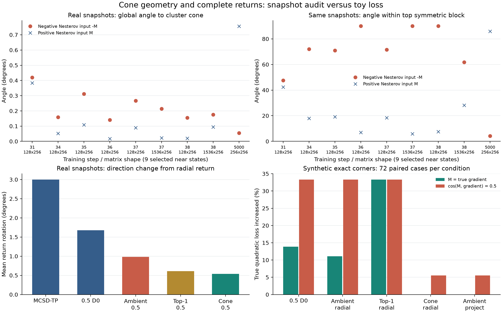

# Momentum, Corner Cones and Complete Radial Returns

**Local study, November 17, 2026.** No new H20 job and no modification of
the queued 3B controls. We downloaded 32 saved matrix states from completed
job `4442918_2`, evaluated 288 paired matrix counterfactuals, and evaluated
3,240 one-step operations on 360 constructed quadratic cases. Six regression
tests pass. These are diagnostics, not new LLM validation results.

**November 18 training follow-up:** the previously queued controls completed.
Near-only half-D0 achieves 3.423857 versus 3.429645 for matched MCSD-TP and
3.432013 for ambient-half, with MORE near calls and repeats. These long-run
results favor investigating attenuation before attributing gains to a cone
direction. They do not replace the missing same-state LLM loss probe below.
[Completed 3B controls and revised next steps](warm_radial_controls_3b_20261117.md).

## What M Means

The saved M is the input to the orthogonalized optimizer, including Nesterov:

$$B_t=0.9B_{t-1}+0.1G_t,\qquad M_t=0.1G_t+0.9B_t.$$

G is the gradient supplied to the optimizer after training-side clipping;
constrained matrices have zero weight decay. M is neither the bare EMA buffer
nor necessarily the current gradient. The relevant descent input is **-M**.
A tangent cone need not be sign symmetric, so angles for M and -M differ.

## Geometry and Angles

For $C_R=\{X:\|X\|_2=R\}$, suppose the true leading singular value has
multiplicity q and paired bases U,V. Put $H(D)=\operatorname{sym}(U^TDV)$.
Spectral directional differentiation gives

$$h_X(D)=\mathrm d\|X\|_2[D]=\lambda_{\max}(H(D)),\qquad
T_{C_R}(X)=\{D:h_X(D)=0\}.$$

This is the **Bouligand/contingent cone**, not an assertion about the Clarke
tangent cone. If the leading singular value is simple, q=1 and this is the
ordinary tangent hyperplane, even when the positive spectral gap is tiny.
The spectral-analysis background is [Lewis (1995)](https://people.orie.cornell.edu/aslewis/publications/95-convex.pdf).
The formulas and radial-return diagnostic below are specialized derivations,
not a claim that the reference proves this stochastic hybrid converges.

For Z=-M, let $A=H(Z)=O\operatorname{diag}(a_1,\ldots,a_q)O^T$, with
$a_1\ge\cdots\ge a_q$. A Frobenius projection onto this cone is

$$B=O\operatorname{diag}(0,\min(a_2,0),\ldots,\min(a_q,0))O^T,
\qquad Q=Z+U(B-A)V^T.$$

Why: Z decomposes orthogonally into a kernel component and $UAV^T$.
Only A is constrained; the nearest symmetric block with largest eigenvalue
zero keeps its eigenbasis, clips positive eigenvalues and fixes the largest
one at zero. If all eigenvalues are negative, the largest still moves to zero.
This is a sphere condition, not the ball's inequality $H(D)\preceq0$.

For nonzero Z we record

$$\theta_{\rm global}=\arcsin\frac{\|Z-Q\|_F}{\|Z\|_F},\qquad
\theta_{\rm top}=\arcsin\frac{\|A-B\|_F}{\|A\|_F}.$$

The second metric is undefined when A=0. It isolates the top symmetric block;
the global angle can be tiny because most matrix entries are outside that
block. We also retain the **signed** $\lambda_{\max}(A)$ and the block-norm
fraction $\|A\|_F/\|M\|_F$. The same angle alone cannot distinguish inward
from outward motion. For q=1, the top-block angle is trivially 90 degrees
whenever the scalar normal component is nonzero; use the global angle and
signed normal component instead.

### A Near Cluster Is a Model, Not an Exact Corner

The actual snapshot spectrum is evaluated in FP64. We distinguish numerical
multiplicity (relative tolerance 1e-10) from the experiment's 2e-4 near window.
For a cluster of q near-top values, define a nearby plateau by lifting those
values to R, leaving the paired vectors and remaining values unchanged. The
cluster-cone formula is exact at that *lifted matrix*, not at the original
simple-top matrix. The report includes the lift's relative Frobenius size.
No top-2 surrogate is silently labeled the current point's true cone.

## Why the Full Return Matters

For a fixed feasible X and direction D, exact radial normalization has the
one-sided expansion

$$\operatorname{Rad}_R(X+\alpha D)
=X+\alpha\left[D-\frac{h_X(D)}R X\right]+o(\alpha).$$

Thus the actual first-order direction is
$D_{\rm eff}=D-h_X(D)X/R$, and $h_X(D_{\rm eff})=0$.
Radial return subtracts a multiple of the **whole matrix**, unlike the local
top-block Frobenius projection. For the true gradient G, the relevant slope is

$$\langle G,D_{\rm eff}\rangle
=\langle G,D\rangle-\frac{h_X(D)}R\langle G,X\rangle.$$

Negative raw pairing $\langle G,D\rangle$ does not ensure negative returned
pairing. Cone membership makes the first-order correction vanish, but does
not guarantee finite-step descent with arbitrary momentum or noisy gradients.
The expansion is not uniform across disappearing inactive spectral gaps.
The audit records actual returned displacement, rotation, norm, signed
momentum pairing, and the finite-step mismatch from this local model.

**Explicit counterexample:** X=I2, $G=\operatorname{diag}(-2,-1)$ and
$D=-G/\|G\|_F$ give $\langle G,D\rangle=-\sqrt5$ but
$\langle G,D_{\rm eff}\rangle=1/\sqrt5>0$. For
$f(W)=\tfrac12\|W-\operatorname{diag}(3,2)\|_F^2$, alpha=0.015 raises
the loss by **0.0066413** after radial return. The cone projection of -G is
zero: this corner is already a constrained minimizer. Escaping a zero gap
is not itself a useful goal.

Standard projected-projected methods also include a final set projection;
see [Schneider and Uschmajew](https://arxiv.org/abs/1402.5284). Neither a
near-cluster approximation nor replacing that projection by radial return
inherits the reference's line-search convergence guarantee automatically.

### Separate Geometry From Momentum Error

For the exact cone projection $Q=P_T(-M)$, optimal scaling along cone rays
gives $\langle M,Q\rangle=-\|Q\|_F^2$. If $Q\ne0$, the normalized
direction $D=cQ/\|Q\|_F$ therefore satisfies

$$\langle G,D\rangle
\le -c\|Q\|_F+c\|G-M\|_F.$$

Thus $\|G-M\|_F<\|Q\|_F$ is a sufficient raw-descent condition, not a
necessary one. A small cone-projection norm can make momentum error dominant.
This uses the actual cone at X; a near-cluster surrogate does not by itself
give the same local-return guarantee at the original matrix.

For an actual displacement $\Delta X=X^+-X$, separate four terms:

$$f(X^+)-f(X)=
\underbrace{\alpha\langle M,D\rangle}_{\text{momentum prediction}}+
\underbrace{\alpha\langle G-M,D\rangle}_{\text{momentum mismatch}}+
\underbrace{\langle G,\Delta X-\alpha D\rangle}_{\text{return correction}}+
\underbrace{r}_{\text{nonlinear remainder}}.$$

For an L-Lipschitz gradient along the displacement segment,
$|r|\le L\|\Delta X\|_F^2/2$. This diagnostic explains why cone angles
alone cannot predict loss: they omit gradient mismatch, finite-step return
effects and curvature. Measuring these terms does not require a line search.

## Real Snapshot Findings

All 32 saved matrices have a simple leading singular value at the audit
tolerance. Nine enter the 2e-4 cluster window, all with cluster size two:
eight at steps 31-38 and one at step 5000. This is selected, highly correlated
data, not nine independent training trials or an unbiased layer sample.

| Negative Nesterov input versus the near-cluster cone | Mean | Range |
|---|---:|---:|
| Global angle | 0.211 degrees | 0.055-0.419 |
| Top symmetric-block angle | 66.45 degrees | 4.13-90.00 |
| Top-block Frobenius norm / full momentum norm | 0.546% | -- |

All nine model top blocks have positive largest eigenvalue. Therefore a
small global angle can coexist with an outward top-block component. This
does not show that the correction would produce a large optimization gain:
the corrected component is still a small fraction of the full momentum.

Counterfactuals use the **same exactly radially normalized copy of X**, the
same stored M, D0 and alpha, and exact FP64 returns. Normalizing X is explicitly
separated from the original-state precision audit below. Except D0 and the
explicit scale variants, directions have the same 0.5*norm(D0,F) trial length.

| Operation, radial unless specified | Mean return rotation | Returned length / D0 trial | Momentum-proxy ascent |
|---|---:|---:|---:|
| D0 | 3.001 degrees | 0.9984 | 0/9 |
| 0.5 D0 | 1.674 degrees | 0.4994 | 0/9 |
| Normalized ambient momentum, half length | 0.984 degrees | 0.5000 | 0/9 |
| Top-1 momentum correction, half length | 0.608 degrees | 0.5000 | 0/9 |
| Cluster-cone momentum correction, half length | 0.537 degrees | 0.5000 | 0/9 |
| Ambient half length + sphere projection | 0.134 degrees | 0.5000 | 0/9 |

The cone correction reduces return rotation in this sample, but all methods
already descend for the **momentum surrogate**. Ambient direction has nearly
unit cosine with -M by construction; MCSD's different LMO geometry is not
disproved by a smaller Frobenius cosine. Do not use this tautological comparison
as evidence of better LLM loss. No raw G, full model or evaluation batch was
saved in these snapshots, so actual LLM loss changes cannot be reconstructed.

### Expanded Precision Audit

The separate original-state audit does **not** normalize X before measuring.
Across all 32, mean/max gap errors are **1.08e-4 / 2.93e-3**, larger than the
previous eight-sample audit. The maximum occurs at step 2 for a 1536x256 matrix
whose true/cached gaps are 0.01058/0.01351, both safely outside the window.
The maximum among the nine near samples is **8.20e-7**. No sampled false or
missed near decision was found; this remains no global routing guarantee.

Maximum returned radius error is **1.50e-4**. One step 2 256x768 matrix has
current radius error 1.18e-3; the approximate return makes its displacement
**5.51 times the D0 trial length**. Startup feasibility correction can thus
dominate a tiny warmup step. Returned tensors precede host update rounding.
This motivates an initialization-specific audit, not more SVDs on every step.

## Controlled True-Loss Check

We use 16x12 matrices, four seeds, q=1/2/4, exact or near multiplicities,
inward/unbiased/outward top-gradient biases, and alpha=0.0015/0.0075/0.015.
For each case, $f(W)=\tfrac12\|W-(X-G)\|_F^2$ has gradient G at X.
The second condition constructs M with cosine 0.5 to G; it is a controlled
misalignment experiment, not a simulation of an unbiased stochastic oracle.
Synthetic D0 uses an exact polar LMO, unlike the stored BF16 NS8 LLM D0.

The table restricts to the **72 exact-corner cases per alignment condition**:

| Operation | Loss increased, M=G | Loss increased, cos(M,G)=0.5 |
|---|---:|---:|
| D0 + radial | 14/72 | 24/72 |
| 0.5 D0 + radial | 10/72 | 24/72 |
| Ambient half length + radial | 8/72 | 24/72 |
| Top-1 momentum correction + radial | 24/72 | 24/72 |
| Full true-cone momentum correction + radial | 0/72 | 4/72 |
| Ambient half length + sphere projection | 0/72 | 4/72 |

These paired cases share targets and include three step sizes per state;
counts are descriptive, not independent Bernoulli trials. Correct cone
geometry helps on this designed corner set, but does not remove momentum
misalignment. Zero increases in one finite set are not a convergence theorem
or evidence that this direction beats baselines in language modeling.



## Next LLM Probe, Not Submitted

1. Reuse a recoverable common model prefix if one remains; otherwise make a
   short diagnostic prefix, not a new 3B grid. Save/restore model, optimizer,
   spectral cache, RNG and data position around each counterfactual.
2. Sample near and matched-safe components by layer, shape and training phase.
   Record clipped G, bare EMA B, actual Nesterov M, true/estimated top spectra,
   both angle scales, signed outward derivative, trial and returned ELR.
   Use FP32 cached small-block estimates online; exact SVD only in sampled
   diagnostics, never as a new production gate.
3. First isolate one component while holding others fixed. Compare D0,
   0.5D0, ambient half, top-1 half, cluster-cone half, and ambient half with
   full projection. Then test the whole near-branch intervention with a
   common safe/Adam update. Keep trial Frobenius lengths matched and record,
   rather than assume, actual returned lengths and spectral ELR.
4. Evaluate the same training microbatch and independent fixed probe batches
   before/after each update. Report separately $\langle G,\Delta X\rangle$,
   $\langle M,\Delta X\rangle$, actual loss change and the nonlinear remainder.
   Restore buffers and RNG between candidates; no backtracking or probe-based
   step selection. A training-batch gain alone is not held-out improvement.
5. Use paired differences, grouped by checkpoint/layer; do not treat thousands
   of correlated components as independent replications. No direction is
   promoted to longer training from angle or momentum-pairing scores alone.

**Near-term decision:** keep the existing two 3B controls unchanged. Add the
sampled angle/loss experiment before another gap grid. It can distinguish
top-block geometry, momentum lag, warm-start error and simple step attenuation.

## Reproduce Locally

```bash
python -B -m unittest discover -s scripts -p test_corner_momentum.py -v
python -B scripts/audit_corner_momentum.py \
  --snapshots docs/results/corner_momentum_20261117/input_snapshots \
  --output docs/results/corner_momentum_20261117/audit.json
python -B scripts/audit_warm_radial.py \
  --snapshots docs/results/corner_momentum_20261117/input_snapshots --limit 32 \
  --output docs/results/corner_momentum_20261117/actual_state_spectrum_audit.json
python -B scripts/plot_corner_momentum.py \
  docs/results/corner_momentum_20261117/audit.json \
  --output docs/results/corner_momentum_20261117
```

The computation requires PyTorch; plotting separately requires NumPy and
Matplotlib. Raw private snapshots are not part of a public code dependency.
[Code](../../scripts/audit_corner_momentum.py), [tests](../../scripts/test_corner_momentum.py),
[all measured rows](../results/corner_momentum_20261117/audit.json),
[original-state precision audit](../results/corner_momentum_20261117/actual_state_spectrum_audit.json).
