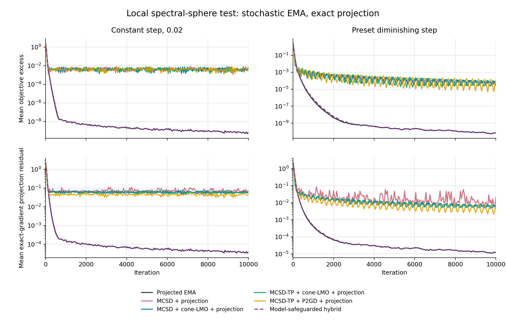

# MCSD with Cone LMO and Exact Spectral Sphere Projection

**Local study, 6 November 2026. CPU FP64; no H20 jobs or production changes.**

[Study code](../../scripts/local_projected_lmo_study.py) |
[Tests](../../scripts/test_local_projected_lmo_study.py) |
[Direction derivation](local_cone_lmo_feasibility_20261106.md) |
[LLM results](mcsd_p2gd_results_summary.md)

## Conclusion

The selected-face P2GD-LMO construction gives a valid tangent-cone descent
direction when the complete, true top singular subspace is supplied. This
does **not** automatically give descent after exact sphere projection.
A 2x2 counterexample below establishes this distinction even with exact
spectra and exact LMOs, independently of BF16 or power-iteration errors.

A separate projected-model safeguard provides a provable route to stochastic
stationarity without a line search. It is an additional algorithm, needs a
second projection, and must not be presented as a convergence theorem for the
unguarded hybrid. The small optimization tests distinguish these two algorithms.

## Problem and Methods

We minimize

$$
f(X)=\tfrac12\|X-A\|_F^2,\qquad
C=\{X\in\mathbb R^{4\times4}:\|X\|_2=1\}.
$$

This is the **spectral sphere**, not the spectral ball. For a trial SVD
$Y=U\operatorname{Diag}(s)V^\top$, $s_1\ge\cdots\ge s_4$, one exact Frobenius
projection is

$$
P_C(Y)=U\operatorname{Diag}(1,\min(s_2,1),\ldots,\min(s_4,1))V^\top.
$$

The top value is raised to one for an interior trial. Consequently
$f^\star=\tfrac12\|P_C(A)-A\|_F^2$ is known, including when the optimum has a
multiple top singular value. Optimality of this formula follows by aligning
singular bases in the Frobenius distance and minimizing over the singular
values subject to their maximum being one.

All updates use EMA momentum, not Nesterov:

$$
m_t=\beta m_{t-1}+(1-\beta)(\nabla f(X_t)+\xi_t),\quad \beta=0.9,
\qquad X_{t+1}\in P_C(X_t+\alpha_t D_t).
$$

There is no backtracking or objective-based step selection. The shared near
threshold is $1-\sigma_2/\sigma_1\le0.02$. It deliberately exercises the
near-region mechanism; it is not a proposed LLM threshold. **Actual multiplicity**
is identified separately with relative tolerance $10^{-10}$ in FP64.

Let $P_T$ be the rank-one tangent-space projector and $\operatorname{polar}$
the exact spectral-norm-ball LMO, with a zero output for a zero input.

| Method | Smooth or safe direction | Near-region direction |
|---|---|---|
| Projected EMA baseline | $-m_t$ | $-m_t$ |
| MCSD + projection | $\operatorname{polar}(P_T(-m_t))$ | Same top-1 rule |
| MCSD-TP direction + projection | $P_T\operatorname{polar}(P_T(-m_t))$ | Same top-1 rule |
| MCSD-TP + PGD | MCSD-TP direction | $-m_t$ |
| MCSD-TP + P2GD | MCSD-TP direction | $P^F_{T_C(X_t)}(-m_t)$ |
| MCSD-TP + cone-LMO | MCSD-TP direction | Selected-face LMO below |
| MCSD + cone-LMO | MCSD direction | Selected-face LMO below |
| MCSD-TP + near-cluster LMO | MCSD-TP direction | Same formula using a 0.05-wide surrogate cluster |
| Safeguarded MCSD-TP + cone-LMO | Candidate as above | Candidate as above; both branches undergo the model check |

Every row uses exact sphere projection as its final return. The two top-1
controls are intentional heuristics at a multiple top value. The near-cluster
row is also a surrogate, not an exact tangent-cone method. The true-top hybrids
use the complete multiplicity, with no top-4 truncation. The PGD and P2GD
directions retain momentum magnitude; the LMO directions have norm-ball scaling.
Thus this is a fixed-schedule mechanism test, not a learning-rate-tuned ranking
or a direction-length-matched comparison.

## Why the Cone LMO Direction Is Valid

At a feasible point with top multiplicity $q$, let $U_q,V_q$ denote paired top
singular bases and $H(Z)=\operatorname{sym}(U_q^\top ZV_q)$. Then

$$
T_C(X)=\{D:\lambda_{\max}(H(D))=0\}.
$$

For $Z=-m$, eigendecompose $A_0=H(Z)$. Construct $B$ by clipping all positive
eigenvalues to zero and setting the largest eigenvalue to zero even if all
were negative. Set

$$
Q=Z+U_q(B-A_0)V_q^\top,\qquad
P=\text{projector onto the strictly negative eigenspace of }B.
$$

For any norm $N$, take an exact ordinary LMO
$S\in\arg\max_{N(S)\le1}\langle Q,S\rangle$. The selected-face correction is

$$
C_0=PH(S)P,\qquad
D=S+U_q((C_0)_--H(S))V_q^\top.
$$

Here $(C_0)_-$ keeps negative eigenvalues, without their absolute values.
Since $\ker P\ne\{0\}$, $H(D)=(C_0)_-\preceq0$ has a zero eigenvalue.
This proves exact cone membership. Moreover,

$$
\langle Z,D\rangle=N_*(Q)-\langle B,(C_0)_+\rangle\ge N_*(Q).
$$

Thus the exact-gradient direction is descending whenever $Q\ne0$. The final
correction is a Frobenius projection onto a convex selected face, so
$\|D\|_F\le\|S\|_F$. It need not preserve $N(D)\le1$. The term **cone-LMO**
here means this selected-face construction, not an exact solution of the
norm-constrained nonconvex-cone LMO. For $q=1$ it reduces to MCSD-TP's
post-LMO tangent correction. See the linked direction study for the derivation
and 432 algebra checks with spectral, Frobenius and entrywise-l1 oracles.

## Exact Projection Can Reverse Descent

Take the linear objective $f(X)=-\langle Z,X\rangle$ and

$$
X_\epsilon=\begin{pmatrix}1&0\\0&1-\epsilon\end{pmatrix},\quad
Z=\begin{pmatrix}4&1\\1&0\end{pmatrix},\quad
D=\begin{pmatrix}0&1\\1&0\end{pmatrix},\quad \alpha=\epsilon>0.
$$

$D$ is exactly the top-1 selected-face spectral LMO and
$\langle\nabla f,D\rangle=-2$. For small positive $\epsilon$, the symmetric
trial $X_\epsilon+\epsilon D$ has singular values
$1-\epsilon/2\pm\epsilon\sqrt5/2$. Clipping only the top one gives

$$
\frac{f(P_C(X_\epsilon+\epsilon D))-f(X_\epsilon)}{\epsilon}
=\frac3{\sqrt5}-1\approx 0.341641>0.
$$

Also,

$$
\frac{\|P_C(X_\epsilon+\epsilon D)-(X_\epsilon+\epsilon D)\|_F}{\epsilon}
=\frac{\sqrt5-1}{2}\approx0.618034.
$$

The code verifies this at $\epsilon=10^{-2},10^{-4},10^{-6},10^{-8}$.
Hence a uniform quadratic return model for these directions cannot hold over
all near-singular points: its linear prediction is $-2\epsilon$ while the
actual change is positive of order $\epsilon$. The example applies to the
near branch of either hybrid, and does not depend on the safe-region choice.
Here the ordinary cone projection also satisfies $Q=D$, so the same example
warns against giving a global no-line-search descent claim for unnormalized
P2GD itself. Adding an LMO is not the only source of this difficulty.

For each **fixed** point, a sufficiently small local step can still descend.
The failed assertion is uniformity while the base point approaches a change
of multiplicity. This one-step counterexample does not prove that every
unguarded trajectory fails to converge. It rules out a tempting but invalid
proof that simply substitutes the cone direction into the smooth MCSD return
assumption.

## A Separate No-Line-Search Safeguard

Let $L>0$ be a valid ambient gradient Lipschitz bound. Use one prescribed
$\alpha>0$ and compute two feasible candidates:

$$
x^c\in P_C(x+\alpha D),\qquad x^b\in P_C(x-\alpha m),\qquad
d_c=x^c-x,\quad d_b=x^b-x.
$$

Define $\psi_m(d)=\langle m,d\rangle+\tfrac L2\|d\|_F^2$. Accept $x^c$ only if

$$
\psi_m(d_c)\le\psi_m(d_b),\qquad
\|d_c\|_F\le\kappa\|d_b\|_F,\quad\kappa\ge1.
$$

Otherwise choose $x^b$. The check uses momentum and the actual returned
displacements, not sampled objective values. There is no backtracking and no
change to the prescribed step. It must be applied to **both** branches for
the following global statement. In this implementation it costs two sphere
projections, in addition to direction construction and diagnostic SVDs.
The Lipschitz bound is known here because the objective is quadratic; obtaining
a useful valid bound for LLM training is an additional practical obstacle.

### Derived Sufficient Convergence Conditions

This is a sufficient argument for the **safeguarded algorithm**, not a cited
theorem for the original hybrid. Suppose:

1. $C$ is nonempty and compact. The spectral sphere satisfies this in finite
   dimension, including all its nonsmooth points.
2. $f$ is continuously differentiable with $L$-Lipschitz gradient on a
   neighborhood of $\operatorname{conv}(C)$; $f$ is bounded below on $C$.
3. All metric projections are global and exact, and selections are measurable.
4. $m_t=\beta m_{t-1}+(1-\beta)(\nabla f(x_t)+\xi_t)$, $0\le\beta<1$,
   with conditionally centered noise and
   $\mathbb E[\|\xi_t\|_F^2\mid\mathcal F_t]\le\nu_t$.
   The initial tracking error has finite second moment.
5. The constant step satisfies

$$
0<\alpha<\frac{1-\beta}{L(1-\beta+2\kappa^2\beta)}.
$$

For an almost-sure cluster-point statement, additionally assume
$\sum_t\nu_t<\infty$. Then **every accumulation point is proximally stationary,
and hence Bouligand stationary and Clarke stationary, almost surely**.
The objective values converge. This does not claim convergence of the whole
iterate sequence to one point or convergence to a global optimum.

The spectral sphere needs no additional uniform inter-stratum separation for
this safeguard proof. It also permits any norm LMO, or an inexact candidate
direction, because the reference step controls the final feasible update.
That generality is a guarantee from the safeguard, not evidence of an LMO
advantage.

### Proof

Write $e_t=m_t-\nabla f(x_t)$ and
$r_t=\|d_{b,t}\|_F$. Comparison of the exact baseline projection with the
feasible point $x_t$ yields

$$
\langle m_t,d_{b,t}\rangle+\frac{\|d_{b,t}\|_F^2}{2\alpha}\le0.
$$

Set $c_\alpha=(1-\alpha L)/(2\alpha)>0$. For the selected displacement
$d_t=x_{t+1}-x_t$, the guard or the fallback gives
$\psi_{m_t}(d_t)\le-c_\alpha r_t^2$ and $\|d_t\|_F\le\kappa r_t$.
Smoothness and Young's inequality therefore imply

$$
f(x_{t+1})\le f(x_t)-\frac{c_\alpha}{2}r_t^2
                 +\frac{\kappa^2}{2c_\alpha}\|e_t\|_F^2. \tag{1}
$$

For $t\ge1$, the current-sample EMA recursion gives

$$
\mathbb E\|e_t\|_F^2\le
\beta\mathbb E\|e_{t-1}\|_F^2+
\frac{\beta^2L^2}{1-\beta}\mathbb E\|d_{t-1}\|_F^2+
(1-\beta)^2\nu_t.
$$

This is the same type of momentum-tracking recursion used in the manuscript.
Summing it and using $\|d_t\|_F\le\kappa r_t$ gives

$$
\sum_{t<T}\mathbb E\|e_t\|_F^2\le
\frac{\mathbb E\|e_0\|_F^2}{1-\beta}
+\frac{\beta^2L^2\kappa^2}{(1-\beta)^2}
  \sum_{t<T}\mathbb E r_t^2
+(1-\beta)\sum_{1\le t<T}\nu_t.
$$

Combining with (1), define

$$
\gamma=\frac{c_\alpha}{2}
-\frac{\kappa^4\beta^2L^2}{2c_\alpha(1-\beta)^2}>0.
$$

The stated step condition is exactly sufficient for $\gamma>0$. If
$\Delta_f=\mathbb E f(x_0)-\inf_C f$, then

$$
\gamma\sum_{t<T}\mathbb E r_t^2\le
\Delta_f+\frac{\kappa^2}{2c_\alpha}
\left(\frac{\mathbb E\|e_0\|_F^2}{1-\beta}
 +(1-\beta)\sum_{1\le t<T}\nu_t\right). \tag{2}
$$

Under summable variance, both $\sum_t\mathbb E r_t^2$ and
$\sum_t\mathbb E\|e_t\|_F^2$ are finite. Thus $r_t\to0$ and $e_t\to0$
almost surely. Compactness and the closed graph of the metric projection,
with constant $\alpha>0$, imply for every cluster point

$$
x_*\in P_C(x_*-\alpha\nabla f(x_*)).
$$

In particular, for every $y\in C$,
$\langle\nabla f(x_*),y-x_*\rangle\ge-\|y-x_*\|_F^2/(2\alpha)$.
Passing to tangent secants gives
$\langle\nabla f(x_*),v\rangle\ge0$ for every $v\in T_C(x_*)$,
which is Bouligand stationarity. Finally (1) bounds the sum of positive
objective increments by a summable error sequence; boundedness below then
gives convergence of objective values.

### Bounded Variance and a Finite Horizon

Increasing batch size is not necessary for a **finite-time residual bound**.
For $\nu_t\le\sigma^2$, divide (2) by $\gamma\alpha^2T$ to bound the mean
squared projected-gradient residual
$\|x_t-P_C(x_t-\alpha m_t)\|_F^2/\alpha^2$.

For each prescribed horizon $T$, choose
$1-\beta=T^{-1/2}$ and $\alpha=a(1-\beta)/L$, where
$0<a<1/(2\kappa^2)$ is fixed. With uniformly bounded initial error and
objective gap, (2) gives an $O(T^{-1/2})$ mean squared residual, or an
$O(T^{-1/4})$ root-mean-square residual. The constants depend on $L$, $a$,
$\kappa$, initialization and noise variance.

This is a **momentum-based projection residual**, not automatically the exact-
gradient mapping plotted below. The optimality of the baseline projection also
gives a proximal-normal residual at $x_t+d_{b,t}$ bounded by
$\|e_t\|_F+(L+1/\alpha)r_t$. Combining its squared bound with the tracking
estimate gives the same $O(T^{-1/2})$ order for a mean squared proximal-normal
residual at these baseline points. Do not relabel that as a same-point
Bouligand residual for the unguarded candidate sequence.

These horizon-dependent choices are a different guarantee from the fixed-
$\alpha$, summable-noise accumulation theorem. The present toy runs use fixed
$\beta=0.9$; no horizon-rate claim is inferred from their curves.

## Experimental Protocol

Eight problems use independent fixed target and starting singular bases.
There are two cases of each family, with target singular values:

| Family | Singular values of $A$ | Constrained optimum |
|---|---|---|
| Interior target | 0.7, 0.5, 0.3, 0.1 | Simple top equal to 1 |
| Exterior target | 1.4, 0.8, 0.4, 0.2 | Simple top equal to 1 |
| Plateau target | 1.3, 1.3, 0.5, 0.2 | Repeated top equal to 1 |
| Nearly repeated exterior target | 1.3, 1.2999, 0.5, 0.2 | Repeated top equal to 1 after projection |

Every initial spectrum is $(1,1,0.65,0.3)$ with independently rotated bases,
so the experiment is not just scalar singular-value fitting. The plateau
families deliberately require handling a genuinely nonsmooth solution.
Repeated near calls there are not, by themselves, an algorithmic failure.

Each problem has deterministic and stochastic trials with identical initial
states and paired noise across methods. Stochastic samples have Gaussian
noise with expected squared Frobenius norm $0.01/(t+1)^{1.2}$, which satisfies
the summable-variance condition. Two schedules are tested:

- Constant: $\alpha_t=0.02$.
- Diminishing: $\alpha_t=0.02(1+t/200)^{-0.6}$.

For the guard, $L=1$ and $\kappa=1.5$. The constant-step theorem allows
$\alpha<0.024096$, so $0.02$ satisfies the sufficient bound. The diminishing
schedule is an empirical additional comparison; the fixed-step cluster-point
proof is not silently transferred to it.

Nine methods, eight problems, two noise settings and two schedules give
**288 trajectories**, each inspected at 2,000 and 10,000 steps. The longer
runs reuse the same prefixes; they are not another 288 independent samples.
Spectra and polar LMOs are recomputed in FP64 to isolate algorithm geometry.
These tests do not benchmark SVD caching, NS8 or approximate PI.

## Results

The 2,000-step records match the prefixes of all 288 longer trajectories
exactly. Maximum recorded radius error across the 10,000-step runs is
**2.22e-15**. All comparisons below retain both cases in every family; there
is no best-seed or best-learning-rate selection.

### Stochastic Diminishing Steps

Arithmetic means across eight problems. The last column is the exact-gradient
residual $\|X-P_C(X-\alpha\nabla f(X))\|_F/\alpha$ at the final step, not a
training gradient norm. The ordinary P2GD row below uses the true tangent cone.

| Method | $f-f^\star$ at 2,000 | $f-f^\star$ at 10,000 | Final projection residual |
|---|---:|---:|---:|
| Projected EMA baseline | 4.290e-9 | 6.456e-11 | 1.171e-5 |
| MCSD + projection | 2.506e-4 | 8.345e-5 | 2.242e-2 |
| MCSD-TP direction + projection | 4.760e-4 | 3.259e-5 | 5.611e-3 |
| MCSD-TP + PGD | 6.186e-4 | 9.029e-5 | 5.460e-3 |
| MCSD-TP + P2GD | 6.351e-4 | 1.032e-4 | 5.860e-3 |
| MCSD-TP + cone-LMO | 2.243e-4 | 2.544e-5 | 4.963e-3 |
| MCSD + cone-LMO | 4.746e-4 | 8.957e-5 | 6.951e-3 |
| MCSD-TP + near-cluster LMO | 2.010e-4 | 1.854e-5 | 4.986e-3 |
| Safeguarded MCSD-TP + cone-LMO | 6.116e-9 | 6.456e-11 | 1.171e-5 |

The requested construction is implementable and improves toward the known
optimum under this decreasing schedule. It is **not** competitive with ordinary
projected EMA on these isotropic quadratic problems. The MCSD-TP-based cone-LMO
variant is better than its own control on average, while the original-MCSD-based
hybrid is not better than its own control. This distinction matters when choosing
which variant to analyze. Near-cluster substitution changes the algorithm; its
slightly smaller objective error does not establish exact-cone correctness.

The quadratic objective uses the same Frobenius metric as the projection, which
naturally suits PGD. These results are geometry and convergence diagnostics,
not a conclusion that PGD is universally preferable for LLM training.

### Constant Steps and the Safeguard

With stochastic samples and fixed $\alpha=0.02$, the final mean objective
errors are 5.264e-3 (MCSD), 4.663e-3 (MCSD-TP), 3.010e-3 (MCSD + cone-LMO),
and 6.543e-3 (MCSD-TP + cone-LMO), versus 6.494e-10 for projected EMA.
Nonvanishing LMO-length updates continue to oscillate near a solution; simply
increasing the iteration budget does not remove this finite-step behavior.

The guard accepts the LMO candidate in only **0.1425%** of steps under the
constant schedule and **0.1525%** under the diminishing schedule. Its final
results nearly coincide with projected EMA because it predominantly uses that
reference step. Thus the safeguard is a constructive theoretical remedy, **not
evidence of a successful or cheaper LMO optimizer**. Its additional projection
would currently be counterproductive for the original engineering motivation.



The plotted curves are arithmetic means of eight paired problems, without
smoothing. Guard and baseline curves nearly overlap. Clipping at 1e-16 is used
only to make logarithmic plotting well-defined; metrics in the JSON are raw.

### Genuine Nonsmooth Optima

At 10,000 stochastic diminishing steps, mean objective excess by target family:

| Method | Interior | Exterior | Repeated exterior | Nearly repeated exterior |
|---|---:|---:|---:|---:|
| Projected EMA | 5.954e-11 | 4.817e-11 | 7.413e-11 | 7.640e-11 |
| MCSD + cone-LMO | 3.404e-4 | 1.049e-5 | 3.405e-6 | 3.984e-6 |
| MCSD-TP + cone-LMO | 8.558e-5 | 9.591e-6 | 3.906e-6 | 2.678e-6 |

The last two families have optimal multiplicity two even though their target
spectra differ. They use the near branch for approximately **99.2%** of updates,
whereas the simple-optimum families use it for only 0.02% in the unguarded LMO
hybrids. The overall near rate of about 49.6% reflects this deliberate balanced
test design. Escaping every zero-gap point is neither necessary nor desirable
when a constrained optimum itself has zero gap.

## What to Test Next

1. Retain exact spectra and projection while addressing direction amplitude.
   Compare the unit-LMO construction with a residual-scaled direction that
   shrinks near stationarity, keeping MCSD and MCSD-TP variants separate.
   Positive scaling preserves cone membership and first-order descent, but
   does not by itself solve the cross-stratum projection counterexample.
2. Evaluate anisotropic least-squares objectives with a controlled condition
   number and paired stepsize budgets. The present isotropic problem is an
   appropriate correctness test, but not strong evidence for the intended
   benefit of a non-Euclidean LMO.
3. Seek a cheaper condition controlling the **actual projected displacement**.
   Direction-only cone checks cannot replace that condition. Any claimed
   convergence result must state whether it assumes such a condition or
   enforces it algorithmically.

The unguarded algorithm remains a research candidate, not a proven stochastic
closed-set solver. The conditional safeguard argument supplies a valid target
for future simplification, but its present acceptance rate does not support
moving it to H20. No remote tests were started.

Validation: **85 tests passed** (74 existing cluster/LMO tests and 11 local
geometry/projected-study tests). All reported experiments use the production
selected-face direction helper; no training optimizer was changed.

## Reproduce

Python 3.12 and CPU PyTorch are sufficient. Plotting additionally needs NumPy
and Matplotlib. From the repository root:

```bash
python -B -m unittest discover -s scripts -p 'test_local*py' -v
python -B scripts/local_projected_lmo_study.py \
  --output docs/results/local_projected_lmo_20261106/study.json
python -B scripts/local_projected_lmo_study.py --steps 10000 \
  --output docs/results/local_projected_lmo_20261106/study_10000.json
python -B scripts/plot_local_projected_lmo_study.py \
  docs/results/local_projected_lmo_20261106/study_10000.json \
  --output docs/experiments/local_projected_lmo_20261106/convergence
```

The JSON outputs contain all trajectories, sampled diagnostics, configuration
and source SHA256 hashes. Results are local generated artifacts, excluded from
the H20 completed-run ledger.

## Relation to Existing Theory

- [Schneider and Uschmajew](https://arxiv.org/abs/1402.5284) analyze projected
  line-search methods on low-rank varieties. That does not directly establish
  this stochastic, no-line-search spectral-sphere construction.
- [Olikier, Gallivan and Absil](https://arxiv.org/abs/2201.03962) obtain
  Bouligand-stationary accumulation for low-rank methods using rank reduction
  or a PGD/P2GD hybrid. Their results motivate explicit cross-stratum handling;
  they do not justify replacing the gradient by any norm LMO without analysis.
- [Olikier and Waldspurger](https://doi.org/10.1137/24M1692782) establish strong
  accumulation-point properties for PGD on closed sets. The projection
  comparison used here is compatible with that approach, but the stochastic
  safeguard proof above is derived separately with its own stated assumptions.
