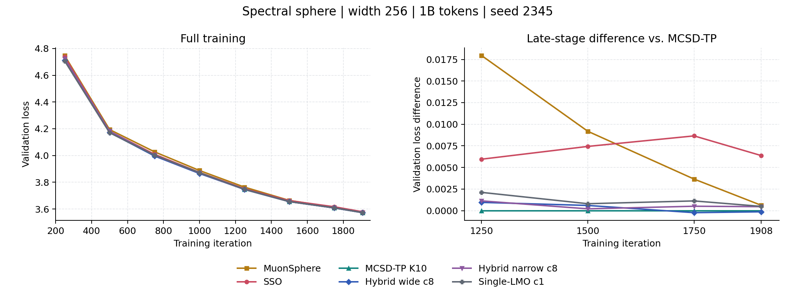

# Spectral-Sphere Experiment Summary

[Overview](../../README.md) · [Algorithms and code](../algorithms/current_comparison_pseudocode.md) · [Reproduction](../runbooks/cluster_experiments_reproduction.md) · [Related work](../related_work.md)

**Results verified 2026-11-01; follow-ups submitted 2026-11-02.** This page
covers **30 completed width-256 runs: 18 at 1B and 12 at 3B tokens**. Budgets
are processed tokens, not model sizes. Historical width sweeps, 12B tests,
Frobenius-geometry experiments, smokes, and failed jobs are not pooled here.

[Latest results](#latest) · [Candidates](#candidates) · [Protocol](#comparisons) · [Numerics](#precision) · [Next](#next) · [Ledger](#ledger)

> **Bottom line:** the approximate engineering path is working, with no
> original-matrix full SVD in the current updates. A reliable optimization
> advantage from the multi-direction near branch has **not** been established.

<a id="latest"></a>

## Latest: Six Matched 1B Runs

Seed **2345**, LR **1.5e-2**, 1908 steps, **20 validation batches** per evaluation.
All six completed with exit 0:0 and no logged NaN/skipped iterations.

| Method | Final loss | Difference vs. control | Train + validation | Job |
|---|---:|---:|---:|---|
| MuonSphere | 3.573290 | +0.000621 | **5:33:30** | `4368383_0` |
| SSO | 3.579043 | +0.006374 | 6:11:37 | `4368383_1` |
| MCSD-TP K10 | 3.572669 | 0 | 5:54:15 | `4368382_2` |
| **Wide cluster K10/c8** | **3.572540** | **-0.000129** | 5:55:24 | `4368383_3` |
| Narrow cluster K10/c8 | 3.573133 | +0.000464 | 5:55:46 | `4368383_4` |
| Single-LMO narrow cluster/c1 | 3.573165 | +0.000496 | 5:55:50 | `4368382_5` |



- The wide hybrid is lower than MuonSphere by **0.000750**, but its advantage
  over its own control is only **0.000129**. One seed is not a robust win.
- Narrowing the cluster removed observed top-4 overflows but did not improve loss.
- Single-LMO c1 had an early lead but a worse endpoint, with **82.94% repeated
  near calls**, versus **70.97%** for wide c8. Early pilot rankings can reverse.
- The wide hybrid adds **69 seconds** to control and costs **6.57%** more than
  MuonSphere. Timings include validation and are not optimizer-kernel timings.

[Full curves, numerical audit, and analysis](cluster_results_20261101.md) ·
[Final machine-readable record](../results/cluster_cone_lmo_1b_20261031/final_20261101.json)

## Cross-Seed 3B Evidence

All rows below use 5723 steps, LR `1.5e-2`, and 20 validation batches.
Compare methods **within a seed**; initialization and seed-dependent data
ordering/indexing can shift absolute loss.

| Method | Seed 1234 | Time | Seed 2345 | Time |
|---|---:|---:|---:|---:|
| MuonSphere | **3.442197** | **16:37:29** | 3.436023 | **16:35:03** |
| SSO | 3.442296 | 18:28:24 | 3.435041 | 18:28:11 |
| MCSD-TP K10 | 3.443943 | 17:41:47 | 3.428613 | 17:39:34 |
| Hybrid K10/c8, top≤4 | 3.442441 | 17:40:21 | 3.432620 | 17:41:00 |
| MCSD-TP K20 | 3.444459 | 18:20:33 | Not run | — |
| Hybrid K20/c8 | 3.443598 | 18:21:08 | Not run | — |
| Ambient near branch/c8 | Not run | — | **3.427854** | 17:40:58 |
| Top-1 near branch/c8 | Not run | — | 3.428247 | 17:44:21 |

Hybrid K10 minus matched control: **-0.001502** at seed 1234 and
**+0.004007** at seed 2345. The two-seed mean paired difference is
**+0.001253**, unfavorable to the hybrid. This is descriptive, not a
significance test. The second-seed hybrid beats both baselines, but loses to
its own control and simpler near directions.

At seed 2345, near-branch rates are **1.8750% / 0.8600% / 0.9327%** for
cluster / ambient / top-1. Repeat rates are **60.19% / 8.40% / 13.80%**.
The cluster arm has 3592 capacity overflows. These statistics end at step
5720 and count matrix components. They do not establish repetition as the
cause of poorer loss.

[First-seed analysis](cluster_results_20261028.md) ·
[Second-seed analysis](cluster_results_20261031.md) ·
[First-seed curves](cluster_summary/validation_3b_k10.png)

<a id="candidates"></a>

## Candidates and Decisions

| Candidate | Evidence | Decision |
|---|---|---|
| **MCSD-TP K10** | Competitive control; lower than both baselines in the latest 1B and second-seed 3B runs | Retain as the matched reference |
| **Wide hybrid K10/c8** | Tiny latest 1B gain; 3B gain changes sign across seeds | Replicate, not a default winner |
| Ambient / top-1 c8 | Best second-seed 3B endpoints; only one mechanism seed | Retain for a later paired mechanism replication |
| Narrow cluster c8 | Eliminates sampled capacity overflows; worsens latest 1B endpoint | Do not expand the long-run grid |
| Single-LMO c1 | Early lead disappears; higher repeat rate and longer near bursts | Replay c0.5/1/2 on frozen matrices first |
| K20 | More accurate sampled spectra, not consistently better loss | Accuracy reference, not automatic upgrade |
| c12 / K40 | Lower repetition / numerical error without better earlier 1B endpoints | Defer |
| Full-SVD reference | Useful for checking direction and return errors, substantially costlier in prior pilots | Offline oracle, not the default training path |

### Current Hybrid Definition

```text
safe branch     tangent -> NS8 matrix sign -> tangent
near branch     normalize momentum (Frobenius) -> top-cluster cone-type correction
routing         estimated relative gap <= 5e-5
cluster         relative width 2e-3; adaptive q<=4; coefficient c=8
spectrum        cached warm block-8, K10, FP32 QR/Ritz
return          approximate radial scaling, both branches
next cache      scaled Ritz values and vectors of the returned point
online checks   no accuracy gate and no automatic full-SVD fallback
```

K is the iteration count; eight is the spectral block size; q is the correction
rank. **c is a step multiplier, not a use percentage.** There is no
post-correction normalization or MCSD length matching. Ambient plus radial
return is not projected gradient descent. Near-cluster plus radial return is
not standard P²GD and does not inherit its convergence theorem.

<a id="comparisons"></a>

## Protocol and Comparability

| Setting | Current track |
|---|---|
| Model | Width 256, 28 layers, FFN 768, 2 heads, head dimension 128, sequence length 4096 |
| Constraints | Spectral-muP target radii for hidden matrix components |
| Data | Existing 3B indexed OLMo-Mix source and its validation source |
| Training | One H20/run, global batch 128, microbatch 4, fresh initialization |
| Precision | BF16 training/NS8; FP32 master weights and experimental QR/Ritz; TF32 off |
| Momentum | Existing Muon-style Nesterov coefficient 0.9 for matrix optimizers |
| Auxiliary parameters | AdamW (0.9, 0.95), eps 1e-8; weight decay 0.1 with group exclusions; constrained matrices wd=0 |
| Schedule | 250 warmup steps, cosine decay to 10% of peak LR |
| Endpoint | 1B: 1908 steps; 3B: 5723 steps; final validation, not best intermediate loss |
| Evaluation | Earlier 12-run 1B grid: 5 batches; latest six-arm 1B and all current 3B runs: 20 batches; every 250 steps + endpoint |
| Time | Training plus validation, excluding preflight/audits; not Slurm elapsed time |

The baseline code names are `muon_ball_dist` (MuonSphere) and
`spectral_ball_dist` (SSO). Both use reference BF16 cold PI10 and hard
pre-step radial normalization; the experimental methods use post-step
approximate radial return. Their return maps are not identical.
Do not compare absolute losses across different token/evaluation protocols,
the historical paper sample, or the separate Frobenius-geometry branch.

<a id="precision"></a>

## Numerical Evidence

In the latest six-arm batch, each experimental arm records **480,816 small
Ritz SVDs and zero original-matrix full-SVD/svdvals calls online**.
Full SVD is used only by offline audits. Legacy zero residual fields in
training logs are not numerical certificates.

At step 1900, wide / narrow / single-LMO near rates are **2.275% / 2.132% /
3.433%**; mean burst lengths are **3.44 / 3.19 / 5.86**. Sampled mean
absolute gap errors are roughly **7.7e-5 to 1.2e-4**, with a maximum sampled
returned-radius error of **1.503e-4**. Audits are selected, bounded samples,
not population rates. Numerical error is still relevant to a `5e-5` route
threshold; no exact feasibility or safe-region certification is claimed.

<a id="next"></a>

## Submitted Follow-Ups

| Test | Configuration | Status at submission |
|---|---|---|
| Frozen-matrix scale audit | 160 saved samples; single-LMO c0.5/1/2 plus wide/narrow references; cached and oracle spectra | `4373185`, completed in 47 seconds |
| Paired 1B replication | Seed 1234, K10 control vs. wide hybrid c8, LR 1.5e-2, 1908 steps, eval20 | `4373351_0–1`, RUNNING as of 2026-11-02 00:59 HKT |

The corrected pair was submitted **2026-11-02 00:55 HKT**; at most two GPUs
concurrently, no checkpoints. [Submission metadata](../results/cluster_followup_1b_20261101/submission_v2.json)
and [launchers](cluster_results_20261101.md#follow-up) are authoritative.
No follow-up final losses are available yet.

The first pair `4373186_0–1` failed in preflight before training because of an
isolated test import-path error. The v2 snapshot fixes that path, isolates
launcher overrides from grid tests, and adds a regression test. All 63 local
tests pass; the successful audit had passed the earlier 62 CUDA tests.

The [completed scale audit](cluster_results_20261101.md#completed-scale-audit)
finds 22/28/37 near-region exits among the same 51 cases for single-LMO
c0.5/c1/c2. Larger c also increases radial change and radius error. This
supports c2 only as a possible future pilot, not a proven loss improvement.

This is not a duplicate of the old seed-1234 1B K20/eval5 or 3B K10 runs.
The failed third-seed 3B array `4360583` never trained; its wrapper path was
fixed, but it has not been resubmitted. The new pair does not count as a
third-seed 3B result.

**Decision rule:** report the paired 1B difference regardless of sign.
The offline audit can reject poor scales or identify a useful pilot, but
momentum linear models do not establish training-loss improvement. Keep
larger widths, broad gap sweeps, and longer budgets deferred. Future common
fixed-batch evaluation would help resolve very small differences; old
checkpoints are unavailable for retrospective re-evaluation.

<a id="ledger"></a>

## Traceable Ledger

| Completed batch | Count | Evidence |
|---|---:|---|
| Earlier 1B, seed 1234, eval5 | 12 | [JSON](../results/cluster_candidates_1b_20261024/final_summary.json), [configuration](cluster_candidates_1b_20261024.md) |
| 3B, seed 1234 | 6 | [JSON](../results/cluster_selected_3b_20261025/final_summary_20261027.json), [analysis](cluster_results_20261028.md) |
| 3B, seed 2345 + mechanism controls | 6 | [JSON](../results/cluster_seed_mechanism_3b_20261028/final_20261031.json), [analysis](cluster_results_20261031.md) |
| Latest 1B, seed 2345, eval20 | 6 | [JSON](../results/cluster_cone_lmo_1b_20261031/final_20261101.json), [analysis](cluster_results_20261101.md) |
| **Total completed** | **30** | Deduplicated by Slurm Job ID; failed jobs and smokes excluded |

<details>
<summary>All earlier 1B endpoints, including unfavorable outcomes</summary>

| Job | LR | Method | K | c | Final loss | Time |
|---|---|---|---:|---:|---:|---|
| `4319977_8` | 1.5e-2 | MuonSphere | N/A | N/A | **3.582948** | 05:24:52 |
| `4319977_9` | 1.5e-2 | SSO | N/A | N/A | 3.591530 | 06:03:41 |
| `4319977_10` | 1.5e-2 | MCSD-TP | 20 | N/A | 3.588559 | 05:59:40 |
| `4319977_11` | 1.5e-2 | Hybrid | 20 | 8 | 3.587659 | 06:02:46 |
| `4319977_2` | 2e-2 | MuonSphere | N/A | N/A | 3.593271 | 05:25:51 |
| `4319977_3` | 2e-2 | SSO | N/A | N/A | 3.591197 | 06:04:47 |
| `4319977_0` | 2e-2 | MCSD-TP | 20 | N/A | 3.589549 | 06:00:02 |
| `4319977_1` | 2e-2 | Hybrid | 20 | 8 | **3.587868** | 05:59:09 |
| `4319977_4` | 2e-2 | Hybrid | 20 | 4 | 3.588366 | 06:00:03 |
| `4319977_5` | 2e-2 | Hybrid | 20 | 12 | 3.590739 | 06:00:25 |
| `4319977_6` | 2e-2 | MCSD-TP | 40 | N/A | 3.591258 | 06:25:55 |
| `4319977_7` | 2e-2 | Hybrid | 40 | 8 | 3.590239 | 06:23:41 |

</details>

All records are keyed by geometry, width, data/evaluation protocol, token
budget, method, K, rank, route/cluster thresholds, c, LR, momentum, and seed.
Source checksums identify training snapshots separately from later
documentation commits. Historical cleanup and failed-job records remain in
their dated reports; checkpoints, environments, datasets, and matrix
snapshots are not published.
