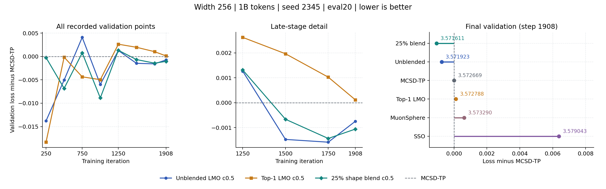

# Spectral-Sphere Experiment Summary

[Overview](../../README.md) · [Algorithms and code](../algorithms/current_comparison_pseudocode.md) · [Reproduction](../runbooks/cluster_experiments_reproduction.md) · [Related work](../related_work.md)

**Results verified 2026-11-05.** This page
covers **38 completed width-256 runs: 26 at 1B and 12 at 3B tokens**. Budgets
are processed tokens, not model sizes. Historical width sweeps, 12B tests,
Frobenius-geometry experiments, smokes, and failed jobs are not pooled here.

[Latest results](#latest) · [Candidates](#candidates) · [Protocol](#comparisons) · [Numerics](#precision) · [Next](#next) · [Ledger](#ledger)

> **Bottom line:** the approximate engineering path is working, with no
> original-matrix full SVD in the current updates. A reliable optimization
> advantage from the multi-direction near branch has **not** been established.

<a id="latest"></a>

## Latest: Twelve Matched 1B Runs

Seed **2345**, LR **1.5e-2**, 1908 steps, **20 validation batches** per evaluation.
Six reference runs and six follow-ups completed with exit 0:0 and no logged
NaN/skipped iterations. Their model, data and schedule settings were checked
against the launch records; the runs were not all concurrent.

| Method | Final loss | Difference vs. control | Train + validation | Job |
|---|---:|---:|---:|---|
| MuonSphere | 3.573290 | +0.000621 | **5:33:30** | `4368383_0` |
| SSO | 3.579043 | +0.006374 | 6:11:37 | `4368383_1` |
| MCSD-TP K10 | 3.572669 | 0 | 5:54:15 | `4368382_2` |
| Wide cluster K10/c8 | 3.572540 | -0.000129 | 5:55:24 | `4368383_3` |
| Narrow cluster K10/c8 | 3.573133 | +0.000464 | 5:55:46 | `4368383_4` |
| Single-LMO narrow cluster/c1 | 3.573165 | +0.000496 | 5:55:50 | `4368382_5` |
| Ambient near/c8 | 3.573986 | +0.001317 | 5:56:10 | `4375034_0` |
| Top-1 near/c8 | 3.572480 | -0.000189 | 5:54:13 | `4375034_1` |
| Single-LMO narrow cluster/c0.5 | 3.571923 | -0.000746 | 5:55:10 | `4375034_2` |
| Single-LMO narrow cluster/c2 | 3.575782 | +0.003113 | 5:55:29 | `4375034_3` |
| Single-LMO top-1/c0.5 (new) | 3.572788 | +0.000119 | 5:54:55 | `4389998_0` |
| **Single-LMO 25% shape blend/c0.5 (new)** | **3.571611** | **-0.001058** | 5:56:14 | `4389998_1` |



- **25% shape blend/c0.5** is the best observed endpoint: 0.000312 below
  unblended c0.5, 0.001679 below MuonSphere, and 0.007432 below SSO. It adds
  64 seconds to unblended c0.5, 0.56% to control and 6.82% to MuonSphere time.
  This is a small selected single-seed gain, not a stable-improvement claim.
- **Same-LMO top-1/c0.5** is worse than both unblended adaptive-q and control.
  This supports testing multi-direction correction within this family; it is
  not an isolated same-trajectory proof. The earlier momentum top-1/c8 is a
  different family and slightly outperforms its own wide-hybrid reference.
- **Reduced repetition is not sufficient:** the blend reduces repeats from
  92.18% to 88.02%, but top-1 repeats only 39.29% and has worse loss. Larger c2
  also reduced repetition without improving training. Unblended c0.5 is lower
  than the blend at steps 1500 and 1750; the new gain is not uniform over time.
- Ambient c8 loses at 1B despite winning the earlier seed-2345 3B comparison.
  Do not assume a candidate ranking transfers across budgets. Timing includes
  validation, not just optimizer kernels; node placement was not identical.

[Latest analysis and numerical audit](cluster_lmo_shape_1b_20261104.md) ·
[New raw records](../results/cluster_lmo_shape_1b_20261104/final_20261105.json) ·
[Previous mechanism/scale analysis](cluster_mechanism_scales_1b_20261102.md) ·
[Six-arm references](cluster_results_20261101.md)

### Completed Paired 1B Replication

The seed-1234 pair completed on 2026-11-02 with the same K10/1908-step/eval20
protocol. Both have exit 0:0, eight validation points, no logged NaN/skipped
iterations, and no original-matrix full SVD calls online.

| Method | Final loss | Difference vs. control | Train + validation | Job |
|---|---:|---:|---:|---|
| MCSD-TP K10 | 3.575916 | 0 | 5:55:07 | `4373351_0` |
| Wide hybrid K10/c8 | **3.575728** | **-0.000188** | 5:55:53 | `4373351_1` |

The two 1B paired differences are -0.000129 and -0.000188 (mean -0.000159,
rounded). This is a small descriptive improvement, not a significance claim
or evidence that the 3B discrepancy is resolved. Seed 1234 has no matched
K10/eval20 1B MuonSphere/SSO runs, so those baseline comparisons remain limited
to seed 2345.

At step 1900, the hybrid used 10,509 / 478,800 near decisions (**2.195%**),
with **69.14%** repeats, mean burst length **3.24**, and **1235** capacity
overflows. Thus the small gain did not remove repeated near calls or the
top-4 capacity limitation.
[Raw paired results](../results/cluster_followup_1b_20261101/paired_final_20261102.json).

## Cross-Seed 3B Evidence

All rows below use 5723 steps, LR `1.5e-2`, and 20 validation batches.
Compare methods **within a seed**; initialization and seed-dependent data
ordering/indexing can shift absolute loss.

| Method | Seed 1234 | Time | Seed 2345 | Time |
|---|---:|---:|---:|---:|
| MuonSphere | **3.442197** | **16:37:29** | 3.436023 | **16:35:03** |
| SSO | 3.442296 | 18:28:24 | 3.435041 | 18:28:11 |
| MCSD-TP K10 | 3.443943 | 17:41:47 | 3.428613 | 17:39:34 |
| Hybrid K10/c8, top≤4 | 3.442441 | 17:40:21 | 3.432620 | 17:41:00 |
| MCSD-TP K20 | 3.444459 | 18:20:33 | Not run | — |
| Hybrid K20/c8 | 3.443598 | 18:21:08 | Not run | — |
| Ambient near branch/c8 | Not run | — | **3.427854** | 17:40:58 |
| Top-1 near branch/c8 | Not run | — | 3.428247 | 17:44:21 |

Hybrid K10 minus matched control: **-0.001502** at seed 1234 and
**+0.004007** at seed 2345. The two-seed mean paired difference is
**+0.001253**, unfavorable to the hybrid. This is descriptive, not a
significance test. The second-seed hybrid beats both baselines, but loses to
its own control and simpler near directions.

At seed 2345, near-branch rates are **1.8750% / 0.8600% / 0.9327%** for
cluster / ambient / top-1. Repeat rates are **60.19% / 8.40% / 13.80%**.
The cluster arm has 3592 capacity overflows. These statistics end at step
5720 and count matrix components. They do not establish repetition as the
cause of poorer loss.

[First-seed analysis](cluster_results_20261028.md) ·
[Second-seed analysis](cluster_results_20261031.md) ·
[First-seed curves](cluster_summary/validation_3b_k10.png)

<a id="candidates"></a>

## Candidates and Decisions

| Candidate | Evidence | Decision |
|---|---|---|
| **MCSD-TP K10** | Competitive control; lower than both baselines in the latest 1B and second-seed 3B runs | Retain as the matched reference |
| **Wide hybrid K10/c8** | Tiny 1B gains at two seeds; 3B gain changes sign across seeds | Retain for mechanism tests, not a default winner |
| Top-1 c8 | Slightly better than wide hybrid at 1B and better at seed-2345 3B; only one mechanism seed | Retain as an important simpler control |
| Ambient c8 | Best seed-2345 3B endpoint, but worse than control/MuonSphere at 1B | Budget-dependent reference; do not promote at 1B |
| Narrow cluster c8 | Eliminates sampled capacity overflows; worsens latest 1B endpoint | Do not expand the long-run grid |
| **Single-LMO c0.5** | Strong unblended 1B reference; 5.800% near calls and 92.18% repeats | Retain for paired confirmation of the blend |
| Single-LMO top-1/c0.5 | Slightly worse than control; less repetition does not recover adaptive-q performance | Keep as the same-LMO rank ablation, not the leading candidate |
| **Single-LMO 25% blend/c0.5** | Best observed 1B endpoint, only 0.000312 below unblended; 4.252% near calls, 88.02% repeats | Prioritize paired-seed confirmation, not a larger grid |
| Single-LMO c1/c2 | Both worse than control at 1B; c2 reduces repetition but worsens loss | Keep as step-scale references; no wider grid yet |
| K20 | More accurate sampled spectra, not consistently better loss | Accuracy reference, not automatic upgrade |
| c12 / K40 | Lower repetition / numerical error without better earlier 1B endpoints | Defer |
| Full-SVD reference | Useful for checking direction and return errors, substantially costlier in prior pilots | Offline oracle, not the default training path |

### Original Wide-Hybrid Reference

```text
safe branch     tangent -> NS8 matrix sign -> tangent
near branch     normalize momentum (Frobenius) -> top-cluster cone-type correction
routing         estimated relative gap <= 5e-5
cluster         relative width 2e-3; adaptive q<=4; coefficient c=8
spectrum        cached warm block-8, K10, FP32 QR/Ritz
return          approximate radial scaling, both branches
next cache      scaled Ritz values and vectors of the returned point
online checks   no accuracy gate and no automatic full-SVD fallback
```

K is the iteration count; eight is the spectral block size; q is the correction
rank. **c is a step multiplier, not a use percentage.** There is no
post-correction normalization or MCSD length matching. Ambient plus radial
return is not projected gradient descent. Near-cluster plus radial return is
not standard P²GD and does not inherit its convergence theorem.

<a id="comparisons"></a>

## Protocol and Comparability

| Setting | Current track |
|---|---|
| Model | Width 256, 28 layers, FFN 768, 2 heads, head dimension 128, sequence length 4096 |
| Constraints | Spectral-muP target radii for hidden matrix components |
| Data | Existing 3B indexed OLMo-Mix source and its validation source |
| Training | One H20/run, global batch 128, microbatch 4, fresh initialization |
| Precision | BF16 training/NS8; FP32 master weights and experimental QR/Ritz; TF32 off |
| Momentum | Existing Muon-style Nesterov coefficient 0.9 for matrix optimizers |
| Auxiliary parameters | AdamW (0.9, 0.95), eps 1e-8; weight decay 0.1 with group exclusions; constrained matrices wd=0 |
| Schedule | 250 warmup steps, cosine decay to 10% of peak LR |
| Endpoint | 1B: 1908 steps; 3B: 5723 steps; final validation, not best intermediate loss |
| Evaluation | Earlier 12-run 1B grid: 5 batches; matched 1B references/follow-ups and all current 3B runs: 20 batches; every 250 steps + endpoint |
| Time | Training plus validation, excluding preflight/audits; not Slurm elapsed time |

The baseline code names are `muon_ball_dist` (MuonSphere) and
`spectral_ball_dist` (SSO). Both use reference BF16 cold PI10 and hard
pre-step radial normalization; the experimental methods use post-step
approximate radial return. Their return maps are not identical.
Do not compare absolute losses across different token/evaluation protocols,
the historical paper sample, or the separate Frobenius-geometry branch.

<a id="precision"></a>

## Numerical Evidence

In the matched 1B references and follow-ups, each experimental arm records **480,816 small
Ritz SVDs and zero original-matrix full-SVD/svdvals calls online**.
Full SVD is used only by offline audits. Legacy zero residual fields in
training logs are not numerical certificates.

In the original six-arm batch at step 1900, wide / narrow / single-LMO c1 near rates are **2.275% / 2.132% /
3.433%**; mean burst lengths are **3.44 / 3.19 / 5.86**. Sampled mean
absolute gap errors are roughly **7.7e-5 to 1.2e-4**, with a maximum sampled
returned-radius error of **1.503e-4**. Audits are selected, bounded samples,
not population rates. Numerical error is still relevant to a `5e-5` route
threshold; no exact feasibility or safe-region certification is claimed.

New ambient / top-1 / LMO c0.5 / LMO c2 cumulative near rates are
**0.906% / 0.983% / 5.800% / 1.607%**, with mean bursts
**1.14 / 1.25 / 12.78 / 2.13**. Counters end at step 1900, not 1908.
LMO c0.5's instantaneous rate at step 1900 is **34.52%**, substantially higher
than its cumulative rate. Its selected-sample gap MAE is 7.753e-5, still
comparable to the 5e-5 route threshold. No strict gap certificate is claimed.

The latest same-LMO top-1 / 25% blend cumulative near rates are
**1.218% / 4.252%**, versus instantaneous step-1900 rates of **10.32% / 30.95%**.
Mean bursts are **1.65 / 8.35**, and the blend has **48** capacity overflows
(unblended: 215). The 44 selected audit matrices per new run have gap MAE
**7.958e-5 / 8.297e-5**, mean relative direction error **3.167% / 3.740%**,
and maximum relative returned-radius error **1.602e-4 / 1.503e-4**.
False-safe / false-near counts are **0/1** and **0/2**, not population error
rates. The blend's small loss gain is not accompanied by better sampled
spectral accuracy. See the [complete audit comparison](cluster_lmo_shape_1b_20261104.md#numerical-audit).

<a id="next"></a>

## Completed Follow-Ups and Next Decisions

| Test | Configuration | Verified status |
|---|---|---|
| Frozen-matrix scale audit | 160 saved samples; single-LMO c0.5/1/2 plus wide/narrow references; cached and oracle spectra | `4373185`, completed in 47 seconds |
| Paired 1B replication | Seed 1234, K10 control vs. wide hybrid c8, LR 1.5e-2, 1908 steps, eval20 | `4373351_0–1`, both COMPLETED on 2026-11-02 |
| Mechanisms and LMO scales | Seed 2345, ambient/top-1 c8, single-LMO c0.5/c2, 1B/eval20 | `4375034_0–3`, all COMPLETED by 2026-11-03 00:58 HKT |
| Single-LMO rank/shape | Seed 2345, top-1 or 25% shape blend, c0.5, 1B/eval20 | `4389998_0–1`, both COMPLETED by 2026-11-05 02:20 HKT |

The corrected pair was submitted **2026-11-02 00:55 HKT**; at most two GPUs
concurrently, no checkpoints. [Submission metadata](../results/cluster_followup_1b_20261101/submission_v2.json)
and [launchers](cluster_results_20261101.md#follow-up) are authoritative.
Final losses are **3.575916 / 3.575728** for control / hybrid; see the paired
results above. These jobs no longer occupy GPUs. The four mechanism/scale
jobs also completed; all endpoints are in the latest table.
[Comparison protocol and detailed results](cluster_mechanism_scales_1b_20261102.md).

The first pair `4373186_0–1` failed in preflight before training because of an
isolated test import-path error. The v2 snapshot fixes that path, isolates
launcher overrides from grid tests, and adds a regression test. That snapshot
passed 63 local tests; the successful audit had passed the earlier 62 CUDA
tests. The current launch suite has 74 cluster tests plus one collector test,
passing locally and on the H20 host's CPU. Both latest allocations also passed
27 CUDA-targeted tests before smoke and again before main training.
[CUDA and smoke completion records](../results/cluster_lmo_shape_1b_20261104/completion_20261105.json).

The [completed scale audit](cluster_results_20261101.md#completed-scale-audit)
finds 22/28/37 near-region exits among the same 51 cases for single-LMO
c0.5/c1/c2. Larger c also increases radial change and radius error. The new
training results show that c2's greater exit rate is not a useful selection
criterion on its own: c0.5 gives the better loss.

This is not a duplicate of the old seed-1234 1B K20/eval5 or 3B K10 runs.
The failed third-seed 3B array `4360583` never trained; its wrapper path was
fixed, but it has not been resubmitted. The new pair does not count as a
third-seed 3B result.

**Now completed:** q=1 versus the completed adaptive-q reference **within the
same LMO/c0.5 family**, plus 25% pre-correction spectral-shape interpolation
with the final near-direction Frobenius length matched. The old momentum
top-1/c8 arm does not isolate this mechanism. A shape-scaled amplitude cap
was screened offline and is almost inactive on the selected snapshots, so
it was not promoted to another full 1B run.
[Protocol, screening, results and job IDs](cluster_lmo_shape_1b_20261104.md).

**Next recommended, not submitted:** compare unblended c0.5 and the 25% blend
at seed 1234 under the same 1B/eval20 protocol, verifying compatibility with
the completed MCSD-TP reference. Keep all other settings fixed and report
unfavorable outcomes too. This batch has no remaining queued or running jobs;
this update launches no new training. Keep larger widths, broad gap sweeps
and 3B expansion deferred. A common larger fixed validation set would help resolve
small differences, but old checkpoints are unavailable for retrospective
re-evaluation. Do not count queued tests as completed results.

<a id="ledger"></a>

## Traceable Ledger

| Completed batch | Count | Evidence |
|---|---:|---|
| Earlier 1B, seed 1234, eval5 | 12 | [JSON](../results/cluster_candidates_1b_20261024/final_summary.json), [configuration](cluster_candidates_1b_20261024.md) |
| 3B, seed 1234 | 6 | [JSON](../results/cluster_selected_3b_20261025/final_summary_20261027.json), [analysis](cluster_results_20261028.md) |
| 3B, seed 2345 + mechanism controls | 6 | [JSON](../results/cluster_seed_mechanism_3b_20261028/final_20261031.json), [analysis](cluster_results_20261031.md) |
| Reference 1B, seed 2345, eval20 | 6 | [JSON](../results/cluster_cone_lmo_1b_20261031/final_20261101.json), [analysis](cluster_results_20261101.md) |
| Paired 1B replication, seed 1234, eval20 | 2 | [JSON](../results/cluster_followup_1b_20261101/paired_final_20261102.json) |
| Mechanism/scale 1B follow-ups, seed 2345, eval20 | 4 | [JSON](../results/cluster_mechanism_scales_1b_20261102/final_20261104.json), [analysis](cluster_mechanism_scales_1b_20261102.md) |
| LMO rank/shape 1B follow-ups, seed 2345, eval20 | 2 | [JSON](../results/cluster_lmo_shape_1b_20261104/final_20261105.json), [analysis](cluster_lmo_shape_1b_20261104.md) |
| **Total completed** | **38** | Deduplicated by Slurm Job ID; failed jobs and smokes excluded |

<details>
<summary>All earlier 1B endpoints, including unfavorable outcomes</summary>

| Job | LR | Method | K | c | Final loss | Time |
|---|---|---|---:|---:|---:|---|
| `4319977_8` | 1.5e-2 | MuonSphere | N/A | N/A | **3.582948** | 05:24:52 |
| `4319977_9` | 1.5e-2 | SSO | N/A | N/A | 3.591530 | 06:03:41 |
| `4319977_10` | 1.5e-2 | MCSD-TP | 20 | N/A | 3.588559 | 05:59:40 |
| `4319977_11` | 1.5e-2 | Hybrid | 20 | 8 | 3.587659 | 06:02:46 |
| `4319977_2` | 2e-2 | MuonSphere | N/A | N/A | 3.593271 | 05:25:51 |
| `4319977_3` | 2e-2 | SSO | N/A | N/A | 3.591197 | 06:04:47 |
| `4319977_0` | 2e-2 | MCSD-TP | 20 | N/A | 3.589549 | 06:00:02 |
| `4319977_1` | 2e-2 | Hybrid | 20 | 8 | **3.587868** | 05:59:09 |
| `4319977_4` | 2e-2 | Hybrid | 20 | 4 | 3.588366 | 06:00:03 |
| `4319977_5` | 2e-2 | Hybrid | 20 | 12 | 3.590739 | 06:00:25 |
| `4319977_6` | 2e-2 | MCSD-TP | 40 | N/A | 3.591258 | 06:25:55 |
| `4319977_7` | 2e-2 | Hybrid | 40 | 8 | 3.590239 | 06:23:41 |

</details>

All records are keyed by geometry, width, data/evaluation protocol, token
budget, method, K, rank, route/cluster thresholds, c, LR, momentum, and seed.
Source checksums identify training snapshots separately from later
documentation commits. Historical cleanup and failed-job records remain in
their dated reports; checkpoints, environments, datasets, and matrix
snapshots are not published.
