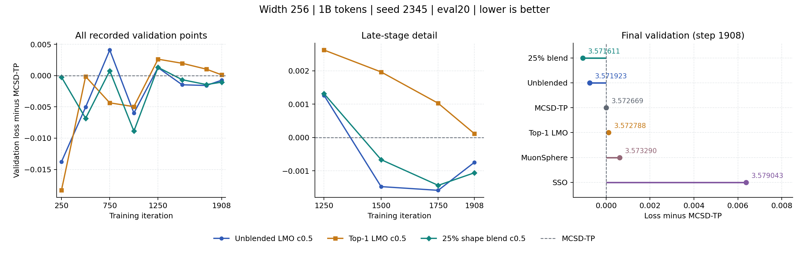

# Spectral-Sphere Experiment Summary

[Overview](../../README.md) · [Algorithms and code](../algorithms/current_comparison_pseudocode.md) · [Reproduction](../runbooks/cluster_experiments_reproduction.md) · [Related work](../related_work.md)

**November 27 update:** [results, launch status and next decisions](results_update_20261127.md).
The separate common-AUS 64-update study is complete: Muon-direction/0.95 ends
at4.476445, versus MCSD-TP/0.95 at4.511190; last16 means4.508469/4.513379.
This is matched FP32-master angular movement, not BF16 spectral matching,
and contains no P2GD arm. Its common exact radial return differs from native
MuonSphere. Do not merge it with the full-budget ledger.

**Requested 3B extension now submitted:** [small-step warm transfer](warm_p2gd_smallstep_3b_20261126.md)
**4519937_0--2**, cluster top<=6/top-1/ambient, common raw-momentum ratio0.075.
At14:07 UTC+08, cluster/top-1 reached600/5723; step500 validation is
**4.185973 / 4.200569**. Ambient queues under the two-H20 cap. No completed
new3B result yet. [Seven-day summary](weekly_summary_20261121_20261127.md). Existing
warm block8/K10 and completed half-D0/MuonSphere/SSO results are reused.
The49 completed full-budget results below are unchanged.

**Latest completed, November 26:**
[four later-start paths 4506265_0-3](p2gd_replication_recovery_20261125.md),
restore4506264 and audit4506266 all COMPLETED, exit0:0. No skipped/NaN
iterations; initial state, training data and held-out evaluations are paired.

| Near policy, steps769--1024 | Final loss | Last-four mean | H20 time |
|---|---:|---:|---:|
| Half-D0 | 3.825426 | 3.843236 | 1:25:14 |
| Top-1 | 3.800925 | 3.823121 | 1:50:58 |
| **Cluster-cone, P2GD-type** | **3.791397** | **3.817367** | 2:17:50 |
| Output-matched half-D0 | 3.812997 | 3.838130 | 1:37:23 |

Cluster beats all three controls at all eight post-update evaluations.
Its maximum BF16 relative budget error is0.471%, but639/9508 near calls
miss the stricter search tolerance. It costs24.2% more than top-1.
Top4 omits directions in461/9508 calls; top6 covers this entire panel.
Oracle-warm block8/K10 has maximum radius/gap errors1.55e-6/2.03e-6 on23
snapshots, not persistent-cache training evidence. Near occupancy14.74%
and93.23% repeats coexist with better loss; repetition is not itself failure.
Two starts of seed1234 now favor the cluster, but not two independent seeds.
No new ambient/MuonSphere/SSO arm,1B/3B run or job was added in this update.
Next: independent-seed controls, persistent-cache short pilot, and a separate
budget-search cost ablation. The49-run1B/3B ledger below is unchanged.

**Historical failure, November 25 at 11:02 UTC+08:**
[later-start replication](p2gd_later_replication_20261125.md) has **no new
branch results**. Prefix **4504395** completed all 256 training updates and
saved step 768, then failed a postprocessing check that incorrectly expected
per-step rather than sparse state audits. The four branches **4504396_0-3**
and snapshot audit **4504397** were cancelled by their dependency rules.
Corrected local verification exactly matches the original half-D0 training
stream, initial state, nine evaluation records and 45 sampled state records.
This is a repeated reference path, **not** a successful new comparison.
At that time restoration was untested. The separate recovery batch above
subsequently passed restoration and completed; original failed/cancelled
job IDs and frozen source remain preserved.

**Earlier completed panel, November25:** [five independent short paths **4488446_0-4**](p2gd_trajectory_panel_20261122.md)
and shared prefix4488445 all COMPLETED, exit0:0. At step768, cluster-cone
loss is **3.911326**, versus top-1 **3.929235**, ambient **3.935439**,
half-D0 **3.942878**, and output attenuation **3.947058**. Last-four means
give the same best arm. Cluster uses8.530% near decisions,92.4% consecutive
near events and clusters up to7, with525 top4 overflows in the *uncapped*
oracle. Its training time is19.4% above top-1. All BF16 matching errors stay
below1%; strict search mismatches are disclosed. This is one starting
checkpoint/seed, not evidence of beating MuonSphere/SSO or a full-budget result.
The49-run1B/3B ledger is unchanged.

**Previous, November22:** [BF16-matched replay **4487990**](p2gd_late_controls_20261122.md)
COMPLETED, exit0:0, elapsed1:41:22. On14 informative states513-528,
P2GD-cluster minus ambient/top-1/output-attenuated half-D0 is
**-9.116e-6 / +7.644e-6 / +2.941e-6**. All14 states pass the <=1% BF16
budget filter; maximum cluster mismatch is0.0578%. All28 near components have
cluster dimension2, so this window does not motivate more top capacity.
This was mixed evidence, not a selected winner. Its approved follow-up:
[prefix **4488445**, independent paths **4488446_0-4**](p2gd_trajectory_panel_20261122.md),
256 updates per policy, max two H20, no new1B/3B run, is now complete.
The49 completed full-budget
results below remain unchanged.

**Previous:** [six-way results and local sphere tests](p2gd_local_and_six_results_20261122.md).
Job **4487800** finished all 48 updates in 37:16 on one H20; its final
postprocessing check compared different audit windows, so Slurm reports
FAILED. Corrected post-hoc verification passes with identical shared-prefix
states and unchanged checkpoint hashes. Of 32 measured states, 24 contain
near components (47 total, all top-2). Cluster-cone does not beat ambient or
top-1 at equal spectral movement. Simple output attenuation reproduces 98.6%
of its mean gain over half-D0. Local matched tests show a synthetic geometric
benefit, not a replicated LLM advantage. The 49 completed full-budget runs
below are unchanged; the later-state diagnostic above is excluded.

**Previous budget replay:** the spectral/output-budget replay **4479762**
completed in **16:30**, exit 0:0. At matched spectral movement, cluster-cone
and finite-momentum directions improve paired loss by about 0.00089, but
their output movement is only about one third of half-D0's. Finite-D0 does
not retain its earlier tiny benefit at equal spectral movement.
Output-matched momentum has a smaller held-out gain (about 0.00010--0.00014)
but slightly worse training-microbatch loss. All candidates decrease held-out
loss from before the update in 4/7 informative steps, not 7/7.
[Latest results and missing mechanism controls](p2gd_budget_matching_20261120.md).
Those two earlier spectral replay jobs are complete. The four separate Frobenius-band jobs
are now also COMPLETED, exit 0:0, and excluded here. The queue was empty at
that earlier check; the separately authorized six-way submission is recorded above.

The earlier short same-state MCSD-TP/P2GD ELR replay
**4472441** completed on one H20 in **12:47**, exit 0:0. Across seven
informative steps, finite-D0 repair is only 1.26e-5 better than half-D0 on
average; momentum-cone variants are about 0.0021 worse. Equal AUS still
permits about 8.4x spectral movement for the momentum family. This is a
mechanism diagnostic, not eight independent training runs.
[Complete results, ELR analysis and next controls](p2gd_returned_elr_replay_20261119.md).
Both warm-K10 controls remain COMPLETED with exit 0:0. There is no new
full-budget LLM endpoint. This page
covers **49 completed width-256 runs: 31 at 1B and 18 at 3B tokens**. Budgets
are processed tokens, not model sizes. Historical width sweeps, 12B tests,
Frobenius-geometry experiments, smokes, and failed jobs are not pooled here.

**New completed 3B pair:** current-backend MCSD-TP **`4453017_0`** reaches
**3.429645 / 17:56:55**; near-only half-D0 **`4453017_1`** reaches
**3.423857 / 17:57:09**. Both exit 0:0, pass 44 CUDA checks plus smoke, and
have zero logged NaN/skipped iterations. The completed ambient half-step
reference is 3.432013. No new tasks were submitted in this check.
[Paired curves, configuration checks and next experiments](warm_radial_controls_3b_20261117.md).

**New local theory, not an H20 result:** [anchored cone-face plus radial](anchored_cone_radial_theory_20261118.md).
All 324 FP64 algebra checks pass. On the 72 exact-corner quadratic cases per
alignment, anchored radial has 0 increases for M=G and 4 for cosine 0.5,
matching the complete true-cone count, not outperforming it. The proof framework
targets conditional Clarke stationarity; it also includes a B-nonstationary
stalling counterexample. Do not count these tests in the 49 LLM runs or
attribute the completed half-D0 result to this new candidate.

**New local diagnostic, not a training run:** [momentum/cone angles and
complete radial returns](corner_momentum_audit_20261117.md). All32 warm-run
snapshots are audited; nine near states remain simple-top points, so their
top-2 cone is explicitly a nearby-corner model. Their mean global/top-block
angles for -M are 0.211/66.45 degrees. Expanded maximum gap error is 2.93e-3
at startup, versus 8.20e-7 in the selected near states; no sampled misrouting.
The separate quadratic loss checks are not LLM loss measurements. No queued
source or H20 job is changed by this local study.

[Latest results](#latest) · [Candidates](#candidates) · [Protocol](#comparisons) · [Numerics](#precision) · [Next](#next) · [Ledger](#ledger)

> **Bottom line:** keeping the MCSD direction and halving it only in the near
> region gives the strongest observed seed2345 3B endpoint here: **3.423857**.
> It beats matched control by **0.005788** and ambient-half by **0.008156**,
> despite MORE near calls and repeats. This supports step attenuation, not
> PGD/P2GD direction switching. Next distinguish targeted attenuation from
> globally reducing matrix steps, and replicate the matched pair.

**Previous exact 3B endpoints:** [exact ambient-radial follow-up](direct_ambient_radial_3b_20261113.md)
finished all 5723 steps with exit 0:0 and zero logged NaN/skipped iterations.
Control / rho=0.5 / rho=1.0: **3.430719 / 3.429565 / 3.436268**,
with main train+validation times **25:47:49 / 25:47:55 / 25:44:49**.
Historical MuonSphere / SSO: 3.436023 / 3.435041; old K10 control /
ambient-c8: 3.428613 / 3.427854. The half-step exact hybrid is 45.9% slower
than old ambient and 0.001711 worse, so it is not an engineering upgrade.
Its final near-call rate is 5.683%, with 16.022% consecutive repeats among
those calls; the corresponding full-step figures are 3.923% / 9.270%.
These replace the earlier intermediate statistics. The independent ELR
prefix and eight 32-step branches also completed, but have no final validation
endpoint and are excluded from the long-run counts. No jobs were added here.

**Previous warm follow-up:** **`4442918_2`**, width256 / seed2345 / rho0.5 /
window2e-4 / warm block-8 K10 FP32 Ritz, finished November17 at07:43 UTC+08.
Final loss **3.432013**, main train+validation **17:54:03**, exit0:0 and zero
NaN/skipped iterations in 573 regular reports. Near calls are **5.577%** of
component updates, with **15.777%** consecutive repeats among near calls.
There are zero original-matrix full SVDs online; the offline eight-snapshot
audit has no routing errors but only two truly near samples, both early.
The results-only check at10:44 found an empty account queue and about20GB
free. The separate11:24 submission is recorded above.
[Results, limitations and next controls](direct_ambient_radial_3b_20261113.md#latest-warm-k10-completed-november-17).

**Local follow-up, 2026-11-11:** [Sections 3-6 theory audit](step_aware_hybrid_review_20261111.md)
and [MCSD-TP/A1/A2/A4 paired trajectories](step_aware_hybrid_results_20261111.md).
1200 exact-spectrum CPU trajectories were extended to 2000 steps, with
complete-return, capacity and matched-trial-length audits. These are not LLM
results and are excluded from the counts below. Two read-only H20 connections
timed out; the previous server status is not reclassified as current.
No new H20 job was submitted or modified.

**Local theory refinement:** [kernel-preserving LMO and conditional stochastic
proof](kernel_lmo_theory_20261111.md), with [864 paired local trajectories](kernel_lmo_results_20261111.md).
This follow-up separates the finite-step correction from LMO amplitude,
relaxes bounded samples to bounded conditional variance, and adds a tighter
return bound. The small local LMO gain alone did not justify long training;
the separately authorized 100M pilot is reported below.
These synthetic results are excluded from all LLM counts.

**Confirmation now complete, checked 2026-11-12:**
[five matched seed-1234 1B runs](cluster_lmo_confirmation_1b_20261110.md),
array **`4419145_0-4`**, at most two H20 GPUs concurrently. The batch compares
unblended single-LMO c0.5 and the 25% blend with fresh MCSD-TP, MuonSphere and
SSO references. All five finished successfully and are now included in the
completed-run count. No production algorithm was changed.

**Local theory study, 2026-11-06:** [selected-face LMO feasibility and
MCSD/P2GD/PGD toy comparisons](local_cone_lmo_feasibility_20261106.md).
Includes exact-cone proofs, missing-direction and radial-return counterexamples,
432 algebra checks, and 768 small CPU trajectories. Not an H20 experiment or
a stochastic convergence claim; excluded from the completed-run count below.

**Local projection follow-up:** [MCSD / MCSD-TP with cone-LMO and exact
sphere projection](local_projected_lmo_study_20261106.md). Includes 288 paired
toy trajectories extended to 10,000 steps, an exact-projection ascent
counterexample, and a separately defined stochastic safeguard with sufficient
convergence conditions. Its safeguard mostly selects PGD; this is not an LLM
performance improvement or a theorem for the unguarded hybrid.

<a id="latest"></a>

## Latest: Completed 3B Radial Comparison

Same width256 / seed2345 / LR0.015 / 3B / eval20 protocol. Baselines are reused
historical runs; the two old experimental rows use different spectrum,
switching and scaling rules. Times include main training and validation.

| Method | Final loss | Time | Source |
|---|---:|---:|---|
| **Current MCSD-TP, near-only half-D0** | **3.423857** | 17:57:09 | `4453017_1` |
| Current MCSD-TP warm K10 control | 3.429645 | 17:56:55 | `4453017_0` |
| Warm ambient-radial rho=0.5 | 3.432013 | 17:54:03 | `4442918_2` |
| Exact MCSD-TP control | 3.430719 | 25:47:49 | `4434107_0` |
| Exact ambient-radial rho=0.5 | 3.429565 | 25:47:55 | `4434107_2` |
| Exact ambient-radial rho=1.0 | 3.436268 | 25:44:49 | `4434107_3` |
| MuonSphere | 3.436023 | **16:35:03** | `4346705_0` |
| SSO | 3.435041 | 18:28:11 | `4346705_1` |
| MCSD-TP warm block-8 K10 | 3.428613 | 17:39:34 | `4346705_2` |
| Ambient K10/c8 | 3.427854 | 17:40:58 | `4346705_4` |

Near-half improves on historical MuonSphere / SSO by 0.012166 / 0.011184
in this seed, and on old ambient/c8 by 0.003997. It is about 8.3% slower than
MuonSphere; the gain is not a free speedup. Most importantly, it also beats
the source-matched current control, without changing the MCSD direction.
Near eligibility is 14.067% versus 9.217% (control) and 5.577% (ambient);
consecutive repeats among near calls are 54.771% / 40.453% / 15.777%.
Higher repetition coexists with better loss. These are evolving trajectories,
not matched same-state direction comparisons, and only one seed is tested.
[Final statistics, all curves, audit limits and follow-up](warm_radial_controls_3b_20261117.md).

## Previous: Five Seed-1234 Confirmation Runs

Same 1B/eval20 protocol, final step 1908, fresh matched source. All five have
Slurm exit 0:0 and no logged NaN/skipped iterations.

| Method | Final loss | Difference vs. control | Train + validation | Job |
|---|---:|---:|---:|---|
| MCSD-TP K10 | 3.575916 | 0 | 5:55:15 | `4419145_0` |
| Single-LMO c0.5 | 3.575186 | -0.000730 | 5:56:11 | `4419145_1` |
| 25% shape blend c0.5 | 3.575362 | -0.000554 | 5:55:37 | `4419145_2` |
| MuonSphere | **3.571786** | **-0.004130** | **5:33:30** | `4419145_3` |
| SSO | 3.580017 | +0.004101 | 6:11:00 | `4419145_4` |

Unblended c0.5 improves on MCSD-TP in both paired seeds, by 0.000746 and
0.000730. The blend's extra advantage does not repeat: it is 0.000176 worse
than unblended in this confirmation. Neither hybrid consistently beats
MuonSphere. Lower repetition and overflow are not sufficient predictors of
better validation loss. [Full analysis and evidence](cluster_lmo_confirmation_1b_20261110.md).

The separately submitted [A2 / Kernel-LMO 100M pilot](kernel_lmo_h20_pilot_20261112.md)
now has **eight completed configurations**, including two counter-fix reruns.
MCSD-TP exact:
4.918329 (57:31); MuonSphere: 4.919347 (38:06); SSO: 4.927444 (41:43).
A2 exact / input x1.5 / warm K10 reach 5.073903 / 5.069594 / 5.087419:
none is a current long-run candidate. Both original Kernel-LMO attempts
stopped on a legacy top-4 statistics dictionary at q=5. The fresh reruns
**`4426353_3` (exact) and `4426353_5` (warm K10)** now complete with loss
**5.078964 (57:05)** and **5.082469 (40:33)**, respectively. Both passed
nine CUDA tests with no logged NaN/skipped iterations; q=5 is recorded without
failure. Near calls account for 30.78% / 29.65% of positive-LR component
updates. The extra kernel LMO does not close the gap to MCSD-TP/MuonSphere,
even with exact spectra. Prioritize same-matrix, matched-return-length
diagnostics; do not promote these settings to 1B/3B. No new jobs were added
in this results check.
The pilot used one H20 per arm and at most two concurrent GPUs. It is not
included in completed 1B/3B counts and must not be compared at unmatched
training budgets.

**Direct top-repair follow-up now complete:** [same-D0 audit and H20 results](direct_top_repair_100m_20261112.md).
All three exact-spectrum runs **4427402_0-2** completed on November 12;
100M tokens each, seed 1234, at most two H20 GPUs concurrently. No repair /
multiple-root repair / finite-step spectral-slack repair achieve
**4.918329 / 4.918715 / 4.912478**, with main train+validation times
57:13 / 57:14 / 57:03. The finite-step candidate is 0.005851 below control
and 0.006869 below the previous same-budget MuonSphere reference, but remains
about 49.7% slower than MuonSphere. Its mean returned step grows only 0.088%;
13.33% of component updates invoke a correction. Capacity reaches q=7;
10.48% of correction calls require q>4, with no imposed cap in these runs.
Both CUDA suites and all smokes passed; no NaN/skipped iterations are logged.
This one-seed short result supports replication and a matched MCSD-TP-PGD
reference, not a convergence claim or automatic 1B/3B promotion. No jobs
were added in that results check; these short runs do not enter the 1B/3B count.

**Latest 100M comparison complete, checked November 13:**
[finite-step repair versus normalized MCSD-TP-PGD](direct_top_pgd_pk_100m_20261113.md),
array **4428745_0-5**. All six width-256 / seed-2345 jobs completed with exit
0:0 and no NaN/skipped iterations; each passed 26 CUDA checks and smoke.

| Method | Final loss | Main train + validation | Actual near operation |
|---|---:|---:|---|
| MCSD-TP control | 4.922614 | 56:57 | None |
| Finite-step repair | 4.915827 | 57:37 | 13.39% top repairs |
| MCSD-TP-PGD, half D0 trial length | 5.210238 | 57:38 | 27.12% full projections |
| MCSD-TP-PGD, full D0 trial length | 5.341342 | 57:42 | 31.29% full projections |
| **MuonSphere** | **4.903361** | **38:16** | Reference |
| SSO | 4.936409 | 41:52 | Reference |

Finite-step minus control is **-0.005851 / -0.006787** at seeds 1234/2345;
finite-step minus MuonSphere is **-0.006869 / +0.012466**. Thus the control
gain repeats, but a consistent MuonSphere advantage does not. Finite-step
still costs 50.6% more time than MuonSphere in the new seed. Its maximum q
is 7; 12.40% of correction calls exceed four directions. PGD half/full
produce cached zero-gap plateaus after 84.26% / 93.88% of their projections,
but retain 99.24% / 94.90% of total near trial length. Do not attribute the
poor loss solely to erased steps or compare these trial ratios to historical
`pgd_lr_scale` values. All experimental arms share exact spectra and a 2e-4
window. The finite correction is not standard P2GD; PGD uses full sphere
projection rather than radial return.

The results-only check did not add jobs. The proposed matched 1B finite-step
check remains unsubmitted. The completed 100M batch is excluded from the
completed 1B/3B count.

### Completed 3B Radial Follow-Up: Protocol

At the user's request, [array 4434107](direct_ambient_radial_3b_20261113.md)
was submitted on November 13 at 18:44 UTC+08. Only three missing width-256 /
seed-2345 / LR 0.015 configurations run: exact-cache MCSD-TP control, and
ambient momentum with rho=0.5/1.0 D0 trial-length matching, all with
`X_next = R * Y / ||Y||_2`. They use the 3B budget (5723 steps), 250 warmup,
eval20/250, exact spectra and window 2e-4. This is **not full-projection PGD**
and still retains one full trial SVD per component for the exact cache.

All three jobs have now completed, including their 32 CUDA-allocation checks,
smoke and post-training audits. Results are reported at the top of this page.
Historical MuonSphere 3.436023 and SSO 3.435041 are reused, not rerun: saved
training configurations and baseline source hashes match. Older K10 MCSD-TP
3.428613 and ambient/c8 3.427854 remain contextual because spectral accuracy,
routing and step scaling differ. The fresh exact control is not a duplicate
of the K10 control. This batch adds three completed 3B runs to the registry.

## Previous: Twelve Matched 1B Runs

Seed **2345**, LR **1.5e-2**, 1908 steps, **20 validation batches** per evaluation.
Six reference runs and six follow-ups completed with exit 0:0 and no logged
NaN/skipped iterations. Their model, data and schedule settings were checked
against the launch records; the runs were not all concurrent.

| Method | Final loss | Difference vs. control | Train + validation | Job |
|---|---:|---:|---:|---|
| MuonSphere | 3.573290 | +0.000621 | **5:33:30** | `4368383_0` |
| SSO | 3.579043 | +0.006374 | 6:11:37 | `4368383_1` |
| MCSD-TP K10 | 3.572669 | 0 | 5:54:15 | `4368382_2` |
| Wide cluster K10/c8 | 3.572540 | -0.000129 | 5:55:24 | `4368383_3` |
| Narrow cluster K10/c8 | 3.573133 | +0.000464 | 5:55:46 | `4368383_4` |
| Single-LMO narrow cluster/c1 | 3.573165 | +0.000496 | 5:55:50 | `4368382_5` |
| Ambient near/c8 | 3.573986 | +0.001317 | 5:56:10 | `4375034_0` |
| Top-1 near/c8 | 3.572480 | -0.000189 | 5:54:13 | `4375034_1` |
| Single-LMO narrow cluster/c0.5 | 3.571923 | -0.000746 | 5:55:10 | `4375034_2` |
| Single-LMO narrow cluster/c2 | 3.575782 | +0.003113 | 5:55:29 | `4375034_3` |
| Single-LMO top-1/c0.5 (new) | 3.572788 | +0.000119 | 5:54:55 | `4389998_0` |
| **Single-LMO 25% shape blend/c0.5 (new)** | **3.571611** | **-0.001058** | 5:56:14 | `4389998_1` |



- **25% shape blend/c0.5** is the best observed endpoint: 0.000312 below
  unblended c0.5, 0.001679 below MuonSphere, and 0.007432 below SSO. It adds
  64 seconds to unblended c0.5, 0.56% to control and 6.82% to MuonSphere time.
  This is a small selected single-seed gain, not a stable-improvement claim.
- **Same-LMO top-1/c0.5** is worse than both unblended adaptive-q and control.
  This supports testing multi-direction correction within this family; it is
  not an isolated same-trajectory proof. The earlier momentum top-1/c8 is a
  different family and slightly outperforms its own wide-hybrid reference.
- **Reduced repetition is not sufficient:** the blend reduces repeats from
  92.18% to 88.02%, but top-1 repeats only 39.29% and has worse loss. Larger c2
  also reduced repetition without improving training. Unblended c0.5 is lower
  than the blend at steps 1500 and 1750; the new gain is not uniform over time.
- Ambient c8 loses at 1B despite winning the earlier seed-2345 3B comparison.
  Do not assume a candidate ranking transfers across budgets. Timing includes
  validation, not just optimizer kernels; node placement was not identical.

[Latest analysis and numerical audit](cluster_lmo_shape_1b_20261104.md) ·
[New raw records](../results/cluster_lmo_shape_1b_20261104/final_20261105.json) ·
[Previous mechanism/scale analysis](cluster_mechanism_scales_1b_20261102.md) ·
[Six-arm references](cluster_results_20261101.md)

### Completed Paired 1B Replication

The seed-1234 pair completed on 2026-11-02 with the same K10/1908-step/eval20
protocol. Both have exit 0:0, eight validation points, no logged NaN/skipped
iterations, and no original-matrix full SVD calls online.

| Method | Final loss | Difference vs. control | Train + validation | Job |
|---|---:|---:|---:|---|
| MCSD-TP K10 | 3.575916 | 0 | 5:55:07 | `4373351_0` |
| Wide hybrid K10/c8 | **3.575728** | **-0.000188** | 5:55:53 | `4373351_1` |

The two 1B paired differences are -0.000129 and -0.000188 (mean -0.000159,
rounded). This is a small descriptive improvement, not a significance claim
or evidence that the 3B discrepancy is resolved. Seed 1234 has no matched
K10/eval20 1B MuonSphere/SSO runs, so those baseline comparisons remain limited
to seed 2345.

At step 1900, the hybrid used 10,509 / 478,800 near decisions (**2.195%**),
with **69.14%** repeats, mean burst length **3.24**, and **1235** capacity
overflows. Thus the small gain did not remove repeated near calls or the
top-4 capacity limitation.
[Raw paired results](../results/cluster_followup_1b_20261101/paired_final_20261102.json).

## Cross-Seed 3B Evidence

All rows below use 5723 steps, LR `1.5e-2`, and 20 validation batches.
Compare methods **within a seed**; initialization and seed-dependent data
ordering/indexing can shift absolute loss.

| Method | Seed 1234 | Time | Seed 2345 | Time |
|---|---:|---:|---:|---:|
| MuonSphere | **3.442197** | **16:37:29** | 3.436023 | **16:35:03** |
| SSO | 3.442296 | 18:28:24 | 3.435041 | 18:28:11 |
| MCSD-TP K10 | 3.443943 | 17:41:47 | 3.428613 | 17:39:34 |
| Hybrid K10/c8, top≤4 | 3.442441 | 17:40:21 | 3.432620 | 17:41:00 |
| MCSD-TP K20 | 3.444459 | 18:20:33 | Not run | — |
| Hybrid K20/c8 | 3.443598 | 18:21:08 | Not run | — |
| Ambient near branch/c8 | Not run | — | **3.427854** | 17:40:58 |
| Top-1 near branch/c8 | Not run | — | 3.428247 | 17:44:21 |

Hybrid K10 minus matched control: **-0.001502** at seed 1234 and
**+0.004007** at seed 2345. The two-seed mean paired difference is
**+0.001253**, unfavorable to the hybrid. This is descriptive, not a
significance test. The second-seed hybrid beats both baselines, but loses to
its own control and simpler near directions.

At seed 2345, near-branch rates are **1.8750% / 0.8600% / 0.9327%** for
cluster / ambient / top-1. Repeat rates are **60.19% / 8.40% / 13.80%**.
The cluster arm has 3592 capacity overflows. These statistics end at step
5720 and count matrix components. They do not establish repetition as the
cause of poorer loss.

[First-seed analysis](cluster_results_20261028.md) ·
[Second-seed analysis](cluster_results_20261031.md) ·
[First-seed curves](cluster_summary/validation_3b_k10.png)

<a id="candidates"></a>

## Candidates and Decisions

| Candidate | Evidence | Decision |
|---|---|---|
| **MCSD-TP K10** | Competitive control; lower than both baselines in the latest 1B and second-seed 3B runs | Retain as the matched reference |
| **Wide hybrid K10/c8** | Tiny 1B gains at two seeds; 3B gain changes sign across seeds | Retain for mechanism tests, not a default winner |
| Top-1 c8 | Slightly better than wide hybrid at 1B and better at seed-2345 3B; only one mechanism seed | Retain as an important simpler control |
| Ambient c8 | Strong historical seed-2345 3B endpoint, but worse than control/MuonSphere at 1B | Budget-dependent reference; do not promote at 1B |
| Exact ambient-radial rho=0.5 | 3B gain of 0.001154 over exact control; worse and 45.9% slower than old ambient/c8 | Mechanism reference; test direction versus attenuation before another long run |
| Warm ambient-radial rho=0.5 | Loss 3.432013, worse than current control 3.429645 and near-half 3.423857 | Retain as a direction-switching reference, not the leading candidate |
| **MCSD-TP near-only half-D0** | 3.423857 at seed2345/3B; gain 0.005788 over matched control, with more repeats | Prioritize global matrix-half control and paired replication; no PGD/P2GD claim |
| Anchored cone-face + radial | 324 local algebra checks; 0/72 aligned-gradient and 4/72 misaligned-momentum quadratic increases; no LLM run | Same-state loss probe only; conditional Clarke result, not a B-stationarity or fixed-K10 guarantee |
| Exact ambient-radial rho=1.0 | Worse than exact control by 0.005549 despite fewer repeats | Do not extend this setting |
| Narrow cluster c8 | Eliminates sampled capacity overflows; worsens latest 1B endpoint | Do not expand the long-run grid |
| **Single-LMO c0.5** | Control gains 0.000746 / 0.000730 at paired 1B seeds; not consistently ahead of MuonSphere | Retain as a reference; second-seed confirmation is complete |
| Single-LMO top-1/c0.5 | Slightly worse than control; less repetition does not recover adaptive-q performance | Keep as the same-LMO rank ablation, not the leading candidate |
| **Single-LMO 25% blend/c0.5** | Extra gain 0.000312 at seed2345 does not repeat: 0.000176 worse than unblended at seed1234 | Do not expand the blend grid or describe the extra gain as confirmed |
| Single-LMO c1/c2 | Both worse than control at 1B; c2 reduces repetition but worsens loss | Keep as step-scale references; no wider grid yet |
| K20 | More accurate sampled spectra, not consistently better loss | Accuracy reference, not automatic upgrade |
| c12 / K40 | Lower repetition / numerical error without better earlier 1B endpoints | Defer |
| Full-SVD reference | Useful for checking direction and return errors, substantially costlier in prior pilots | Offline oracle, not the default training path |

### Original Wide-Hybrid Reference

```text
safe branch     tangent -> NS8 matrix sign -> tangent
near branch     normalize momentum (Frobenius) -> top-cluster cone-type correction
routing         estimated relative gap <= 5e-5
cluster         relative width 2e-3; adaptive q<=4; coefficient c=8
spectrum        cached warm block-8, K10, FP32 QR/Ritz
return          approximate radial scaling, both branches
next cache      scaled Ritz values and vectors of the returned point
online checks   no accuracy gate and no automatic full-SVD fallback
```

K is the iteration count; eight is the spectral block size; q is the correction
rank. **c is a step multiplier, not a use percentage.** There is no
post-correction normalization or MCSD length matching. Ambient plus radial
return is not projected gradient descent. Near-cluster plus radial return is
not standard P²GD and does not inherit its convergence theorem.

<a id="comparisons"></a>

## Protocol and Comparability

| Setting | Current track |
|---|---|
| Model | Width 256, 28 layers, FFN 768, 2 heads, head dimension 128, sequence length 4096 |
| Constraints | Spectral-muP target radii for hidden matrix components |
| Data | Existing 3B indexed OLMo-Mix source and its validation source |
| Training | One H20/run, global batch 128, microbatch 4, fresh initialization |
| Precision | BF16 training/NS8; FP32 master weights and experimental QR/Ritz; TF32 off |
| Momentum | Existing Muon-style Nesterov coefficient 0.9 for matrix optimizers |
| Auxiliary parameters | AdamW (0.9, 0.95), eps 1e-8; weight decay 0.1 with group exclusions; constrained matrices wd=0 |
| Schedule | 250 warmup steps, cosine decay to 10% of peak LR |
| Endpoint | 1B: 1908 steps; 3B: 5723 steps; final validation, not best intermediate loss |
| Evaluation | Earlier 12-run 1B grid: 5 batches; matched 1B references/follow-ups and all current 3B runs: 20 batches; every 250 steps + endpoint |
| Time | Training plus validation, excluding preflight/audits; not Slurm elapsed time |

The baseline code names are `muon_ball_dist` (MuonSphere) and
`spectral_ball_dist` (SSO). Both use reference BF16 cold PI10 and hard
pre-step radial normalization; the experimental methods use post-step
approximate radial return. Their return maps are not identical.
Do not compare absolute losses across different token/evaluation protocols,
the historical paper sample, or the separate Frobenius-geometry branch.

<a id="precision"></a>

## Numerical Evidence

In the matched 1B references and follow-ups, each experimental arm records **480,816 small
Ritz SVDs and zero original-matrix full-SVD/svdvals calls online**.
Full SVD is used only by offline audits. Legacy zero residual fields in
training logs are not numerical certificates.

In the original six-arm batch at step 1900, wide / narrow / single-LMO c1 near rates are **2.275% / 2.132% /
3.433%**; mean burst lengths are **3.44 / 3.19 / 5.86**. Sampled mean
absolute gap errors are roughly **7.7e-5 to 1.2e-4**, with a maximum sampled
returned-radius error of **1.503e-4**. Audits are selected, bounded samples,
not population rates. Numerical error is still relevant to a `5e-5` route
threshold; no exact feasibility or safe-region certification is claimed.

New ambient / top-1 / LMO c0.5 / LMO c2 cumulative near rates are
**0.906% / 0.983% / 5.800% / 1.607%**, with mean bursts
**1.14 / 1.25 / 12.78 / 2.13**. Counters end at step 1900, not 1908.
LMO c0.5's instantaneous rate at step 1900 is **34.52%**, substantially higher
than its cumulative rate. Its selected-sample gap MAE is 7.753e-5, still
comparable to the 5e-5 route threshold. No strict gap certificate is claimed.

The latest same-LMO top-1 / 25% blend cumulative near rates are
**1.218% / 4.252%**, versus instantaneous step-1900 rates of **10.32% / 30.95%**.
Mean bursts are **1.65 / 8.35**, and the blend has **48** capacity overflows
(unblended: 215). The 44 selected audit matrices per new run have gap MAE
**7.958e-5 / 8.297e-5**, mean relative direction error **3.167% / 3.740%**,
and maximum relative returned-radius error **1.602e-4 / 1.503e-4**.
False-safe / false-near counts are **0/1** and **0/2**, not population error
rates. The blend's small loss gain is not accompanied by better sampled
spectral accuracy. See the [complete audit comparison](cluster_lmo_shape_1b_20261104.md#numerical-audit).

<a id="next"></a>

## Completed Follow-Ups and Next Decisions

**November25 priorities; no new jobs submitted.** The six-way replay, later
BF16 replay and five independent256-update paths have now completed.
The latter favors cluster-cone on endpoint and tail mean, unlike the mixed
same-state results. Repeat cluster/top-1/output attenuation from a second
starting state; collect paired snapshots on the cluster path to inspect
residence and capacity; then test approximate spectra and cheaper calibration
offline. Preserve the complete numerical cluster reference (observed q up to7).
MuonSphere/SSO short branches remain missing. See the
[current analysis and follow-up plan](p2gd_trajectory_panel_20261122.md).

**Historical November22 planning context (superseded):**
Both the matched-AUS replay and its spectral/output-budget follow-up are
complete. They reuse seven informative steps and 12 near components, all
numerical q=2. Momentum-cone candidates lose under AUS matching and win under
spectral matching; their independent-input output movement changes substantially.
Finite-D0 loses its tiny benefit at equal spectral movement. The priority is
to isolate correction from direction-family and amplitude changes at a later
checkpoint, not repeat the same budgets on the same states.
Preserve training-microbatch and held-out signs separately. Relative wins are
not absolute descent: each candidate decreases held-out loss in 4/7 informative
steps, and those complete updates also include unchanged safe/non-matrix paths.

| Priority | Missing evidence | Decision it enables |
|---|---|---|
| 0 | Spectral-matched ambient / top-1 / cluster-cone / finite-momentum, with half-D0 and output-attenuated half-D0 controls | Isolate multi-direction correction; the observed spectral-matched gain has a roughly 66% output-reduction confound |
| 1 | Surviving candidate in a 32-step independent branch comparison from a later checkpoint | Test whether same-state gains persist when optimizer states diverge |
| 2 | MuonSphere at 0.985 and 0.95 coefficient in the 32-step confirmation protocol | Distinguish MCSD-TP directional benefit from a generic smaller-step benefit |
| Later | All-step matrix-only half-D0; then current control/near-half at a second seed | Test targeted attenuation and reproducibility of the 0.005788 3B paired gain; keep AdamW LR fixed |
| Conditional | Warm block-8 K10 implementation of a surviving exact-oracle mechanism | Measure accuracy and cost before any new full-budget run |

Within each study keep data, LR0.015, window2e-4, eval20 and momentum fixed.
Short geometry probes use the common exact radial oracle; full-budget warm
references use K10. Do not silently mix these backends or compare their absolute
losses across evaluation sets. Use a later checkpoint and fresh fixed batches
for the next short probe. The seven informative steps are correlated, not
seven independent seeds. See the [complete proposed protocol](p2gd_budget_matching_20261120.md#next-test-decision).
Reuse completed full-budget ambient/baseline endpoints for context, but do
not substitute them for new same-state budget-matched controls. Do not repeat
the completed replay unchanged. Larger widths, broader gap grids and 12B
runs remain deferred.

**Concrete minimal follow-up:** one all-step matrix-half 3B run at seed2345,
then two source-matched seed1234 runs (control and near-half). Reuse the
completed seed2345 pair; never relabel historical seed1234 implementations as
fresh matched controls. A short same-state replay should restore weights,
optimizer and spectral cache, RNG, and data position for each candidate. Use
paired training and held-out probe batches, record mean/median loss change,
ascent fraction, actual returned length, required cluster capacity and sampled
spectral error. Report absolute and length-matched results; a tiny step can
artificially reduce ascent counts. The replay is diagnostic, not an online
line search. A candidate must improve on half-D0 without relying on larger
steps before a separate short training pilot is justified.

| Test | Configuration | Verified status |
|---|---|---|
| Frozen-matrix scale audit | 160 saved samples; single-LMO c0.5/1/2 plus wide/narrow references; cached and oracle spectra | `4373185`, completed in 47 seconds |
| Paired 1B replication | Seed 1234, K10 control vs. wide hybrid c8, LR 1.5e-2, 1908 steps, eval20 | `4373351_0–1`, both COMPLETED on 2026-11-02 |
| Mechanisms and LMO scales | Seed 2345, ambient/top-1 c8, single-LMO c0.5/c2, 1B/eval20 | `4375034_0–3`, all COMPLETED by 2026-11-03 00:58 HKT |
| Single-LMO rank/shape | Seed 2345, top-1 or 25% shape blend, c0.5, 1B/eval20 | `4389998_0–1`, both COMPLETED by 2026-11-05 02:20 HKT |
| Exact ambient-radial 3B | Seed2345, matched exact control and rho=0.5/1.0, eval20 | `4434107_0,2,3`, all COMPLETED by November 15; [results](direct_ambient_radial_3b_20261113.md) |
| Warm ambient-radial 3B | Seed2345, rho=0.5/window2e-4, warm block-8 K10 FP32 Ritz | `4442918_2`, COMPLETED November17; [summary and audit](../results/warm_ambient_radial_3b_20261116/final_summary_20261117.json) |
| Warm matched controls 3B | Same spectral backend; D0 versus near-only half-D0 | `4453017_0-1`, COMPLETED November18; [results and provenance](../results/warm_radial_controls_3b_20261117/final_summary_20261118.json) |
| ELR/AUS mechanisms | Shared 250-step prefix, eight restored 32-step branches | `4434317`, `4434318_0-7`, all COMPLETED; not a 1B/3B validation comparison |

The corrected pair was submitted **2026-11-02 00:55 HKT**; at most two GPUs
concurrently, no checkpoints. [Submission metadata](../results/cluster_followup_1b_20261101/submission_v2.json)
and [launchers](cluster_results_20261101.md#follow-up) are authoritative.
Final losses are **3.575916 / 3.575728** for control / hybrid; see the paired
results above. These jobs no longer occupy GPUs. The four mechanism/scale
jobs also completed; all endpoints are in the latest table.
[Comparison protocol and detailed results](cluster_mechanism_scales_1b_20261102.md).

The first pair `4373186_0–1` failed in preflight before training because of an
isolated test import-path error. The v2 snapshot fixes that path, isolates
launcher overrides from grid tests, and adds a regression test. That snapshot
passed 63 local tests; the successful audit had passed the earlier 62 CUDA
tests. The current launch suite has 74 cluster tests plus one collector test,
passing locally and on the H20 host's CPU. Both latest allocations also passed
27 CUDA-targeted tests before smoke and again before main training.
[CUDA and smoke completion records](../results/cluster_lmo_shape_1b_20261104/completion_20261105.json).

The [completed scale audit](cluster_results_20261101.md#completed-scale-audit)
finds 22/28/37 near-region exits among the same 51 cases for single-LMO
c0.5/c1/c2. Larger c also increases radial change and radius error. The new
training results show that c2's greater exit rate is not a useful selection
criterion on its own: c0.5 gives the better loss.

This is not a duplicate of the old seed-1234 1B K20/eval5 or 3B K10 runs.
The failed third-seed 3B array `4360583` never trained; its wrapper path was
fixed, but it has not been resubmitted. The new pair does not count as a
third-seed 3B result.

**Now completed:** q=1 versus the completed adaptive-q reference **within the
same LMO/c0.5 family**, plus 25% pre-correction spectral-shape interpolation
with the final near-direction Frobenius length matched. The old momentum
top-1/c8 arm does not isolate this mechanism. A shape-scaled amplitude cap
was screened offline and is almost inactive on the selected snapshots, so
it was not promoted to another full 1B run.
[Protocol, screening, results and job IDs](cluster_lmo_shape_1b_20261104.md).

**Now completed:** unblended c0.5 and the 25% blend at seed 1234 under the
same 1B/eval20 protocol, plus fresh MCSD-TP, MuonSphere and SSO references.
The historical seed-1234 control used a different source manifest, so it is
not silently reused as a strictly source-matched control. The five new runs
share one frozen snapshot and introduce no production algorithm changes.
Array **`4419145_0-4`** was submitted on 2026-11-10, capped at two GPUs with
checkpoints disabled. All five completed successfully; results checked on
2026-11-12 are reported at the top of this page.
[Protocol, job mapping and predeclared analysis](cluster_lmo_confirmation_1b_20261110.md).

Report unfavorable outcomes as well as favorable ones. Following the now
completed radial 3B batch, keep larger widths, broad gap sweeps and unrelated
3B expansion deferred; the completed controls now prioritize step attenuation
over the ambient switch. A common larger fixed validation
set would help resolve small differences, but old checkpoints are unavailable
for retrospective re-evaluation. Do not count queued tests as completed
results or treat two seeds as a significance test.

<a id="ledger"></a>

## Traceable Ledger

| Completed batch | Count | Evidence |
|---|---:|---|
| Earlier 1B, seed 1234, eval5 | 12 | [JSON](../results/cluster_candidates_1b_20261024/final_summary.json), [configuration](cluster_candidates_1b_20261024.md) |
| 3B, seed 1234 | 6 | [JSON](../results/cluster_selected_3b_20261025/final_summary_20261027.json), [analysis](cluster_results_20261028.md) |
| 3B, seed 2345 + mechanism controls | 6 | [JSON](../results/cluster_seed_mechanism_3b_20261028/final_20261031.json), [analysis](cluster_results_20261031.md) |
| Reference 1B, seed 2345, eval20 | 6 | [JSON](../results/cluster_cone_lmo_1b_20261031/final_20261101.json), [analysis](cluster_results_20261101.md) |
| Paired 1B replication, seed 1234, eval20 | 2 | [JSON](../results/cluster_followup_1b_20261101/paired_final_20261102.json) |
| Mechanism/scale 1B follow-ups, seed 2345, eval20 | 4 | [JSON](../results/cluster_mechanism_scales_1b_20261102/final_20261104.json), [analysis](cluster_mechanism_scales_1b_20261102.md) |
| LMO rank/shape 1B follow-ups, seed 2345, eval20 | 2 | [JSON](../results/cluster_lmo_shape_1b_20261104/final_20261105.json), [analysis](cluster_lmo_shape_1b_20261104.md) |
| Matched confirmation 1B, seed 1234, eval20 | 5 | [Collected results](../results/cluster_lmo_confirmation_1b_20261110/confirmation_results_20261112.json), [analysis](cluster_lmo_confirmation_1b_20261110.md) |
| Exact ambient-radial 3B, seed2345, eval20 | 3 | [Final results](../results/direct_ambient_radial_3b_20261113/final_summary_20261116.json), [analysis](direct_ambient_radial_3b_20261113.md) |
| Warm ambient-radial 3B, seed2345, eval20 | 1 | [Final result](../results/warm_ambient_radial_3b_20261116/final_summary_20261117.json), [analysis](direct_ambient_radial_3b_20261113.md#latest-warm-k10-completed-november-17) |
| Warm matched controls 3B, seed2345, eval20 | 2 | [Final results](../results/warm_radial_controls_3b_20261117/final_summary_20261118.json), [analysis](warm_radial_controls_3b_20261117.md) |
| **Total completed** | **49** | Deduplicated by Slurm Job ID; failed jobs, smokes and short ELR branches excluded |

<details>
<summary>All earlier 1B endpoints, including unfavorable outcomes</summary>

| Job | LR | Method | K | c | Final loss | Time |
|---|---|---|---:|---:|---:|---|
| `4319977_8` | 1.5e-2 | MuonSphere | N/A | N/A | **3.582948** | 05:24:52 |
| `4319977_9` | 1.5e-2 | SSO | N/A | N/A | 3.591530 | 06:03:41 |
| `4319977_10` | 1.5e-2 | MCSD-TP | 20 | N/A | 3.588559 | 05:59:40 |
| `4319977_11` | 1.5e-2 | Hybrid | 20 | 8 | 3.587659 | 06:02:46 |
| `4319977_2` | 2e-2 | MuonSphere | N/A | N/A | 3.593271 | 05:25:51 |
| `4319977_3` | 2e-2 | SSO | N/A | N/A | 3.591197 | 06:04:47 |
| `4319977_0` | 2e-2 | MCSD-TP | 20 | N/A | 3.589549 | 06:00:02 |
| `4319977_1` | 2e-2 | Hybrid | 20 | 8 | **3.587868** | 05:59:09 |
| `4319977_4` | 2e-2 | Hybrid | 20 | 4 | 3.588366 | 06:00:03 |
| `4319977_5` | 2e-2 | Hybrid | 20 | 12 | 3.590739 | 06:00:25 |
| `4319977_6` | 2e-2 | MCSD-TP | 40 | N/A | 3.591258 | 06:25:55 |
| `4319977_7` | 2e-2 | Hybrid | 40 | 8 | 3.590239 | 06:23:41 |

</details>

All records are keyed by geometry, width, data/evaluation protocol, token
budget, method, K, rank, route/cluster thresholds, c, LR, momentum, and seed.
Source checksums identify training snapshots separately from later
documentation commits. Historical cleanup and failed-job records remain in
their dated reports; checkpoints, environments, datasets, and matrix
snapshots are not published.
