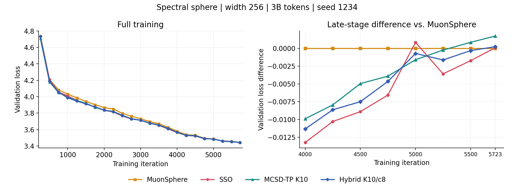

# Spectral Sphere: MCSD-TP / MCSD-P²GD Experiments at 1B and 3B Tokens

**Updated and checked on H20: 2026-10-29 at 17:04 HKT.** There are **20 completed runs**: twelve at 1B and eight at 3B. Four second-seed arms are running; four third-seed replications are queued behind them. The new offline startup/capacity audit completed successfully.

| Completed 1B runs | Completed 3B runs | Second-seed batch | Latest status of that batch |
|:---:|:---:|:---:|:---:|
| **12** | **8** | **6 runs** | 2 completed / 4 running |

[Latest results](#latest) · [Retained candidates](#candidates) · [Learning rates and step scales](#comparisons) · [Accuracy and cost](#precision) · [Next experiments](#next) · [Results ledger](#ledger)

This page consolidates the current **width-256, spectral-sphere, warm block-8** experiments. Completed runs, short-budget pilots, and queued jobs are reported separately. See the [latest status snapshot](../results/cluster_seed3_3b_20261029/status_20261029.json) and [third-seed submission and audit](cluster_seed3_3b_20261029.md). Status is dated, not live.

The organization follows the [Frobenius experiment overview](https://github.com/YYKKWW/SSO_test/blob/exp/mcsd-three-geometries/docs/experiments/FROBENIUS_3B_6B_SUMMARY.md#next), but the results are not pooled. The two tracks differ in constraints, attention-head configuration, sequence length, schedules, and evaluation protocols; their absolute losses are not directly comparable. The historical paper's 1B experiments and earlier 12B runs are also excluded from candidate selection here.

Algorithm reference: [workflow, pseudocode, and implementation guide (Chinese)](../algorithms/current_comparison_pseudocode.md).

<a id="latest"></a>

## Latest Results

### New: Second Seed, 3B Tokens

All six runs use seed **2345**, LR=`1.5e-2`, and the same 5723-step / 20-validation-batch protocol as the first-seed 3B runs. A final loss is reported only after the endpoint and successful completion have been verified.

| Method | Latest state / step | Final val loss | Latest intermediate val loss | Training + validation time | Job |
|---|---|---:|---|---|---|
| MuonSphere | COMPLETED / 5723 | 3.436023 | N/A | 16:35:03 | `4346705_0` |
| **SSO** | COMPLETED / 5723 | **3.435041** | N/A | 18:28:11 | `4346705_1` |
| MCSD-TP K10 | RUNNING / 1570 | Pending | 3.916097 at step 1500 | Not final | `4346705_2` |
| Hybrid K10/c8, top≤4 | RUNNING / 20 | Pending | Not evaluated yet | Not final | `4346705_3` |
| Ambient K10/c8, no tangent correction | RUNNING / 20 | Pending | Not evaluated yet | Not final | `4346705_4` |
| Top-1 K10/c8 | RUNNING / 20 | Pending | Not evaluated yet | Not final | `4346705_5` |

The two completed runs have `COMPLETED / exit 0:0` and both completion markers. The control has reached **27.4%** of its training steps, with a last-ten-log mean of **10.778 s/step**. All six started runs have zero logged NaN and skipped iterations. The control's near-branch rate is zero by design, not evidence about the hybrid.

**Baseline ranking changes with seed.** SSO is lower by `0.000982` at seed 2345, whereas MuonSphere was lower by `0.000099` at seed 1234:

| Seed | MuonSphere final | SSO final | SSO minus MuonSphere |
|---|---:|---:|---:|
| 1234 | **3.442197** | 3.442296 | +0.000099 |
| 2345 | 3.436023 | **3.435041** | -0.000982 |

Absolute losses also shift between seeds. Initialization, data order, and seed-dependent sample indexing can contribute, so **compare methods within each seed**. Do not compare the first-seed hybrid's `3.442441` directly against the second-seed baselines or claim statistical significance from two baseline seeds. The hybrid's cross-seed gain and mechanism remain unverified.

### Running Control: Same-Step Comparison Only

| Step, seed 2345 | MuonSphere | SSO | MCSD-TP K10 | Control minus MuonSphere | Control minus SSO |
|---|---:|---:|---:|---:|---:|
| 250 | 4.709467 | 4.731229 | **4.706380** | -0.003087 | -0.024849 |
| 500 | 4.217583 | 4.217828 | **4.179104** | -0.038479 | -0.038724 |
| 750 | 4.110416 | 4.085800 | **4.069032** | -0.041384 | -0.016768 |
| 1000 | 4.030036 | 3.999783 | **3.998133** | -0.031903 | -0.001650 |
| 1250 | 3.974174 | 3.958632 | **3.943121** | -0.031053 | -0.015511 |
| 1500 | 3.948638 | 3.919994 | **3.916097** | -0.032541 | -0.003897 |

The control has a promising early trajectory, but this is not a final-budget win and says nothing yet about the added cluster branch. Retain the existing control and all three running mechanism arms. No current result justifies canceling them for poor optimization performance.

### Completed First-Seed 3B Comparison

**The K10/c8 hybrid remains the leading candidate for further evaluation, not a confirmed baseline winner.** At seed 1234, it improves over the matched MCSD-TP control and approaches, but does not surpass, MuonSphere or SSO. All entries below are final validation losses from the same completed first-seed batch, with LR=`1.5e-2`; they are not the minimum losses observed during training.

| Method | Final val loss | Difference vs. MuonSphere | Training + validation time | Job |
|---|---:|---:|---|---|
| **MuonSphere** | **3.442197** | N/A | **16:37:29** | `4329039_2` |
| SSO | 3.442296 | +0.000099 | 18:28:24 | `4329039_3` |
| **Hybrid K10/c8** | **3.442441** | **+0.000244** | **17:40:21** | `4329039_5` |
| Hybrid K20/c8 | 3.443598 | +0.001401 | 18:21:08 | `4329039_1` |
| MCSD-TP K10 | 3.443943 | +0.001746 | 17:41:47 | `4329039_4` |
| MCSD-TP K20 | 3.444459 | +0.002262 | 18:20:33 | `4329039_0` |

All six runs finished with `COMPLETED / exit 0:0`, with no logged NaN or skipped iterations. Times exclude CUDA preflight tests and post-training offline audits; they are not optimizer-only timings.

### Gains Over Matched Controls

| Spectral iterations | MCSD-TP | Hybrid c8 | Hybrid minus control |
|---|---:|---:|---:|
| K10 | 3.443943 | **3.442441** | **-0.001502** |
| K20 | 3.444459 | **3.443598** | **-0.000861** |

The K10 hybrid reduces loss by **0.001157** relative to the K20 hybrid and saves **40:47 (3.70%)**. It is **6.30%** slower than MuonSphere and **4.34%** faster than SSO. Its 86-second advantage over its own control is a single timing observation, not evidence that the cluster branch reliably accelerates training.



[Vector figure](cluster_summary/validation_3b_k10.svg) · [Source curves and audits](../results/cluster_selected_3b_20261025/final_summary_20261027.json) · [Plotting script](../../scripts/plot_cluster_results_summary.py)

Each curve contains 23 recorded validation points, without smoothing or synthetic uncertainty bands. The right panel subtracts MuonSphere's loss at each matched step; negative values indicate lower loss at that point. **An intermediate lead does not replace the final result.** With only one completed seed, the `0.000244` difference establishes neither statistical equivalence nor superiority over the baseline.

## Main Findings

1. **The engineering path is operational.** Full 1B/3B training runs completed successfully without original-matrix full SVDs in the hybrid update. The K10 hybrid's total runtime overhead relative to MuonSphere is about 6.3%.
2. **The hybrid gain warrants replication.** The c8 hybrid beats its own control in the tested K20/K40 pairs at 1B and K10/K20 pairs at 3B. The gain cannot yet be attributed specifically to multi-direction cluster correction; second-seed and mechanism controls have been submitted.
3. **More accurate spectra do not automatically improve training.** K20 is more accurate than K10 in the audits, but has worse final 3B loss in this batch. K40 also failed to improve the 1B endpoint.
4. **Lower branch frequency is not an objective by itself.** c12 reduces repeated branch calls relative to c8, yet worsens 1B loss. Loss, actual displacement, radius error, and cost must be considered together.
5. **The theoretical scope remains limited.** This implementation uses a near-top-cluster P²GD-type direction with an approximate radial return. It is neither standard P²GD nor full-SVD PGD. Successful execution does not establish exact feasibility or stochastic convergence to Clarke-stationary points.
6. **Cross-seed ranking is not settled.** The second-seed baseline ranking reverses, while the experimental control is still early and the three near-direction arms have just started. No hybrid replication claim is supported yet.

<a id="candidates"></a>

## Retained Candidates

Here, a viable candidate has sufficient engineering and empirical support for further investigation. This does not mean that all theoretical assumptions hold or that the method is demonstrably superior to the baselines.

| Candidate | Current evidence | Decision |
|---|---|---|
| **Hybrid K10/c8** | Largest 3B gain over its matched control; faster than K20; close to both baselines | **Priority candidate** for second-seed and direction-mechanism tests |
| Hybrid K20/c8 | Improves over matched controls at 1B and 3B; smaller sampled numerical errors | Retain as an accuracy reference; avoid expanding its grid simultaneously |
| MCSD-TP K10 / K20 | Matched controls for the hybrid branch | Retain both; a control with a different K is not interchangeable |
| MuonSphere / SSO | Primary baselines | Continue matching seeds, data, and budgets |
| c4 | Improves 1B loss, but less than c8 under the same settings | Secondary candidate; no immediate expansion |
| c12, K40 | Reduce repetition or spectral error, respectively, without improving final loss | Defer further long runs; retain existing results |
| Full-SVD cluster variant | Runs at 100M, but earlier steps took about 16.1 s versus 10.8–11.2 s for approximate variants | Keep as an offline accuracy/mechanism reference, not the default for a large grid |

The recommended candidate is defined by:

```text
main path     MCSD-TP: tangent -> matrix sign -> tangent
spectrum      warm block-8, FP32 QR/Ritz, K=10
route gap     tau=5e-5
cluster width epsilon_cluster=2e-3, adaptive q<=4
near direction normalize momentum in Frobenius norm -> cluster correction
near step     c=8, no post-correction normalization or MCSD length matching
return        approximate radial return for both branches
cache         scaled spectrum and vectors of the returned point
online gate   none; no automatic full-SVD fallback
```

`K` is the iteration count, 8 is the subspace dimension, and q≤4 is the correction-rank cap. `c=8` is a branch step multiplier, **not a branch-use percentage or a guarantee of eight times the MCSD displacement**. Evidence for this configuration is limited to the current model and protocol; transfer across widths has not been established.

<details>
<summary><strong>Comparison protocol and method definitions</strong></summary>

| Item | Fixed setting |
|---|---|
| Model | Width 256, 28 layers, FFN width 768, 2 attention heads, head dimension 128, sequence length 4096 |
| Geometry | Spectral-μP target spectral radii for hidden matrix components; not the Frobenius-sphere `r=1` setting |
| Data | The same 3B indexed OLMo-Mix training source and validation source; 1B/3B denotes processed-token budget, not model size |
| Training | Global batch 128, microbatch 4, one H20 per run, seed 1234; the new six-run batch uses 2345 |
| Precision | BF16 training and NS8 matrix sign; FP32 master weights and experimental QR/Ritz computations; TF32 disabled |
| Momentum | Matrix optimizers use the existing 0.9 Muon-style Nesterov combination, not extrapolation on the manifold |
| Auxiliary parameters | AdamW, betas=(0.9,0.95), eps=1e-8, weight decay 0.1 with bias/norm exclusions by parameter group; constrained matrices use wd=0 |
| Schedule | 250 warmup steps, cosine decay to 10% of peak LR, training from initialization without checkpoint resume |
| 1B | 1908 steps; 5 validation batches every 250 steps and at the end |
| 3B | 5723 steps; 20 validation batches every 250 steps and at the end |
| Final metric | Validation loss at the full-budget endpoint, not the best intermediate value |
| Time | Training-process wall time including validation, excluding preflight tests and offline audits; not total Slurm elapsed time |

MuonSphere is named `muon_ball_dist` in code and uses BF16 cold PI10, NS8, and hard pre-step radial normalization. SSO is `spectral_ball_dist` and additionally solves a scalar multiplier subproblem. The experimental methods instead use a post-step approximate radial return; this is not a comparison in which every method has the same return map.

The 1B and 3B runs use different validation-batch counts and cosine schedule lengths, so their losses must not be joined into one training curve. Changing the seed can also change data order; compare method differences within each seed first. Any extended evaluation protocol must be reported separately rather than replacing historical endpoints.

</details>

<a id="comparisons"></a>

## Learning Rates and Branch Step Scales

### 1B: Four Methods at Matched Learning Rates

Seed=1234 throughout; the experimental methods use K20 and the hybrid uses c8. Comparisons are matched within each row. Comparing methods at different learning rates is not an optimizer-only ablation.

| LR | MuonSphere | SSO | MCSD-TP | Hybrid c8 | Hybrid minus control |
|---|---:|---:|---:|---:|---:|
| `1.5e-2` | **3.582948** | 3.591530 | 3.588559 | 3.587659 | -0.000900 |
| `2e-2` | 3.593271 | 3.591197 | 3.589549 | **3.587868** | -0.001681 |

The hybrid beats both baselines at LR=`2e-2`, but **the best MuonSphere result across the tested learning rates remains better**. Only two common learning rates were tested, so these results do not establish superiority after comprehensive tuning.

### 1B: Varying c at Fixed LR=`2e-2`

| K20 configuration | Final val loss | Cumulative cluster rate | Consecutive-repeat rate | Mean burst length |
|---|---:|---:|---:|---:|
| MCSD-TP control | 3.589549 | 0% | N/A | N/A |
| c4 | 3.588366 | 1.587% | 75.88% | 4.15 |
| **c8** | **3.587868** | **0.954%** | 59.82% | 2.49 |
| c12 | 3.590739 | 0.787% | **46.63%** | **1.87** |

c12 has lower branch and repeat rates, yet its loss is 0.001190 higher than the control. Minimizing near-region calls or forcing a one-step exit is therefore insufficient. Statistics end at step 1900, not the final step 1908; denominators count matrix-component calls.

### 1B: Increasing Spectral Iterations

| Configuration, LR=`2e-2` | K20 | K40 | K40 minus K20 |
|---|---:|---:|---:|
| MCSD-TP | **3.589549** | 3.591258 | +0.001709 |
| Hybrid c8 | **3.587868** | 3.590239 | +0.002371 |

K40 improves numerical accuracy without improving the training outcome. **There is currently no matched K10 pair at 1B**; the K10 results at 3B cannot fill that gap.

<details>
<summary><strong>100M pilots: why this direction was retained</strong></summary>

- Full-SVD MCSD-TP and the broad-cluster hybrid reached final losses of 4.947731 and 4.947553, with earlier step times around 16.1 s. Warm block-8 variants took about 10.8–11.2 s per step. Historical Slurm elapsed time and newer training-process time have different definitions, so no precise end-to-end speedup is inferred from them.
- With Frobenius-normalized momentum, the K20/c1 hybrid reached 4.969451, worse than its control at 4.947171, with about 90.81% consecutive repetition. This step rule differs from earlier MCSD length matching; its coefficient has a different meaning.
- At the same LR=`1.5e-2`, c2/c4/c8 reached 4.962942/4.957274/4.956690. c8 improved over c1 but still failed to beat the control at 100M. The later matched 1B/3B results provided the evidence for retaining the hybrid.

These short-budget screening runs are excluded from the count of 20 completed long runs. Differences between 100M and 3B outcomes cannot be attributed solely to the causal effect of training budget.

Sources: [approximate-spectrum tests](cluster_warm_ritz_100m_20261021.md), [momentum normalization](cluster_momentum_fro_100m_20261021.md), and [step-scale tuning](cluster_momentum_lr_tune_100m_20261021.md). Results for variants not retained as primary candidates remain available.

</details>

<a id="precision"></a>

## Accuracy, Calls, and Cost

The 3B branch statistics end at step 5720. Both denominators are 1,441,440 matrix-component calls, including 252 zero-LR initialization calls; they do not count the 5723 training steps.

| Metric | Hybrid K10/c8 | Hybrid K20/c8 |
|---|---:|---:|
| Cumulative near-branch calls | 25,681 (1.7816%) | 25,490 (1.7684%) |
| Near-branch rate at the last logged step | 10.32% | 13.10% |
| Consecutive-repeat rate / mean burst length | 57.30% / 2.34 | 58.69% / 2.42 |
| Calls exceeding the top-4 capacity | 2,952 | 2,931 |
| Sample mean absolute gap error | `1.014e-4` | `4.345e-6` |
| Sample median absolute gap error | `1.044e-6` | `7.694e-7` |
| Maximum sampled relative radius error after return | `1.038e-4` | `2.849e-5` |
| Sample mean relative direction error | 0.898% | 0.637% |
| Sample false-safe / false-cluster counts | 0 / 0 | 0 / 0 |

**Each of the four experimental 3B runs recorded 1,442,196 small Ritz SVDs and zero original-matrix full SVD or svdvals calls inside updates.** Exact decompositions were restricted to tests and post-training audits. The baselines were not instrumented with this call counter.

About 96.1% of K10's summed gap error came from four startup samples at step 2. In the remaining 48 samples, mean gap errors were `4.294e-6` for K10 and `2.219e-6` for K20. This stage-specific diagnosis does not replace the full-sample statistics: K10's full-sample mean still exceeds the routing threshold of `5e-5`.

Each hybrid audit contains only 52 deliberately selected samples. Zero sampled misclassifications do not guarantee zero errors throughout training, and the approximate return does not guarantee that the true spectral norm is exactly R. Top-4 overflows account for about 11.5% of near-branch calls, so the implementation cannot be described as using the complete true tangent cone.

<a id="next"></a>

## Next Experiments

### Newly Submitted: Third Seed, Fixed Candidate

Following the request to execute the replication plan, **4360583_0--3** now
contains MuonSphere, SSO, MCSD-TP K10, and hybrid K10/c8 at seed **3456**.
Each uses width 256, 3B tokens, one H20, and the unchanged protocol. It waits
for successful completion of existing array **4346705** and short audit
**4360582**, then runs at most four arms concurrently. No duplicate seed-2345
jobs, tuning grid, width expansion, or new long-budget variant was submitted.

The startup/capacity audit finished in **22 seconds**: 52 local tests and three
new CUDA checks passed. Warm-trial mean gap error on 21 early samples improved
from `8.775e-5` (K10) to `1.157e-5` (K20). Top-4 and top-6 matched on 19 near
samples, but none contained a true cluster larger than four. Actual overflow
matrices are still needed before inferring capacity sufficiency or launching
top-6 long training. [Configuration, limitations, and results](cluster_seed3_3b_20261029.md).

### Earlier Structural Audit

Before this replication request, a one-GPU structural audit **4360368** completed in **22 seconds**,
holding all hyperparameters fixed. On 88 stored matrices, 19 near cases were
compared using the current cluster correction, a new gap-aware small-matrix
correction, top-1 correction, and ambient momentum. The new rule showed no
clear local advantage. Top-1/ambient exited the near region more often but did
not improve the average frozen-momentum descent model; no training-loss
conclusion follows. See [algorithmic directions, derivation, and audited results](cluster_structural_directions_20261029.md).

That audit did not change the runtime algorithm. The third seed is now queued;
other tuning and structural long-run variants remain unsubmitted.

### Already Submitted: Finish the Matched Comparison

Array **`4346705`** contains six runs at width 256, 3B tokens, seed 2345, and LR=`1.5e-2`. The state below was checked on **2026-10-29 at 17:04 HKT**. A1/A2 are complete; A3--A6 are running after increasing the concurrency limit from one to four. Do not resubmit these comparisons.

| Arm | Method | Job | Last known status | Question |
|---|---|---|---|---|
| A1 | MuonSphere | `4346705_0` | COMPLETED | Baseline at the second seed |
| A2 | SSO | `4346705_1` | COMPLETED | Baseline at the second seed |
| A3 | MCSD-TP K10 | `4346705_2` | RUNNING, step 1570 | Matched control for the hybrid |
| A4 | Hybrid K10/c8, top≤4 | `4346705_3` | RUNNING, step 20 | Does the first-seed gain replicate? |
| A5 | No tangent correction at small gaps | `4346705_4` | RUNNING, step 20 | Is the gain merely due to changing direction or step scale? |
| A6 | Top-1 correction only at small gaps | `4346705_5` | RUNNING, step 20 | Does multi-direction correction add value? |

A4–A6 share momentum normalization, routing, c8, and radial return, with **no renormalization after direction correction**. Correction changes direction length as well as orientation; equal c does not mean equal displacement. Their trigger locations can diverge as their training trajectories separate, so this is not a counterfactual comparison at identical matrices. A5 is not PGD, and A6 is not multi-direction P²GD.

All 45 CPU/CUDA tests and two four-step H20 smoke runs passed. The smoke runs did not naturally enter the small-gap branch; dedicated CUDA tests cover the direction formulas, so the smoke runs are not evidence of optimization quality.

**Resources at this check:** 6 of 16 H20 GPUs were allocated: four to this user's existing batch and two to other users. Ten GPUs were unallocated; the home filesystem had about **28 GB free**. The new third-seed array waits on dependencies, not a reported lack of GPUs. The offline audit briefly used a fifth user GPU and has released it.

The current four-run batch should finish in roughly **17--19 hours**, followed by another **17--19 hours** for the third seed, excluding scheduler delays and assuming previous throughput. Dependency scheduling prevents the two four-run batches from overlapping.

[Configuration and mechanism definitions](cluster_seed_mechanism_3b_20261028.md) · [Original submission](../results/cluster_seed_mechanism_3b_20261028/submission.json) · [Latest status and all recorded validation points](../results/cluster_seed3_3b_20261029/status_20261029.json)

### Supplementary Experiments: Prioritized Plan

**B1 is submitted; the offline part of B3/B4 is complete. Other long runs remain proposals.** Keep the existing K10/c8 candidate fixed at width 256, 3B tokens, LR=`1.5e-2`, gap=`5e-5`, cluster tolerance=`2e-3`, block size 8, top≤4, and Frobenius momentum normalization. Existing A3–A6 must finish before retuning the candidate.

| Priority | Proposed tests | New training cost | Decision criterion |
|---|---|---|---|
| B1: Paired replication | **Queued: `4360583_0--3`, seed 3456**, MuonSphere, SSO, MCSD-TP K10, hybrid K10/c8 | 4 × 3B, roughly 70 H20-hours | Report all seeds and within-seed hybrid-minus-control/baseline differences. Do not select seeds after seeing their outcomes; three seeds still do not guarantee statistical significance |
| B2: Direction mechanism | First finish A4–A6. If the multi-direction gain is small or inconsistent, replicate ambient and top-1 at seed `1234` against the existing matched control/hybrid | 2 × 3B, roughly 35 H20-hours, conditional | If ambient or top-1 matches/beats the cluster method, the evidence does not isolate a multi-direction benefit. Do not change c or renormalize only one arm |
| B3: Startup accuracy | Offline replay of the same startup matrices with K10/K20; only if warranted, add control/hybrid using K20 for steps 1–50, then K10 | Offline first; optional 2 × 3B | Reduce startup radius, gap, and direction errors before paying for training. Apply the same solver schedule to control and hybrid |
| B4: Cluster capacity | Offline top≤4 vs. top≤6 on identical X/M/cache at K10 and block-8 | No new long run initially | Focus on the roughly 11.5% capacity-overflow near calls; measure actual direction/return changes. Audit missing directions with an offline oracle; top≤8 needs a larger auditing subspace |
| B5: Stable evaluation | Add a fixed, common 100–200-batch validation list to future runs, while retaining the original 20-batch metric | Evaluation only | Report as a separate metric, identical across methods and seeds. No checkpoints remain for old runs, so retrospective re-evaluation has not been performed |
| C: Width transfer | Freeze the candidate and test width 512 with both baselines and a matched control | 4 × 3B, runtime not yet calibrated | Defer until replication and mechanism results justify expansion; distinguish fixed-parameter transfer from a new tuning sweep |

The **only new long training batch is B1**. B2 remains conditional on the mechanism results. The B3 audit supports further startup investigation, not a training-loss claim; B4 still lacks actual overflow matrices. Neither K20-to-K10 nor top-6 long runs were added. B5 is not attached to this replication, which preserves the original evaluation protocol. Costs exclude queue delays, preflight checks, and audits.

**Defer** broad gap sweeps, simultaneous changes to K/q/c, and longer token budgets. First determine whether A4 reliably improves over A3 and whether it beats A5/A6. If A5/A6 perform similarly or better, prefer the simpler implementation rather than continuing to attribute gains to multi-direction cluster correction.

A low-cost mechanism audit can hold X, momentum M, the cache, and step size fixed while comparing actual displacement, momentum inner product, radial correction ratio, next-point gap, and loss on independent small batches. Check snapshot contents first: if they lack the batch/model state needed for loss replay, collect that evidence prospectively rather than inventing it. Such diagnostics do not replace full-budget or cross-seed evaluation.

For every completed experimental arm, collect final validation loss and runtime; cumulative and last-step near-branch rates; repeat rate and burst length; q distribution and capacity overflows; startup/late radius, gap, and direction errors; and small/full SVD call counts. The final completion check must still verify one small Ritz SVD per component update and no original-matrix full-SVD fallback. Baselines do not have these experimental counters. Legacy zero-valued residual fields in training logs are not a numerical-accuracy certificate.

<a id="ledger"></a>

## Traceable Results Ledger

The **20 completed runs** belong to three arrays and are deduplicated by Job ID: twelve 1B runs in `4319977`, six first-seed 3B runs in `4329039`, and two second-seed 3B baselines in `4346705`. The two 3B tables above list all eight completed 3B runs. The running and pending arms are not counted. The twelve 1B results are retained below, including unfavorable outcomes.

<details>
<summary><strong>All 1B results: array 4319977, seed 1234, final step 1908</strong></summary>

| Job | LR | Method | K | c | Final val loss | Training + validation time |
|---|---|---|---:|---:|---:|---|
| `4319977_8` | `1.5e-2` | MuonSphere | N/A | N/A | **3.582948** | 05:24:52 |
| `4319977_9` | `1.5e-2` | SSO | N/A | N/A | 3.591530 | 06:03:41 |
| `4319977_10` | `1.5e-2` | MCSD-TP | 20 | N/A | 3.588559 | 05:59:40 |
| `4319977_11` | `1.5e-2` | Hybrid | 20 | 8 | 3.587659 | 06:02:46 |
| `4319977_2` | `2e-2` | MuonSphere | N/A | N/A | 3.593271 | 05:25:51 |
| `4319977_3` | `2e-2` | SSO | N/A | N/A | 3.591197 | 06:04:47 |
| `4319977_0` | `2e-2` | MCSD-TP | 20 | N/A | 3.589549 | 06:00:02 |
| `4319977_1` | `2e-2` | Hybrid | 20 | 8 | **3.587868** | 05:59:09 |
| `4319977_4` | `2e-2` | Hybrid | 20 | 4 | 3.588366 | 06:00:03 |
| `4319977_5` | `2e-2` | Hybrid | 20 | 12 | 3.590739 | 06:00:25 |
| `4319977_6` | `2e-2` | MCSD-TP | 40 | N/A | 3.591258 | 06:25:55 |
| `4319977_7` | `2e-2` | Hybrid | 40 | 8 | 3.590239 | 06:23:41 |

</details>

<details>
<summary><strong>3B training loss at the last regular log, step 5720; not final validation loss</strong></summary>

| Method | Train loss | Job |
|---|---:|---|
| MuonSphere | 3.428725 | `4329039_2` |
| SSO | 3.426996 | `4329039_3` |
| Hybrid K10/c8 | 3.428968 | `4329039_5` |
| Hybrid K20/c8 | 3.430508 | `4329039_1` |
| MCSD-TP K10 | 3.430026 | `4329039_4` |
| MCSD-TP K20 | 3.430956 | `4329039_0` |

These values use the original training-log window. They are neither full evaluations on a fixed training set nor averages over the last ten steps.

</details>

| Source | Contents |
|---|---|
| [1B JSON](../results/cluster_candidates_1b_20261024/final_summary.json) / [configuration record](cluster_candidates_1b_20261024.md) | Endpoints, curves, branch statistics, runtime, and accuracy audits for 12 runs |
| [3B JSON](../results/cluster_selected_3b_20261025/final_summary_20261027.json) / [final analysis](cluster_results_20261028.md) | Configurations, Slurm completion status, full curves, and per-sample audits for 6 runs |
| [Second-seed status, 2026-10-29](../results/cluster_seed_mechanism_3b_20261028/status_20261029.json) | Two completed baselines, one partial control, three pending arms, all recorded validation points, log hashes, timing, and resource snapshot |
| [New six-run submission record](../results/cluster_seed_mechanism_3b_20261028/submission.json) | Job IDs, source checksums, 45 CUDA tests, and smoke-run evidence; no final losses |
| [Third-seed submission and offline audit](cluster_seed3_3b_20261029.md) | Four queued replications, unchanged runtime hashes, updated second-seed progress, and completed paired startup/capacity diagnostics; no third-seed training results yet |
| [Algorithms and implementation](../algorithms/current_comparison_pseudocode.md) / [environment and reproduction](../runbooks/cluster_experiments_reproduction.md) | Code entry points, actual update procedures, and runtime setup |

Future records should be keyed by `(geometry, width, data/evaluation protocol, budget, method, K, q, tau, cluster_tol, c, LR, momentum, seed)`. Fill in final metrics only after confirming completion and the final validation step. Canceled, failed, partial, and queued jobs do not count as completed results. Keep training-source snapshots distinct from documentation-release commits.

This is the consolidated results entry point on `exp/mcsd-experiment-results`. Historical batch notes remain available. Datasets, checkpoints, and matrix snapshots are not uploaded; the independent paper reproduction repository and the Frobenius experiment branch are unchanged.
