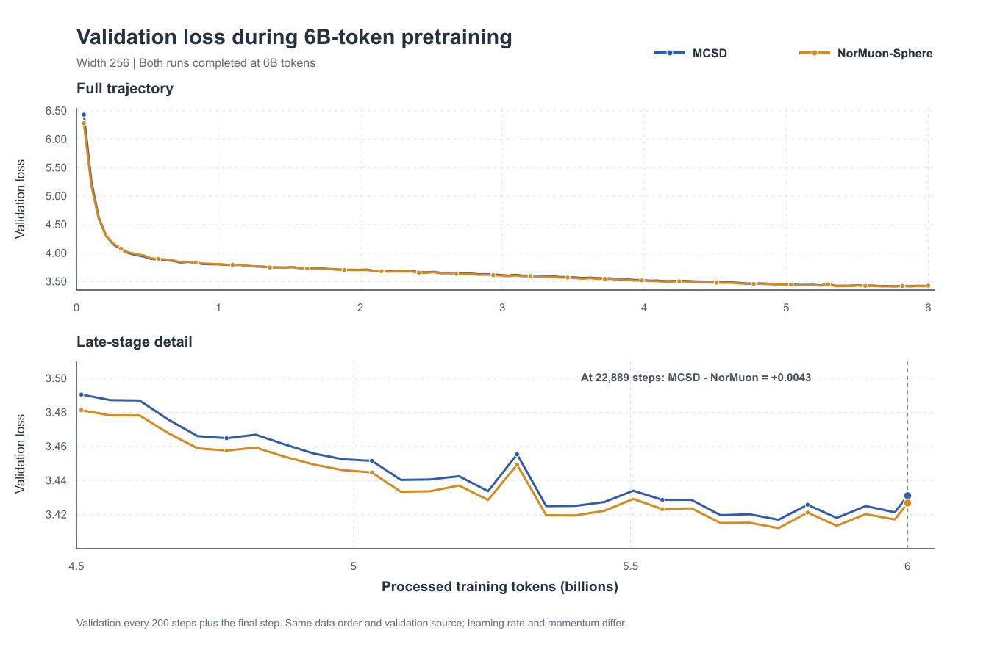

# Width-256 Frobenius sphere: completed 6B comparison

Status: both H20 jobs completed successfully on 2026-10-22. The validation
curves were extracted from the original Slurm stdout logs; the frozen numeric
data are in
[`validation.csv`](reports/width256_6b_final_20261022/validation.csv).

| Method | Job | Peak LR | Matrix momentum | Final val loss | Last logged train loss at step 22,880 | Slurm elapsed |
| --- | ---: | ---: | --- | ---: | ---: | ---: |
| MCSD | 4288199 | 0.010 | beta=0.95 EMA | 3.431077 | 3.406337 | 1 day 12:52:20 |
| NorMuon-Sphere | 4288211 | 0.015 | beta=0.9 Nesterov-style | **3.426804** | 3.402065 | 1 day 12:49:13 |

Both jobs used width 256, 28 layers, Frobenius shape-radius policy with
`r=1`, the same 6B OLMo-Mix-1124 indexed training prefix, the same 3B-index
validation source, seed 1234, one H20 each, and 22,889 updates / 6,000,214,016
processed training tokens. Slurm states are `COMPLETED` and both training exit
codes are zero. No numerical failure appeared in the final logged training
window. The last logged train losses are short-window training metrics, not
full-train-set losses.

At the final evaluation NorMuon-Sphere is lower by **0.004273** loss. It is
lower at 94 of the 115 matched validation steps. At step 12,000 (3.146B
tokens) MCSD minus NorMuon-Sphere was +0.011603; by the final step it had
shrunk to +0.004273. Thus MCSD catches up in the latter half, but it has not
crossed in this run. Both final validation values are slightly higher than
their respective step-22,800 values; the plotted raw points are not smoothed.

These are each method's width-256-selected settings, **not** a matched
momentum/LR experiment or a new 6B learning-rate sweep. The 3B and 6B runs
also use different total cosine-decay horizons, so comparing their losses at
the same intermediate token count does not isolate the effect of additional
data. One seed and a 0.0043 final gap are insufficient for a broad ranking.
The next fixed-budget width-384/512 transfer test is specified in
[`WIDTH_TRANSFER_MCSD_NORMUON_20261022.md`](WIDTH_TRANSFER_MCSD_NORMUON_20261022.md).

Plot reproduction: run `scripts/manifold/plot_6b_validation.js` with this CSV
and an output stem; the generated SVG and PNG are stored beside the CSV.
