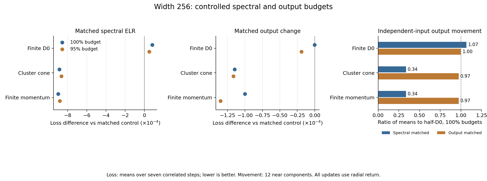

# Spectral and Output ELR Controls for MCSD-TP and P2GD

**Completed November 20; rechecked November 22, 2026.** Follow-up to
[the matched-AUS replay](p2gd_returned_elr_replay_20261119.md).
H20 job **4479762** completed all 16 common updates on one H20, SPG-7-2,
in **16:30**, exit 0:0. It is not a new 1B/3B training comparison. No new
checkpoints were saved. The checkpoint and prior common training replay match.
There is no new spectral-sphere run since the previous publication. This
update adds complete-update descent statistics and checks the same raw data;
the [six-way follow-up](p2gd_six_controls_20261122.md) was separately authorized
and submitted on November22 as4487800. It has no completed result yet.

**Main finding:** momentum-cone directions improve the paired held-out loss
after spectral matching, but their local-output changes are only about one
third of half-D0's. Finite-D0's previous tiny AUS-matched advantage does not
survive equal spectral movement. Neither result yet isolates a geometric gain.

[Verified summary](../results/p2gd_budget_20261120/h20_summary.json) |
[Completion record](../results/p2gd_budget_20261120/h20/BUDGET_COMPLETED.json)

## Results

The same **seven informative steps / 12 near components** are replayed; all
numerical clusters have q=2. These repeat the prior trajectory, not seven new
independent states. Held-out batches are fresh, so do not subtract absolute
losses between the two jobs. Each entry below is a mean paired loss difference
from half-D0 **at the same metric and budget**; negative is better.

| Matching | Budget | Finite D0 | Cluster cone | Finite momentum |
|---|---:|---:|---:|---:|
| Spectral ELR | 100% | +0.000081403 | -0.000886338 | **-0.000898480** |
| Spectral ELR | 95% | +0.000049720 | -0.000865667 | **-0.000880906** |
| Local output | 100% | -0.000000290 | **-0.000114720** | -0.000100044 |
| Local output | 95% | -0.000018975 | -0.000116645 | **-0.000135105** |

Both momentum-cone variants improve held-out loss in **7/7** informative
steps under spectral matching, versus **5/7** under output matching. Finite-D0
loses **7/7** at 100% spectral budget and **6/7** at 95%; its 100% output
mean is essentially tied. The 95% half-D0 controls themselves improve over
the original half-D0 by about 4.2e-5. That attenuation effect is already
subtracted in the 95% rows above.

These are relative improvements, not seven successive decreases from the
pre-update loss: **every candidate decreases held-out loss in 4/7 informative
steps**. Mean changes from before the complete update are -0.00110667 for
half-D0, -0.00200515 for spectral-100% finite momentum, and -0.00120671 for
output-100% finite momentum. Safe-component and non-matrix updates are common,
so not all of this complete-update decrease is attributable to the near branch.

### Relative Benefit Versus Complete-Update Descent

The following values use the 100% budgets and the same seven informative
steps. Training differences refer to the first training microbatch, not the
entire accumulated training batch.

| Candidate | Held-out difference from half-D0 | Held-out change from pre-update | Training-microbatch difference from half-D0 |
|---|---:|---:|---:|
| half-D0 | 0 | -0.001106668 | 0 |
| Cluster cone / spectral | -0.000886338 | -0.001993006 | -0.000650508 |
| Finite momentum / spectral | -0.000898480 | -0.002005148 | -0.000657797 |
| Cluster cone / output | -0.000114720 | -0.001221388 | +0.000190156 |
| Finite momentum / output | -0.000100044 | -0.001206711 | +0.000165531 |

All five decrease held-out loss in four steps and increase it in three.
The nine other common steps have no near-component change and therefore
zero between-candidate differences. Averaging over all 16 steps gives
-0.000393085 for spectral-matched finite momentum and -0.000043769 for
output-matched finite momentum versus half-D0. This dilution is reported,
not hidden by selecting informative steps. Neither denominator creates
independent observations.

Validation loss need not decrease on every stochastic update. The point of
this distinction is to avoid turning a paired advantage into a monotonic
descent claim. Without a zero-near-update control, the full loss change
cannot be assigned exclusively to the repaired near direction.



### What Matching Leaves Uncontrolled

These are ratios of means over the 12 components at the **100% budgets**:

| Direction / matching | Spectral movement | Independent-input output movement | AUS |
|---|---:|---:|---:|
| half-D0 reference | 1.00 | 1.00 | 1.00 |
| Finite D0 / spectral | 1.00 | 1.07 | 1.06 |
| Cluster cone / spectral | 1.00 | 0.34 | 0.13 |
| Finite momentum / spectral | 1.00 | 0.34 | 0.13 |
| Cluster cone / output | 2.93 | 0.97 | 0.37 |
| Finite momentum / output | 2.93 | 0.97 | 0.37 |

The large spectral-matched benefit could reflect lower output/angular
movement, the direction, or both. The 95% half-D0 control is not enough to
resolve a roughly 66% output reduction. The original and gap-preserving
momentum corrections are very close; their ranking changes between budgets.
There is no consistent evidence for paying extra for the finite-step formula.

At matched output the held-out gain is smaller, while the first training
microbatch loss is **worse** for the momentum family. Neither a universal
descent claim nor a long-training advantage follows from this diagnostic.
The mean training-microbatch differences from the same-budget half-D0 control
are +0.000166 to +0.000275 for output-matched finite momentum and +0.000190
to +0.000247 for output-matched cluster-cone repair. The training and held-out
signs must therefore be reported together.

### Precision and Verification

All 168 calibrated matches pass the FP32 absolute-plus-relative tolerance;
the 12 reference updates need no search. Maximum FP32 radius error is
1.19e-7. BF16 rounding leaves a maximum budget discrepancy of **6.33% for
spectral matching**, versus **0.72% for output matching** across this sample.
Thus FP32 master matching is not exact forward-weight matching. Independent
activation inputs preserve the approximate one-third output ratio under
spectral matching, so the difference is not confined to calibration inputs.

The completion record and both raw numerical files match the H20 SHA256
checksums. The November22 expansion preserves all historical summary fields
and adds pre-update changes, descent/increase counts and all-step paired means.
All **23** relevant CPU tests pass, including five summary regression tests.
Search work averages about 11--15 evaluations per calibrated
candidate. This is an exact-SVD diagnostic, not evidence for production speed.

## Next Test Decision

**Keep cluster-cone and finite-momentum as short-test candidates; do not
promote finite-D0 or start a new 1B/3B sweep yet.** The missing evidence is
whether a multi-direction correction helps beyond changing the direction
family and its realized amplitude.

Use six counterfactuals from one later width256 checkpoint, retaining the
same gap/cluster windows, Nesterov, full spectrum and common radial return:

1. half-D0 reference.
2. Uncorrected half-D0 calibrated per component to the local-output movement
   of the spectral-matched cluster-cone candidate, not a global factor 0.34.
3. Ambient normalized momentum, spectral-matched to half-D0.
4. Top-1 momentum correction, with the same spectral target.
5. Cluster-cone momentum, with the same spectral target.
6. Finite-momentum correction, with the same spectral target.

Start with 16--32 common-trajectory updates and 20 fresh fixed held-out
microbatches. A cheap optional zero-near-update control tests whether avoiding
the near update explains the gain. Report paired deltas, BF16 and FP32
movements, independent-output changes, cluster size, all-step and informative
means, and full wall time. Do not treat these correlated steps as seeds.

Only if a correction improves on **ambient/top-1 at matched spectral budget**
and the **output-attenuated half-D0 control**, proceed to a 32-step independent
branch comparison. Then test the surviving mechanism with warm block-8 K10.
Separately, the previous 32-step study still lacks attenuated MuonSphere
controls (coefficients 0.985/0.95); those test direction versus global scale.
The original cluster-cone formula is the simplest candidate to carry forward;
keep finite momentum as an ablation, not a presumed improvement. Require
consistent paired evidence on both the original and a later checkpoint before
expanding the budget. No new experiments were submitted by this publication update.

## Question

Previously, finite-D0 repair was only 1.26e-5 better than half-D0 on seven
informative steps. The momentum-cone family was approximately 0.0021 worse,
but equal AUS permitted about 8.4x spectral movement and 2.9x local-output
movement. This experiment asks whether either direction helps after those
actual movements are separately controlled.

## Paired Design

All candidates share X, the gradient, Nesterov input, data, non-matrix updates
and the safe MCSD-TP components. The common trajectory still uses half-D0
only when the exact FP32 gap is at most 2e-4. Near-component candidates are
temporarily committed to both FP32 masters and BF16 forward weights, evaluated,
and restored. Their momentum histories do not diverge.

Let the reference point be

$$X^+_0=R\frac{X+\alpha D_0/2}{\|X+\alpha D_0/2\|_2}.$$

Two **separate** matching policies are tested:

$$e_{\rm spec}(X,X^+)=\frac{\|X^+-X\|_2}{\|X\|_2},\qquad
e_{\rm out}(X,X^+;A)=\frac{\|A(X^+-X)^T\|_F}{\|AX^T\|_F}.$$

A contains fixed pre-update calibration activations in its rows. Output ELR
is a local linear measure, not the full-network output change. Held-out loss
is never used to choose a coefficient.

For each policy, target = **1.00 or 0.95** times the corresponding reference
ELR. At each target compare:

| Direction | Purpose |
|---|---|
| half-D0 | Matched-budget control; at 0.95, an actual-return shrink control |
| finite D0 | MCSD-TP direction with gap-preserving finite-step top correction |
| cluster cone | Normalized negative momentum with the original multiple-root-style correction |
| finite momentum | Same momentum input, but retaining singular-value offsets |

The 100% half-D0 point is identical under both metrics and is reused. This
leaves **15 unique candidate updates**, not 15 independent training runs.
The 95% controls match **95% of returned movement**, not simply 0.95 times
the coefficient. The two budgets were fixed before observing this test's loss.

Finite-step corrections are rebuilt for every candidate coefficient. Searches
use only the designated geometric quantity, with tolerance
`2e-7 + 2e-4 * target`; failed matches raise an error. No silent fallback or
loss-based line search is allowed. Spectral and output ELR are not claimed
to match simultaneously, and AUS is monitored rather than enforced here.

## Protocol

| Item | Setting |
|---|---|
| Model | Width 256, 28 layers, approximately 75M parameters |
| Starting state | Same existing step-252 checkpoint as job 4472441 |
| Updates | 253--268; 8,388,608 additional training tokens |
| Schedule | Existing 1B/1908-step schedule; base LR 0.015 |
| Near threshold and cluster window | Both 2e-4; no truncation of the identified cluster |
| Return and spectral oracle | FP32 `gesvd`, radial return for every candidate |
| Main arithmetic | BF16 model and NS8; FP32 masters; Nesterov 0.9 |
| Batch | Sequence 4096, global 128, microbatch four |
| Calibration | One fresh microbatch; 256 input tokens per linear module |
| Evaluation | 20 fresh fixed held-out microbatches; skip the previous 47 validation batches |
| Data | Existing 3B indexed source; not a new full 3B run |
| Layout | Inherited 252-component, unsplit-FC1 checkpoint layout |
| Resources | One H20, 3-hour upper limit, no new checkpoints |

The launcher verifies initial optimizer/state records, training token identities
and pre-update training losses against the prior common replay. Checkpoint
hashes are checked before and after the diagnostic. Evaluation batches must
be disjoint from the previous fixed batch set.

## What Is Recorded

- Complete-update training-microbatch and held-out losses.
- Difference from the **same metric, same budget** half-D0 control, as well
  as from the original unshrunk half-D0 point.
- Actual FP32 spectral/output ELR, AUS, coefficient, gradient work, radius
  error and search work.
- Output ELR on independent held-out activations, not only calibration inputs.
- BF16-rounded spectral and output movement. FP32 matching need not survive
  quantization exactly; such discrepancies are reported, not hidden.
- Identified cluster size and successful restoration of every counterfactual.

The primary comparison for a 95% candidate is the 95% half-D0 control, not
the larger original step. A gain only against the larger step supports
attenuation, not the proposed geometric correction. A gain disappearing
under independent inputs or after accounting for BF16 movement is not robust
evidence of a direction improvement.

## Local Verification

Twenty-three CPU tests pass, including matching after the full return, rebuilding
the finite-step model at the final coefficient, explicit rejection of
unreachable targets, and restoration after an injected evaluation failure.
The five summary tests also check duplicate/per-step record consistency,
relative versus absolute loss changes, training/held-out sign differences,
the all-step denominator, and preservation of previously published metrics.

Three saved training matrices (128x256, 1536x256 and 256x256) also pass all
45 candidate checks, including 42 calibrated matches. Their input activations
are synthetic and anisotropic: these checks establish implementation behavior,
not LLM loss performance. Maximum relative residual is 3.61e-4, within the
absolute-plus-relative tolerance; maximum FP64 radius error is 3.56e-15.

## Reproduction and Interpretation

[Geometry and matching](../../scripts/p2gd_budget_geometry.py) |
[LLM adapter](../../scripts/p2gd_budget_replay.py) |
[Tests](../../scripts/test_p2gd_budget.py) |
[Paired summarizer](../../scripts/summarize_p2gd_budget.py)

```bash
PYTHONPATH=scripts:/path/to/frozen/elr/h20_elr:/path/to/frozen/elr \
  python -m unittest test_p2gd_budget -v
python scripts/audit_p2gd_budget_local.py \
  docs/results/corner_momentum_20261117/input_snapshots \
  docs/results/p2gd_budget_20261120/local_geometry.json
python scripts/summarize_p2gd_budget.py \
  docs/results/p2gd_budget_20261120/h20 /tmp/budget_summary.json
PYTHONPATH=scripts python -m unittest test_summarize_p2gd_budget -v
python scripts/publish_returned_step_repair.py \
  docs/results/returned_step_repair_20261119 \
  --budget-root docs/results/p2gd_budget_20261120
```

Unlike AUS calibration, matching full spectral/output movement generally
requires radial norms during the coefficient search. This test intentionally
uses an exact numerical oracle; its runtime must not be advertised as the
cost of a production approximate optimizer. The repeated batches and common
trajectory are correlated observations, not independent seeds or a convergence
proof. No long-run promotion is pre-authorized by a small positive difference.

The published numerical JSONL files contain scalar diagnostics and batch
hashes, not model weights or training-token arrays. Reconstructing the budget
summary requires PyTorch because the arm definitions are imported from the
geometry module. Plotting additionally needs NumPy and Matplotlib. Actual
LLM replay requires the frozen ELR host, original checkpoint and indexed
data; the launch adapters are not standalone Megatron replacements.
