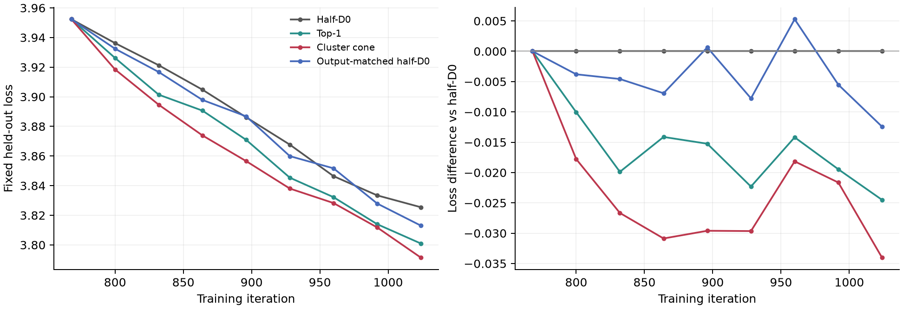

# P2GD Later-Start Recovery

## Completed Results: November 26

All four jobs **4506265_0--3**, restore job **4506264** and snapshot audit
**4506266** are **COMPLETED, exit 0:0**. Training ended November 25 at
15:14 UTC+08 and the audit at 15:15. No skipped/NaN iterations are reported;
the frozen source manifest still verifies. All 256 updates per arm, full
initial model/optimizer states, training token streams and fixed evaluation
batches pass the post-hoc pairing checks.

**The cluster direction retains an advantage at this later start under the
same BF16 returned-step matching rule.** This is a second starting point on
the same seed, not an independent-seed replication or a full-budget result.

| Near-region policy | Final loss | Last-four mean | Near decisions | H20 elapsed |
|---|---:|---:|---:|---:|
| Half-D0 | 3.825426 | 3.843236 | 1.373% | 1:25:14 |
| Top-1 | 3.800925 | 3.823121 | 8.177% | 1:50:58 |
| **Full numerical cluster, P2GD-type** | **3.791397** | **3.817367** | 14.738% | 2:17:50 |
| Output-matched half-D0 | 3.812997 | 3.838130 | 2.313% | 1:37:23 |

Times are scheduler elapsed times, excluding the shared restore gate.
Cluster minus top-1 is **-0.009528** at the endpoint and **-0.005754** for
the last-four mean. Endpoint differences versus half-D0 and output-matched
half-D0 are **-0.034029** and **-0.021600**. Cluster is lower at **all eight
post-update evaluation points** than each control. These repeated observations
are correlated, not eight independent trials or a significance test.



### BF16 Matching and Interpretation

| Policy | Mean relative budget error | Maximum | Outside strict search tolerance |
|---|---:|---:|---:|
| Top-1 | 0.01435% | 0.45844% | 402 / 5,275 |
| Cluster | 0.01432% | 0.47105% | 639 / 9,508 |
| Output-matched half-D0 | 0.01246% | 0.20629% | 14 / 1,492 |

The strict search tolerance is `2e-7 + 2e-4 * target` in the ELR metric.
Every recorded relative error remains below 1%; best-observed unmatched
candidates are retained, not silently reclassified as exactly matched.
The output control also has 58 reference-cluster searches outside the strict
tolerance. The largest FP32 master sphere error is `6.38e-7`.

Top-1 and cluster match the BF16 **spectral** movement of half-D0 at their
own current state. The output control matches the BF16 **output** movement
of a hypothetical cluster update at its own state. Once paths diverge,
absolute displacement, momentum and future branch occupancy differ. Thus
the experiment weakens a simple "only a smaller step" explanation, but does
not isolate a geometric benefit on every individual update.

The earlier step512-start panel also favored cluster (endpoint advantage
over top-1 `0.017909`); this step768-start panel gives a smaller but persistent
advantage. The new held-out batches differ, so **do not concatenate the two
loss curves or compare their absolute losses as a single trajectory**.
No new ambient, MuonSphere or SSO arm is included. This result concerns a
numerical-cluster direction with radial return, not standard projection P2GD
or a proof of stochastic convergence.

### Capacity, Repetition and Cost

Cluster uses 9,508 of 64,512 component decisions (14.738%). Of these,
8,864 are consecutive repeats (93.227%), with a longest observed streak of
252 steps. Better loss despite high repetition means repetition alone is
not a failure criterion; longer-term stability is still untested.

| Required cluster dimension | 2 | 3 | 4 | 5 | 6 | >6 |
|---|---:|---:|---:|---:|---:|---:|
| Calls | 5,313 | 2,334 | 1,400 | 416 | 45 | 0 |

Top-4 would omit directions in **461/9,508 = 4.85%** of calls. Top-6 covers
all observed clusters in this panel, though the preceding panel contained
nine size-7 clusters. Do not assume a universal capacity guarantee.

The stratified audit contains **23 snapshots**, seven with size5, and **no
size6 snapshot**. At the same selected coefficient, top-4 changes seven
returned points, with maximum relative matrix error `4.59e-5`; top-6 matches
the full return on all 23. This is a geometry audit, not a truncated-policy
LLM-loss experiment, and the snapshot frequencies are not population rates.

| Oracle-warm method | Max radius error | Max absolute gap error | Median kernel time |
|---|---:|---:|---:|
| Block8, K10 | 1.55e-6 | 2.03e-6 | 2.03 ms |
| Block8, K20 | 1.43e-6 | 2.32e-6 | 3.58 ms |
| Block12, K10 | 1.91e-6 | 1.97e-6 | 2.27 ms |
| Block12, K20 | 1.79e-6 | 2.15e-6 | 4.17 ms |
| Exact svdvals reference | -- | -- | 9.70 ms |

Every approximate call starts from the **true current-X right subspace**.
Block8/K10's aggregate reference/approximate kernel-time ratio is 3.63x;
single-call timings are noisy and **not end-to-end training speedups**.
The audit does not establish persistent-cache accuracy, gap classification
agreement, or tangent-direction accuracy over a training trajectory. K20
shows no consistent benefit on this small, favorably initialized sample.

The actual cluster run is **24.2% slower than top-1** and 61.7% slower than
half-D0 by scheduler time. Each cluster call averages 15.25 coefficient
trials and 31.51 norm-SVD calls for diagnostic BF16 matching, apart from
common spectral work. Replacing just one main-path SVD will not remove this
matching overhead. Snapshot collection is also included in cluster time.

### Next Tests, Not Submitted

1. **Independent-seed confirmation:** keep the exact protocol and compare
   cluster, top-1 and output-matched half-D0 for 256 updates from one new
   matched checkpoint. Report endpoint and last-four mean; do not select a
   favorable intermediate step. The existing two starts are not two seeds.
2. **Persistent-cache pilot:** on width256, test block8/K10 with top<=6 for
   32 updates, retaining sparse exact diagnostic checks of radius, gap,
   direction, missed cluster members and BF16 returned displacement. Do not
   reset the approximate cache to exact vectors after each audit. Use the
   completed exact path as reference; extend to 256 updates only if stable.
   Capacity overflow must be recorded, not silently treated as a full cone.
3. **Remove the diagnostic search bottleneck separately:** profile main
   spectral work versus budget-search SVDs. Calibrate coefficients on a
   fixed prefix and test frozen or layerwise coefficients with sparse BF16
   ELR audits; repeat the top-1/cluster/shrinkage controls under the same
   cheaper rule. This changes the matching protocol and needs its own test.

No new jobs, wider gap grid, 1B or 3B runs were submitted in this results
update. The most defensible conclusion is **repeatable direction-selection
evidence at two starts of one seed, with production efficiency unresolved**.

[Verified statistics](../results/p2gd_replication_20261125_recovery/analysis_20261126.json) |
[Scheduler/source/health record](../results/p2gd_replication_20261125_recovery/status_20261126.json) |
[Raw logs and metrics, compressed](../results/p2gd_replication_20261125_recovery/raw_results_20261126.tar.gz) |
[Snapshot measurements](../results/p2gd_replication_20261125_recovery/h20/SNAPSHOT_AUDIT_COMPLETED.json)

Recompute from the archive (no checkpoint, dataset or matrix tensors are
included):

```bash
mkdir -p /tmp/p2gd-results
tar -xzf docs/results/p2gd_replication_20261125_recovery/raw_results_20261126.tar.gz -C /tmp/p2gd-results
python scripts/summarize_p2gd_recovery.py /tmp/p2gd-results/results /tmp/p2gd-analysis.json --figure /tmp/p2gd-curves.png
```

The collector uses the Python standard library; `--figure` additionally
requires Matplotlib. Raw input hashes accompany the statistics.

## Scope

This is the authorized recovery of the [interrupted replication](p2gd_later_replication_20261125.md),
not another parameter sweep or a 1B/3B run. The failed source project and its
original job states are retained unchanged. A separately frozen recovery
project reuses the saved step-768 checkpoint and prefix logs through links;
it does not replay steps 513--768 or save new training checkpoints.

Submitted **November 25, 2026 at 11:29 UTC+08**:

| Job | Work | Resource/dependency |
|---|---|---|
| 4506264 | Restore checkpoint; verify updates 769--770 | One H20; 45-minute cap |
| 4506265_0 | Half-D0, updates 769--1024 | Restore succeeds |
| 4506265_1 | Top-1, updates 769--1024 | Restore succeeds |
| 4506265_2 | Full numerical cluster, updates 769--1024 | Restore succeeds |
| 4506265_3 | Output-matched half-D0, updates 769--1024 | Restore succeeds |
| 4506266 | Top-4/top-6/full and warm-block snapshot audit | All four branches succeed |

The array is limited to **two simultaneous one-H20 jobs**. The audit uses
one H20 for at most 30 minutes. The unrelated Frobenius-band task is not
modified. At preparation the account had about 14 GB free; the recovery
creates no additional checkpoint or dataset copy.

## Fixed Comparison

Keep width 256, 28 layers, seed 1234, gap/cluster window `2e-4`, Nesterov 0.9,
the inherited 1908-step learning-rate schedule (peak `0.015`), exact FP32
spectra and exact-norm radial return. Constrained matrix weight decay stays
disabled. All four paths start from identical model and optimizer states
and consume the same training batches. Each path commits 256 updates
(134,217,728 training tokens).

The BF16 step-matching rule is unchanged. Top-1/cluster candidates
match the reference spectral displacement at their own current state;
the output-matched half-D0 control matches the cluster candidate's output
displacement. Diverged trajectories do not have identical absolute steps.
Only 20 fresh fixed held-out batches are used; these are not full validation
or directly comparable to older 1B/3B tables.

The numerical cluster is uncapped during training. Cluster snapshots are
bounded by 24 matrices and 256 MiB. The dependent offline audit compares
top-4, top-6 and full-cluster returns at the same selected coefficient, then
oracle-warm block-8/12 with K10/K20 against exact spectra. The approximate
audit does not change the training policy and is not a persistent-cache
training result. No new MuonSphere/SSO arm is launched yet.

## Recovery Safeguards

- Verify every original source-file hash and the previously recorded
  checkpoint file set, sizes and SHA256 hashes before staging.
- Preserve the source checkpoint and prefix; never replace a staged or
  partially run recovery directory.
- Recheck all 256 prefix updates, training streams, evaluations and the
  declared sparse state-audit schedule against the completed reference.
- Run two restored updates; compare the initial full model/optimizer
  signature with the recorded post-save signature at step 768.
- Check fresh held-out/calibration batches do not overlap the prior panel.
- Release branches only when the restore job succeeds. Each branch checks
  the shared checkpoint before and after training and verifies pairing.

Local validation: **56 tests passed**, including recovery idempotency,
changed-checkpoint rejection, dependency/concurrency settings, sparse audit
coverage and prior geometry/trajectory tests. CUDA/host tests run again on
each H20 allocation. Unit-test success is not a restored-checkpoint proof
or evidence of algorithmic improvement.

## Historical Startup Record

The two-update restore job **4506264 COMPLETED**, exit `0:0`, in **1:35**.
Its gate **passed**: full model/optimizer signatures
exactly match the recorded post-save state, the 45 reference state audits
match, and the new evaluation batches are disjoint. Restored training
finished at 11:30 UTC+08 with no skipped/NaN iterations.

Live check after the gate: **4506265_0 (half-D0)** and **4506265_1 (top-1)**
are RUNNING on SPG-7-1. Arms 2--3 wait on the two-job array limit; the audit
waits on all four branches. Both running arms have committed update 769;
FP32 radius error is below `2.25e-7`, and top-1 BF16 budget error is 0.0189%.
These are startup checks, not comparative performance results.
No final branch comparison was available at that startup check; the completed
results above supersede it.
The independent restoration proof is recorded in
[PREFIX_READY.json](../results/p2gd_replication_20261125_recovery/PREFIX_READY.json).

Report endpoint and last-four-evaluation mean, actual BF16 matching error,
near occupancy/repetition, required cluster capacity and total runtime.
Only a repeated advantage over top-1 and output-matched shrinkage supports
moving to a cheaper persistent-cache implementation and matched baselines.
Do not widen the gap grid or promote a diagnostic to a 3B result.

[Submission receipt](../results/p2gd_replication_20261125_recovery/replication_submission.json) |
[Recovery provenance](../results/p2gd_replication_20261125_recovery/recovery_preparation.json) |
[Checkpoint hashes](../results/p2gd_replication_20261125_recovery/common_checkpoint_manifest.json)

Implementation: [staging](../../scripts/prepare_p2gd_recovery.py),
[restore/branch runner](../../scripts/run_p2gd_replication.py),
[submission](../../scripts/submit_p2gd_replication.py),
[regression tests](../../scripts/test_p2gd_recovery.py).
