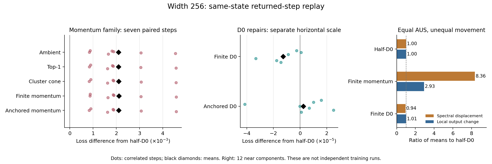

# MCSD-TP and P2GD Repairs at Matched Returned Step Size

**Completed November 19, 2026.** H20 job **4472441** completed all 16 common
updates on **one H20, SPG-7-1**, in **12:47**, exit 0:0. No new checkpoints
were saved. The seven informative LLM updates do not support replacing
half-D0 by a matched-AUS momentum-cone direction. Gap-preserving repair of
D0 itself has a tiny favorable signal, not enough to promote a 1B/3B run.
The question is whether a repair improves the **complete returned update**,
beyond changing its size. The [completed spectral/output-budget follow-up](p2gd_budget_matching_20261120.md)
now supersedes the preliminary candidate decisions below: finite-D0 does not
retain its gain at equal spectral movement; momentum-cone gains remain
confounded by much lower output/angular movement.

[Local study](../../scripts/returned_step_repair_study.py) |
[Local numerical aggregates](../results/returned_step_repair_20261119/local_summary.json) |
[Repair and AUS calibration](../../scripts/p2gd_elr_geometry.py) |
[Real-LLM replay](../../scripts/p2gd_elr_replay.py)

## Decisions After the AUS Replay

**Verified November 21:** the completion record and both numerical JSONL
files match the H20 SHA256 checksums. Regenerating the H20 summary reproduces
every published field. Thirteen related CPU tests pass, including restoration
after an evaluation exception. No new jobs were submitted in this publication
update; unrelated Frobenius-band training is not included here.

- **Retain finite-step repair of D0 for a matched-amplitude replication.**
  It is slightly better in six of seven informative LLM updates, with mean
  loss difference -1.26e-5. This is a candidate, not a robust improvement.
- **Do not promote the momentum-cone variants yet.** Their local quadratic
  benefit does not transfer in this replay. Equal AUS permits about 8.4x
  greater spectral movement and 2.9x greater local-output movement; isolate
  that difference before concluding that their directions cannot work.
- Keep **half-D0, ambient and top-1** controls. The historical half-D0 3B
  result remains evidence for attenuation, not evidence for P2GD geometry.
- Keep the exact geometry oracle for the next short mechanism check, then
  test warm approximate spectra only if a useful direction survives it.

## Algorithms and Matching

The common state is on the spectral sphere. D0 denotes the signed MCSD-TP
direction, including its post-matrix-sign tangent projection. The reference
is the complete radial update

$$X^+_0=R\frac{X+\alpha D_0/2}{\|X+\alpha D_0/2\|_2}.$$

The momentum family starts from the normalized negative momentum, initially
scaled to half the Frobenius length of D0. This initial scale is **not the
comparison budget**: a geometry-only coefficient search matches the actual
returned displacement. The coefficient is never selected using loss.

| Candidate | Input to repair | Top-block operation |
|---|---|---|
| half-D0 | D0/2 | None; amplitude reference |
| ambient | Normalized negative momentum | None |
| top-1 | Same momentum input | Remove the leading normal component |
| cluster cone | Same momentum input | Treat the numerical cluster as a multiple root |
| finite momentum | Same momentum input | Retain the actual singular-value offsets |
| anchored momentum | Same momentum input | Fix the leading anchor; allow remaining top directions to contract |
| finite D0 | D0/2 | Gap-preserving repair of the MCSD-TP direction |
| anchored D0 | D0/2 | Anchored repair of the MCSD-TP direction |

For paired top vectors U,V, write A = sym(U^T Z V). The old cluster repair
replaces A by its nearest symmetric matrix with largest eigenvalue zero.
The finite-step repair instead uses

$$E_\alpha=\operatorname{diag}(R-s_i)/\alpha,\qquad
B_\alpha=E_\alpha+P_{\{H:\lambda_{\max}(H)=0\}}(A-E_\alpha),$$
$$D_\alpha=Z+U(B_\alpha-A)V^T.$$

Thus the compressed trial has largest eigenvalue R. This is a **small-block
model**, not a guarantee that the full trial has spectral norm R. The repair
is rebuilt at every candidate coefficient; scaling an already repaired
direction would generally break its defining model.

Anchored repair sets the first row/column of B to zero and replaces A[2:q,2:q]
by its negative-semidefinite part. With the true leading anchor this ensures
H(D)e1=0 and H(D)<=0. It is a restricted cone-face operation, not a proof of
global stochastic convergence. A numerical cluster of unequal singular
values is not the true active multiplicity.

All candidates use the same final **radial return**, not a nearest-point
projection. Consequently these are P2GD-type radial variants, not standard
projection-based P2GD or PGD.

### Three Separate Local Budgets

Each test matches one quantity at a time:

1. Spectral ELR: ||X+ - X||2 / R.
2. Frobenius displacement: ||X+ - X||F / R. This is not the convention with
   ||X||F in the denominator; for a fixed shared X the matching is equivalent.
3. AUS: ||X+/||X+||F - X/||X||F||F.

All other measures are logged, not claimed to match simultaneously. Search
is capped at 64 times the nominal coefficient; zero targets and unsuccessful
matches are explicit failures. Finite-step coefficients are always recomputed.

## Completed Local Results

The FP64 study contains **360 constructed quadratic states**, plus **9 real
training-matrix snapshots**. Across eight methods and three metrics, all
**8,856** attempted matches succeed. Maximum relative matching error is
9.993e-6; maximum radius error is 1.78e-15. These are paired cases, not
8,856 independent experiments.

The quadratic objective is f(W)=0.5||W-(X-G)||F^2. Its complete loss change
is <G,X+-X> + 0.5||X+-X||F^2, including the radial correction. Matrix shapes
are 16 by 12, with true top multiplicities two/four or a top gap of 1e-4.
The table counts increases after **AUS matching**, with 72 cases per column.

| Direction | True corner, M=G | True corner, cosine(M,G)=0.5 | Near-simple, M=G | Near-simple, cosine=0.5 |
|---|---:|---:|---:|---:|
| half-D0 | 10 | 24 | 6 | 24 |
| ambient | 8 | 24 | 8 | 23 |
| top-1 | 24 | 24 | 24 | 24 |
| cluster cone | 0 | 4 | 0 | 3 |
| finite momentum | 0 | 4 | 0 | 2 |
| anchored momentum | 0 | 4 | 0 | 3 |
| finite D0 | 0 | 10 | 0 | 1 |
| anchored D0 | 0 | 7 | 0 | 1 |

At exact multiplicity, finite momentum and the complete cluster-cone formula
coincide, as expected. At near-simple points, finite momentum improves the
mean loss change over cluster cone by **3.54e-5** for M=G and **4.50e-5** for
cosine 0.5 under AUS matching. Anchoring is slightly worse than the complete
cone in these averages. None of these numbers is an LLM loss result.

**The ELR convention changes the ranking.** At true corners with M=G,
cluster cone has mean loss change -0.010327 versus -0.006274 for half-D0
under AUS matching. Under spectral matching, the values are -0.005703 and
-0.006274: half-D0 has the better mean despite more individual increases.
Matching one norm does not equalize the direction's angular size or rank.

### Real Matrix Snapshots

The nine near-region snapshots include 128x256, 256x256 and 1536x256 weights.
All have a simple true leading singular value and a two-dimensional numerical
cluster under window 2e-4. The common starting state is radially normalized
in FP64 before comparison; the stored production D0 and momentum are retained.

At matched AUS, mean momentum work is about -1.90e-5 for half-D0 and
-1.176e-4 for the momentum family. However, ambient, top-1, cluster, finite and
anchored momentum repairs are very close to one another. This tests geometry,
not loss: these snapshots lack the full model, raw gradient and data batches.
The toy capacity never exceeds four and these real cases need two; neither
establishes that top-4 suffices throughout LLM training.

## H20 Same-State Loss Replay

**Completed: 4472441, 12:47, exit 0:0.** Six host/CUDA checks pass, all 16
optimizer updates succeed, and the source checkpoint is unchanged. This
short diagnostic is excluded from the 1B/3B result counts.

| Setting | Value |
|---|---|
| Model | Width 256, 28 layers, 75M scale |
| Common starting point | Existing step-252 model and optimizer checkpoint |
| Common trajectory | MCSD-TP; half-D0 only when gap <= 2e-4 |
| Near window and cluster window | Both 2e-4; measured from full FP32 spectrum |
| Capacity | Full identified numerical cluster; log q and q>4, no silent truncation |
| Counterfactuals | Eight directions above, identical current X/G/Nesterov input |
| Near-branch budget | Own-state half-D0 **returned AUS** |
| Return | Common FP32 `gesvd` norm and radial scaling |
| Completed updates | 253--268, 16 updates, 8,388,608 training tokens |
| Learning-rate schedule | Existing 1B/1908-step schedule, base 0.015 |
| Data | Existing indexed 3B source; not a new full 3B training run |
| Batch | Sequence 4096, global 128, microbatch four |
| Evaluation | 20 fixed held-out microbatches, after skipping the 26 previously used batches |
| Precision and momentum | BF16 model/NS8, FP32 masters, Nesterov 0.9 |
| Inherited layout | 252 components, FC1 unsplit; checkpoint-compatible |
| Resources | One H20, three-hour limit, no model checkpoints saved |

At each update, native non-matrix updates and the safe MCSD-TP components are
shared. The replay substitutes only the near-component candidates, evaluates
the same training microbatch and fixed held-out batches, then **restores both
FP32 masters and BF16 forward weights**. Only the common half-D0 trajectory
advances. Candidate momentum states are never separately advanced.

The replay logs gradient work, momentum work, actual spectral/Frobenius ELR,
AUS, calibration-input output change, radial correction, cluster size, and
changed BF16 elements. Candidates producing identical BF16 model weights
reuse the identical forward loss and are explicitly marked. Restoration is
asserted even after evaluation errors.

**Engineering point:** AUS(X, aY)=AUS(X,Y) for a>0. Matching therefore uses
norms and small eigensystems, with **zero original-matrix SVD calls during
the coefficient search**. Final candidate returns and this diagnostic's
spectral audits still use full SVD. This is not yet a zero-SVD optimizer or
a production timing benchmark.

### Completed Readout

There are **12 near-component decisions in seven informative steps**, out
of 4,032 component updates (0.298%). Every identified cluster has q=2, with
estimated gaps from 2.00e-5 to 1.79e-4. These are numerical near-clusters,
not observations of exact zero-gap multiplicity. No capacity overflow was
seen, which does not establish that top-2 suffices later in training.

All candidates restore the common state. The table averages each method's
held-out loss difference from half-D0 over the seven informative steps;
negative is better. These are **not** final optimizer validation losses.

| Near candidate | Mean difference from half-D0 | Better / worse / tied steps |
|---|---:|---:|
| ambient | +0.002099895 | 0 / 7 / 0 |
| top-1 | +0.002099674 | 0 / 7 / 0 |
| cluster cone | +0.002107545 | 0 / 7 / 0 |
| finite momentum | +0.002112242 | 0 / 7 / 0 |
| anchored momentum | +0.002108850 | 0 / 7 / 0 |
| finite D0 | **-0.000012626** | **6 / 1 / 0** |
| anchored D0 | +0.000002483 | 1 / 5 / 1 |

Tie tolerance is 1e-7. Finite D0's mean first-training-microbatch difference
is -9.52e-5, but this is not the full gradient-batch objective. The seven
steps and repeated held-out batches are correlated. The small finite-D0
signal needs replication before a long training test.

**Equal AUS is not equal spectral or output ELR.** The following averages
cover the same 12 near components:

| Candidate | Spectral displacement / R | Local-output ELR |
|---|---:|---:|
| half-D0 | 0.0085925 | 0.0114192 |
| finite momentum | 0.0718295 | 0.0334277 |
| finite D0 | 0.0081096 | 0.0114963 |

Finite momentum therefore has about **8.4x** the spectral movement and
**2.9x** the output movement, despite passing AUS matching. Its mean gradient
work is more negative (-0.002918 versus -0.001357), yet its held-out loss is
worse. A better first-order or momentum surrogate does not establish a
better complete stochastic LLM update.

This is an amplitude/shape confound, not proof that it causes the loss gap.
Finite D0 also has approximately 5.6% smaller spectral movement than half-D0,
so even its tiny benefit is not yet isolated from spectral attenuation.
The next diagnostic should match or bound spectral/output movement and add
the corresponding attenuated half-D0 control, not increase the gap threshold.
An upper bound may undershoot AUS; do not claim simultaneous exact matching.

All matching residuals pass the FP32 tolerance 2e-6 + 0.002*target (plus a
2e-6 outer-return allowance). Maximum observed relative AUS residual is
0.002101, and maximum candidate radius error is 1.19e-7. Coefficient searches
use at most nine geometry evaluations here, with no original-matrix SVD
during those searches. Diagnostic runtime includes extra full spectra and
repeated LLM evaluations; it is not production optimizer timing.

[Final H20 summary](../results/returned_step_repair_20261119/h20_summary.json)
is generated by [the paired replay summarizer](../../scripts/summarize_p2gd_elr_replay.py).
Completed-step loss and geometry records must agree before aggregation;
in-flight records are excluded explicitly.



The two loss panels deliberately use different horizontal scales. Dots are
correlated step observations, not independent seeds; diamonds are means.
The right panel uses ratios of component means, not means of per-component ratios.

## Completed Follow-Up and Next Tests

Job **4479762** has now tested four directions at separate spectral/output
budgets of 100% and 95%, including matched half-D0 shrink controls. See its
[results and updated six-way test plan](p2gd_budget_matching_20261120.md#next-test-decision).
Do not repeat that completed comparison as a pending task. The missing
controls are spectral-matched ambient/top-1 and half-D0 with output attenuation
as large as the cone candidate's, preferably at a later checkpoint.

Do not select a new direction solely because it exits the near region,
has larger negative gradient work, or wins a toy quadratic. All 12 H20 near
events here have numerical q=2, not exact multiplicity. A convergence claim
at nonsmooth points requires separate mathematical assumptions and evidence.

## Promotion Criteria

1. Compare finite/anchored momentum **against ambient and top-1**, not only
   against half-D0. Otherwise a direction-family change can be mistaken for
   a useful multi-direction repair.
2. Require a reproducible full-return loss improvement at the same AUS,
   without a large unexplained increase in output ELR. Report ties and loss
   increases, not only average improvements.
3. Confirm that the gain occurs in q>=2 cases and survives BF16 rounding.
   Check a later checkpoint and an independent set of batches before another
   long-budget run; the 16 steps are correlated observations, not 16 seeds.
4. Only then replace the exact oracle by warm block-8/K10 or K20 and audit
   routing, required capacity and radius error. A useful direction is the
   current question; cheap approximate implementation is the next question.

No stochastic convergence guarantee follows from these tests. They do not
resolve changing active multiplicity, near-cluster identification, fixed
momentum error, or the distinction between radial return and metric projection.

## Reproduce Locally

```bash
PYTHONPATH=scripts python -m unittest \
  test_returned_step_repair_study test_p2gd_elr_geometry -v
python scripts/returned_step_repair_study.py \
  --snapshots docs/results/corner_momentum_20261117/input_snapshots \
  --limit 9 --output docs/results/returned_step_repair_20261119/local.json
python scripts/summarize_p2gd_elr_replay.py \
  docs/results/returned_step_repair_20261119/h20 /tmp/replay_summary.json
python scripts/publish_returned_step_repair.py \
  docs/results/returned_step_repair_20261119
```

PyTorch is required for the toy tests; Matplotlib and NumPy are required for
the figure. The H20 summary needs only the Python standard library. The two
published JSONL files contain scalar diagnostics and batch hashes, not token
arrays or weights. The 16 MB local row archive is omitted; its checksum and
all 168 group aggregates are retained in `local_summary.json`.

Omitting `--snapshots` reproduces the 360 toy states
without private training snapshots. H20 launch is isolated by
[prepare_p2gd_elr_replay.py](../../scripts/prepare_p2gd_elr_replay.py), which
verifies and copies the frozen ELR host, references the existing checkpoint,
and refuses to overwrite a staged or submitted project.
The launch/replay adapters and `test_p2gd_elr_replay.py` additionally require
the frozen ELR host (`adapter`, `confirm_adapter`, `matched_geometry`, `run`)
and Megatron environment; they are not standalone training entry points in
this results repository. The local geometry tests and published-summary
reconstruction do not require that host or H20 access.
