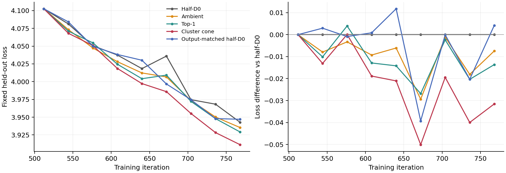

# BF16-Matched Independent Trajectories

## Completed Results: November 25 Check

**All five paths and the shared-prefix gate completed with exit 0:0.**
Unlike the earlier single-step replays, these branches each commit 256 updates
and evolve their own momentum. Cluster-cone has the lowest endpoint and
last-four-evaluation mean in this one-checkpoint, one-seed panel.

| Policy | Loss at step 768 | Mean at 672/704/736/768 | Near decisions | Scheduler time |
|---|---:|---:|---:|---:|
| Half-D0 | 3.942878 | 3.980456 | 0.769% | 1:26:11 |
| Ambient | 3.935439 | 3.966445 | 1.705% | 1:29:51 |
| Top-1 | 3.929235 | 3.964658 | 3.491% | 1:35:15 |
| **Cluster-cone** | **3.911326** | **3.945195** | **8.530%** | 1:53:43 |
| Output-attenuated half-D0 | 3.947058 | 3.966588 | 0.885% | 1:29:50 |

All start at **4.102630** on the same 20 fixed held-out microbatches. These
are not full validation scores and must not be compared by absolute value
with older 1B/3B tables. Near rates divide component decisions by
`256 updates * 252 components = 64,512`, not by optimizer steps alone.
The shared-prefix job took another **1:30:09**, separate from branch times.

At the endpoint, cluster-cone improves on ambient by **0.024113**, top-1 by
**0.017909**, and output attenuation by **0.035732**. Last-four means preserve
this ordering. Cluster is best at seven of the eight post-start evaluations;
the exception is step576. This supports further testing of cumulative
behavior, not a universal single-step direction advantage or a convergence
claim. There is no MuonSphere/SSO arm in this panel.

### Geometry and Precision

The local collector independently checked complete update/evaluation windows,
initial model and optimizer signatures, every training microbatch hash, fixed
held-out tokens, weighted evaluation losses and committed radial returns.
The recomputed endpoints and tail means agree with the remote completion
receipt. All **1,280** branch updates passed their return checks.

| Policy | Near events | Consecutive-event fraction | Longest observed streak | Maximum cluster size |
|---|---:|---:|---:|---:|
| Half-D0 | 496 | 0.81% | 2 | 2 |
| Ambient | 1,100 | 50.64% | 18 | 2 |
| Top-1 | 2,252 | 77.09% | 164 | 4 |
| Cluster-cone | 5,503 | 92.40% | 240 | 7 |
| Output attenuation | 571 | 8.41% | 5 | 3 |

Consecutive means the same component was near on the immediately preceding
update. Streaks are censored by the 256-update observation window. Repeated
near-region use is **not by itself failure**: here the branch with the most
repetition has the lowest measured loss. It also changes the frequency and
duration of direction replacement, so the result does not isolate geometry
from altered branch occupancy.

Cluster-cone required more than four directions in **525/5,503 events (9.54%)**:
368 size-five,148 size-six and9 size-seven clusters. The earlier q=2 replay
did not predict this trajectory-dependent capacity requirement. This exact
panel retains the complete numerical cluster; a top-4 approximation is not
an equivalent implementation. Cluster sizes are numerical, not exact ties.

Maximum BF16 budget errors were **0.1995% / 0.2792% / 0.3234% / 0.1531%**
for ambient/top-1/cluster/output attenuation. Their stricter search-tolerance
failures were **57 / 138 / 268 / 9**, respectively; none exceeded1% and none
was dropped. The attenuation arm additionally used33 hypothetical cluster
references outside that strict tolerance; it matched their attained output,
not an asserted exact spectral target. Maximum master radius error was
**6.38e-7** across all arms.

Cluster's diagnostic training wall time is **19.4%** above top-1 and **26.6%**
above ambient. It performs about15 coefficient trials and31 norm-SVD calls
per near event on average, in addition to common spectral work. This is an
exact-oracle budget-matching diagnostic, not evidence of production speed.

### Follow-Up Status and Next Tests

The [later-start follow-up](p2gd_later_replication_20261125.md) was submitted
as prefix4504395 / four branches4504396 / audit4504397. On November25 it
stopped at a prefix-verifier bug after reproducing the reference path; the
original branches and audit did not run. A [separate recovery](p2gd_replication_recovery_20261125.md)
has now completed all four later-start paths and the snapshot audit.
Cluster still wins under the matching rule, but this remains the same seed.
The historical priorities below led to that recovery; its new plan supersedes them.

1. **Confirm the cumulative signal:** repeat the bounded256-update comparison
   of cluster, top-1 and output-attenuated half-D0 at a second starting state
   with fresh fixed evaluation batches. Add half-D0 as the shared reference
   where affordable. Keep gap, schedule, direction and BF16 budget rule fixed;
   do not search for a favorable endpoint. One new checkpoint is not a new
   initialization seed; label the replication correctly.
2. **Separate residence from local correction:** during confirmation save a
   small predeclared set of near-matrix/momentum/input snapshots along the
   cluster path, covering first entries and repeated events. At each identical
   state compare ambient/top-1/cluster full returns and radius/output changes.
   This targets the path distribution missing from the half-D0-only replays.
3. **Check capacity and cost offline:** compare full-cluster reference with
   top-4/top-6 and a basis large enough to observe the current q=7 cases.
   Then test warm block K10/K20 and calibrated fixed coefficients on those
   same snapshots. Preserve unmatched/overflow cases; do not silently cap q.
   Only promote a cheaper version after checking actual returned movement.

MuonSphere/SSO need new matched short branches before any claim of beating
those baselines. Keep the49 completed full-budget results unchanged. Defer
1B/3B promotion, wider models and a broad gap grid until this signal repeats.

[Compact verified analysis](../results/p2gd_paths_20261122/analysis_20261125.json) |
[Original completion receipt and batchwise curves](../results/p2gd_paths_20261122/h20/TRAJECTORIES_COMPLETED.json) |
[Restore proof](../results/p2gd_paths_20261122/h20/PREFIX_READY.json) |
[Collector](../../scripts/summarize_p2gd_trajectories.py)

The publication check passed43 replay/trajectory tests and8 local-sphere
regression tests. Full component and
training-stream logs are retained locally/on H20; the compact publication
includes their SHA256 hashes. No checkpoints or datasets are uploaded.

## Submission

Approved five-arm follow-up, submitted November22 at20:40 UTC+08.

- Common prefix and restore proof: **4488445**, one H20, three-hour limit.
- Five dependent branches: **4488446_0-4**, at most **two H20 concurrently**,
  one GPU and a six-hour limit per branch.
- Project: `/home/u3013198/projects/mcsd-p2gd-paths-20261122-v1`.
- Overlay SHA256: `a5b628191dd2e432a5363b8784b83eeeca67982d692cd3ec106e489c161b2bfd`.
- Local regression: **44 tests passed**. H20 preflight: **7 tests passed**.
- At submission, startup confirmed: prefix4488445 was RUNNING onSPG-7-2 and had completed
  step253;4488446_0-4 were PENDING on its success dependency. The prefix and
  all branches subsequently passed; final results are reported above.
- No1B/3B runs. No existing experiment or other account job is modified.

The [completed BF16 replay](p2gd_late_controls_20261122.md) shows a tiny mixed
signal: cluster beats ambient but not top-1 or output attenuation. These runs
are a bounded test of cumulative effects, not confirmation of a chosen winner.

## Fixed Design

Width256,28 layers, seed1234, existing data, original1908-step schedule with
peak LR0.015, Nesterov0.9, gap/cluster2e-4, BF16 model and FP32 master weights.
The constrained matrices have zero weight decay; auxiliary optimizer behavior
is unchanged. Exact FP32 spectra and exact-norm radial return are retained to
isolate direction effects. No top-q capacity truncation is applied.

The common path restores trusted step252, verifies the same16-step prefix,
and continues once to512. One complete temporary checkpoint is saved, including
optimizer/RNG/data position; exact spectra are recomputed, so there is no
persistent approximate spectral cache. A two-step half-D0 restore smoke must
match the earlier replay's513-514 weight/gradient/momentum hashes and training
tokens before any branch can start. A failed prerequisite cancels dependent
branches rather than silently changing the comparison.

| Array index | Policy | Near-branch budget |
|---:|---|---|
| 0 | Half-D0 | Unadjusted reference |
| 1 | Ambient normalized momentum | Own-state half-D0 BF16 spectral ELR |
| 2 | Top-1 repaired momentum | Same rule |
| 3 | Numerical-cluster cone-style momentum | Same rule |
| 4 | Output-attenuated half-D0 | Own-state hypothetical cluster BF16 local-output ELR |

Each branch commits its own updates for **steps513-768**,256 updates or
**134,217,728 additional processed tokens**. After divergence, budgets follow
the same rule at each arm's own state; they are not identical absolute steps.
There is no loss-based selection of update coefficients and no weight rollback.
All arms share D0 in safe regions. This is not standard projection-based P2GD.

## Evaluation and Integrity

- A separate fixed calibration microbatch supplies256 sampled input rows per
  linear module. It is never a held-out loss objective.
- 20 fixed held-out microbatches, distinct from selection-replay tokens; validate
  at step512 and every32 updates through768. No full validation loss claim.
- Primary readouts: endpoint and final-four-evaluation mean, plus the full
  curve. The256-step horizon is fixed, not chosen after observing performance.
- Log every training microbatch's token/label hashes. All branches must restore
  identical initial model and full optimizer states and use the same token order.
- Audit every component's committed master and rounded forward weights; record
  BF16 spectral/output ELR, search residual, radius error, correction rank,
  direction angle and required cluster dimension. Quantized mismatches remain
  in the report; they are not declared exact matches.
- Branches save no checkpoints. The one shared checkpoint is about916MB based
  on the existing state; free space was16GB before staging. Retain it until all
  branch integrity checks pass, then consider cleanup when reviewing results.

The exact budget searches are diagnostics, not a production optimizer benchmark.
First32-step and whole-run timings are recorded separately. The six-hour limit
is a resource cap, not an estimated completion time. No third seed, new gap grid
or automatic longer-budget promotion is included.

## Code

- [Single selected update](../../scripts/p2gd_trajectory_geometry.py)
- [Training integration](../../scripts/p2gd_trajectory.py)
- [Shared checkpoint, restore proof and verification](../../scripts/run_p2gd_trajectories.py)
- [Dependent submission](../../scripts/submit_p2gd_trajectories.py)
- [Slurm job](../../scripts/p2gd_trajectory.sbatch)
- [Geometry/commit tests](../../scripts/test_p2gd_trajectory.py)
- [Integrity rejection tests](../../scripts/test_p2gd_trajectory_integrity.py)

Host dependencies are the same frozen ELR confirmation project as the replay.
Source hashes are checked inside every allocation. Existing archived studies
are not edited by these overlays.
