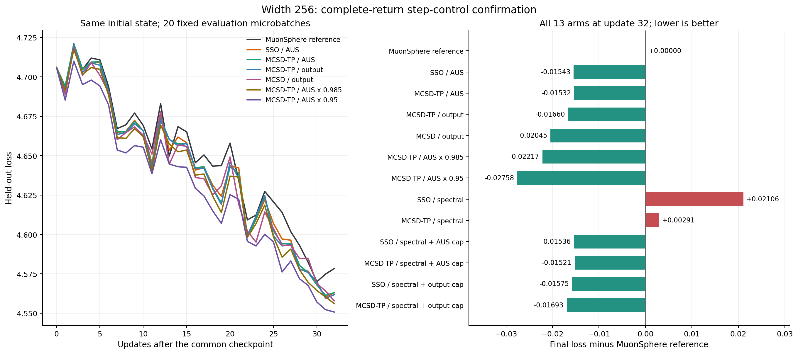
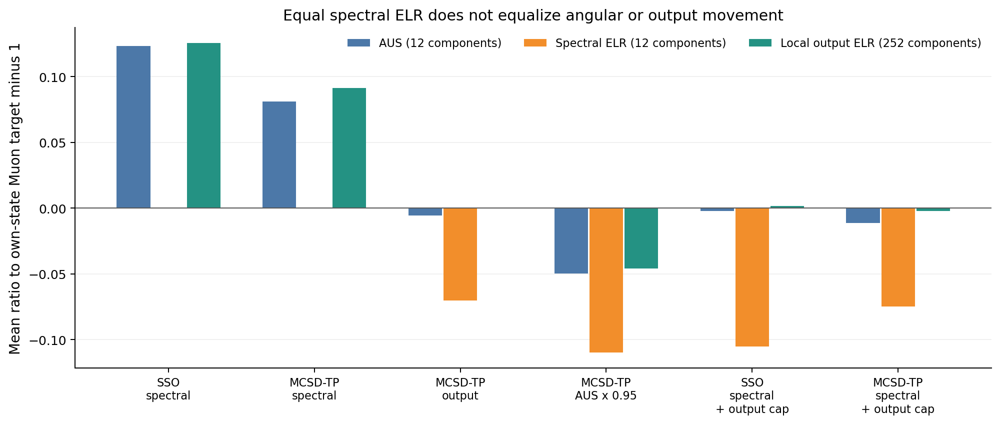
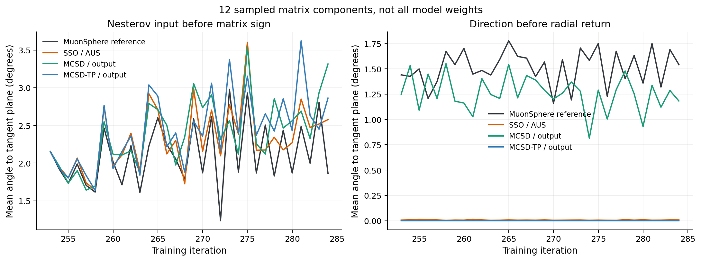

# Spectral-Sphere ELR: 32-Update Confirmation

**Updated November 19, 2026.** All 13 arms completed on November 18.
This is a paired **mechanism diagnostic**, not a new 1B/3B optimizer leaderboard.

**Follow-up checked November 27:** [shared-AUS trajectories and attenuated
Muon controls](spectral_elr_trajectory_20261127.md) do not retain the earlier
MCSD-TP advantage. The target rule and evaluation data differ; this historical
table remains unchanged and should not be pooled with the new losses.

[Numerical results](../results/spectral_elr_confirmation_20261119/summary.json) |
[Loss figure (PDF)](../results/spectral_elr_confirmation_20261119/loss_confirmation.pdf) |
[Analysis script](../../scripts/summarize_spectral_elr_confirmation.py) |
[Plot script](../../scripts/plot_spectral_elr_confirmation.py)

## Main Findings

- **Uniform attenuation is the strongest observed intervention.** MCSD-TP
  with an AUS-matched coefficient multiplied by 0.95 reaches **4.550776**,
  versus 4.561753 for MCSD-TP with local-output matching and 4.578351 for
  the MuonSphere reference. Output matching has not demonstrated an advantage
  over simply reducing the step.
- **Spectral ELR alone is not a sufficient matching criterion.** Uncapped
  spectral matching worsens SSO and MCSD-TP relative to the reference. Adding
  an AUS or output upper bound removes most of this degradation.
- **Direction superiority remains unresolved.** There is no attenuated
  MuonSphere control yet. One early checkpoint, one seed and repeated use of
  20 evaluation microbatches cannot establish a final-training advantage.



## Completed Results

All arms start at loss **4.706060672**. Lower is better. Differences are
against the common-return MuonSphere reference at update 32. Time includes
loading, calibration, exact spectral calculations and diagnostic evaluation;
it is **not production optimizer timing**. `mm:ss` may exceed 60 minutes.

| Direction and step control | Final loss | Difference | Better evaluation microbatches | Time |
|---|---:|---:|---:|---:|
| MuonSphere reference | 4.578351 | 0 | Reference | 16:04 |
| SSO, AUS matched | 4.562919 | -0.015432 | 20/20 | 18:18 |
| MCSD-TP, AUS matched | 4.563033 | -0.015319 | 20/20 | 17:40 |
| MCSD-TP, output matched | 4.561753 | -0.016598 | 20/20 | 23:17 |
| MCSD, output matched | 4.557906 | -0.020446 | 20/20 | 22:55 |
| MCSD-TP, AUS coefficient x 0.985 | 4.556185 | -0.022167 | 20/20 | 18:36 |
| **MCSD-TP, AUS coefficient x 0.95** | **4.550776** | **-0.027576** | **20/20** | **18:34** |
| SSO, spectral ELR matched | 4.599415 | +0.021063 | 4/20 | 49:39 |
| MCSD-TP, spectral ELR matched | 4.581257 | +0.002905 | 7/20 | 48:22 |
| SSO, spectral target + AUS cap | 4.562996 | -0.015355 | 20/20 | 84:36 |
| MCSD-TP, spectral target + AUS cap | 4.563141 | -0.015210 | 20/20 | 79:35 |
| SSO, spectral target + output cap | 4.562600 | -0.015752 | 20/20 | 84:53 |
| MCSD-TP, spectral target + output cap | 4.561419 | -0.016932 | 20/20 | 82:04 |

The 0.95 control improves over MCSD-TP output matching by **0.010977**, on all
20 microbatches, and beats the reference at all 32 observed endpoints. Its
mean trajectory difference from the reference is -0.019416, versus -0.007575
for MCSD-TP output matching. The result is not solely an endpoint fluctuation.

MCSD-TP output matching improves over AUS matching by only 0.001280 and on
12/20 microbatches. MCSD output matching is 0.003847 below MCSD-TP output
matching on 19/20 microbatches: the extra post-LMO tangent projection is not
uniformly beneficial in this test. These are descriptive comparisons, not
independent-seed significance tests. The best attenuation is also the lowest
tested value, so **0.95 is a candidate, not an identified optimum**.

## What Was Matched

For a matrix component with radius R, every method forms a signed direction D,
a trial Y = X + alpha D, and the same exact FP32 radial return:

$$X^+ = R Y / \|Y\|_2,\qquad \Delta X=X^+-X.$$

| Control | Measured after the complete return |
|---|---|
| AUS | $\|X^+/\|X^+\|_F-X/\|X\|_F\|_F$ |
| Spectral ELR | $\|\Delta X\|_2/\|X\|_2$ |
| Local-output ELR | $\|\Delta X H\|_F/\|XH\|_F$, with fixed pre-update module inputs H |

Targets come from a Muon-direction counterfactual at the **same current
state**, not from the separately trained Muon reference trajectory. Only the
initial checkpoint, batch, gradient and optimizer state are shared; later
weights, activations and momentum diverge. Non-matrix AdamW updates are not
included in per-matrix matching.

The 0.985/0.95 controls multiply the AUS-calibrated coefficient uniformly
across components. They do not exactly prescribe the resulting AUS or output
change. Cap arms shrink a spectral-calibrated coefficient until both measured
upper bounds pass, using tolerance `2e-6 + 0.002 * target`. They can undershoot
the spectral target and **do not match two metrics exactly**. Searches use
geometry only, not validation loss.

## Mechanism Evidence

The following are mean ratios to own-state Muon targets over 32 updates.
AUS and spectral ELR use 12 sampled components; local output uses all 252.
They are different sampling scopes, not whole-model norms.

| Control | AUS ratio | Spectral ELR ratio | Independent local-output ratio | Cap active |
|---|---:|---:|---:|---:|
| SSO, spectral | 1.1232 | 0.9999 | 1.1256 | Not capped |
| MCSD-TP, spectral | 1.0810 | 1.0000 | 1.0915 | Not capped |
| MCSD-TP, output | 0.9942 | 0.9298 | 0.9998 | Not capped |
| MCSD-TP, AUS x 0.95 | 0.9502 | 0.8901 | 0.9541 | Not capped |
| SSO, spectral + AUS cap | 1.0017 | 0.8977 | 1.0045 | 95.14% |
| MCSD-TP, spectral + AUS cap | 0.9937 | 0.9294 | 1.0017 | 86.88% |
| SSO, spectral + output cap | 0.9977 | 0.8947 | 1.0017 | 94.97% |
| MCSD-TP, spectral + output cap | 0.9886 | 0.9252 | 0.9977 | 87.81% |



**Interpretation:** equal spectral displacement permits larger angular and
activation-weighted movement. Removing that excess recovers the short-run
performance. This supports an amplitude explanation, but does not isolate
angular size from activation-dependent allocation. The current cap search
is too expensive to recommend as a production optimizer: 24--26 candidate
evaluations per component on average, versus one for direct AUS calibration.

### Tangency and Finite Steps



At the common initial state, the sampled Nesterov input is only **2.153 degrees**
from the top-1 tangent plane. The Muon direction is **1.441 degrees** from it;
SSO is 0.00593 degrees, MCSD 1.251 degrees, and MCSD-TP approximately
0.00000125 degrees. The plot follows these quantities as states diverge.
The measured input is the **actual Nesterov input before matrix sign**, not
the EMA buffer alone. Small angles are descriptive; they do not prove the
normal component is negligible or that matrix sign preserves tangency.

At a simple top singular value, with $\Theta=u_1v_1^T$, the radial differential
and orthogonal tangent projection differ:

$$J_XD=D-\langle\Theta,D\rangle X/R,\qquad
P_XD=D-\langle\Theta,D\rangle\Theta,$$
$$\|J_XD-P_XD\|_F=|\langle\Theta,D\rangle|\sqrt{\operatorname{sr}(X)-1}.$$

The sampled identity agrees within **9.54e-7 absolute error**. However, the
finite returned displacement need not be well approximated by alpha J_X D:

| Arm | Median relative linearization residual | 95th percentile |
|---|---:|---:|
| Muon reference | 1.09% | 2.24% |
| SSO, AUS | 1.98% | 23.50% |
| MCSD-TP, AUS | 2.46% | 23.47% |
| MCSD-TP, output | 2.46% | 23.24% |
| MCSD, output | 3.99% | 41.13% |

Residual means $\|\Delta X-\alpha J_XD\|_F/\|\Delta X\|_F$.
This is evidence to analyze **complete returns**, not only infinitesimal
tangency. It does not establish a cause for all large residuals; gap-conditioned
and step-halving checks remain necessary. The logged `alpha_over_absolute_gap`
omits the direction norm and is not a perturbation/gap certificate. These
checks do not prove global nonsmooth or stochastic convergence.

## Protocol and Integrity

- Width 256, 28 layers, seed 1234, common step-252 checkpoint. Each arm runs
  updates 253--284, processing 16,777,216 additional training tokens.
- Existing 3B indexed source, original 1B/1908-update learning-rate schedule,
  base LR 0.015 near the end of 250-step warmup. **Not 3B training.**
- Sequence length 4096; global batch 128; microbatch four. BF16 model,
  FP32 master weights, BF16 NS8, Nesterov 0.9; constrained matrix decay zero.
- One calibration and **20 fixed held-out microbatches** (327,680 evaluated
  tokens), disjoint in token hashes from the earlier five inspected batches.
  Capture 256 input tokens at each of 112 linear modules per update.
- Preserve and assert the effective **252-component, unsplit-FC1 layout**.
  This is not the originally intended separate gate/up configuration.
- Common FP32 `gesvd` spectral radius and exact tensor commit before copying
  masters to BF16. The method labels identify direction interventions;
  they are not native end-to-end optimizer implementations.
- Both lanes passed **16 CUDA tests**. Two-label three-update Muon negative
  controls had identical component hashes and held-out losses in each lane.
- Initial sampled state/optimizer records, initial activations, all 32 training
  token/label streams and evaluation streams agree across main arms. All arms
  have 32 successful updates, **8,064 returns**, and zero logged NaN/skips.
- Maximum FP32 relative radius error is **4.99e-7**. Enforced matching errors
  satisfy the absolute-plus-relative tolerance; capped/scaled arms are not
  incorrectly treated as exact matches. No new model checkpoints were saved.

| Array lane | Node | State | Elapsed | Exit code |
|---|---|---|---|---|
| 4464129_0 | SPG-7-2 | COMPLETED | 02:20:06 | 0:0 |
| 4464129_1 | SPG-7-1 | COMPLETED | 07:13:47 | 0:0 |

The account queue was empty at the November 19 check. This update submits no
new jobs. Different nodes, diagnostic overhead and sequential arm execution
prevent interpreting the table as a production speed benchmark.

## Next Tests

1. **Add the missing attenuation control first.** From one compatible later
   checkpoint, compare Muon and MCSD-TP at AUS-calibrated coefficient factors
   **1.0, 0.985, 0.95**, giving six paired 32--64-update arms. Use a fresh
   evaluation set and retain native non-matrix updates. This tests whether the
   gain is shared by Muon or persists for the constrained direction after
   matching the angular budget. No later checkpoint has yet been selected.
2. **Separate allocation from total output size.** Compare componentwise
   output matching against a single common multiplier chosen on calibration
   inputs to match a prespecified aggregate output budget. Apply this to the
   same direction. The present 0.95 control is informative but is not an
   aggregate-output-matched control. Never tune using held-out loss.
3. **Cheap offline geometry audit.** Replay saved matrices at alpha, alpha/2
   and alpha/4; bin by gap and stable rank, and measure complete-return error,
   angular/output changes and gradient work. This can test the local model
   without another LLM training run.
4. Only after a later-state replication, compare SSO, MCSD and MCSD-TP at the
   retained common budget, then promote a small paired subset to 250M/1B.
   Do not expand width/gap grids or deploy the expensive cap search yet.

**Decision:** retain MCSD-TP + modest attenuation and MCSD + output matching
as candidates. Keep spectral-plus-cap arms as mechanism evidence, not as
production defaults. Do not claim output matching, exact tangency or a new
ELR geometry has already beaten a tuned MuonSphere optimizer.

## Reproduce the Analysis

The JSON includes all endpoints, per-step curves, per-microbatch differences,
sampled geometry and SHA256 hashes of the source logs. Raw checkpoints,
activations and the 128 MB downloaded log collection are not uploaded.
The scripts reproduce the **analysis**, not the complete training launch.

```bash
python scripts/summarize_spectral_elr_confirmation.py \
  /path/to/downloaded/4464129/results \
  docs/results/spectral_elr_confirmation_20261119/summary.json
python scripts/plot_spectral_elr_confirmation.py \
  docs/results/spectral_elr_confirmation_20261119/summary.json \
  docs/results/spectral_elr_confirmation_20261119
```

The analysis uses Python's standard library; plotting additionally requires
NumPy and matplotlib. Replotting the published JSON does not require H20 access.
