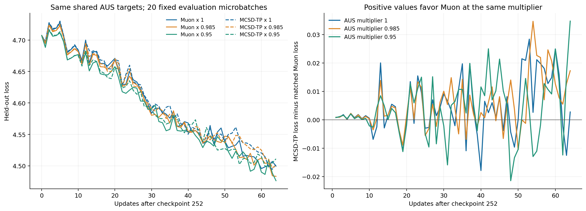
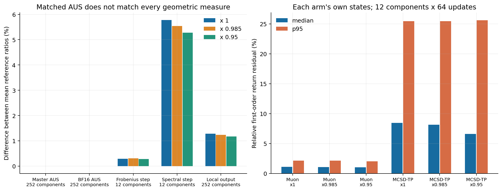
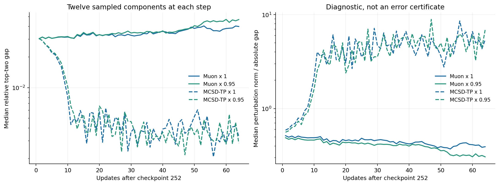
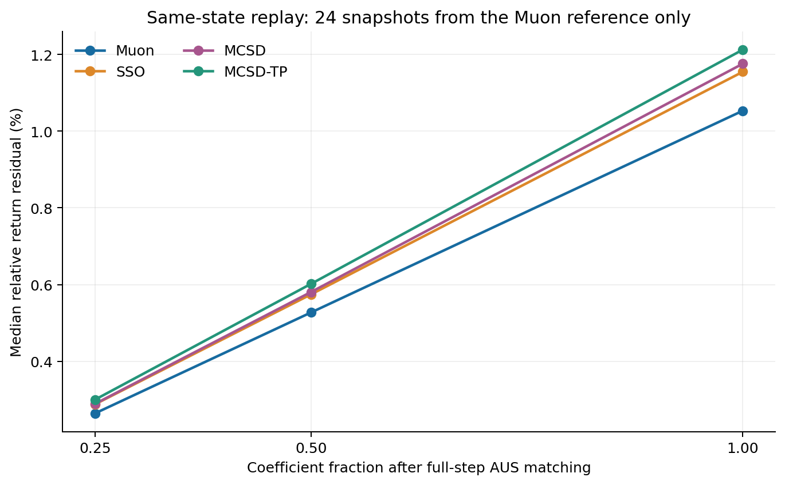

# Spectral-Sphere ELR: Shared-AUS Trajectories

**Checked November 27, 2026. All six 64-update arms completed.**
This is an ELR mechanism study, separate from the PGD/P2GD experiments and
native 1B/3B optimizer rankings. No new jobs were submitted for this report.

[Numerical summary](../results/spectral_elr_trajectory_20261127/summary.json) |
[Portable evidence](../results/spectral_elr_trajectory_20261127/evidence.json.gz) |
[Analysis](../../scripts/summarize_spectral_elr_trajectory.py) |
[Plots](../../scripts/plot_spectral_elr_trajectory.py) |
[Previous own-state study](spectral_elr_confirmation_20261119.md)

## Main Result

**The earlier MCSD-TP advantage did not persist under the new shared-AUS
protocol.** At each of the three target multipliers, the Muon-direction arm
has lower endpoint loss and lower last-16-update mean than MCSD-TP. The best
observed arm is Muon x0.95, but 0.95 is the lowest tested multiplier, not an
identified optimum. Differences remain small relative to the common loss
decrease, and this is one seed and one early checkpoint.

All arms start at **4.707247543**. Times below are per-arm process wall time,
including loading, exact spectral calculations and repeated diagnostic
evaluation, not production optimizer timing.

| Direction | Shared AUS multiplier | Final loss | Last-16 mean | Time, mm:ss |
|---|---:|---:|---:|---:|
| Muon, common radial | 1.000 | 4.499633 | 4.518949 | 31:37 |
| Muon, common radial | 0.985 | 4.483395 | 4.515647 | 35:28 |
| **Muon, common radial** | **0.950** | **4.476445** | **4.508469** | 35:16 |
| MCSD-TP, common radial | 1.000 | 4.502379 | 4.530159 | 35:08 |
| MCSD-TP, common radial | 0.985 | 4.500671 | 4.528250 | 35:25 |
| MCSD-TP, common radial | 0.950 | 4.511190 | 4.513379 | 35:25 |



| Multiplier | MCSD-TP minus Muon, endpoint | Last-16 mean difference | All-64 mean difference |
|---|---:|---:|---:|
| 1.000 | +0.002746 | +0.011211 | +0.004648 |
| 0.985 | +0.017276 | +0.012603 | +0.005417 |
| 0.950 | +0.034745 | +0.004910 | +0.003862 |

Do not interpret the largest endpoint difference as the typical gap:
MCSD-TP x0.95 is its best multiplier by last-16 mean, despite its worse final
point. It beats its matched Muon arm at 18/64 observed endpoints; the x1 and
x0.985 arms do so at 18/64 and 14/64, respectively. Endpoint microbatch counts
are descriptive, not independent-seed significance tests.

## What Was Controlled

Width256, 28 layers, seed1234, checkpoint252, updates253--316. Sequence length
4096, global batch128, microbatch4, one H20 per arm. Each arm processes
33,554,432 tokens, for 201,326,592 across six arms, excluding the identity gate.
All use BF16 forward/backward, FP32 masters, NS8, Nesterov beta0.9, no decay on
constrained matrices, and unchanged auxiliary AdamW groups. The existing 3B
indexed source and original 1908-step LR schedule are reused: peak0.015,
250 warmup updates, minimum0.0015, with no schedule restart.

For every component i and step t, first record the Muon reference's returned
FP32-master angular chord:

$$a^{ref}_{t,i}=\left\|\frac{X^{ref}_{t+1,i}}{\|X^{ref}_{t+1,i}\|_F}
-\frac{X^{ref}_{t,i}}{\|X^{ref}_{t,i}\|_F}\right\|_F.$$

Every intervention solves for a scalar coefficient that gives returned AUS
equal to **c times this frozen reference value**, not a counterfactual
computed at its own evolving state. All directions use the same FP32 `gesvd`
radial return. Later gradients, activations and momenta evolve normally.
Only the initial full state and training data sequence are identical.

The reference is a Muon-direction/common-return intervention, **not native
MuonSphere's PI pre-return**. SSO and MCSD participate in the matrix replay,
not new 64-update training arms. The effective layout remains 252 matrix
components with unsplit FC1, matching the checkpoint.

Evaluation uses 20 fixed microbatches, 327,680 tokens, disjoint from one
calibration microbatch and from the previous study's inspected batches.
Neither coefficient selection nor any early stopping uses held-out loss.

## Integrity and Actual Movement

- All jobs completed with exit0:0; all 384 training updates succeeded with
  zero logged NaN/skipped iterations.
- All 32 training microbatches per update match across branches by hash.
  Initial checkpoint/state checks and sampled gradients/activation probes agree.
- Three-step reference replay is bitwise identical. All 96,768 component
  returns passed the matching and radius checks.
- Maximum relative AUS target error: **4.43e-7**. Maximum relative radius
  error: **7.05e-7**. These do not certify BF16 angular matching.

The following are means of per-component/per-step ratios to the common
reference trajectory. AUS/output cover all252 components; spectral and
Frobenius displacement use 12 predeclared components. Different norms should
not be interpreted as full-model aggregates.

| Direction / multiplier | Master AUS | BF16 AUS | Spectral displacement | Local output |
|---|---:|---:|---:|---:|
| Muon / 1 | 1.000000 | 1.000000 | 1.000000 | 1.000000 |
| Muon / 0.985 | 0.985000 | 0.985115 | 0.984702 | 0.985629 |
| Muon / 0.95 | 0.950000 | 0.950369 | 0.946280 | 0.950916 |
| MCSD-TP / 1 | 1.000000 | 1.000007 | 1.057807 | 1.012800 |
| MCSD-TP / 0.985 | 0.985000 | 0.985108 | 1.039270 | 0.997768 |
| MCSD-TP / 0.95 | 0.950000 | 0.950368 | 0.996259 | 0.962026 |

At c=1, almost identical mean BF16 AUS coexists with **5.78% larger sampled
spectral movement** and **1.28% larger local-output movement** for MCSD-TP.
Mean agreement cannot exclude componentwise BF16 deviations. Output ratios
use each trajectory's own pre-update activations; after divergence these are
not common H matrices or a measure of full-network output difference.



## Geometry: State Dependence Matters

For a simple leading singular value, define Theta=u1*v1^T and

$$J_XD=D-\langle\Theta,D\rangle X/\sigma_1(X),\quad
r=\frac{\|\Delta X-\alpha J_XD\|_F}{\|\Delta X\|_F},\quad
\kappa=\frac{\alpha\|D\|_2}{\sigma_1(X)-\sigma_2(X)}.$$

r is the relative error of the first-order radial-return model, **not SVD
inaccuracy or constraint violation**. Kappa is a diagnostic, not a certificate.
These statistics pool 12 sampled components over 64 updates, not all layers.
Logged momentum angles use the actual Nesterov input before matrix sign,
not the EMA buffer alone.

| c=1 trajectory | Median relative gap | Median kappa | Median r | p95 r |
|---|---:|---:|---:|---:|
| Muon | 0.034707 | 0.433 | 1.08% | 2.13% |
| MCSD-TP | 0.004347 | 4.033 | 8.44% | 25.46% |

MCSD-TP's own states exhibit substantially narrower sampled top-two gaps
and larger finite-step linearization errors. This association motivates a
direction/spectrum-feedback hypothesis; it does not prove the loss difference
is caused by the narrower gap.



### Same-State Four-Direction Replay

Twenty-four real snapshots (12 components at updates253 and316) are all
from the **Muon reference trajectory**. At each fixed X,M, compare Muon,
SSO, MCSD and MCSD-TP, first using a common coefficient and then a common
returned AUS. Halve and quarter each full-step coefficient without changing
the starting matrix or direction:576 audited updates in total.

Median r at common full-step AUS:

| Direction | Full coefficient | Half | Quarter |
|---|---:|---:|---:|
| Muon | 1.053% | 0.527% | 0.265% |
| SSO | 1.155% | 0.575% | 0.288% |
| MCSD | 1.176% | 0.581% | 0.289% |
| MCSD-TP | 1.212% | 0.602% | 0.300% |

All576 sampled returned updates have negative gradient inner product.
That is **not measured full-network loss decrease**. The decreasing median
residual supports the local return approximation on these sampled states,
not a uniform convergence claim.



The distinction is central: MCSD-TP is not severely inaccurate when applied
once at the sampled Muon states. Its larger trajectory residual develops
along its own states, which this snapshot set does not cover. Reciprocal
state replay is now more informative than another large multiplier grid.

## Next Experiments, in Order

1. **Reciprocal state replay.** Capture small X,M,G,H snapshots along Muon
   and MCSD-TP at updates253/260/268/284/300/316. At each identical state,
   evaluate all four directions with common AUS, and repeat at half step.
   Include signed top-one/top-two singular-value drift, next gap, returned
   spectral displacement, r and fixed-batch loss for selected layer-group
   interventions. Keep the other parameter updates unchanged. This separates
   direction effects from which states an optimizer visits.
2. **Complete the missing direction control.** Add MCSD without post-LMO TP
   and SSO at one fixed common AUS budget, alongside matched Muon/MCSD-TP.
   First use short trajectories and the existing trace, not a new LR sweep.
   This tests whether repeated post-LMO tangency is associated with spectral
   crowding; matrix replay alone cannot establish the training mechanism.
3. **Separate direction from output amplitude.** At a retained budget, compare
   MCSD-TP with one global output-matching scalar against componentwise
   output matching. Match the same prespecified aggregate calibration budget;
   evaluate on independent batches. This distinguishes total amplitude from
   layerwise allocation. AUS and output matching are separate controls.
4. **Replicate before extension.** Check a verified later Muon-compatible
   checkpoint or independent seed. Do not substitute a P2GD-generated state
   while calling it Muon. Promote only replicated mechanisms to250M/1B.

Do not select an optimizer only by its last point, assume a larger gap is
always better, or use these diagnostics to start a PGD threshold search.
The research question remains **direction, realized ELR and return geometry
on the spectral sphere**. No new H20 tasks were launched during this update.

## Execution and Reproduction

| Slurm job | Work | State | Allocation wall time |
|---|---|---|---:|
| 4514694 | Reference, identity gate, matrix replay | COMPLETED | 00:34:48 |
| 4514695_0 | Two Muon attenuations | COMPLETED | 01:11:28 |
| 4514695_1 | Three MCSD-TP multipliers | COMPLETED | 01:46:44 |

At most two H20s ran concurrently. Per-arm times above exclude the gate and
matrix audit outside that arm's process. No new model checkpoints were saved.

The compressed evidence contains numerical logs needed for these tables,
paired checks and plots, with unused fields removed; source hashes identify
the original logs. It contains no checkpoints, tensor snapshots, token text,
credentials or private server paths. Recompute with Python3.9+ standard library:

```bash
python scripts/summarize_spectral_elr_trajectory.py \
  --evidence docs/results/spectral_elr_trajectory_20261127/evidence.json.gz \
  --output /tmp/elr-trajectory-summary
python scripts/plot_spectral_elr_trajectory.py \
  /tmp/elr-trajectory-summary/summary.json /tmp/elr-trajectory-plots
python -m unittest discover -s scripts -p test_summarize_spectral_elr_trajectory.py -v
```

Plotting additionally requires matplotlib. The published evidence reproduces
the analysis, not a standalone Megatron training release. The old32-update
study used different evaluation batches, own-state Muon targets and coefficient
attenuation; do not pool its absolute losses with this study or claim this
experiment isolates which one of those protocol changes explains the reversal.
