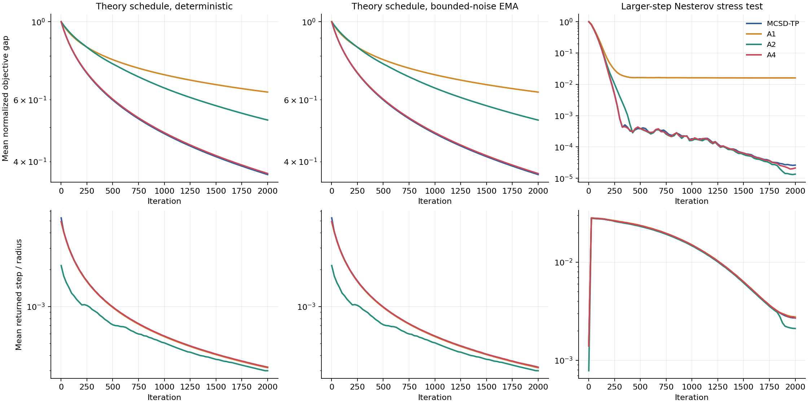

# Step-Aware Hybrid Local Results and Decision

[Theory audit](step_aware_hybrid_review_20261111.md) |
[Complete generated tables](step_aware_local_20261111/computed_tables.md) |
[Code](../../scripts/local_step_aware_hybrid.py) |
[Tests](../../scripts/test_local_step_aware_hybrid.py)

## Decision

Keep **A2 as the leading local geometry candidate**, retain A4 as a secondary
corrected-LMO candidate and retain MCSD-TP as the essential reference. A1 is
useful as a conservative negative control. **Do not start new H20 training.**
The existing five-job confirmation batch remains separate; two SSH attempts
on November 11 timed out, so its latest results could not be retrieved.

The theoretical construction survives the algebra and applicable-return-bound
checks. The experiments do not establish a universal optimization advantage.
A4's momentum protection is not full-step monotonicity, and its high acceptance
rate is not evidence that the protected direction is better than A2.

## Completed Local Work

- Ten regression tests passed, including **972 single-step algebra cases**,
  zero momentum, rectangular shapes, radius scaling 0.1/1/10, the original
  2x2 radial ascent example, cross-face movement and cache consistency.
- **1200 paired trajectories, 2000 steps each**: 20 instance seeds, five
  shapes, three protocols and four methods. The earlier 400-step screening
  is not an independent replication and is not added to this trajectory count.
- Exact FP64 spectra, exact polar LMOs up to numerical rank tolerance, and
  exact-norm radial returns. Initialization and bounded noise are paired.
- **2700 cluster-extension audits** for A1/A2/A4, and **900 same-state
  amplitude audits** on A4 trajectories. These are selected diagnostics,
  not additional training trajectories or LLM snapshots.

The three protocols separate a conservative theoretical schedule without
momentum, that schedule with bounded-noise current-sample EMA, and a larger
relative-step Nesterov stress test. The stress test uses alpha_peak=0.0075R
and h=0.0002R; it does not simulate the full LLM objective or its layer spectra.



## Complete Return

The handoff's conditional return bound and the corresponding smoothness
upper bound had **zero observed violations where applicable**. All A1/A2/A4
steps in the theoretical schedules satisfy the external-gap condition.
The largest sampled relative radius error was **3.55e-15**.

On the original 2x2 example at epsilon=0.01, the objective change divided by
alpha is **+0.469236** for top-1 MCSD-TP with radial return, **0** for A1,
and **-0.184459** for both A2 and A4. A1 removes the problematic direction
but stops; the finite-step model allows movement without the old ascent.
The same signs hold in the smaller-epsilon regressions.

This repair is local, not unconditional. In the larger-step stochastic
protocol, A4 satisfies the external-gap condition on **77.61%** of steps,
while **42.34%** of all steps increase the objective. The theoretical upper
bound is negative on only **25,405/200,000** A4 steps in this protocol.
A positive bound is inconclusive, not a failure of the inequality.

The full-step reversal counter compares alpha<grad f,D> with the actual
objective change. It includes curvature, momentum and normalization effects;
it does **not** isolate radial normalization as the cause. These overall
rates also include the shared q=1 branch, so they are not near-branch-only
failure rates. Late fluctuations near the optimum are retained, not removed.

## Final Objective Comparison

Mean f-f* below uses the **75 isotropic known-optimum instances** per row,
across five shapes. The remaining 25 anisotropic instances are included only
in within-instance paired comparisons. These are synthetic objectives, not
validation losses, and different shapes are not normalized by parameter count.

| Method | Theory schedule + EMA | Larger-step Nesterov |
|---|---:|---:|
| MCSD-TP | **3.708326** | 2.15623e-4 |
| A1: cluster tangent | 6.168148 | 3.75578e-2 |
| A2: finite-step normalized momentum | 5.530249 | **9.35994e-5** |
| A4: protected corrected LMO | 3.723751 | 1.72662e-4 |

The theoretical schedule is deliberately conservative and is far from solving
many instances in 2000 steps. A4 is slightly worse than MCSD-TP there:
30 wins, 20 ties and 50 losses over all 100 paired objectives. A1 remains
constrained by the wide surrogate tangent, and A2 often takes shorter steps.

In the larger-step protocol, A4 beats MCSD-TP in **28** cases, ties in **60**
and loses in **12**, with mean paired objective difference **-3.22e-5**.
However, it loses to A2 in **36** cases, wins in **4**, and ties in **60**.
This is evidence to retain A2, not to promote A4 as the best method.

## Actual Step and Matched-Length Controls

In the larger-step protocol the average returned Frobenius step divided by
R is **0.0147994 / 0.0149112 / 0.0145620 / 0.0148324** for
MCSD-TP / A1 / A2 / A4. Equal alpha does not mean equal displacement.

On the sampled near-region A4 states, A4's trial length is a median
**4.15 times** A2's (3.55 times in the theoretical EMA protocol). The very
large maximum ratio occurs when A2's direction is small and is not a typical
scale recommendation. This prevents attributing their raw loss difference
solely to the LMO's geometry.

For a direct same-state check, scale only the MCSD-TP baseline direction to
match each candidate's trial Frobenius length, then apply radial return.
Do **not** normalize the candidate after its model correction. The resulting
returned lengths may still differ, so this is an equal-trial, not equal-returned,
length control.

| Candidate | Stress-test near samples | Better than matched top-1 | Worse | Mean objective-change difference |
|---|---:|---:|---:|---:|
| A1 | 78 | 18 | 60 | +2.18186e-3 |
| A2 | 78 | **54** | 24 | **-4.99609e-5** |
| A4 | 78 | 33 | 45 | +3.98058e-4 |

These are counterfactual steps on A4-selected states, not independent or
full matched-length trajectories. They support the next local A2 control,
but do not prove its advantage is independent of step-size effects.

## Capacity and Guard

The offline extension audit reconstructs D for every q>=q_window until
2 alpha||D||_2<=Gamma. For A4, **16%** of the 300 theoretical-EMA audits and
**5.33%** of the 300 stress audits require more than eight directions;
the maximum is **24**, the full smaller dimension. Every audited case has
a satisfying capacity at or below full rank.

These percentages weight initialization heavily, because audits use only
three points per trajectory. They are not per-step rates and cannot be
extrapolated to LLM matrices. In particular, top-4 overflow alone would miss
the distinction between a small observed cluster and a larger capacity needed
by the sufficient return bound. Conversely, a large sufficient capacity does
not prove a small-cluster update must fail.

A4 accepts **14,931/14,932** candidate near steps in the deterministic
theoretical protocol, **15,048/15,049** in the EMA version, and
**4,462/4,531** in the stress version. The guard is rarely decisive here.
An unguarded A3 trajectory is not part of this requested four-method comparison,
so its necessity for empirical performance remains unresolved.

## Next Local Work

**Follow-up completed:** [kernel-preserving LMO study](kernel_lmo_results_20261111.md)
now includes full A2-length replay, bounded-candidate checks, and the tighter
coupling bound. The [theory refinement](kernel_lmo_theory_20261111.md) also
removes the earlier bounded-sample assumption for bounded directions. The
list below records the original next steps; real-matrix and approximate
spectral validation remain open.

1. Run **A2 versus MCSD-TP with explicit same-trial-length control over
   complete trajectories**, keeping the finite-step projection's alpha
   consistent. Pair all noise and initial states again. The current amplitude
   audits are not a substitute for that comparison.
2. For A4, study bounding the LMO candidate **before** model correction,
   followed by the same momentum test. For example, scale the LMO output
   by a factor in [0,1] tied to ||D_F|| before applying P_K. The bounded-candidate
   descent proof can still apply, but this is a new variant, not the existing
   A4 or an exact unit-ball constrained LMO. Do not rescale corrected D.
3. Inspect saved real width-256 X/M/learning-rate snapshots, if available
   locally, for complete-window and reconstructed capacity. Compare the
   actual cross-block coupling with the conservative ||D||_2 bound before
   increasing block size or shrinking learning rates globally.
4. Retrieve the existing H20 five-arm confirmation batch when connectivity
   returns. Do not submit A1/A2/A4 long jobs until matched-length evidence and
   real-matrix capacity support the cost and geometry claims.

## Reproduction and Records

```bash
env OMP_NUM_THREADS=1 MKL_NUM_THREADS=1 \
  /Users/ykw/Desktop/code/SSO_test-three-geometries/.venv/bin/python -B \
  -m unittest discover -s scripts -p test_local_step_aware_hybrid.py -v

env OMP_NUM_THREADS=1 MKL_NUM_THREADS=1 \
  /Users/ykw/Desktop/code/SSO_test-three-geometries/.venv/bin/python -B \
  scripts/local_step_aware_hybrid.py --steps 2000 --seeds 20 \
  --output docs/results/local_step_aware_20261111/trajectories_2000.json
```

Run from the `SSO_test-exp-publish` root. The CPU run took **323.3 seconds**,
including exact spectral norms, capacity searches and counterfactual returns.
It is not a training-kernel benchmark. Each update has one trial-weight SVD;
the polar LMO and offline diagnostics have their own decompositions.

[Compact machine-readable summary](step_aware_local_20261111/summary.json)
and [full tables](step_aware_local_20261111/computed_tables.md).
Full trajectories are retained locally under `docs/results/local_step_aware_20261111/`;
the roughly 117 MB raw JSON is not intended for an ordinary GitHub blob.
The implementation snapshot and source hash accompany those raw records.
