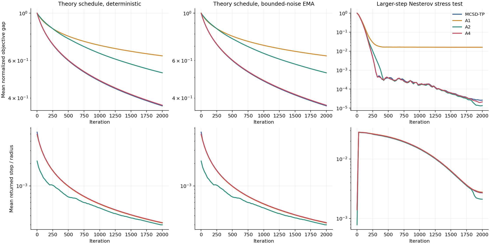

# Local Step-Aware Hybrid Results

Exact FP64 spectral-sphere reference; no new H20 jobs. [Theory audit](../step_aware_hybrid_review_20261111.md).

## Protocol

1200 trajectories: 20 fixed instance seeds x five shapes x three protocols x four methods, each for 2000 steps. The 400-step screening and this extension are not independent replications.

Shapes: 4x4, 16x12, 12x16, 32x24, 24x32. Initial top multiplicity is 1, 2, 4 or full. Isotropic inside/outside/plateau targets have known optima; anisotropic quadratics do not. This is a stratified synthetic suite, not a full factorial design or an LLM matrix sample.

All methods share initialization, noise samples and schedules within each case. Near routing uses the complete h-window, not the existing two-threshold production routing. No rank cap is imposed. Exact polar LMOs use a zero extension on roundoff-sized null modes.

- Theory protocols: h=0.05R(1+t/100)^(-0.3), alpha=0.2*0.05R/(2sqrt(r))*(1+t/100)^(-0.9). EMA fresh-sample weight is 0.5(1+t/100)^(-0.5). Noise has bounded Frobenius norm 0.05R.
- Stress protocol: peak alpha=0.0075R, 20-step warmup and cosine factor to 0.1, h=0.0002R; B=0.9B+0.1G and M=0.9B+0.1G with updated B. These are synthetic relative steps, not measured LLM displacements.
- The reference algorithms do not normalize after model correction. A2 is unit-momentum based; A1/A4 use a spectral LMO, so equal alpha does not imply equal trial lengths.

Curves average per-instance objective gaps normalized at the first recorded update; only the 75 known-optimum instances per method/protocol enter the upper row. The lower row uses all 100 instances. No confidence band is implied.

## Complete Return and Step Size

| Protocol | Method | Mean f-f* | Return bound applicable | Uphill steps | Prediction reversed | Mean trial / R | Mean returned / R |
|---|---|---:|---:|---:|---:|---:|---:|
| certified_det | MCSD-TP | 3.70799 | 94.92% | 0.00% | 0.00% | 0.000880475 | 0.000883735 |
| certified_det | A1 | 6.16807 | 100.00% | 0.00% | 0.00% | 0.000876735 | 0.000876758 |
| certified_det | A2 | 5.53044 | 100.00% | 0.00% | 0.00% | 0.000612837 | 0.000612882 |
| certified_det | A4 | 3.72366 | 100.00% | 0.00% | 0.00% | 0.000883674 | 0.0008838 |
| certified_ema | MCSD-TP | 3.70833 | 94.92% | 0.00% | 0.00% | 0.000880826 | 0.000883166 |
| certified_ema | A1 | 6.16815 | 100.00% | 0.00% | 0.00% | 0.000876761 | 0.000876785 |
| certified_ema | A2 | 5.53025 | 100.00% | 0.00% | 0.00% | 0.00061286 | 0.000612905 |
| certified_ema | A4 | 3.72375 | 100.00% | 0.00% | 0.00% | 0.000883069 | 0.000883195 |
| practical_nesterov | MCSD-TP | 0.000215623 | 76.39% | 42.36% | 37.71% | 0.0152384 | 0.0147994 |
| practical_nesterov | A1 | 0.0375578 | 78.55% | 41.78% | 36.12% | 0.015274 | 0.0149112 |
| practical_nesterov | A2 | 9.35994e-05 | 80.70% | 41.23% | 35.88% | 0.0149142 | 0.014562 |
| practical_nesterov | A4 | 0.000172662 | 77.61% | 42.34% | 37.37% | 0.0152433 | 0.0148324 |

Mean f-f* excludes the anisotropic objectives. A prediction reversal means alpha<grad f,D><0 but f(X_next)-f(X)>0, with numerical tolerance 1e-11 R^2. Applicability of the return bound alone does not imply objective decrease.

## Paired Final Objectives

| Protocol | Left minus right | Mean difference | Wins / ties / losses |
|---|---|---:|---:|
| certified_det | A4 - MCSD-TP | +0.0106039 | 29 / 20 / 51 |
| certified_det | A4 - A1 | -2.33597 | 80 / 20 / 0 |
| certified_det | A4 - A2 | -1.91775 | 78 / 20 / 2 |
| certified_det | A2 - A1 | -0.418221 | 53 / 20 / 27 |
| certified_ema | A4 - MCSD-TP | +0.0104271 | 30 / 20 / 50 |
| certified_ema | A4 - A1 | -2.336 | 80 / 20 / 0 |
| certified_ema | A4 - A2 | -1.91756 | 78 / 20 / 2 |
| certified_ema | A2 - A1 | -0.41844 | 53 / 20 / 27 |
| practical_nesterov | A4 - MCSD-TP | -3.22211e-05 | 28 / 60 / 12 |
| practical_nesterov | A4 - A1 | -0.0616837 | 34 / 58 / 8 |
| practical_nesterov | A4 - A2 | +5.92968e-05 | 4 / 60 / 36 |
| practical_nesterov | A2 - A1 | -0.0617429 | 38 / 56 / 6 |

Differences pair the same objective and initial state, including anisotropic cases. They are descriptive; heterogeneous problem scales and repeated seed usage preclude a simple significance claim.

## Capacity and Protection

| Protocol | Method | Window q>4 | Audited rebuilt q>4 | q>8 | Max rebuilt q | A4 acceptance |
|---|---|---:|---:|---:|---:|---:|
| certified_det | A1 | 48.00% | 48.00% | 48.00% | 24 | -- |
| certified_det | A2 | 8.86% | 16.67% | 16.00% | 24 | -- |
| certified_det | A4 | 1.16% | 16.00% | 16.00% | 24 | 99.99% |
| certified_ema | A1 | 48.00% | 48.00% | 48.00% | 24 | -- |
| certified_ema | A2 | 8.86% | 16.67% | 16.00% | 24 | -- |
| certified_ema | A4 | 1.16% | 16.00% | 16.00% | 24 | 99.99% |
| practical_nesterov | A1 | 0.18% | 5.33% | 5.33% | 24 | -- |
| practical_nesterov | A2 | 0.02% | 5.33% | 5.33% | 24 | -- |
| practical_nesterov | A4 | 0.01% | 5.33% | 5.33% | 24 | 98.48% |

Capacity audits occur at initialization, midpoint and final pre-update state: 300 per method/protocol. They search q>=q_window, recomputing D for each extension until 2*alpha*||D||_2<=Gamma. This is a sufficient-bound audit, not necessary geometric capacity or a change to the trajectory. Window rates count every step; audit rates count only these sampled states.

## Same-State Trial-Length Control

Only A4 states are sampled. Each candidate is compared with the top-1 MCSD-TP direction scaled to the candidate's Frobenius trial length. The finite-step model direction is never rescaled. The objective is evaluated after each radial return; these counterfactuals do not update the trajectory.

| Protocol | Near samples | A4 minus matched top-1, mean change | A4 wins / ties / losses |
|---|---:|---:|---:|
| certified_det | 90 | +0.00163022 | 16 / 0 / 74 |
| certified_ema | 90 | +0.00162461 | 15 / 0 / 75 |
| practical_nesterov | 78 | +0.000398058 | 33 / 0 / 45 |

## Verification and Limits

- Applicable-bound violations: **0**. Largest sampled radius error: **3.55e-15**.
- Each step uses one trial-weight SVD and the transformed post-return cache. Exact polar LMOs, spectral-norm diagnostics and capacity/amplitude audits use additional decompositions. This is not a one-total-SVD engineering benchmark.
- Total measured CPU time including diagnostics: 323.3 seconds. No GPU timing claim is made.
- No online line search, sphere-projection fallback or full-loss acceptance test.
- Finite trajectories do not prove stochastic convergence or universal superiority.

Raw results: `docs/results/local_step_aware_20261111/trajectories_2000.json`. Source SHA256: `efa06c1e83af37e82a52302ff2b80ef44f4e35aab2fac181898f695c3c5e630b`.
