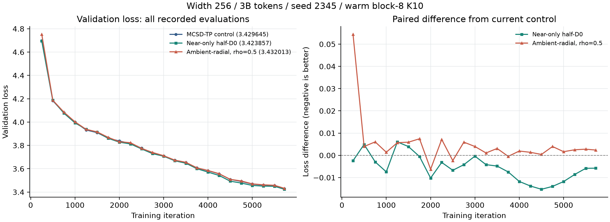

# Warm Radial 3B: Matched Control and Step Attenuation

**Completed; accounting rechecked November 19, 2026 at 15:05 HKT.** Both jobs reached
step 5723, exited 0:0, and passed 44 CUDA checks plus a separate four-step
smoke. Each has 573 regular training reports with zero NaN/skipped iterations.
Each used one H20; neither occupies a GPU now. No new jobs were submitted
in this results check. Other account jobs are untouched.

The account queue is now empty. The separate Frobenius-manifold jobs
`4459729` / `4459730` also completed, but their results are not pooled here.
The endpoint/log analysis below is the November18 extraction; final losses
are unchanged. [Latest accounting record](../results/warm_radial_controls_3b_20261117/server_recheck_20261119.json).

## Main Result

**Near-only half-D0 wins this matched single-seed comparison.** It improves
final loss by 0.005788 over the current-backend control and by 0.008156 over
the completed ambient half-step hybrid. This is evidence for step attenuation,
not evidence that PGD/P2GD directions help. It does not yet establish that the
gap condition is better than globally reducing matrix-update length.

| Method | Final validation loss | Main train + validation | Job |
|---|---:|---:|---|
| Current-backend MCSD-TP | 3.429645 | 17:56:55 | `4453017_0` |
| **MCSD-TP, near D=0.5*D0** | **3.423857** | 17:57:09 | `4453017_1` |
| Warm ambient-radial, rho=0.5 | 3.432013 | 17:54:03 | `4442918_2` |
| Exact MCSD-TP | 3.430719 | 25:47:49 | `4434107_0` |
| Exact ambient-radial, rho=0.5 | 3.429565 | 25:47:55 | `4434107_2` |
| Historical MuonSphere | 3.436023 | 16:35:03 | `4346705_0` |
| Historical SSO | 3.435041 | 18:28:11 | `4346705_1` |
| Historical MCSD-TP K10 | 3.428613 | 17:39:34 | `4346705_2` |
| Historical ambient K10/c8 | 3.427854 | 17:40:58 | `4346705_4` |

All rows have width256, seed2345, LR0.015, 3B processed tokens and eval20.
The two new arms share a frozen source; recorded differences are only method,
the explicit half-step flag, and snapshot paths. The warm ambient reference
shares the recorded model/data/schedule/spectral settings but was run earlier.
Historical experimental methods are contextual, not source-matched controls.
Slurm allocation times for the new pair are 17:59:11 / 17:59:18; table times
exclude preflight, smoke and offline audits. Half-D0 is about 8.3% slower than
historical MuonSphere and 2.8% faster than SSO, not a kernel-speed comparison.

### Full-Curve Check

| Iteration | Current control | Near half-D0 | Ambient rho=0.5 |
|---:|---:|---:|---:|
| 4750 | 3.491262 | **3.477275** | 3.495223 |
| 5000 | 3.468671 | **3.456874** | 3.470299 |
| 5250 | 3.459792 | **3.451174** | 3.462290 |
| 5500 | 3.455409 | **3.449567** | 3.458169 |
| 5723 | 3.429645 | **3.423857** | 3.432013 |

The endpoint gain also appears at these late checkpoints, although its size
shrinks toward completion. These are correlated measurements from one seed,
not independent replications. Compare methods at the same evaluation step;
validation movement between checkpoints need not be a pure optimization signal.

### Branches and Actual Step Length

| Endpoint diagnostic | Control | Near half-D0 | Ambient half-step |
|---|---:|---:|---:|
| Near-eligible component updates | 132,901 | 202,834 | 80,422 |
| Near / all component updates | 9.217% | 14.067% | 5.577% |
| Consecutive near repeats / near calls | 40.453% | 54.771% | 15.777% |
| Near returned / chosen trial length | 99.811% | 99.890% | 102.927% |
| Near returned / same-state D0 trial length | 99.811% | 49.945% | 51.463% |
| Actual ambient calls | 0 | 0 | 80,422 |
| Actual step-attenuation calls | 0 | 202,834 | 0 |

Denominator: 1,441,944 positive-LR matrix-component updates in each run.
Control's near counts are diagnostic eligibility, not a fallback branch.
The best arm has **more** near calls and repeats. This directly rules out
using fewer repeats or faster escape from small gap as a sufficient success
criterion. The three rates reflect different evolving trajectories, not
the same set of matrices receiving different operations at fixed states.

Length percentages are ratios of accumulated Frobenius displacements divided
by each component's target radius R, not means of per-call percentages and
not spectral-norm ELR. Online lengths precede host update rounding.

Every arm makes 1,442,196 small Ritz SVDs (including 252 bootstrap solves),
with zero original-matrix full SVDs online and no online accuracy fallback.
The eight-state offline audits give max gap errors 1.50e-5 / 5.60e-6 and
max returned-radius errors 1.30e-5 / 6.46e-6 for control / half-D0. They contain
only two / three near samples and show no sampled misrouting. They are not
global error bounds; the earlier 32-state ambient audit found a larger startup
error missed by its initial eight-state subset.

## Paired Comparison

Let D0 be the current MCSD-TP direction: tangent projection of negative
momentum, BF16 NS8 matrix-sign LMO, then a second tangent projection.
The near region uses the cached approximate relative gap <=2e-4.

| Job | Method | Safe direction | Near direction | State |
|---|---|---|---|---|
| `4453017_0` | Current-backend MCSD-TP control | D0 | D0 | Completed: 3.429645 |
| `4453017_1` | Near-only step attenuation | D0 | 0.5*D0 | Completed: 3.423857 |
| `4442918_2` | Ambient-radial reference, rho=0.5 | D0 | -0.5*norm(D0,F)*M/norm(M,F) | Completed: loss 3.432013, 17:54:03 |

The attenuation arm never replaces D0 with momentum, never invokes PGD or
cone correction, and leaves zero D0 unchanged. The completed ambient arm
retains its existing nonzero reference-length fallback when D0 vanishes.
All arms use Y=X+alpha*D followed by R*Y/estimated_sigma1(Y), and cache the
scaled approximate trial spectrum for the next step. Actual returned ELR
is measured, not assumed equal to the chosen trial-length ratio.

## Fixed Protocol

- Width256, 28 layers, head dimension128, sequence4096; global batch128,
  microbatch4, TP=PP=1, seed2345, fresh training on the existing 3B source.
- 5723 steps (3,000,500,224 processed tokens), peak LR0.015, 250-step warmup,
  cosine decay to0.0015, eval20 every250 steps and at completion.
- Warm block-8 K10, FP32 QR/Ritz and master weights; BF16 model/NS8,
  Nesterov0.9, no weight decay on constrained matrices.
- Same warm initialization, gap/window2e-4, radial return, sampling schedule
  and host optimizer as the completed warm reference. No online full SVD or
  accuracy fallback. Checkpoints disabled; no new dataset download.
- One small Ritz SVD per positive-LR component update, plus bootstrap. A
  separate offline snapshot audit does not affect the training trajectory.

The frozen source is copied from the completed warm experiment; only the
optional attenuation mode, launcher flag, tests and submission files change.
All other recorded training fields match the reference. **44 tests passed
locally, on the server CPU, and on CUDA in each allocation.** Each allocation
also completed a separate four-step smoke before fresh main training.

Frozen project: `/home/u3013198/projects/warm-radial-controls-3b-20261117`.
Source manifest: `ec80d212d45bf1c7dfcad269e38a515c533874c8eb712fc0e57dd03a363cd186`.
Submitted November 17 at 11:24 UTC+08; allocated at 14:33 / 15:42 and ended
November 18 at 08:32 / 09:41. Home storage had about 18GB free at the November18
check (not remeasured November19). At that earlier check the account had one separate Frobenius-manifold angle job running
(`4459729`) and its dependency pending (`4459730`); neither is a spectral-sphere
result or a new submission by this check. Both have since completed, and the
November19 queue is empty. The previous reference is unchanged.

## Next Experiments, Not Submitted

1. **Same-state short loss probe.** At matched near and safe states, compare
   D0, half-D0, ambient-half, top-1-half and cluster-cone-half. Restore model,
   optimizer/cache, RNG and batches between operations. Record raw G and M,
   full/top-block cone angles, returned ELR, training-batch and independent
   probe loss. Use exact spectra only in offline/sampled diagnostics. This
   is not a line search or a rule selecting updates by probe performance.
2. **All-step matrix-only half-D0 control.** Same warm K10, data, schedule and
   AdamW updates; set D=0.5*D0 for every constrained matrix, not just small
   gaps. Do not halve the global learning-rate flag, which would also change
   auxiliary AdamW parameters. Compare with the completed near-only arm to
   ask whether gap-local attenuation matters beyond a smaller matrix LR.
3. **Paired replication.** Repeat current control and near-half at seed1234
   with this source; historical seed1234 implementations are not substitutes.
   Reuse historical baselines only as context unless matched reruns are needed.
4. **Conditional cone follow-up.** Only if same-state probes show an advantage
   over half-D0, test a cone correction with the same chosen trial length and
   audited returned length. Keep K10/window2e-4 fixed; no wider gap grid yet.

The current candidate is gap-conditioned MCSD-TP step attenuation, **not**
MCSD-PGD/P2GD. Positive small gap still defines a smooth point; a cluster cone
is a nearby-corner model. One-seed loss gains do not establish convergence,
exact feasibility, or general superiority. Defer larger models and 12B runs.

[Completed-run evidence, config differences and all validation points](../results/warm_radial_controls_3b_20261117/final_summary_20261118.json) ·
[Local cone/return diagnostics](corner_momentum_audit_20261117.md) ·
[Rebuild this result summary](../../scripts/report_warm_radial_controls.py)

[Adapter](../../scripts/direct_top_pgd_pk.py) ·
[Regression tests](../../scripts/test_warm_radial_controls.py) ·
[Launcher](../../slurm/warm_radial_controls_3b_20261117.sbatch) ·
[Submission receipt](../results/warm_radial_controls_3b_20261117/submission.json) ·
[Configuration comparison](../results/warm_radial_controls_3b_20261117/config_comparison.json) ·
[Queue and CPU checks](../results/warm_radial_controls_3b_20261117/status_20261117.json)
